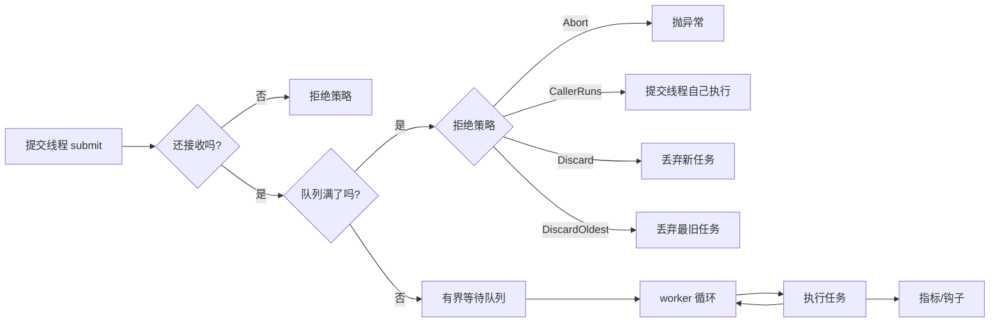
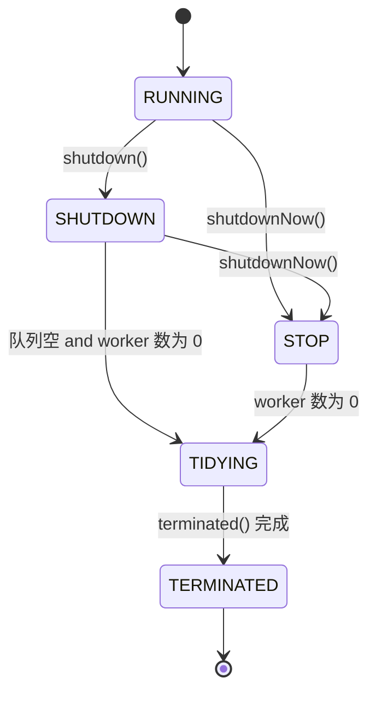

# Day 01 · 线程池：把并发关进笼子

> **一句话结论**：线程池的价值不只是“复用线程”，而是为任务执行建立一组显式的资源边界：**最多多少并发、最多排多长、满了怎么办、关闭时谁先走**。线程池写得对不对，主要看这四条边界，而不是看线程创建得有多快。

---

## 0. 本次问题

你大概已经用过线程池，但下面这些问题未必能立刻答上来：

1. 为什么 `new Thread` 不够？池化到底省了什么？
2. JDK 的 `ThreadPoolExecutor` 为什么把“运行状态”和“worker 数量”塞进同一个 `AtomicInteger`？
3. 为什么把队列设成无界之后，`maximumPoolSize` 就几乎没用了？
4. `shutdown()` 和 `shutdownNow()` 到底保证了什么？运行中的任务会被杀死吗？
5. 队列满时，Abort、CallerRuns、Discard、DiscardOldest 分别在让谁承担代价？
6. 自己写 C++ 线程池时，怎样保证异常不会杀死 worker、关闭不会丢任务、指标不会骗人？

本次读完，你应该能对着一份线程池配置，指出它在**过载、异常、关闭**三种情况下的行为，并能写出一个有界、可关闭、可观测的最小实现。

---

## 1. 设计背景：线程很贵，队列更贵

### 1.1 线程的成本

在常见 64 位平台上，创建一个平台线程至少涉及：

- **栈空间**：默认栈大小通常在 MB 级（Linux 原生 pthread 常见 8 MB；Java 由 `-Xss` 控制，常见 1 MB 量级），虽然按需提交，但虚拟地址、guard page 和页表都有成本。
- **内核对象**：task/thread 结构、调度实体、信号掩码、文件描述符表等。
- **调度成本**：线程数超过 CPU 核数后，上下文切换、cache/TLB 污染会让“更多线程”变成“更少吞吐”。
- **生命周期成本**：创建、启动、销毁都要系统调用和同步。

所以，为每个任务创建一个线程，在低并发时简单直接，在高压下会迅速变成灾难。线程池的第一个收益是**摊薄创建/销毁成本**，第二个收益是**限制并发度**，第三个收益是**复用线程上的缓存与上下文**。

`ThreadPoolExecutor` 由 Doug Lea 设计，随 JSR-166 进入 Java 5。它的目标不是只服务一种场景，而是用**一组参数 + 可替换队列 + 可替换拒绝策略 + 可覆写钩子**覆盖从固定池到缓存池的多种形态。理解这个“通用骨架”的定位，就不会奇怪它为什么参数这么多、边界这么细。

但池化不是免费的：

- 任务必须在队列里等待，**队列长度就是延迟和内存的债务**；
- 线程被池管理，**异常、上下文、关闭**都变得更复杂；
- 线程池只能控制“有多少任务同时进入执行”，**不能创造下游容量**。下游数据库只有 100 个连接，池里开 500 个线程只会让 400 个线程阻塞在连接池上。

### 1.2 四个真实故障

**故障一：固定线程池 + 无界队列**

```java
ExecutorService pool = Executors.newFixedThreadPool(8);
```

这行代码内部是 `core = max = 8`，外加一个**无界** `LinkedBlockingQueue`。当任务提交速度持续高于处理速度：

- 队列无限增长，直到堆 OOM；
- `maximumPoolSize` 永远不会触发，因为队列永远“没满”；
- 延迟悄悄上涨，监控上却只看到“线程都在忙”。

**故障二：所有 worker 阻塞在同一个下游**

8 个 worker 都在等数据库连接，每个请求 30 秒超时。线程池并没有过载保护，它只是把 8 个线程变成 8 个等待者。队列继续增长，上游开始超时，重试又把流量放大。最后不是线程池挂了，而是整个调用链雪崩。

**故障三：`shutdownNow()` 之后立刻关闭资源**

```java
pool.shutdownNow();
dataSource.close();
```

`shutdownNow()` 只是**尽力中断**，并把未开始的任务从队列里拿出来。正在执行的任务如果忽略中断，仍会继续使用数据库。资源先关，任务后炸。

**故障四：任务异常悄无声息**

```java
pool.execute(() -> {
    throw new RuntimeException("boom");
});
```

`execute` 的异常会走到线程的 `UncaughtExceptionHandler`；如果没有配置，默认打印到 stderr。更隐蔽的是 `submit`：异常被包进 `Future`，如果没人调用 `future.get()`，它就像没发生过。worker 可能被替换，吞吐下降，但业务指标一切正常。

### 1.3 设计约束

| 约束 | 具体表现 | 对设计的影响 |
|---|---|---|
| 延迟 | 队列等待会直接叠加到 p99 | 队列必须有界，且容量按可接受等待估算 |
| 吞吐 | 线程过多导致调度和缓存抖动 | 并发度要匹配 CPU/下游容量 |
| 内存 | 每个排队任务都持有闭包、上下文、数据 | 队列是内存上限的一部分 |
| 可靠性 | 任务异常、下游超时、进程退出 | 异常隔离、超时、关闭协议必须显式 |
| 可运维性 | 出问题时要能定位“卡在哪” | 队列深度、等待时间、拒绝数、活跃数必须可观测 |

---

## 2. 总体架构：一个“任务准入系统”

把线程池看成一个小型系统，它可以拆成四个环节：



它要回答四个问题：

1. **准入**：现在还接收任务吗？
2. **排队**：排多长？排队期间谁负责超时？
3. **执行**：多少个 worker？任务抛异常怎么办？
4. **退出**：停止接收后，队列里的任务做完还是丢掉？运行中的任务怎么通知？

JDK 的 `ThreadPoolExecutor` 把这四个问题拆成了：

- `ctl`：生命周期 + worker 数量；
- `workQueue`：等待队列；
- `Worker`：执行单元与中断控制；
- `RejectedExecutionHandler`：队列满/关闭时的策略；
- `shutdown` / `shutdownNow`：两种退出语义；
- `beforeExecute` / `afterExecute` / `terminated`：扩展点。

### 2.1 生命周期状态机



五个状态的含义：

| 状态 | 接收新任务 | 处理队列 | 中断运行中任务 | 说明 |
|---|---|---|---|---|
| `RUNNING` | 是 | 是 | 否 | 正常状态 |
| `SHUTDOWN` | 否 | 是 | 否 | 优雅关闭，排空队列 |
| `STOP` | 否 | 否 | 是（尽力） | 强关闭，清空队列 |
| `TIDYING` | 否 | 否 | — | 所有任务结束、worker 归零，准备收尾 |
| `TERMINATED` | 否 | 否 | — | `terminated()` 已执行 |

注意两个容易误解的点：

- **`shutdown()` 不会等待任务完成**。它只是改变状态并唤醒空闲 worker；要等待，必须调用 `awaitTermination()`。
- **`shutdownNow()` 不保证正在执行的任务停止**。它依赖任务响应中断；一个死循环、阻塞在不可中断 IO 上的任务，可能永远不结束。

---

## 3. JDK `ThreadPoolExecutor` 源码拆解

> 阅读入口：[OpenJDK `ThreadPoolExecutor.java`](https://github.com/openjdk/jdk/blob/master/src/java.base/share/classes/java/util/concurrent/ThreadPoolExecutor.java)。源码会演进，下面以方法名和机制为主，不绑定行号。

### 3.1 `ctl`：把状态和计数塞进一个 int

```java
private final AtomicInteger ctl = new AtomicInteger(ctlOf(RUNNING, 0));

private static final int COUNT_BITS = Integer.SIZE - 3;   // 29
private static final int COUNT_MASK = (1 << COUNT_BITS) - 1;
private static final int RUNNING    = -1 << COUNT_BITS;
private static final int SHUTDOWN   =  0 << COUNT_BITS;
private static final int STOP       =  1 << COUNT_BITS;
private static final int TIDYING    =  2 << COUNT_BITS;
private static final int TERMINATED =  3 << COUNT_BITS;

private static int runStateOf(int c)    { return c & ~COUNT_MASK; }
private static int workerCountOf(int c) { return c & COUNT_MASK; }
private static int ctlOf(int rs, int wc) { return rs | wc; }
```

位布局：

```text
 31 30 29 | 28 ........................ 0
+---------+----------------------------+
| runState|       workerCount          |
|  3 bit  |          29 bit            |
+---------+----------------------------+
```

| 状态 | 高 3 位 |
|---|---|
| `RUNNING` | `111`（作为有符号 int 是负数） |
| `SHUTDOWN` | `000` |
| `STOP` | `001` |
| `TIDYING` | `010` |
| `TERMINATED` | `011` |

**为什么要把两个字段打包？**

因为线程池有很多“状态 + 数量必须一起判断”的瞬间：

- 只有在 `RUNNING` 时才能增加 worker；
- 进入 `STOP` 后，不能再用普通方式增加 worker；
- 判断能否终止，需要同时看状态和 worker 数；
- 提交路径是热点，不能每次都拿一把大锁。

如果状态和计数是两个独立的 `AtomicInteger`，就会出现“读到 RUNNING，但计数已经被另一个线程改掉”的窗口，必须加锁或做复杂的双重检查。打包进一个 word 后，一次 CAS 就能同时承诺两个字段，提交路径的大部分判断都是无锁读。

**代价**：

- worker 数量上限变成 `2^29 - 1`（约 5.36 亿），对实际系统不是问题，但不再是 `int` 的全部范围；
- 位运算和负数比较让代码更难读，调试时不能直接看数字；
- 状态值必须保持单调递增，才能用 `c < SHUTDOWN` 表示 `RUNNING`、用 `c >= STOP` 表示停止。

JDK 注释里也说了：如果未来真的需要更多 worker，可以换成 `AtomicLong` 并调整位移常量；当前选择 `int` 是为了更快、更简单。**这是一个典型的“在真实上限内做极致优化”的取舍，不要为了炫技在业务代码里随便复制。**

### 3.2 `execute` 的三步提交

`execute` 是线程池最核心的路径。简化后的逻辑：

```java
public void execute(Runnable command) {
    int c = ctl.get();

    // 1. worker 数小于 core：优先创建核心线程
    if (workerCountOf(c) < corePoolSize) {
        if (addWorker(command, true)) return;
        c = ctl.get();
    }

    // 2. 尝试入队；入队后必须复检
    if (isRunning(c) && workQueue.offer(command)) {
        int recheck = ctl.get();
        if (!isRunning(recheck) && remove(command))
            reject(command);
        else if (workerCountOf(recheck) == 0)
            addWorker(null, false);
    }
    // 3. 入队失败：尝试扩容到 max；失败则拒绝
    else if (!addWorker(command, false))
        reject(command);
}
```

这三步对应三种资源判断：

1. **核心线程没满**：先加线程，不排队。这样低负载时任务不用等队列。
2. **核心线程已满**：先排队，不急着扩容。因为大多数池希望用固定的小并发平滑突发。
3. **队列也满了**：才尝试把线程数扩到 `maximumPoolSize`；再失败就拒绝。

**关键细节：入队后的 recheck。**

在 `isRunning(c)` 和 `workQueue.offer(command)` 之间，池可能被另一个线程关闭。于是：

- 如果状态已经不是 `RUNNING`，并且任务还在队列里，就 `remove` 并拒绝；
- 如果池还是 `SHUTDOWN`（允许排空），但 worker 数变成 0，就补一个 `firstTask = null` 的 worker 去排空队列。

这个 recheck 是典型的 **TOCTOU（time-of-check to time-of-use）修复**：检查和使用之间状态会变，所以使用之后必须再检查一次，并准备好回滚。

**另一个关键结论：`maximumPoolSize` 只在队列满时生效。**

如果用的是无界 `LinkedBlockingQueue`，`offer` 永远成功，第 3 步永远走不到。于是：

```java
new ThreadPoolExecutor(
    8, 8, 0L, TimeUnit.MILLISECONDS,
    new LinkedBlockingQueue<>()   // 无界
);
```

和

```java
new ThreadPoolExecutor(
    8, 64, 0L, TimeUnit.MILLISECONDS,
    new LinkedBlockingQueue<>()   // 无界
);
```

在“是否会扩到 64 个线程”这件事上完全一样：**都不会**。区别只是后者的配置给了你一个错觉。

### 3.3 `Worker`：非重入锁与中断协议

`Worker` 继承 `AbstractQueuedSynchronizer`（AQS），实现了一个**非重入**的互斥锁：

```java
private final class Worker extends AbstractQueuedSynchronizer implements Runnable {
    final Thread thread;
    Runnable firstTask;
    volatile long completedTasks;

    Worker(Runnable firstTask) {
        setState(-1); // 禁止在 runWorker 开始前被中断
        this.firstTask = firstTask;
        this.thread = getThreadFactory().newThread(this);
    }

    public void run() { runWorker(this); }

    protected boolean isHeldExclusively() { return getState() != 0; }
    protected boolean tryAcquire(int unused) {
        if (compareAndSetState(0, 1)) {
            setExclusiveOwnerThread(Thread.currentThread());
            return true;
        }
        return false;
    }
    protected boolean tryRelease(int unused) {
        setExclusiveOwnerThread(null);
        setState(0);
        return true;
    }
}
```

状态含义：

- `-1`：worker 已创建但还没开始跑，禁止中断；
- `0`：空闲，正在等任务；
- `1`：正在执行任务。

`runWorker` 的关键骨架：

```java
final void runWorker(Worker w) {
    Thread wt = Thread.currentThread();
    Runnable task = w.firstTask;
    w.firstTask = null;
    w.unlock();                    // 允许空闲时被中断
    boolean completedAbruptly = true;
    try {
        while (task != null || (task = getTask()) != null) {
            w.lock();              // 执行期间禁止“空闲中断”误伤
            // 处理 STOP 状态下的中断传播
            // ...
            try {
                beforeExecute(wt, task);
                try {
                    task.run();
                    afterExecute(task, null);
                } catch (Throwable ex) {
                    afterExecute(task, ex);
                    throw ex;
                }
            } finally {
                task = null;
                w.completedTasks++;
                w.unlock();
            }
        }
        completedAbruptly = false;
    } finally {
        processWorkerExit(w, completedAbruptly);
    }
}
```

为什么用**非重入**锁，而不是 `ReentrantLock`？

- `tryLock()` 只有 0→1 才成功，能精确表达“这个 worker 现在空闲”；
- 如果任务内部调用 `setCorePoolSize` 之类的池控制方法，非重入锁不会让任务重新拿到控制锁，避免“任务以为自己还在安全区”；
- `shutdown()` 只中断**空闲** worker：`w.tryLock()` 成功才 `interrupt()`，所以不会打断正在运行的任务；
- `shutdownNow()` 用 `interruptIfStarted()` 中断所有已启动 worker，运行中的任务也会收到中断，但仍然必须自己响应。

这里有一个非常重要的工程原则：

> **Java/C++ 都没有安全的“强制杀死线程”。所谓取消，都是协作式的。**

`Thread.stop()` 被废弃，因为它会在任意字节码位置抛异常、释放锁，留下不一致状态。正确做法是任务自己检查中断/取消令牌，使用可中断的阻塞调用，并在退出时清理资源。线程池能做的是“发信号”和“不再给你新任务”，不是“替你终止”。

### 3.4 `getTask`：什么时候退出？

`getTask` 决定一个 worker 是继续等、拿任务，还是退出。简化逻辑：

```java
private Runnable getTask() {
    boolean timedOut = false;
    for (;;) {
        int c = ctl.get();

        // STOP，或 SHUTDOWN 且队列空：退出
        if (runStateAtLeast(c, SHUTDOWN) &&
            (runStateAtLeast(c, STOP) || workQueue.isEmpty())) {
            decrementWorkerCount();
            return null;
        }

        int wc = workerCountOf(c);
        boolean timed = allowCoreThreadTimeOut || wc > corePoolSize;

        // 超时、或超过 max：在保证至少一个 worker 的前提下退出
        if ((wc > maximumPoolSize || (timed && timedOut))
            && (wc > 1 || workQueue.isEmpty())) {
            if (compareAndDecrementWorkerCount(c)) return null;
            continue;
        }

        try {
            Runnable r = timed
                ? workQueue.poll(keepAliveTime, TimeUnit.NANOSECONDS)
                : workQueue.take();
            if (r != null) return r;
            timedOut = true;
        } catch (InterruptedException retry) {
            timedOut = false; // 被中断后重试，重新检查状态
        }
    }
}
```

行为表：

| 池状态 | 队列 | 结果 |
|---|---|---|
| `RUNNING` | 空 | `take()` 阻塞，或 `poll(timeout)` 等待 |
| `RUNNING` | 非空 | 取任务执行 |
| `SHUTDOWN` | 非空 | 继续取任务，排空 |
| `SHUTDOWN` | 空 | worker 数减一，退出 |
| `STOP` | 任意 | worker 数减一，退出 |

`processWorkerExit` 负责收尾：

- 如果 worker 是异常退出（`completedAbruptly`），先补减计数；
- 从 `workers` 集合移除，累计完成数；
- 调用 `tryTerminate()`；
- 如果池还没到 `STOP`：异常退出时无条件补一个 worker；正常退出时，只有当前 worker 数低于最小值（队列非空时至少为 1）才补。

这就是“**worker 自愈**”：一个任务抛出未捕获异常，杀死当前 worker，池会补充一个新的，而不是让并发度永久下降。代价是：如果异常是系统性的，你会看到 worker 不断死亡/重建，必须靠日志和指标发现。

### 3.5 `tryTerminate`：终止是一个协作过程

`tryTerminate` 不会强行结束任何东西，它只检查“是否已经满足终止条件”（下面省略了 `mainLock`，保留核心状态迁移）：

```java
final void tryTerminate() {
    for (;;) {
        int c = ctl.get();
        if (isRunning(c) ||
            runStateAtLeast(c, TIDYING) ||
            (runStateLessThan(c, STOP) && !workQueue.isEmpty()))
            return;

        if (workerCountOf(c) != 0) {
            interruptIdleWorkers(ONLY_ONE); // 让关闭信号继续传播
            return;
        }

        // CAS 到 TIDYING，执行 terminated()，再置 TERMINATED
        if (ctl.compareAndSet(c, ctlOf(TIDYING, 0))) {
            try {
                terminated();
            } finally {
                ctl.set(ctlOf(TERMINATED, 0));
                termination.signalAll(); // 唤醒 awaitTermination()
            }
            return;
        }
    }
}
```

几个细节：

- `SHUTDOWN` 下必须等队列空；`STOP` 下不需要。
- worker 数不为 0 时，只中断一个空闲 worker，让“关闭信号”继续传播，而不是中断风暴。
- `terminated()` 在 `TIDYING` 中执行，执行完才 `TERMINATED`；`awaitTermination()` 等到的是后者。
- `terminated()` 里不要做长时间阻塞的事，否则所有等待关闭的线程都被拖住。

### 3.6 钩子：`beforeExecute` / `afterExecute` / `terminated`

这三个钩子是 JDK 留给使用者的扩展点：

- `beforeExecute`：设置 ThreadLocal、MDC、上下文；
- `afterExecute`：清理 ThreadLocal、记录耗时、检查异常；
- `terminated`：关闭资源、上报最终指标。

有一个非常容易踩的坑：

> 通过 `submit()` 提交的任务，异常会被 `FutureTask` 捕获并放进 `Future`。因此 `afterExecute(r, t)` 里的 `t` 通常是 `null`，即使任务失败了。要拿到异常，需要在 `afterExecute` 里检查 `r instanceof Future` 并调用 `get()`，或者直接在业务代码里处理 `Future`。

另外，钩子本身抛异常会导致 worker 异常退出。钩子里只做轻量、可靠的事；不要在里面做可能阻塞或抛异常的网络调用。

---

## 4. 队列、拒绝策略与容量

### 4.1 队列不是“随便选一个”

| 队列 | 容量 | 行为 | 适用/风险 |
|---|---|---|---|
| `ArrayBlockingQueue` | 有界 | FIFO，可选公平锁 | 通用有界池；公平模式吞吐更低 |
| `LinkedBlockingQueue` | 可选，默认无界 | 链表 FIFO | `newFixedThreadPool` 默认用它；无界会掩盖过载 |
| `SynchronousQueue` | 0 | 直接交接，没有等待槽 | `newCachedThreadPool`；必须配大 `max`，否则频繁拒绝/建线程 |
| `PriorityBlockingQueue` | 无界 | 按优先级出队 | 优先级任务；低优先级可能饿死，队列仍会涨 |
| `DelayQueue` | 无界 | 到期才能取 | 延迟任务；`ScheduledThreadPoolExecutor` 用的是专用 `DelayedWorkQueue` |
| `LinkedTransferQueue` | 无界 | 支持直接传递 | 高吞吐交接；同样要自己控制上游 |

选择队列时，先问三个问题：

1. **能接受多长的等待？** 这决定容量。
2. **队列满时，谁承担代价？** 提交者、被丢弃的任务，还是最旧的任务？
3. **任务是否可丢？** 日志/遥测可以丢，支付/订单不能。

### 4.2 四种内置拒绝策略

| 策略 | 队列满时 | 池已关闭时 | 代价 | 适用 |
|---|---|---|---|---|
| `AbortPolicy` | 抛 `RejectedExecutionException` | 抛异常 | 调用方必须处理；可能把失败向上传播 | 默认；不能丢的任务 |
| `CallerRunsPolicy` | 提交线程同步执行 | **静默丢弃** | 阻塞提交线程；可能拖垮事件循环/造成死锁 | 能承受反压的批处理、离线任务 |
| `DiscardPolicy` | 静默丢弃 | 静默丢弃 | 无感知的数据丢失 | 可丢的遥测、非关键日志 |
| `DiscardOldestPolicy` | 丢队头，再重试 | 静默丢弃 | 可能丢更重要的任务；重试可能继续失败 | 几乎不推荐；需要额外取消/记录 |

`CallerRunsPolicy` 是“天然背压”的经典例子：队列满时，提交者被迫慢下来，生产速率自然下降。但它有两个致命边界：

- 如果提交者是 Netty event loop、UI 线程、定时器线程，长任务会直接卡住整个事件循环；
- 如果任务内部还要等待池里的另一个任务，而那个任务正排在队列里，可能死锁。

所以，**CallerRuns 只适合“提交者可以安全地被阻塞”的场景**。不要因为它“不会丢任务”就无脑使用。

`DiscardOldestPolicy` 的 JDK 实现是“poll 队头，然后重新 `execute`”，可能递归重试。它几乎总是需要配合取消和日志，否则你丢了一个任务，等待它完成的线程会永远等下去。

---

## 5. 参数与容量：不要拍脑袋

### 5.1 参数表

| 参数 | 作用 | 常见误区 |
|---|---|---|
| `corePoolSize` | 核心 worker 数（默认空闲不超时） | 以为它总能保证“最小并发”；其实核心线程也按需创建，空闲时才保留 |
| `maximumPoolSize` | 最大 worker 数 | 以为它总会生效；无界队列下不会 |
| `keepAliveTime` | 超过 core 的空闲线程存活时间 | 忽略 `allowCoreThreadTimeOut` 对 core 的影响 |
| `workQueue` | 等待队列 | 用无界队列，等于把过载藏起来 |
| `threadFactory` | 创建线程 | 不命名，排障时不知道线程属于谁 |
| `handler` | 拒绝策略 | 用 Discard 却不记录丢弃 |
| `allowCoreThreadTimeOut` | core 是否可超时 | 开了之后并发度会抖动，需预热 |

### 5.2 线程数怎么估

CPU 密集型任务，线程数接近**可用核数**通常就够；多出来的线程主要增加上下文切换。

IO 密集型任务，可以用一个粗估公式：

```text
所需并发 ≈ 核数 × (1 + 平均等待时间 / 平均计算时间)
```

但更可靠的是 **Little's Law**：

```text
并发数 = 吞吐 × 平均延迟
```

例如目标 1000 QPS、平均端到端延迟约 100 ms，按 Little's Law 平均约有 100 个在途请求。注意这里用的是**平均延迟**，不是 p99；容量规划要按峰值和 p99 留余量，不能把平均值当上限。而且**这个数字必须被下游容量截断**：数据库连接池只有 50 个连接，你把线程池开到 200 只会制造排队。

### 5.3 队列容量怎么估

一个起点：

```text
队列容量 ≈ 目标吞吐 × 可接受的排队等待时间
```

1000 QPS、最多接受 100 ms 排队，大约 100 个槽位。但突发流量、任务耗时分布、下游抖动都会让这个数字不准，最终要靠压测和线上指标校准。

队列太小的代价是频繁拒绝、线程频繁创建；队列太大的代价是延迟高、内存高、故障恢复慢。**没有“最佳队列长度”，只有和 SLO 匹配的队列长度。**

### 5.4 两个现代补充

- **`ForkJoinPool`**：适合可递归拆分的 CPU 任务，靠 work stealing 提高利用率；不适合大量阻塞 IO。
- **虚拟线程（JDK 21+）**：虚拟线程很便宜，**不应该再池化**。用 `Executors.newVirtualThreadPerTaskExecutor()` 为每个任务创建虚拟线程，再用 `Semaphore` 限制对稀缺资源（数据库连接、下游 API）的并发访问。把平台线程池的经验直接套到虚拟线程上，会得到“池化廉价资源”的反效果。

---

## 6. 六个可迁移的设计技巧

### 技巧 1：把“状态 + 计数”打包成一个原子字

**做法**：用一个整数/长整数同时存生命周期状态和资源计数，用位运算读写，用一次 CAS 完成状态迁移。

**为什么有效**：状态判断和计数修改必须原子地一起发生，否则就要加锁或反复双重检查。单字 CAS 在热点路径上非常便宜。

**代价**：上限被位宽限制；可读性下降；状态值必须单调，比较逻辑依赖编码。

**适用边界**：状态机简单、计数范围可控、热点路径确实需要无锁。业务代码里如果一年调不了几次，直接用互斥锁更清楚。

### 技巧 2：有界队列 + 显式拒绝策略

**做法**：队列容量不是实现细节，而是 API 的一部分；队列满时必须有明确的 `RejectedExecutionHandler`，并把拒绝计数暴露出来。

**为什么有效**：它把“过载”从“延迟悄悄上涨/内存悄悄上涨”变成“一个可观测、可处理的失败”。失败是系统设计的一部分，不是异常。

**代价**：调用方要处理拒绝；容量调小会增加拒绝，调大会增加延迟。

**适用边界**：所有面向生产的执行器。只有纯离线、可无限重试、且上游有持久化缓冲的场景，才可以考虑更长的队列。

### 技巧 3：两阶段关闭，关闭必须幂等

**做法**：先停止准入，再决定“排空”还是“取消排队”；最后等待运行中任务到达安全点。关闭入口用 `once`/状态机保证幂等。

**为什么有效**：关闭不是瞬间动作，而是一个协议。先把“不再接收”与“正在处理”分开，才能避免新任务不断涌入导致永远关不掉。

**代价**：需要明确的超时和强制兜底；排空可能很久。

**适用边界**：任何有生命周期的资源池、服务、连接。区别只是“排空”还是“取消”。

### 技巧 4：协作式取消，不用“强杀”

**做法**：用中断/`stop_token`/取消令牌通知任务；任务在安全点检查并退出；池只负责发信号和停止派发。

**为什么有效**：强制终止会破坏锁、内存和外部资源的一致性。协作式取消让任务自己决定在哪里退出、如何清理。

**代价**：任务必须配合；不响应取消的任务会拖住关闭。

**适用边界**：所有托管线程/协程。对不可中断的第三方阻塞调用，要用超时、隔离进程或异步 IO 兜底。

### 技巧 5：异常隔离 + worker 自愈

**做法**：worker 循环捕获任务异常，记录指标，继续取下一条；如果框架选择让异常杀死 worker，则必须有替换机制。

**为什么有效**：单个任务失败不应该让整个执行器停摆；但也不能静默吞掉，否则系统性错误会被掩盖。

**代价**：吞异常会隐藏 bug；替换 worker 会带来抖动。必须配合失败计数、日志和告警。

**适用边界**：任务彼此独立、失败可重试/可丢弃。有依赖关系的任务需要更结构化的取消传播。

### 技巧 6：入队后复检（TOCTOU）

**做法**：先检查状态再入队，入队后再次检查状态；如果状态已变，回滚入队或补 worker。

**为什么有效**：并发下“检查时正确”不等于“使用时正确”。复检把线性化点推迟到真正的提交动作之后。

**代价**：多一次原子读；回滚逻辑增加复杂度。

**适用边界**：任何“先检查容量/状态，再放入共享结构”的并发代码，包括连接池、限流器、任务队列。

---

## 7. 反例与边界

| 看起来对的用法 | 实际问题 | 正确做法 |
|---|---|---|
| `Executors.newFixedThreadPool(8)` | 无界队列，过载时 OOM；`max` 无效 | 手写 `ThreadPoolExecutor`，用有界队列 |
| `Executors.newCachedThreadPool()` | `max = Integer.MAX_VALUE`，流量突增时线程爆炸 | 有界池 + 有界队列，或虚拟线程 + 信号量 |
| 把 `maximumPoolSize` 调大解决积压 | 队列没满时根本不会扩容；扩了也可能只是更多线程等下游 | 先看队列和下游容量，再决定扩不扩 |
| 在 Netty event loop 上用 CallerRuns | 长任务阻塞 I/O 线程，整个连接停摆 | 业务线程池与 I/O 线程池隔离；用 Abort/自定义策略 |
| `shutdownNow()` 后立刻关 DB | 运行中任务仍可能使用 DB | 先 `awaitTermination`，超时再强制隔离/退出 |
| `submit()` 后不 `get()` | 异常被 Future 吞掉 | 统一收集 Future、记录异常；或用 `execute` + 包装 |
| 任务里 `submit` 后立刻 `future.get()`，且池很小 | 依赖任务排在队列里，互相等待，死锁 | 分离线程池、限制依赖、用 ForkJoin/异步组合 |
| 不清理 ThreadLocal/MDC | 池化线程复用，上下文泄漏到下一个请求 | `try/finally` 清理；用包装器传递上下文 |
| 用 `getActiveCount()` 做精确计费 | 并发变化，返回值只是近似 | 用自己维护的任务级指标 |
| 关闭时无限期 `join()` | 一个阻塞任务让进程永远退不出 | 设置关闭截止时间，超时后记录/隔离并退出 |

### 压力下会发生什么

- **队列打满**：Abort 让上游收到拒绝；CallerRuns 让上游变慢；Discard 让上游以为成功。三种行为对应三种完全不同的故障模式，必须提前选好。
- **下游超时**：worker 被占满，队列上涨，拒绝率上升。此时扩容线程池通常无效，应该降级、限流、缩短超时。
- **进程崩溃**：内存队列全部丢失。需要持久化的任务不能只放在线程池队列里，要先落 WAL/MQ。
- **扩缩容**：新实例冷启动，核心线程未预热，首批请求延迟高；用 `prestartAllCoreThreads` 或预热流量。
- **时钟跳跃**：`keepAliveTime` 基于单调时钟（`System.nanoTime`）通常没问题，但业务里的“超时”如果用墙钟，会受 NTP 调整影响。

---

## 8. C++20 最小实现

完整代码在 [`code/`](code/)：

- [`bounded_thread_pool.hpp`](code/bounded_thread_pool.hpp)：执行器本体；
- [`main.cpp`](code/main.cpp)：10 个行为测试；
- [`CMakeLists.txt`](code/CMakeLists.txt)：构建配置。

### 8.1 设计映射

| JDK 概念 | 本实现 | 说明 |
|---|---|---|
| `ctl` | `mutex_` + 普通计数器 | 教学优先，未做无锁位打包；行为等价性优先 |
| `workQueue` | `std::deque<Task>` + 容量 | 有界；`Task = std::function<void()>` |
| `Worker` | `std::thread` + `worker_loop` | 固定 worker 数，不做 core/max 动态调整 |
| `RejectedExecutionHandler` | `RejectPolicy` 枚举 | Abort / CallerRuns / Discard / DiscardOldest |
| `shutdown` / `shutdownNow` | `ShutdownMode::Drain` / `CancelPending` | 运行中任务都不强杀 |
| `Future` | `std::packaged_task` + `std::future` | `submit` 返回结果/异常 |
| `beforeExecute` | 暂未提供 | 练习：加任务包装器/钩子 |
| `awaitTermination` | `shutdown()` 内 `join` | 没有超时版本；练习：加 deadline |

**为什么不用无锁队列？** 因为这一天的目标是看清“边界”而不是炫技。用互斥锁 + 条件变量，行为容易推理，测试容易稳定；无锁化会引入内存序、ABA、伪共享等一整套新问题，适合在 Day 06 的 Disruptor 里专门讨论。

### 8.2 准入与拒绝

核心路径（简化）：

```cpp
bool execute(std::function<void()> task) {
    bool run_inline = false;
    Task discarded;  // 延迟到锁外析构

    {
        std::lock_guard<std::mutex> lock(mutex_);

        if (!accepting_) {
            ++rejected_;
            if (policy_ == RejectPolicy::Abort)
                throw RejectedExecutionError("thread pool is shut down");
            return false;
        }

        if (tasks_.size() < capacity_) {
            tasks_.push_back(std::move(task));
            ++submitted_;
            max_queued_ = std::max(max_queued_,
                                   static_cast<std::uint64_t>(tasks_.size()));
            not_empty_.notify_one();
            return true;
        }

        switch (policy_) {
        case RejectPolicy::Abort:
            ++rejected_;
            throw RejectedExecutionError("thread pool queue is full");
        case RejectPolicy::CallerRuns:
            ++submitted_;
            run_inline = true;
            break;
        case RejectPolicy::Discard:
            ++rejected_;
            return false;
        case RejectPolicy::DiscardOldest:
            discarded = std::move(tasks_.front());
            tasks_.pop_front();
            ++dropped_;
            tasks_.push_back(std::move(task));
            ++submitted_;
            not_empty_.notify_one();
            return true;
        }
    }

    if (run_inline) {
        bool failed = false;
        try { task(); } catch (...) { failed = true; }
        std::lock_guard<std::mutex> lock(mutex_);
        ++completed_;
        if (failed) ++failed_;
    }
    return true;
}
```

三个细节值得注意：

1. **CallerRuns 在锁外执行**。否则任务里如果再提交任务，或者任务执行很久，会把整个池的提交路径锁死。
2. **被丢弃的旧任务在锁外析构**。用户任务的析构函数可能持有资源、甚至回调池；在锁内析构是隐蔽的死锁源。
3. **关闭后 Abort 仍然抛，其他策略返回 false**。这与 JDK 的 `CallerRunsPolicy` 在 shutdown 后丢弃行为一致；但我们的 `submit` 会把 `false` 转成异常，避免返回一个永远不 ready 的 future。

### 8.3 worker 循环

```cpp
void worker_loop() {
    tls_worker_pool_ = this;

    for (;;) {
        Task task;
        {
            std::unique_lock<std::mutex> lock(mutex_);
            not_empty_.wait(lock, [this] {
                return stopping_ || !tasks_.empty();
            });

            if (tasks_.empty()) {
                if (stopping_) break;
                continue;
            }

            task = std::move(tasks_.front());
            tasks_.pop_front();
            ++active_;
        }

        bool failed = false;
        try {
            task();
        } catch (...) {
            failed = true;  // 任务异常绝不能逃出线程函数
        }

        {
            std::lock_guard<std::mutex> lock(mutex_);
            --active_;
            ++completed_;
            if (failed) ++failed_;
        }
    }

    tls_worker_pool_ = nullptr;
}
```

关键点：

- `wait` 一定带谓词，处理虚假唤醒；
- `stopping_` 为 true 但队列非空时，仍然继续取任务——这就是 `Drain`；
- 任务异常被捕获，worker 继续存活；`std::function` 的目标抛出的任何异常都不能穿透线程入口，否则会 `std::terminate`；
- `active_` 在任务执行前加、执行后减，`stats()` 在锁内读，得到一致快照。

### 8.4 两阶段关闭

```cpp
void shutdown(ShutdownMode mode = ShutdownMode::Drain) {
    if (tls_worker_pool_ == this)
        throw std::logic_error("shutdown from worker");

    std::call_once(shutdown_once_, [this, mode] {
        std::deque<Task> pending;
        {
            std::lock_guard<std::mutex> lock(mutex_);
            accepting_ = false;
            stopping_ = true;
            if (mode == ShutdownMode::CancelPending) {
                pending.swap(tasks_);
                dropped_ += static_cast<std::uint64_t>(pending.size());
            }
            not_empty_.notify_all();
        }

        pending.clear();  // 锁外析构

        for (auto& worker : workers_) {
            if (worker.joinable()) worker.join();
        }
    });
}
```

语义：

| 模式 | 新任务 | 排队任务 | 运行中任务 | 返回时机 |
|---|---|---|---|---|
| `Drain` | 拒绝 | 全部执行 | 等它结束 | 所有 worker 退出后 |
| `CancelPending` | 拒绝 | 丢弃并计数 | 等它结束 | 所有 worker 退出后 |

**与 JDK 的差异**：这里的 `CancelPending` 只清空排队任务，**不会中断运行中的任务**；`std::thread` 没有跨平台的“中断”原语，示例也不假装提供。JDK 的 `shutdownNow()` 会额外调用 `interrupt()`，但同样不保证任务停止。

**CallerRuns 的关闭边界**：内联任务执行在提交线程上，`shutdown()` 只 `join` worker，不会等待提交线程上正在执行的内联任务。调用方必须自己保证提交线程的生命周期，否则会出现“池已关闭，但任务还在调用者线程里跑”的窗口。

**运行中的任务不会被杀死**。C++ 的 `std::thread` 没有安全的跨平台取消；要支持超时取消，需要任务自己接受 `std::stop_token` 或业务级取消令牌，并在安全点检查。

### 8.5 `submit`：不要让 future 永远不 ready

```cpp
template <class F, class... Args>
auto submit(F&& f, Args&&... args)
    -> std::future<std::invoke_result_t<std::decay_t<F>, std::decay_t<Args>...>> {
    using R = std::invoke_result_t<std::decay_t<F>, std::decay_t<Args>...>;

    auto bound = [fn = std::forward<F>(f),
                  tuple = std::make_tuple(std::forward<Args>(args)...)]() mutable -> R {
        return std::apply(std::move(fn), std::move(tuple));
    };

    auto task = std::make_shared<std::packaged_task<R()>>(std::move(bound));
    auto future = task->get_future();

    const bool accepted = execute([task]() mutable { (*task)(); });
    if (!accepted)
        throw RejectedExecutionError("task was discarded by rejection policy");

    return future;
}
```

这里用 `shared_ptr<packaged_task>` 包了一层，原因是 `std::function` 要求可拷贝，而 `packaged_task` 和 move-only 的可调用对象不一定可拷贝。`shared_ptr` 让外层 lambda 可拷贝，同时任务只执行一次。

`submit` 在被丢弃时**主动抛异常**，而不是返回一个 broken promise 的 future。后者只会在 `get()` 时抛 `broken_promise`，而且如果没人 `get()`，永远静默——这是生产环境很难排查的一类问题。

### 8.6 行为测试

`main.cpp` 覆盖 10 个场景：

1. 基本 future 返回值；
2. `submit` 的参数转发与异常传播；
3. `execute` 任务抛异常后 worker 仍存活；
4. 队列满时 Abort；
5. CallerRuns 在提交线程执行；
6. Drain 关闭排空队列；
7. CancelPending 丢弃排队任务、等待运行中任务；
8. DiscardOldest 丢弃最旧任务；
9. 在 worker 内调用 `shutdown()` 被拒绝，worker 仍存活；
10. 关闭后拒绝 + 幂等 shutdown。

运行：

```bash
cmake -S . -B build -G Ninja
cmake --build build
ctest --test-dir build --output-on-failure
# 或直接运行
./build/thread_pool_demo
```

Windows（PowerShell）：

```powershell
cmake -S . -B build -G Ninja -DCMAKE_CXX_COMPILER=g++
cmake --build build
.\build\thread_pool_demo.exe
```

实测输出：

```text
[  OK  ] basic_futures
[  OK  ] submit_propagates_exception
[  OK  ] worker_survives_task_exception
[  OK  ] abort_when_full
[  OK  ] caller_runs_on_submitter
[  OK  ] drain_shutdown
[  OK  ] cancel_pending_shutdown
[  OK  ] discard_oldest
[  OK  ] shutdown_from_worker_is_rejected
[  OK  ] reject_after_shutdown

All 10 tests passed.
```

> 验证环境：Windows 11 + MinGW-w64 g++ 15.2 + CMake 4.2 + Ninja；`-std=c++20 -Wall -Wextra -Wpedantic -Werror` 编译通过。

### 8.7 三个破坏性实验

**实验 A：把容量改成 1，观察 Abort**

在 `abort_when_full` 里，队列只有一个槽位。先让 worker 阻塞，再提交两个任务：第二个必然被拒绝。把 `Abort` 改成 `CallerRuns`，你会看到第二个任务在测试线程执行——**同一份代码，过载行为完全不同**。

**实验 B：注释掉 worker 里的 `catch (...)`**

任务抛出异常后会逃出线程函数，触发 `std::terminate`，整个测试进程直接退出。这能直观看到“异常隔离”不是可选项。

**实验 C：在任务里调用 `shutdown()`**

会得到 `std::logic_error`。如果去掉这个保护，worker 会 `join` 自己，导致死锁或 `std::system_error`。这是生命周期设计里必须显式拒绝的用法。

### 8.8 生产化缺口

这份实现刻意省略了：

- **动态调整**：core/max、`keepAlive`、运行时扩缩容；
- **任务优先级/延迟**：优先级队列、延迟队列、定时任务；
- **每个任务的截止时间/取消**：`stop_token`、deadline、取消传播；
- **有界等待**：队列满时阻塞提交者，而不是立即拒绝；
- **work stealing**：空闲 worker 从其他队列偷任务；见 8.9，本实现是单队列基线；
- **线程命名/TLS/上下文传播**：日志 trace_id、MDC、租户上下文；
- **指标**：队列等待时间直方图、任务执行时间、按任务类型的拒绝数；
- **关闭截止时间**：`shutdown` 无限等待，生产上需要超时和强制退出策略；
- **公平性**：当前 `std::deque` + 锁不保证公平，也不支持优先级反转保护；
- **可测试性**：没有注入时钟、没有故障注入钩子。

这些缺口正好对应后续几天的主题：Day 03 时间轮、Day 04 异步日志、Day 06 Disruptor、Day 36 Go GMP、Day 37 Tokio、Day 41 连接池、Day 46 背压、Day 47 优雅关闭。

### 8.9 性能补记：单队列的天花板与工作窃取

前面这份实现有一个刻意的简化：**所有 worker 共享一个 `std::deque` + 一把 `mutex`**。它适合把边界讲清楚，但在多核、短任务、高提交速率下，会遇到四个瓶颈：

1. **锁竞争**：所有 `push`/`pop` 都要抢同一把锁，核数越多，临界区越像收费站。
2. **缓存行抖动**：deque 的 head/tail、size、锁状态可能落在同一 cache line；多核同时修改会造成 false sharing 和 cache line ping-pong。
3. **唤醒不精确**：`notify_one` 唤醒哪个 worker 不确定；任务可能在核心间迁移，破坏数据局部性。
4. **无法跨队列借活**：一个 worker 被长任务占住，其他 worker 即使空闲也不能替它分担；单队列只能按入队顺序消费，不能做负载均衡。

`ThreadPoolExecutor` 也是单 `workQueue` 设计。它的目标是通用、可配置、可扩展，不是多核极限吞吐；真正面向多核细粒度任务的运行时，通常采用**每 worker 一个队列 + 工作窃取**。例如 `Executors.newWorkStealingPool()` 返回的是 `ForkJoinPool`，它为每个 worker 维护 work queue，并有独立的外部提交队列；Go 的 P、Tokio 的 worker 也采用类似结构。

#### 工作窃取的基本结构

```text
Worker 0:  head [T7 T6 T5 T4 T3 T2 T1] tail
                                     ↑
                                  窃取者从尾部拿最老的任务

Worker 1:  head [T9 T8] tail
```

常见策略：

- **owner 在队头 push / pop（LIFO）**：刚提交的任务更可能在 cache 里，执行它有更好的局部性；
- **空闲 worker 从受害者队尾 steal（FIFO）**：偷最老的任务，和 owner 的操作端错开，减少冲突，也避免老任务一直轮不到；
- **随机或轮询选择受害者**，一次偷一个或偷一半，摊销窃取成本；
- **外部提交走全局队列或注入队列**：worker 先看本地，再看全局，最后才去偷；全局队列可以用分片/批量降低竞争。

一个最小 C++ 骨架（**伪代码**，用每队列一把锁把算法讲清楚，生产实现通常用 CAS/无锁 deque）：

```cpp
struct LocalQueue {
    std::deque<Task> q;
    mutable std::mutex m;
};

bool owner_pop(LocalQueue& q, Task& out) {
    std::lock_guard lock(q.m);
    if (q.q.empty()) return false;
    out = std::move(q.q.front());  // LIFO：拿刚放进去的
    q.q.pop_front();
    return true;
}

bool steal_one(LocalQueue& victim, Task& out) {
    std::lock_guard lock(victim.m);
    if (victim.q.empty()) return false;
    out = std::move(victim.q.back());  // FIFO：偷最老的
    victim.q.pop_back();
    return true;
}

void worker_loop(Worker& self) {
    for (;;) {
        Task t;
        if (owner_pop(self.local, t) ||
            global_pop(t) ||
            steal_random(self, t)) {
            run(t);
        } else {
            wait_or_stop();
        }
    }
}
```

这个骨架还不是生产实现：真实系统还要处理窃取失败退避、批量窃取、任务粒度、关闭时的静默检测、per-worker 指标，以及 owner 无锁写/ thief CAS 读的内存序问题。

#### 工作窃取不解决什么

| 场景 | 工作窃取是否有效 | 原因 |
|---|---|---|
| CPU-bound、细粒度、任务彼此独立 | 有效 | 能均衡多核负载，LIFO 提升局部性 |
| 阻塞 IO、锁等待、长任务 | 基本无效 | 任务没结束就不能被偷；需要异步 IO / 独立阻塞池 / `ManagedBlocker` |
| 严格 FIFO/优先级 | 可能破坏语义 | LIFO + 窃取会改变执行顺序 |
| 任务只有几微秒 | 可能负收益 | 窃取、唤醒、原子操作的开销超过任务本身 |
| 需要可预测的 p99 | 要谨慎 | 任务迁移、窃取失败、队列不均会增加尾延迟 |

一句话：**工作窃取优化的是“CPU 任务在多核间的负载均衡与局部性”，不是“阻塞 IO 的吞吐”。** 把阻塞任务丢进 work-stealing 池，通常只会得到更复杂的阻塞。

#### 和本课程其他部分的关系

- **Day 06 · Disruptor**：另一条路线——仍然是单队列，但用环形缓冲、序列栅栏和批处理把单队列做到极致；
- **Day 36 · Go GMP**：每个 P 有本地 run queue，空闲 P 从其他 P 偷一半；还有全局队列和 netpoller；
- **Day 37 · Tokio**：per-worker local run queue + global injection queue，work stealing 与异步任务结合；
- **Day 46 · 背压**：调度器解决“怎么跑”，背压解决“要不要接”；两者不能互相替代。

**一个实验**：用同一批 CPU-bound 任务，分别跑单队列和 per-worker + stealing 版本，任务粒度取 1 µs / 100 µs / 10 ms，记录吞吐、p99、steal 成功率和跨核迁移。你会看到：任务太细，调度开销占比过高；任务太粗，窃取也救不了负载不均造成的尾延迟。

---

## 9. 如何借鉴到自己的项目

### 9.1 模式卡片

```text
模式名称：有界执行器（Bounded Executor）
解决什么问题：把无限并发/无限排队，转成可观测、可拒绝的资源边界。
核心机制：
  1. 固定/受控 worker 数；
  2. 有界等待队列；
  3. 显式拒绝策略；
  4. 两阶段关闭；
  5. 队列深度/活跃数/拒绝数/等待时间指标。
代价/限制：
  - 调用方必须处理拒绝；
  - 队列容量需要按 SLO 调参；
  - 关闭可能需要等待，无法强杀运行中任务。
不适用场景：
  - 任务必须绝对不丢，且上游没有持久化缓冲；
  - 任务之间有复杂依赖，需要 work stealing/结构化并发；
  - 资源本身很便宜（虚拟线程），池化反而增加开销。
一个最小例子：本课的 BoundedThreadPool。
```

### 9.2 接口清单

给你的执行器/资源池做一次体检：

```text
[ ] 队列是否有界？容量是多少？依据是什么？
[ ] 队列满时行为是否显式？调用方是否处理？
[ ] 是否有“停止接收”和“取消排队”两种关闭语义？
[ ] 关闭是否幂等？是否能在 worker 内被误调用？
[ ] 运行中任务是否能收到取消信号？不能响应时如何兜底？
[ ] 是否记录 queued / active / rejected / dropped / max_queued？
[ ] 是否记录任务等待时间，而不只是执行时间？
[ ] 任务异常是否被记录？submit 的异常是否有人 get？
[ ] 线程是否有名字？ThreadLocal/MDC 是否清理？
[ ] 是否按下游资源（DB 连接、HTTP 连接）分别隔离池？
```

### 9.3 迁移步骤

1. **先加观测，不改行为**：记录队列深度、活跃数、拒绝数、任务等待时间。
2. **找出无界队列**：把所有 `newFixedThreadPool` / 默认 `LinkedBlockingQueue` 改成有界，先设一个保守容量。
3. **定义拒绝策略**：面向用户的关键路径用 Abort + 上层降级；离线可丢任务才用 Discard。
4. **加关闭协议**：先停止接收，再排空/取消，最后 `awaitTermination` + 超时兜底。
5. **做饱和测试**：固定下游延迟，逐步加压，观察队列、拒绝、p99 和错误率。
6. **再调参**：根据测试结果调整线程数和队列，不要反过来。

### 9.4 如果你只改一处

把**无界队列**改成有界队列，并把拒绝策略显式化。仅这一件事，就能把“过载时 OOM/延迟无限上涨”变成“可观测的拒绝”，这是从 demo 到生产最重要的一步。

### 9.5 如果你只加一个测试

写一个“饱和测试”：让 worker 阻塞，填满队列，再提交一个任务，断言拒绝行为符合预期。这个测试能同时验证容量、策略、指标和关闭路径。

---

## 10. 练习

**基础**

1. 给 `BoundedThreadPool` 加一个 `Discard` 策略的测试，验证 `execute` 返回 `false`、`rejected` 增加、任务没有执行。
2. 给 `submit` 加一个 move-only 可调用对象的测试，验证 `shared_ptr<packaged_task>` 的包装确实有效。
3. 把 `max_queued`、`queued`、`active` 打印成一行周期指标，观察压测时的变化。

**进阶**

1. 实现 `try_execute_for(task, timeout)`：队列满时阻塞提交者最多 `timeout`，超时再拒绝。这是“有界等待”的背压，不是 CallerRuns。
2. 给任务加 `std::stop_token`，让 `CancelPending` 能通知运行中的任务；对比“只清队列”和“协作取消”的关闭时间。
3. 用 `std::chrono::steady_clock` 记录每个任务的排队时间，输出 p50/p99 直方图；思考为什么只看平均等待会骗人。

**挑战**

1. 把固定 worker 数改成 core/max + keepAlive，要求：不引入惊群、不在提交路径上长时间持锁、关闭时能正确回收。
2. 设计一个“按任务类型隔离”的执行器：每种类型独立队列和并发上限，但共享一个物理线程池；说明如何避免队头阻塞和饥饿。
3. 用 Rust 重写一版：`crossbeam-channel` + `std::thread`，或 `tokio` 的 `spawn_blocking` 语义对照；重点比较取消和关闭。
4. 把单队列改成 **per-worker deque + 全局注入队列 + work stealing**：定义任务粒度、受害者选择、批量窃取和关闭静默检测；用 1 µs / 100 µs / 10 ms 任务测吞吐与 p99，说明什么场景下不值得。

---

## 11. 自测题

<details>
<summary>点击展开答案</summary>

**1. 为什么 `ThreadPoolExecutor` 要把 runState 和 workerCount 打包进一个 `ctl`？**

因为很多状态迁移需要“状态 + 数量”一起判断和修改。打包后可以用一次 CAS 同时承诺两个字段，避免在提交热点上加锁，也避免两个原子变量之间的不一致窗口。代价是 worker 上限受位宽限制、代码可读性下降。

**2. 为什么无界队列会让 `maximumPoolSize` 失效？**

`execute` 只有在 `workQueue.offer()` 失败时才会尝试创建超过 core 的 worker。无界队列的 `offer` 永远成功，所以永远不会走到“扩容到 max”的分支。线程数最多停在 core。

**3. `shutdownNow()` 保证运行中的任务停止吗？**

不保证。它把状态置为 `STOP`，清空队列，并对所有已启动 worker 调用 `interrupt()`；但中断是协作式的，任务可以不响应。它能保证的是“不再接收新任务、未开始的任务被移出队列”，不能保证“正在执行的任务一定结束”。

**4. `Worker` 为什么用非重入 AQS 锁，而不是 `ReentrantLock`？**

`tryLock()` 成功表示 worker 空闲，`shutdown()` 只中断空闲 worker，避免误伤正在执行的任务；非重入防止任务通过池控制方法重新获取控制锁；`-1` 初始状态还抑制了 worker 启动前的中断。

**5. `execute` 里任务抛异常，和 `submit` 里任务抛异常，有什么区别？**

`execute` 的异常会从 `runWorker` 逃出，导致当前 worker 异常退出（随后可能被替换），并交给 `UncaughtExceptionHandler`；`submit` 会把任务包进 `FutureTask`，异常被捕获到 `Future` 里，worker 不会死，但必须 `get()` 才能看到。`afterExecute` 对 `submit` 任务通常拿不到这个异常。

**6. CallerRuns 为什么可能造成死锁？**

队列满时，提交线程同步执行任务。如果提交线程是某个 worker，而该任务又在等待池里另一个尚未执行的任务，那个任务可能排在队列里，永远等不到执行；或者提交线程是事件循环，长任务会阻塞所有后续事件。它只适合“提交者可以安全阻塞、任务之间无依赖”的场景。

**7. 为什么关闭要拆成“停止接收”和“取消排队”两步？**

因为“不再接收”与“已经接收的任务怎么处理”是两个独立决策。先停止接收，才能让队列长度收敛；再选择排空（Drain）或取消（CancelPending），才能同时支持“优雅退出”和“快速退出”。混在一起会导致新任务不断涌入，或者该保留的任务被误丢。

</details>

---

## 12. 下次预习

下一次进入 **Redis 事件循环**。带着三个问题读：

1. 单线程为什么能处理大量连接？瓶颈到底在哪里？
2. 文件事件和时间事件如何在同一个循环里共存？定时器精度如何保证？
3. `beforeSleep` 做了什么？为什么“把写操作攒到事件循环末尾”能减少系统调用？

阅读入口：Redis `ae.c`、`ae_epoll.c`、`networking.c` 中的 `aeProcessEvents`、`beforeSleep`、`handleClientsWithPendingWrites`。

---

## 参考资料

- OpenJDK, [`ThreadPoolExecutor.java`](https://github.com/openjdk/jdk/blob/master/src/java.base/share/classes/java/util/concurrent/ThreadPoolExecutor.java)，阅读于 2026-10。
- Oracle, [`ThreadPoolExecutor` API 文档（Java 21）](https://docs.oracle.com/en/java/javase/21/docs/api/java.base/java/util/concurrent/ThreadPoolExecutor.html)。
- OpenJDK, [`Executors.java`](https://github.com/openjdk/jdk/blob/master/src/java.base/share/classes/java/util/concurrent/Executors.java)，对照 `newFixedThreadPool` / `newCachedThreadPool` 的队列与最大线程数。
- Brian Goetz 等，《Java Concurrency in Practice》，第 8 章“Applying Thread Pools”。
- OpenJDK, [JEP 444: Virtual Threads](https://openjdk.org/jeps/444)，理解为什么虚拟线程不应池化。
- cppreference, [`std::packaged_task`](https://en.cppreference.com/w/cpp/thread/packaged_task) 与 [`std::condition_variable`](https://en.cppreference.com/w/cpp/thread/condition_variable)。
