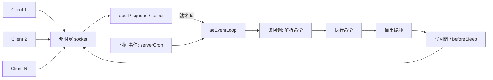
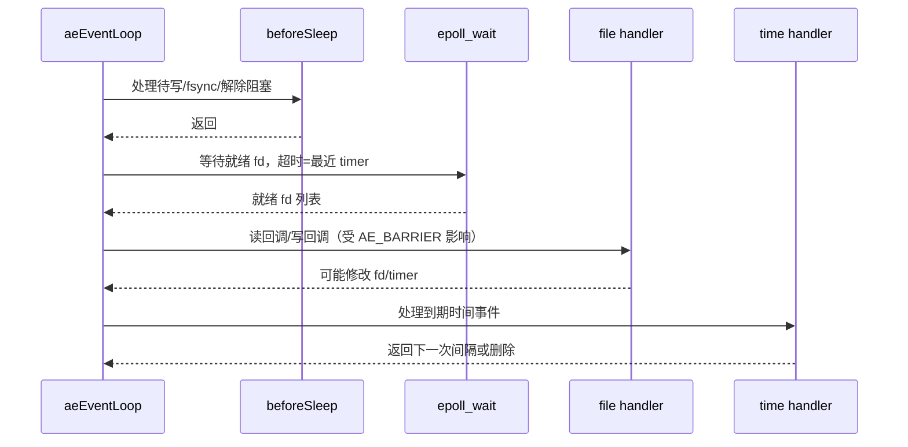

# Day 02 · Redis 事件循环：单线程为什么能快

> **一句话结论**：Redis 的快，不是因为它把每个命令都算得飞快，而是因为它把“等待”从线程里拿走了。一个线程 + 非阻塞 I/O + 事件循环，避开了锁、上下文切换和每连接一线程的内存成本；代价是**任何阻塞都会拖住所有客户端**。

---

## 0. 本次问题

1. 十万个连接，为什么不需要十万个线程？
2. `epoll_wait` 返回就绪 fd 之后，Redis 到底按什么顺序处理读写和定时任务？
3. 为什么 Redis 不给每个 key 建一个定时器？过期删除到底怎么做的？
4. `beforeSleep` 为什么存在？它和“把回复写回 socket”有什么关系？
5. 单线程模型什么时候会崩？Redis 自己是怎么补的？
6. 如果自己写一个事件循环，最小需要哪些抽象，才能既正确又可测试？

这次读完后，你应该能画出一个事件循环的完整一轮：

```text
beforeSleep → 计算超时 → epoll_wait → 处理就绪 fd → 处理到期时间事件 → 下一轮
```

并且能说清楚：这一轮里哪些事情**绝对不能做**。

---

## 1. 设计背景：线程很贵，等待更贵

### 1.1 每连接一线程的代价

一个连接一个线程的模型很直观：

```text
accept() → 创建线程 → read() 阻塞 → 处理 → write() → 销毁线程
```

在连接数不大时它很好用。但 Redis 的场景是：

- 连接数可能很大，但每个连接上的请求很轻；
- 大量时间花在等网络数据，而不是 CPU 计算；
- 请求通常是内存操作，单条命令很快；
- 需要可预测的低延迟，而不是把 CPU 打满。

如果每个连接一个线程：

- 每个线程要有栈、内核调度实体、文件描述符表等资源；
- 线程多了以后，上下文切换和 cache/TLB 抖动会吞掉吞吐；
- 共享数据结构要加锁，锁竞争又会引入新的延迟和死锁风险；
- 阻塞在 `read()` 上的线程什么都不做，却占着资源。

Redis 的选择是：**一个主线程负责事件循环和命令执行，socket 全部非阻塞，用 I/O 多路复用等待“谁准备好了”**。

### 1.2 单线程的收益与代价

| 收益 | 代价 |
|---|---|
| 没有多线程锁竞争，数据结构可以很简单 | 一个慢命令会阻塞所有客户端 |
| 没有线程创建/切换开销 | 无法利用多核跑命令 |
| 事件循环和命令执行在同一线程，顺序清晰 | 任何阻塞调用都是灾难 |
| 内存访问局部性好，cache 友好 | 单核吞吐有上限 |

所以，“Redis 单线程快”是一个**有条件的结论**：

- 快在“大量轻量请求 + 非阻塞 I/O + 内存操作”；
- 不快在“CPU 密集型命令、超大集合操作、阻塞式外部调用”；
- Redis 自己也在用后台线程处理关闭文件、AOF fsync、lazy free 等阻塞工作；Redis 6 之后还可以用 I/O 线程并行读写 socket，但**命令执行仍然在主线程**。

> 单线程不是信仰，而是一个围绕“避免锁和等待”的架构选择。

### 1.3 约束表

| 约束 | 具体表现 | 对设计的影响 |
|---|---|---|
| 连接数 | 可能远大于 CPU 核数 | 不能一连接一线程 |
| 单请求延迟 | 命令通常是内存操作 | 事件循环不能有长任务 |
| 吞吐 | 网络往返占大头 | 批量读写、pipelining 很重要 |
| 内存 | 输出缓冲可能堆积 | 必须有输出缓冲上限 |
| 定时任务 | 过期、统计、复制、持久化 | 需要统一的时间事件，但不能每 key 一个 |
| 可移植性 | Linux/macOS/BSD/Windows | 抽象出 epoll/kqueue/evport/select |

---

## 2. 总体架构：一个事件驱动的调度器

Redis 的事件循环不是“`epoll_wait` 一把梭”，它至少包含四类东西：



核心对象：

| 对象 | 作用 |
|---|---|
| `aeEventLoop` | 事件循环状态：fd 表、就绪事件、时间事件链表、before/after sleep 钩子 |
| `aeFileEvent` | 一个 fd 上的读/写 mask 和回调 |
| `aeTimeEvent` | 一个定时任务：何时触发、触发时做什么、是否续期 |
| `aeApiState` | 多路复用器的私有状态（epoll fd、事件数组等） |

`aeEventLoop` 的关键字段（简化）：

```c
typedef struct aeEventLoop {
    int maxfd;                 // 当前注册的最大 fd
    int setsize;               // fd 表大小
    long long timeEventNextId;
    aeFileEvent *events;       // 按 fd 索引
    aeFiredEvent *fired;       // 本次就绪的事件
    aeTimeEvent *timeEventHead;// 时间事件链表
    int stop;
    void *apidata;             // epoll/kqueue/... 私有数据
    aeBeforeSleepProc *beforesleep;
    aeAfterSleepProc *aftersleep;
    int flags;
} aeEventLoop;
```

注意：**fd 是数组下标**。这带来 O(1) 的“从 fd 找到 handler”，代价是 fd 很大时要扩容 `events` 数组。epoll 本身用红黑树管理 fd，但 Redis 在自己的层里仍然维护了一张按 fd 索引的表，避免每次事件都做哈希查找。

---

## 3. Redis 源码关键路径

> 阅读入口：[`ae.c`](https://github.com/redis/redis/blob/unstable/src/ae.c)、[`ae_epoll.c`](https://github.com/redis/redis/blob/unstable/src/ae_epoll.c)、[`networking.c`](https://github.com/redis/redis/blob/unstable/src/networking.c)、[`server.c`](https://github.com/redis/redis/blob/unstable/src/server.c)。下面以 Redis 7.x 的机制为主线，源码会演进，方法名比行号更稳定。

### 3.1 注册文件事件

应用层通过 `aeCreateFileEvent` 把 fd 和回调注册进循环：

```c
int aeCreateFileEvent(aeEventLoop *eventLoop, int fd, int mask,
                      aeFileProc *proc, void *clientData)
{
    if (fd >= eventLoop->setsize) {
        errno = ERANGE;
        return AE_ERR;
    }
    aeFileEvent *fe = &eventLoop->events[fd];

    if (aeApiAddEvent(eventLoop, fd, mask) == -1)
        return AE_ERR;
    fe->mask |= mask;
    if (mask & AE_READABLE) fe->rfileProc = proc;
    if (mask & AE_WRITABLE) fe->wfileProc = proc;
    fe->clientData = clientData;
    if (fd > eventLoop->maxfd)
        eventLoop->maxfd = fd;
    return AE_OK;
}
```

几个细节：

- `mask` 可以是 `AE_READABLE`、`AE_WRITABLE` 或两者的组合；
- 同一个 fd 的读回调和写回调可以是不同函数；
- `aeApiAddEvent` 负责把 mask 同步给 epoll：如果该 fd 之前没有注册，用 `EPOLL_CTL_ADD`；否则用 `EPOLL_CTL_MOD`；
- `fe->clientData` 让回调知道“这个 fd 属于哪个客户端/连接”；
- `maxfd` 用于快速判断“还有没有 fd 需要等”。

删除时对应 `aeDeleteFileEvent`，会清 mask、调用 `aeApiDelEvent`，必要时回退 `maxfd`。

### 3.2 `aeProcessEvents`：一轮到底做什么

`aeProcessEvents` 是事件循环的心脏。简化后的顺序：

```c
int aeProcessEvents(aeEventLoop *eventLoop, int flags) {
    int processed = 0;

    // 1. 找最近的时间事件，决定 epoll_wait 最多等多久
    aeTimeEvent *shortest = NULL;
    if (flags & AE_TIME_EVENTS)
        shortest = aeSearchNearestTimer(eventLoop);

    struct timeval tv, *tvp = NULL;
    if (shortest) {
        long long now = mstime();
        tv.tv_sec = (shortest->when - now) / 1000;
        tv.tv_usec = ((shortest->when - now) % 1000) * 1000;
        tvp = &tv;
    }
    if (flags & AE_DONT_WAIT) {
        tv.tv_sec = tv.tv_usec = 0;
        tvp = &tv;
    }

    // 2. poll 之前：处理延迟工作（待写回复、AOF fsync、解除阻塞...）
    if (eventLoop->beforesleep != NULL && flags & AE_CALL_BEFORE_SLEEP)
        eventLoop->beforesleep(eventLoop);

    // 3. 等 I/O；没有 timer 且没有 fd 时可以永久阻塞
    int numevents = aeApiPoll(eventLoop, tvp);

    // 4. poll 之后：某些版本用于统计/唤醒后的处理
    if (eventLoop->aftersleep != NULL && flags & AE_CALL_AFTER_SLEEP)
        eventLoop->aftersleep(eventLoop);

    // 5. 处理就绪文件事件
    for (int j = 0; j < numevents; j++) {
        aeFileEvent *fe = &eventLoop->events[eventLoop->fired[j].fd];
        int mask = eventLoop->fired[j].mask;
        int fd = eventLoop->fired[j].fd;
        int fired = 0;
        int invert = fe->mask & AE_BARRIER;

        if (!invert && fe->mask & mask & AE_READABLE) {
            fe->rfileProc(eventLoop, fd, fe->clientData, mask);
            fired++;
        }
        if (fe->mask & mask & AE_WRITABLE) {
            if (!fired || fe->wfileProc != fe->rfileProc) {
                fe->wfileProc(eventLoop, fd, fe->clientData, mask);
                fired++;
            }
        }
        if (invert && fe->mask & mask & AE_READABLE) {
            if (!fired || fe->wfileProc != fe->rfileProc) {
                fe->rfileProc(eventLoop, fd, fe->clientData, mask);
                fired++;
            }
        }
    }

    // 6. 处理到期时间事件
    if (flags & AE_TIME_EVENTS)
        processed += processTimeEvents(eventLoop);

    return processed;
}
```

这段代码里有四个非常值得学的点：

1. **超时由最近的 timer 决定**：有 timer 时，`epoll_wait` 最多等到最近一个 timer 到期；没有 timer 时，可以无限阻塞，避免忙轮询。
2. **`beforeSleep` 在 poll 之前**：它可以把“现在能做的延迟工作”做完，再安心去等 I/O。
3. **文件事件先于时间事件**：同一轮里，先把网络 I/O 处理掉，再处理定时任务；避免定时任务延迟已经就绪的请求。
4. **`AE_BARRIER` 控制读写顺序**：同一个 fd 同时可读可写时，默认先读后写；设置 barrier 后先写后读，用于某些必须保证顺序的状态机。

> 一个容易忽略的细节：Redis 先计算 `tvp`，再调用 `beforesleep`。所以如果 `beforesleep` 里新增了更早的 timer，本次 `epoll_wait` 不会因此缩短。Redis 的 `beforeSleep` 通常不做这种操作；我们自己实现时，把 timeout 计算放到 `beforeSleep` 之后会更稳。

### 3.3 文件事件：epoll 是水平触发

`ae_epoll.c` 的核心很简单：

```c
static int aeApiAddEvent(aeEventLoop *eventLoop, int fd, int mask) {
    aeApiState *state = eventLoop->apidata;
    struct epoll_event ee = {0};

    int op = eventLoop->events[fd].mask == AE_NONE ?
             EPOLL_CTL_ADD : EPOLL_CTL_MOD;

    ee.events = 0;
    mask |= eventLoop->events[fd].mask;  // 合并旧 mask
    if (mask & AE_READABLE) ee.events |= EPOLLIN;
    if (mask & AE_WRITABLE) ee.events |= EPOLLOUT;
    ee.data.fd = fd;

    return epoll_ctl(state->epfd, op, fd, &ee);
}
```

关键点：

- **没有设置 `EPOLLET`**：Redis 使用的是**水平触发（level-triggered）**。只要 socket 还有数据可读，下一轮 `epoll_wait` 还会返回它。因此读回调必须循环读到 `EAGAIN`，否则会一直触发。
- socket 必须是非阻塞的。水平触发 + 非阻塞 + 读到 `EAGAIN`，是 Redis 事件循环的基本契约。
- `EPOLLERR`/`EPOLLHUP` 也会被映射成读写事件，让连接层有机会处理错误和关闭。
- `epoll_wait` 的返回值是“就绪 fd 的数量”，Redis 把它们放进 `fired` 数组，然后逐个分发。

> 为什么不用边缘触发？边缘触发更省系统调用，但要求应用一次把数据读干净，状态机和错误处理更复杂。Redis 选择水平触发，用“每次可能多一次 `epoll_wait`”换“实现简单、不会因为漏读而卡死”。

### 3.4 时间事件：不是每个 key 一个定时器

`aeTimeEvent` 是一个链表节点：

```c
typedef struct aeTimeEvent {
    long long id;
    long long when;                 // 绝对时间，毫秒
    aeTimeProc *timeProc;           // 返回下一次间隔，或 AE_NOMORE
    aeEventFinalizerProc *finalizerProc;
    void *clientData;
    struct aeTimeEvent *prev, *next;
} aeTimeEvent;
```

创建时插到链表头，删除时从链表摘除。`aeSearchNearestTimer` 遍历整条链表找最小 `when`，`processTimeEvents` 再遍历到期节点：

```c
static int processTimeEvents(aeEventLoop *eventLoop) {
    int processed = 0;
    aeTimeEvent *te = eventLoop->timeEventHead;

    while (te) {
        aeTimeEvent *next = te->next;  // 回调可能删除当前节点
        long long now = mstime();
        if (now >= te->when) {
            int retval = te->timeProc(eventLoop, te->id, te->clientData);
            processed++;

            if (retval != AE_NOMORE) {
                te->when = now + retval;   // 续期
            } else {
                aeDeleteTimeEvent(eventLoop, te->id);
            }
        }
        te = next;
    }
    return processed;
}
```

这里最重要的一句话是：

> **Redis 的定时器数量很少，不是每个 key 一个。**

`serverCron` 是一个典型的时间事件，负责：

- 过期键的主动清理（抽样）；
- 哈希表渐进式 rehash 的推进；
- 客户端超时、复制、集群、持久化状态检查；
- 统计和内存碎片整理等。

它返回 `1000 / server.hz` 毫秒（默认 `hz=10`，约 100 ms），于是事件循环会按这个间隔再次调度它。**key 的过期不是靠定时器**：Redis 用惰性删除 + 定期抽样清理，避免为几千万个 key 建几千万个定时器。

这个取舍非常关键：

- 每个 key 一个 timer：内存爆炸，`aeSearchNearestTimer` 变成 O(keys)，不可行；
- 一个 `serverCron` + 抽样：内存 O(1)，过期不是“精确到毫秒”，但足够实用。

时间事件链表的另一个特点是**无序**：`aeSearchNearestTimer` 每次 O(N) 找最近。因为 N 很小（通常个位数到几十个），这比维护堆更简单；如果你要做百万级定时器，应该用时间轮/最小堆，而不是照抄这条链表。

### 3.5 `beforeSleep`：把“现在能做的”集中做完

`beforeSleep` 在每轮 `epoll_wait` 之前调用。Redis 的 `server.c` 里它做很多收尾工作，典型包括：

- `handleClientsWithPendingWrites()`：把输出缓冲里的回复尽量写回 socket；
- `flushAppendOnlyFile(0)`：按策略刷 AOF；
- `handleClientsBlockedOnKeys()`：键就绪后唤醒阻塞客户端；
- `freeClientsInAsyncFreeQueue()`：释放待关闭客户端；
- 更新缓存时间、处理模块/追踪等延迟任务。

为什么要把写操作集中到 `beforeSleep`？

1. **批量化**：命令执行时只把回复追加到输出缓冲，不立即做大量 `write()` 系统调用；一轮结束后统一尝试写。
2. **减少 epoll 抖动**：如果每次回复都注册/注销写事件，`epoll_ctl` 调用会很多；先尝试直接写，只有写不完（`EAGAIN`）才注册 `EPOLLOUT`。
3. **顺序可控**：先把本轮所有命令执行完，再统一 flush，避免“命令执行到一半就触发下一个读事件”的复杂交错。
4. **给延迟工作一个固定位置**：很多“不紧急但不能忘”的事情集中在这里，主循环更清晰。

典型写路径：

```text
命令执行 → 追加到 client output buffer
        → beforeSleep: handleClientsWithPendingWrites
        → writeToClient: 尝试 write()
             ├─ 全部写完：清空缓冲，移除 EPOLLOUT
             └─ 短写/EAGAIN：保留缓冲，注册 EPOLLOUT
```

这里必须有**输出缓冲上限**。如果客户端只发命令不读回复，输出缓冲会无限增长，最终吃光内存。Redis 用 `client-output-buffer-limit` 对普通客户端、pub/sub 客户端、主从客户端分别限制，超限就断开。这是事件循环的背压边界：**既然不能阻塞写，就必须限制排队的数据量**。

### 3.6 一轮的完整时序



---

## 4. 单线程为什么能快，以及什么时候不快

### 4.1 快的来源

1. **没有锁**：所有命令在主线程串行执行，数据结构不需要为并发加锁；没有锁竞争、死锁、内存序问题。
2. **没有每连接线程**：连接数上升时，内存和调度成本不会线性爆炸。
3. **事件驱动**：只在 fd 就绪时工作，等待不占线程。
4. **批处理**：pipelining、`beforeSleep` 集中写、一次 `epoll_wait` 处理多个 fd，摊薄系统调用。
5. **内存操作 + 简单协议**：命令执行本身通常很短，网络往返和协议解析占比更高。
6. **cache 友好**：单线程反复访问自己的数据结构，减少跨核 cache line 迁移。

### 4.2 不快的来源

| 场景 | 后果 | Redis 的应对 |
|---|---|---|
| `KEYS *`、大 `SMEMBERS`、大 Lua 脚本 | 主线程长时间占用，所有客户端卡住 | 用 `SCAN` 替代；限制 Lua 时间；拆分大 key |
| 阻塞式外部调用 | 事件循环停摆 | 不要在主线程做；用异步/后台任务 |
| 大 value 写入/读取 | 单次拷贝和网络写耗时 | 控制 value 大小；pipelining；I/O 线程 |
| 输出缓冲无限增长 | 内存耗尽 | `client-output-buffer-limit` |
| 单核吞吐上限 | 无法利用多核执行命令 | Redis 6 I/O 线程（读写），命令仍单线程；集群分片 |
| 持久化 fork / COW | 延迟抖动 | 合理配置；监控 fork 时间；避免大页/THP 影响 |
| 定时任务过重 | 每轮延迟 | 控制 `serverCron` 工作量；抽样；后台线程 |

### 4.3 Redis 的“补丁”

- **后台线程（bio）**：关闭文件、AOF fsync、lazy free 等阻塞操作交给后台；
- **I/O 线程**：Redis 6+ 可以把 socket 读写/协议解析分给多个线程，但命令执行仍在主线程；
- **子进程**：RDB/AOF rewrite 用 fork，不阻塞主线程（但 fork 本身和 COW 会带来延迟）；
- **抽样清理**：过期键、eviction、rehash 分片推进，避免一次性大操作；
- **输出缓冲限制**：用背压保护内存。

> 这些补丁的共同点是：**不让主线程做“不可预测的长等待”**。

---

## 5. 六个可迁移的设计技巧

### 技巧 1：把等待交给内核，把线程留给计算

**做法**：socket 非阻塞，用一个 `epoll_wait`/`kqueue`/`select` 等待所有 fd，只在就绪时处理。

**为什么有效**：等待网络数据不消耗线程；连接数与线程数解耦。

**代价**：编程模型变成状态机/回调；一个阻塞调用会拖垮全局。

**适用边界**：I/O 密集、连接多、单请求计算轻。CPU 密集或必须阻塞的场景，需要工作线程/进程池。

### 技巧 2：事件循环里只做“短工作”，长工作外移

**做法**：给每个 handler 设定时间预算；把慢操作（大文件、外部 API、复杂计算）移到后台线程/进程，完成后通过事件通知回主循环。

**为什么有效**：单线程模型的尾延迟由“最慢的 handler”决定；短工作保证轮转。

**代价**：跨线程回传、状态同步、结果顺序复杂。

**适用边界**：所有单线程事件循环。判断标准不是“代码行数”，而是“最坏执行时间”。

### 技巧 3：时间事件集中管理，回调返回下次间隔

**做法**：一个 timer 结构保存 `when + callback`；回调返回下一次延迟或“删除”。事件循环每轮处理到期项。

**为什么有效**：定时任务数量可控；避免每个对象一个 timer；续期逻辑集中在回调里。

**代价**：链表查找 O(N)；精度受事件循环轮询影响；长任务会推迟 timer。

**适用边界**：定时任务少、精度要求不极端的场景。海量定时器用时间轮/最小堆（Day 03）。

### 技巧 4：`beforeSleep` 作为延迟工作阶段

**做法**：把“本轮命令执行完后统一做”的事情集中到 poll 前：flush 输出、fsync、解除阻塞、释放对象。

**为什么有效**：批量化系统调用；把延迟工作从命令路径剥离；顺序清晰。

**代价**：`beforeSleep` 变长会直接增加每轮延迟；它不能做阻塞操作。

**适用边界**：事件循环/批处理系统。要监控它的耗时，并设预算。

### 技巧 5：输出缓冲必须有上限

**做法**：写不完时缓冲，但给每个连接/类别设置上限；超限断开或拒绝。

**为什么有效**：非阻塞写意味着“写不出去”不能阻塞线程，只能排队；排队必须有边界，否则内存就是无限的。

**代价**：超限断开会丢请求/连接，需要业务层处理。

**适用边界**：所有非阻塞网络服务。没有背压的缓冲，只是延迟爆炸的另一种写法。

### 技巧 6：用 mask/顺序控制事件语义

**做法**：一个 fd 可以同时注册读/写；用 `AE_BARRIER` 决定先读后写还是先写后读；删除 fd 时同步清理注册表。

**为什么有效**：事件顺序会影响协议状态机；显式控制比隐式依赖更可靠。

**代价**：状态组合变多，测试要覆盖同时读写、删除后仍有事件等边界。

**适用边界**：自定义协议、代理、连接层。简单请求-响应可以默认先读后写。

---

## 6. 反例与边界

| 看起来对的用法 | 实际问题 | 正确做法 |
|---|---|---|
| 在读回调里直接查数据库 | 数据库慢查询阻塞整个事件循环 | 异步客户端/后台线程，结果回传事件循环 |
| 给每个 key 建过期 timer | timer 数量和 key 数量同阶，内存/查找爆炸 | 惰性删除 + 定期抽样 |
| 写不完就无限缓冲 | 客户端不读，内存持续上涨 | 输出缓冲上限 + 断开/拒绝 |
| 用边缘触发但不读到 `EAGAIN` | 水平/边缘语义混淆，连接卡死 | 明确触发模式，循环读到 `EAGAIN` |
| `beforeSleep` 里做全量 fsync | 每轮延迟抖动 | 分策略/后台 fsync，控制预算 |
| timer 回调返回 0 | 同一轮反复触发，CPU 打满 | 最小间隔/限制单轮触发次数 |
| fd 关闭后仍处理旧事件 | use-after-free / 写已关闭连接 | 标记关闭、延迟释放、事件分发前检查 |
| 在事件循环里做 `sleep` | 所有客户端停摆 | 用 timer，不要阻塞 |
| 只监控平均延迟 | 慢 handler 的尾延迟被平均掉 | 监控 event loop latency / 慢命令 |
| 认为单线程一定比多线程快 | CPU 密集时单核是瓶颈 | 按负载选模型；分片/多进程/工作线程 |

### 压力下会发生什么

- **慢命令**：所有连接排队，`epoll_wait` 迟迟回不到循环；p99 飙升。
- **输出缓冲堆积**：内存上涨，最终 OOM 或被系统 kill；必须有限制。
- **大量短连接**：`accept`、注册/注销 fd、创建/销毁客户端对象成为开销；连接池/长连接更好。
- **定时器过多**：`aeSearchNearestTimer` O(N)，每轮都扫；应换时间轮/堆。
- **fork/COW**：RDB/AOF rewrite 时页表复制和写时复制导致延迟抖动；不是事件循环本身的问题，但会表现为事件循环延迟。
- **时钟跳跃**：`when` 用墙钟毫秒；NTP 调整可能影响定时精度；Redis 的时间事件不是高精度实时调度器。

---

## 7. C++20 最小实现

完整代码在 [`code/`](code/)：

- [`event_loop.hpp`](code/event_loop.hpp)：事件循环、Poller 抽象、定时器堆；
- [`main.cpp`](code/main.cpp)：8 个行为测试；
- [`CMakeLists.txt`](code/CMakeLists.txt)：构建配置。

### 7.1 为什么用 MockPoller

Redis 的事件循环直接绑 epoll/kqueue。为了让示例在 Windows/Linux 都能编译、测试，并且不依赖真实 socket，我们把“等待就绪事件”抽象成 `Poller`：

```cpp
class Poller {
public:
    virtual ~Poller() = default;
    virtual void add(int fd, std::uint32_t mask) = 0;
    virtual void remove(int fd) = 0;
    virtual std::vector<ReadyEvent> wait(std::optional<Duration> timeout) = 0;
};
```

- `MockPoller`：测试注入“fd 7 可读”，不阻塞；
- 生产实现：`EpollPoller`、`KqueuePoller`、`SelectPoller`，`wait()` 里调用对应的系统调用；
- 事件循环主体完全不变。

这不是逃避 OS 细节，而是把**调度语义**和**I/O 机制**分开测试。真实 epoll 的接入只需要一个 `wait()`：

```cpp
// 伪代码：EpollPoller::wait
int timeout_ms = timeout ? duration_cast<milliseconds>(*timeout).count() : -1;
int n = epoll_wait(epfd_, events_.data(), events_.size(), timeout_ms);
std::vector<ReadyEvent> ready;
for (int i = 0; i < n; ++i) {
    std::uint32_t mask = 0;
    if (events_[i].events & EPOLLIN) mask |= kReadable;
    if (events_[i].events & EPOLLOUT) mask |= kWritable;
    ready.push_back({events_[i].data.fd, mask});
}
return ready;
```

### 7.2 对应关系

| Redis | 本实现 | 说明 |
|---|---|---|
| `aeEventLoop` | `EventLoop` | 调度器 |
| `aeFileEvent` | `FileHandler` | fd + mask + 读写回调 |
| `aeTimeEvent` | `Timer` | `when` + callback |
| `aeApiPoll` | `Poller::wait` | Mock/epoll/kqueue |
| `beforesleep` | `set_before_sleep` | poll 前延迟工作 |
| `aftersleep` | `set_after_sleep` | poll 后钩子 |
| `AE_BARRIER` | `barrier` 参数 | 先写后读 |
| 时间事件链表 + O(N) 最近查找 | `priority_queue` + lazy deletion | 教学实现选择堆，支持更多 timer |

**为什么用最小堆而不是链表？**

Redis 的 timer 很少，链表更简单；我们的示例要让“timer 数量”成为一个可扩展维度，所以用 `priority_queue`：

- 插入 O(log N)；
- 最近到期 O(1) 查看；
- 取消采用 lazy deletion：从 map 删除，堆里的旧项在弹出时跳过；
- 续期时插入新堆项，旧项通过 `when` 比对失效。

这正好展示了“数据结构选择取决于规模假设”：Redis 的链表不是落后，而是**在它的 timer 数量假设下更简单**。

### 7.3 一轮调度

```cpp
void run_once() {
    if (stopped_) return;

    if (before_sleep_) before_sleep_();
    if (stopped_) return;

    // Redis 先算 timeout 再 beforeSleep；这里放在之后，
    // 让 beforeSleep 新增的 timer 也能缩短本次等待。
    const auto timeout = next_timeout();
    auto ready = poller_->wait(timeout);

    if (after_sleep_) after_sleep_();

    for (const auto& event : ready) {
        dispatch_file_event(event);
    }
    process_timers();
}
```

和 Redis 的差异：

- Redis 先计算 `tvp`，再 `beforeSleep`；本实现先 `beforeSleep` 再算 timeout，避免“beforeSleep 新增 timer 但本轮等待过长”。这是教学实现的一个小改进，不是 Redis 的原样复刻。
- Redis 的文件事件分发有“同一个回调不重复调用”的细节；本实现简化成读/写各调用一次。
- Redis 的 timer 链表 O(N)；本实现用堆。

### 7.4 `AE_BARRIER` 的分发

```cpp
if (handler.barrier) {
    if (want_write && handler.write_callback)
        handler.write_callback(event.fd, event.mask);
    if (want_read && handler.read_callback)
        handler.read_callback(event.fd, event.mask);
} else {
    if (want_read && handler.read_callback)
        handler.read_callback(event.fd, event.mask);
    if (want_write && handler.write_callback)
        handler.write_callback(event.fd, event.mask);
}
```

测试 `read_write_order` 验证：

- 默认：`R` → `W`；
- `barrier=true`：`W` → `R`。

### 7.5 时间事件

```cpp
struct Timer {
    std::uint64_t id;
    TimePoint when;
    TimerCallback callback;   // 返回 nullopt=一次性；返回 Duration=续期
};

struct TimerRef {
    TimePoint when;
    std::uint64_t id;
    bool operator>(const TimerRef& other) const { ... }
};
```

处理逻辑：

```cpp
const auto now = Clock::now();
for (;;) {
    discard_stale_timer_refs();
    if (timer_heap_.empty()) break;

    const auto ref = timer_heap_.top();
    if (ref.when > now) break;
    timer_heap_.pop();

    auto it = timers_.find(ref.id);
    if (it == timers_.end() || it->second->when != ref.when)
        continue;  // 已取消，或旧堆项

    auto timer = it->second;
    timers_.erase(it);

    const auto next = timer->callback();
    if (next) {
        const auto delay = std::max<Duration>(
            *next, std::chrono::milliseconds(1));
        timer->when = Clock::now() + delay;
        timers_.emplace(timer->id, timer);
        timer_heap_.push({timer->when, timer->id});
    }
}
```

两个边界：

- **取消**：`cancel_timer` 只从 `timers_` 删除，堆里的旧项靠 `when/id` 校验跳过；这是 lazy deletion。
- **返回 0**：会把下一次触发压到至少 1 ms 后，避免同一轮无限循环；Redis 的 `serverCron` 返回固定间隔，不走这个边界。

### 7.6 测试

```bash
cmake -S . -B build -G Ninja
cmake --build build
ctest --test-dir build --output-on-failure
# 或
./build/event_loop_demo
```

Windows（PowerShell）：

```powershell
cmake -S . -B build -G Ninja -DCMAKE_CXX_COMPILER=g++
cmake --build build
.\build\event_loop_demo.exe
```

实测输出：

```text
[  OK  ] file_read_event
[  OK  ] read_write_order
[  OK  ] one_shot_timer
[  OK  ] recurring_timer
[  OK  ] cancel_timer
[  OK  ] before_after_sleep_order
[  OK  ] remove_file
[  OK  ] stop_skips_round

All 8 tests passed.
```

> 验证环境：Windows 11 + MinGW-w64 g++ 15.2 + CMake 4.2 + Ninja；`-std=c++20 -Wall -Wextra -Wpedantic -Werror` 编译通过。

### 7.7 生产化缺口

- **真实 Poller**：epoll/kqueue/select 的封装、错误处理、fd 上限；
- **边缘触发/水平触发**：本实现只模拟水平语义；
- **跨线程唤醒**：`eventfd`/pipe，让工作线程能唤醒事件循环；
- **信号处理**：`SIGTERM` 优雅退出；
- **输出缓冲**：本实现没有真实的 socket 输出队列；
- **定时器精度**：`steady_clock` 与系统调用的毫秒换算；
- **fd 生命周期**：延迟关闭、半关闭、错误事件；
- **TLS**：握手状态机比明文读写复杂得多；
- **可观测性**：事件循环延迟、慢 handler、就绪队列长度、timer 延迟；
- **多线程 I/O**：Redis 6 的 I/O 线程模型不在本示例范围。

---

## 8. 如何借鉴到自己的项目

### 8.1 模式卡片

```text
模式名称：单线程 Reactor / 事件循环
解决什么问题：用少量线程承载大量 I/O 连接，避免每连接一线程的资源和调度成本。
核心机制：
  1. 非阻塞 fd + epoll/kqueue/select；
  2. 文件事件注册表（fd -> mask + 回调）；
  3. 时间事件 + 最近到期超时；
  4. beforeSleep 集中处理延迟工作；
  5. 输出缓冲上限形成背压。
代价/限制：
  - 单线程不能利用多核执行命令；
  - 任何阻塞 handler 都会拖住所有连接；
  - 状态机/回调风格增加复杂度；
  - 需要额外的背压和生命周期管理。
不适用场景：
  - CPU 密集型请求；
  - 必须阻塞等待的外部调用；
  - 需要严格实时精度的定时任务。
一个最小例子：本课的 EventLoop + MockPoller。
```

### 8.2 接口清单

```text
[ ] 所有 socket 是否非阻塞？
[ ] 读回调是否循环读到 EAGAIN？
[ ] 每个 handler 的最坏执行时间是否有预算？
[ ] 是否有 beforeSleep/afterSleep 的耗时指标？
[ ] 输出缓冲是否有上限？超限怎么办？
[ ] timer 数量级是多少？链表/堆/时间轮是否匹配？
[ ] timer 回调返回 0 会不会忙循环？
[ ] fd 关闭后，旧事件是否会被安全丢弃？
[ ] 是否监控 event loop latency / 慢命令？
[ ] 能否在不改调度器的情况下替换 epoll/select？
```

### 8.3 迁移步骤

1. **先量**：统计连接数、每连接内存、handler p99、事件循环延迟。
2. **分离等待与计算**：把阻塞调用移到后台线程/进程，事件循环只做状态推进。
3. **加背压**：输出缓冲上限、每连接配额、慢客户端断开。
4. **定时任务集中化**：不要每对象一个 timer；按规模选链表/堆/时间轮。
5. **做故障注入**：慢客户端、半关闭、fd 耗尽、timer 风暴、handler 抛异常。
6. **再谈多线程**：单线程不够时，先分片/多进程，再考虑 I/O 线程。

---

## 9. 练习

**基础**

1. 给 `EventLoop` 加一个 `run_for(duration)`，在固定时间内循环执行，返回处理的事件数。
2. 实现一个 `SelectPoller`（POSIX/Windows 均可），把 `wait` 换成 `select`，保持现有测试通过。
3. 给 `Timer` 增加“取消后执行 finalizer”的语义，对比 Redis 的 `finalizerProc`。

**进阶**

1. 实现 `EpollPoller`（Linux）：`epoll_create1`、`EPOLL_CTL_ADD/MOD/DEL`、`epoll_wait`；用 socketpair 做真实读写测试。
2. 给事件循环加 `eventfd` 唤醒：工作线程完成任务后唤醒主循环，模拟 Redis 6 I/O 线程的完成通知。
3. 实现一个简单的输出缓冲：写回调里 `write` 返回 `EAGAIN` 时保留数据并注册 `EPOLLOUT`，下次可写时继续。

**挑战**

1. 用这个事件循环实现一个最小 Redis 协议服务器：`PING`、`SET`、`GET`，支持 pipelining；测量 1/100/1000 连接下的 p99。
2. 注入一个 50 ms 的慢命令，观察其他连接的延迟；然后把它移到后台线程，比较 p99。
3. 把 timer 从堆换成时间轮，支持 100 万个定时器；比较内存、插入/取消/触发延迟。

---

## 10. 自测题

<details>
<summary>点击展开答案</summary>

**1. Redis 单线程为什么能处理大量连接？**

因为它不为每个连接创建线程，而是用非阻塞 socket + epoll/kqueue 等 I/O 多路复用，一个线程等待所有 fd 的就绪事件；命令执行本身通常是短小的内存操作，避免了锁和线程切换。它不是“单线程一定更快”，而是“在这个负载下，避免了多线程的协调成本”。

**2. 为什么 Redis 不给每个 key 建过期定时器？**

key 的数量可能远大于 timer 的合理规模。每个 key 一个 timer 会让内存和 `aeSearchNearestTimer` 的 O(N) 查找爆炸。Redis 用惰性删除 + `serverCron` 定期抽样清理，牺牲毫秒级精确性，换取可扩展性。

**3. `beforeSleep` 的作用是什么？**

在每轮 `epoll_wait` 之前集中处理延迟工作：把输出缓冲写回 socket、按策略 fsync AOF、唤醒阻塞客户端、释放待关闭客户端等。它把“命令执行”和“收尾/批量 I/O”分开，减少系统调用和 epoll 抖动；但它自己不能阻塞，否则直接增加每轮延迟。

**4. Redis 的 epoll 是水平触发还是边缘触发？**

水平触发。`ae_epoll.c` 没有设置 `EPOLLET`；只要 fd 还有数据，下一轮还会返回。因此读回调必须循环读到 `EAGAIN`，socket 必须非阻塞。

**5. 如果事件循环里有一个 handler 阻塞 100 ms，会发生什么？**

这一轮 `aeProcessEvents` 卡在 handler 里，所有其他就绪 fd 和到期 timer 都要等它返回；客户端 p99 至少增加 100 ms，timer 也会延迟。单线程模型下，最慢 handler 决定尾延迟。

**6. 时间事件回调返回 `AE_NOMORE` 和返回一个整数有什么区别？**

返回 `AE_NOMORE` 表示删除该 timer；返回整数表示以“当前时间 + 返回值”为下一次触发时间续期。`serverCron` 返回 `1000/hz`，所以会周期性执行。

**7. `AE_BARRIER` 解决什么问题？**

同一个 fd 同时可读可写时，默认先读后写；设置 barrier 后先写后读。它用于需要控制事件顺序的状态机，避免某些“先读后写”导致协议/状态不一致。代价是顺序语义更复杂，需要测试覆盖。

**8. 为什么输出缓冲必须有上限？**

非阻塞写写不完时不能阻塞线程，只能把数据排队；如果客户端一直不读，队列会无限增长直到 OOM。上限把“无限内存”变成“可观测的断开/拒绝”，是事件循环的背压边界。

</details>

---

## 11. 模式卡片

```text
模式名称：单线程 Reactor + 延迟工作阶段
解决什么问题：大量并发连接下，避免每连接一线程的资源与锁成本。
核心机制：
  1. 非阻塞 fd + I/O 多路复用；
  2. fd -> handler 注册表；
  3. 最近 timer 决定 poll 超时；
  4. beforeSleep 批量处理延迟工作；
  5. 有界输出缓冲。
代价/限制：
  - 单核执行命令；
  - 阻塞 handler 全局停摆；
  - 回调/状态机复杂；
  - 定时精度受事件循环影响。
不适用场景：
  - CPU 密集型命令；
  - 阻塞式外部依赖；
  - 海量高精度定时器（需时间轮）。
一个最小例子：本课的 EventLoop + MockPoller。
```

---

## 12. 下次预习

下一次进入 **时间轮**。带着三个问题读：

1. 链表/最小堆已经能做定时器，为什么还需要时间轮？
2. Netty `HashedWheelTimer` 和 Kafka 的 timer 结构分别怎么处理“海量连接超时”？
3. 时间轮的 bucket 数量、tick 精度、任务取消和降级，分别如何取舍？

阅读入口：Netty `HashedWheelTimer`、Kafka `SystemTimer` / `TimerWheel`，以及 Linux `timerfd` 的基本用法。

---

## 参考资料

- Redis, [`ae.c`](https://github.com/redis/redis/blob/unstable/src/ae.c)：事件循环、文件事件、时间事件、`aeProcessEvents`。
- Redis, [`ae_epoll.c`](https://github.com/redis/redis/blob/unstable/src/ae_epoll.c)：epoll 的水平触发注册与 `epoll_wait`。
- Redis, [`ae.h`](https://github.com/redis/redis/blob/unstable/src/ae.h)：`aeEventLoop`、`aeFileEvent`、`aeTimeEvent` 定义。
- Redis, [`networking.c`](https://github.com/redis/redis/blob/unstable/src/networking.c)：`readQueryFromClient`、`writeToClient`、`handleClientsWithPendingWrites`。
- Redis, [`server.c`](https://github.com/redis/redis/blob/unstable/src/server.c)：`beforeSleep`、`serverCron`、`clientsCron`。
- `epoll(7)` man page：水平/边缘触发、`EPOLLIN`/`EPOLLOUT`/`EPOLLERR`。
- C++ reference：[`std::priority_queue`](https://en.cppreference.com/w/cpp/container/priority_queue)、[`std::chrono::steady_clock`](https://en.cppreference.com/w/cpp/chrono/steady_clock)。
- 《Redis 设计与实现》中事件循环、过期键、持久化相关章节（可选，作为中文辅助材料）。
