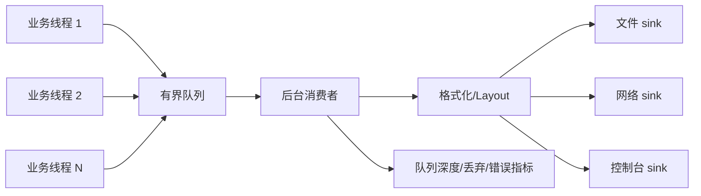

# Day 04 · 异步日志：别让磁盘拖慢业务线程

> **一句话结论**：异步日志不是“把日志扔给另一个线程”这么简单，而是用**有界队列 + 明确的溢出策略 + 可等待的 flush + 可收敛的 shutdown**，在“业务延迟”和“日志完整性”之间签一份合同。

---

## 0. 本次问题

1. 一行 `logger.info(...)` 到底可能阻塞多久？
2. 为什么日志框架要把“生产日志”和“写日志”拆成两个线程？
3. 队列满了以后，应该阻塞业务、丢新日志，还是丢旧日志？
4. 格式化应该在业务线程做，还是后台线程做？
5. `flush()` 到底保证什么？进程被 `kill -9` 时还保证吗？
6. Log4j2 的 Disruptor 和 spdlog 的 thread pool，解决的是同一个问题吗？
7. 如果自己写异步日志，最小但正确的边界是什么？

---

## 1. 设计背景：日志是 I/O，不是免费函数

### 1.1 同步日志的成本

一个看起来无害的调用：

```cpp
logger.info("order {} paid, amount={}", order_id, amount);
```

同步实现可能依次做：

```text
格式化字符串
  -> 获取锁（多线程写同一个文件）
  -> write() 系统调用
  -> 可能 flush/fsync
  -> 磁盘/网络抖动时阻塞
```

在正常情况下，这些成本可能只有几微秒到几十微秒；但在异常情况下：

- 磁盘 I/O 排队，`write()` 阻塞几毫秒甚至更久；
- 日志文件被轮转/压缩，写入等待；
- 网络日志对端不可用，socket 缓冲区满；
- 多线程争抢同一把日志锁，出现锁 convoy；
- 日志量突然暴涨（异常循环、重试风暴），把业务线程拖死。

日志本来是为了**观测故障**，结果却成了**故障放大器**。

### 1.2 异步日志的承诺

异步日志把链路拆成两段：

```text
业务线程：构造日志记录 -> 放入队列 -> 返回
后台线程：从队列取记录 -> 格式化/写 sink -> flush
```

它承诺：

- 业务线程不做磁盘/网络 I/O；
- 多个业务线程的日志可以批量写，摊薄系统调用；
- 慢 sink 不会直接阻塞业务线程（在队列未满时）；
- 可以通过队列深度/丢弃数观测日志链路自身的健康。

它不承诺：

- 日志一定不丢（队列满、进程崩溃、kill -9 都会丢）；
- 日志顺序和业务事件顺序完全一致（多生产者并发）；
- 队列无限大（无限队列只是把 OOM 延后）；
- 后台线程永远不会阻塞（sink 慢时队列会满）。

### 1.3 约束表

| 约束 | 具体表现 | 对设计的影响 |
|---|---|---|
| 业务延迟 | 不能在调用线程做磁盘 I/O | 生产者只做最小捕获 |
| 日志完整性 | 关键审计日志不能丢 | 有界队列 + Block/同步兜底 |
| 吞吐 | 每条日志一次 write 太贵 | 批量消费、缓冲 |
| 内存 | 日志洪峰可能无限 | 有界队列 + 丢弃/限流 |
| 停机 | 进程退出时队列还有日志 | drain + flush + 超时 |
| 可观测性 | 日志系统自己也会坏 | 队列深度、丢弃数、sink 错误 |
| 上下文 | MDC/trace_id 在线程本地 | 生产时快照，不能后台读取 |

---

## 2. 总体架构：三阶段流水线



三个阶段：

1. **捕获（producer）**：时间戳、级别、线程、消息、上下文；尽量不做 I/O。
2. **排队（queue）**：有界缓冲；满时按策略处理。
3. **消费（consumer）**：批量取、格式化、写 sink、flush。

### 2.1 捕获阶段：哪些东西必须在业务线程做？

必须在业务线程捕获：

- **时间戳**：后台线程的时间不是日志发生时间；
- **线程 id/协程 id**：后台线程的 id 没有意义；
- **请求上下文**：trace_id、tenant_id、user_id、MDC；
- **可变对象的快照**：不能把业务对象的引用传给后台，否则后台读到时可能已释放/被修改；
- **异常栈**：异常对象生命周期有限，通常要当场格式化或复制。

可以延迟到后台：

- 字符串格式化（如果消息参数已经安全复制）；
- JSON/文本 layout；
- 文件/网络写入；
- 采样、脱敏（但脱敏前的数据要小心生命周期）。

**核心原则**：后台线程只能看到**不可变、生命周期独立**的数据。

### 2.2 格式化放在哪？

| 方案 | 优点 | 缺点 | 典型 |
|---|---|---|---|
| 业务线程格式化 | 后台简单；参数生命周期简单；日志关闭时零成本 | 业务线程承担格式化和分配成本 | spdlog `async_logger` 常见实现 |
| 后台线程格式化 | 业务线程延迟更低；可延迟 layout | 必须安全复制参数/上下文；实现复杂；可能更多分配 | Log4j2 AsyncLogger 的 LogEvent/Layout 路径 |

没有绝对答案。判断标准：

- 业务线程的 p99 是否敏感？
- 日志参数是否包含大对象/复杂结构？
- 格式化是否可能抛异常/分配大量内存？
- 日志关闭时是否希望零成本？

一个常见折中：**生产时只做轻量捕获（时间、级别、线程、消息字符串/安全参数），后台做 layout 和 I/O**。本课代码采用这个模型。

### 2.3 队列：有界是底线

队列容量决定：

- 能吸收多大的突发；
- sink 慢时业务线程能撑多久；
- 内存上限；
- 日志丢失的窗口。

```text
队列太小 -> 频繁丢弃/阻塞，日志缺失
队列太大 -> 内存高，故障时延迟高，丢失时一次丢很多
```

队列容量应该由“可接受的内存”和“sink 的持续吞吐”共同决定，而不是拍脑袋写 `Integer.MAX_VALUE`。

---

## 3. Log4j2 AsyncLogger：Disruptor 路线

> 阅读入口：[`AsyncLogger.java`](https://github.com/apache/logging-log4j2/blob/2.x/log4j-core/src/main/java/org/apache/logging/log4j/core/async/AsyncLogger.java)、[`RingBufferLogEvent.java`](https://github.com/apache/logging-log4j2/blob/2.x/log4j-core/src/main/java/org/apache/logging/log4j/core/async/RingBufferLogEvent.java)。

### 3.1 结构

```text
Logger
  -> AsyncLogger
      -> LMAX Disruptor RingBuffer<RingBufferLogEvent>
          -> background consumer
              -> AsyncLoggerConfig
                  -> Appenders / Layout
```

关键点：

- 每个日志事件不是“新对象”，而是环形缓冲里的一个**可复用槽位**；
- 生产者 claim 一个 sequence，填充事件，publish；
- 消费者按 sequence 处理，处理完更新 consumer sequence；
- 队列满时由 **wait strategy** 决定生产者等待方式；
- 目标是减少锁、减少分配、批量处理。

`AsyncLogger` 与 `AsyncAppender` 的区别：

| | AsyncLogger | AsyncAppender |
|---|---|---|
| 异步范围 | 整个 logger 调用链 | 单个 appender |
| 队列 | Disruptor ring buffer | 通常 `ArrayBlockingQueue` |
| 性能 | 更低延迟、更少锁 | 配置简单，包裹现有 appender |
| 适用 | 高性能全局异步 | 只想异步某一个输出 |

两者不要随意叠加：异步 logger 里再套异步 appender，会变成两级队列，增加延迟、丢失窗口和关闭复杂度。

### 3.2 RingBuffer 与 wait strategy

Disruptor 的核心是：

```text
预分配 ring[capacity]
producer: next sequence -> fill slot -> publish
consumer: wait for sequence -> process -> advance
```

它避免了每个事件的对象分配和锁竞争，但队列满时仍然要选择：

- **Block**：生产者阻塞等待，日志不丢，但业务线程可能被拖慢；
- **Timeout**：等一小段时间，超时后可能走错误处理/丢弃；
- **Sleep/Yield/BusySpin**：用 CPU 换延迟，适合极端低延迟场景，但会吃 CPU。

Log4j2 的默认值会随版本/配置变化，重要的是理解语义：**wait strategy 就是“队列满时生产者怎么办”的策略**。

### 3.3 关闭与“垃圾回收”

Log4j2 的异步 logger 在正常关闭时会尝试停止后台线程并处理队列；但：

- `kill -9`、断电、JVM crash 不会给你 drain 的机会；
- 异步日志的“最后几条”可能永远丢失；
- 如果业务要求审计级不丢，不能只依赖异步日志，需要同步落盘/确认机制。

“garbage-free”也不是绝对的：它通常指 steady-state 下复用事件/消息对象，减少分配；layout、异常栈、字符串转换仍可能分配。不要把它当成“零成本”。

---

## 4. spdlog async_logger：线程池路线

> 阅读入口：[`async_logger.h`](https://github.com/gabime/spdlog/blob/v1.x/include/spdlog/async_logger.h)、[`thread_pool.h`](https://github.com/gabime/spdlog/blob/v1.x/include/spdlog/details/thread_pool.h)。

spdlog 的异步模型更接近“线程池 + 阻塞队列”：

```text
async_logger
  -> details::thread_pool
      -> mpmc_blocking_queue<async_msg>
          -> worker thread(s)
              -> sink->log(msg)
```

特点：

- 使用线程池，可以配置队列大小和后台线程数；
- `async_msg` 包含日志消息/格式化后的 payload；
- 队列满时由 `async_overflow_policy` 决定：阻塞、覆盖最旧、丢弃新（具体枚举随版本变化）；
- `flush()` 通常投递一个 flush 消息，等待后台处理；
- `spdlog::shutdown()` 停止线程池并 flush。

spdlog 的常见实现会在调用线程完成格式化，再把消息放入队列；因此后台线程主要承担 sink I/O，而不是 layout。这和 Log4j2 的 LogEvent/layout 路径不同，也说明“异步日志”没有唯一正确的切分点。

### 4.1 Log4j2 vs spdlog

| 维度 | Log4j2 AsyncLogger | spdlog async_logger |
|---|---|---|
| 队列 | Disruptor ring buffer | 线程池 + 阻塞队列 |
| 生产者 | 填充可复用事件 | 构造/格式化消息后入队 |
| 消费者 | 后台线程处理 appender/layout | 线程池 worker 写 sink |
| 溢出 | wait strategy | overflow policy |
| 优势 | 低延迟、可减少分配 | 简单、灵活、易嵌入 |
| 风险 | 配置/关闭复杂 | 队列/线程池参数需要调 |

---

## 5. 六个可迁移的设计技巧

### 技巧 1：有界队列是异步日志的底线

**做法**：队列容量固定；容量与内存、sink 吞吐、可接受延迟一起定。

**为什么有效**：把“无限增长的内存”变成“可观测的丢弃/阻塞”。

**代价**：容量小会丢日志/阻塞；容量大则内存高、故障恢复慢。

**适用边界**：所有生产日志链路。无界队列不是异步，是延迟 OOM。

### 技巧 2：溢出策略必须显式

**做法**：定义 Block / DropNew / DropOldest，并在指标里区分。

- Block：不丢，但业务线程可能被拖慢，甚至死锁；
- DropNew：保留旧日志，丢最新；适合“现场在早期”的调试；
- DropOldest：保留最新，丢旧；适合“故障尾部最重要”的场景。

**代价**：Drop 策略都会丢数据；Block 会把日志系统的问题传导给业务。

**适用边界**：关键审计日志用 Block/同步落盘；普通诊断日志可以 Drop。

### 技巧 3：批量消费，摊薄系统调用

**做法**：后台一次取一批（例如 64/256 条），统一写 sink，必要时统一 flush。

**为什么有效**：减少锁、减少 `write()` 次数、提高吞吐；对慢 sink 更明显。

**代价**：批量越大，单条日志的可见延迟越高；进程崩溃时未 flush 的批次更多。

**适用边界**：吞吐优先的日志；低延迟审计日志要缩短批次/及时 flush。

### 技巧 4：上下文在生产者线程快照

**做法**：在调用线程捕获 trace_id、tenant_id、线程名、时间戳；把这些值复制进记录。

**为什么有效**：后台线程没有业务线程的 ThreadLocal/MDC；延迟读取会读错或读到已释放的数据。

**代价**：复制上下文有成本；上下文太大时日志本身变重。

**适用边界**：所有异步日志。尤其是请求级 trace_id、用户/租户信息。

### 技巧 5：flush 是屏障，不是“保证不丢”

**做法**：`flush()` 等待“调用前已入队的记录”被 sink 处理，并调用 sink flush；用条件变量/序列号实现。

**为什么有效**：让“日志可见”有明确边界，测试和停机可以依赖。

**代价**：flush 可能等很久；并发生产者持续写入时，flush 不是全局静止点；`kill -9` 仍然会丢。

**适用边界**：正常停机、测试、关键操作后的强制落盘。不要在高频路径反复 flush。

### 技巧 6：关闭要分 Drain / Discard，并设置超时

**做法**：停止接收 -> 选择排空或丢弃 -> 唤醒生产者 -> join 后台 -> flush sink；整个过程有截止时间。

**为什么有效**：避免“队列还有日志但进程已经退出”，也避免“sink 卡死导致永远关不掉”。

**代价**：Drain 可能很慢；Discard 会丢日志；超时后强退仍有丢失。

**适用边界**：所有带后台线程的日志系统。关闭顺序要和业务资源关闭顺序协调。

---

## 6. C++20 最小实现

完整代码在 [`code/`](code/)：

- [`async_logger.hpp`](code/async_logger.hpp)：有界队列、后台批处理、三种溢出策略、flush/shutdown；
- [`main.cpp`](code/main.cpp)：7 个行为测试；
- [`CMakeLists.txt`](code/CMakeLists.txt)：构建配置。

### 6.1 设计映射

| Log4j2 / spdlog | 本实现 | 说明 |
|---|---|---|
| AsyncLogger / async_logger | `AsyncLogger` | 调用线程只入队 |
| RingBuffer / thread pool queue | `std::deque` + mutex | 教学简化；Day 06 再讲无锁环 |
| wait strategy / overflow policy | `OverflowPolicy` | Block / DropNew / DropOldest |
| background consumer | worker thread | 批量取出 |
| appender/layout | `LogSink` | 测试用 Memory/Blocking/Throwing sink |
| flush | `flush()` | 等待队列空 + 调用 sink.flush |
| shutdown | `Drain` / `Discard` | 幂等关闭 |

### 6.2 生产者：只做捕获和入队

```cpp
bool log(LogLevel level, std::string message) {
    LogRecord record{std::chrono::system_clock::now(),
                     level,
                     std::this_thread::get_id(),
                     std::move(message)};

    std::unique_lock<std::mutex> lock(mutex_);
    if (stopping_) {
        ++dropped_;
        return false;
    }

    if (queue_.size() >= capacity_) {
        switch (policy_) {
        case OverflowPolicy::Block:
            not_full_.wait(lock, [this] {
                return stopping_ || queue_.size() < capacity_;
            });
            if (stopping_) {
                ++dropped_;
                return false;
            }
            break;
        case OverflowPolicy::DropNew:
            ++dropped_;
            return false;
        case OverflowPolicy::DropOldest:
            queue_.pop_front();
            ++dropped_;
            break;
        }
    }

    queue_.push_back(std::move(record));
    ++accepted_;
    not_empty_.notify_one();
    return true;
}
```

几个取舍：

- 时间戳/线程 id 在生产者线程捕获；
- 消息以 `std::string` 复制/移动，后台不再访问业务对象；
- `Block` 策略会让生产者等待，可能拖慢业务，但不会静默丢日志；
- `DropOldest` 保留最新现场，适合“故障发生时最后几条最重要”；
- 入队后只通知一个消费者（本实现只有一个后台线程）。

### 6.3 消费者：批量取出，锁外写 sink

```cpp
std::vector<LogRecord> batch;
{
    std::unique_lock<std::mutex> lock(mutex_);
    not_empty_.wait(lock, [this] {
        return stopping_ || !queue_.empty();
    });

    if (queue_.empty()) {
        if (stopping_) break;
        continue;
    }

    const auto count = std::min(batch_size_, queue_.size());
    for (std::size_t i = 0; i < count; ++i) {
        batch.push_back(std::move(queue_.front()));
        queue_.pop_front();
    }

    processing_ = true;
    not_full_.notify_all();
}

for (const auto& record : batch) {
    try {
        sink_.write(record);
    } catch (...) {
        ++sink_errors_;
    }
}
```

关键点：

- 批量取，减少锁和 sink 调用；
- 写 sink 时**不持队列锁**，否则慢磁盘会阻塞所有生产者；
- sink 异常被捕获并计数，日志线程不能因为一次写失败而退出；
- `processing_` 让 `flush()` 知道“已出队但还没写完”。

### 6.4 flush：等待队列排空

```cpp
void flush() {
    std::unique_lock<std::mutex> lock(mutex_);
    if (!worker_.joinable()) {
        sink_.flush();
        return;
    }

    idle_cv_.wait(lock, [this] {
        return queue_.empty() && !processing_;
    });
    sink_.flush();
}
```

语义：

- 等待“当前已入队”的记录被消费；
- 调用 `sink.flush()` 把 sink 内部缓冲刷出去；
- 并发生产者持续写入时，flush 可能等很久；它不是全局暂停；
- 进程被 `kill -9` 时，flush 没有机会执行。

### 6.5 shutdown：Drain 与 Discard

```cpp
void shutdown(ShutdownMode mode = ShutdownMode::Drain) {
    std::call_once(shutdown_once_, [this, mode] {
        {
            std::lock_guard<std::mutex> lock(mutex_);
            stopping_ = true;
            if (mode == ShutdownMode::Discard) {
                dropped_ += static_cast<std::uint64_t>(queue_.size());
                queue_.clear();
            }
            not_empty_.notify_all();
            not_full_.notify_all();
        }

        if (worker_.joinable()) {
            worker_.join();
        }
        {
            std::lock_guard<std::mutex> lock(mutex_);
            sink_.flush();
        }
    });
}
```

语义：

| 模式 | 新日志 | 已排队日志 | 正在写的日志 | 返回时机 |
|---|---|---|---|---|
| `Drain` | 拒绝 | 全部消费 | 等它写完 | 队列空 + 后台退出 |
| `Discard` | 拒绝 | 丢弃并计数 | 等它写完 | 当前批次完成 |

关闭顺序很重要：

1. 停止接收新日志；
2. 唤醒被 Block 策略阻塞的生产者；
3. 排空/丢弃队列；
4. join 后台线程；
5. flush sink；
6. 再关闭业务资源。

### 6.6 测试

```bash
cmake -S . -B build -G Ninja
cmake --build build
ctest --test-dir build --output-on-failure
# 或
./build/async_logger_demo
```

Windows（PowerShell）：

```powershell
cmake -S . -B build -G Ninja -DCMAKE_CXX_COMPILER=g++
cmake --build build
.\build\async_logger_demo.exe
```

实测输出：

```text
[  OK  ] flush_and_batching
[  OK  ] drop_new
[  OK  ] drop_oldest
[  OK  ] block_policy
[  OK  ] discard_shutdown
[  OK  ] sink_error_isolated
[  OK  ] stop_rejects_new_logs

All 7 tests passed.
```

> 验证环境：Windows 11 + MinGW-w64 g++ 15.2 + CMake 4.2 + Ninja；`-std=c++20 -Wall -Wextra -Wpedantic -Werror` 编译通过。

### 6.7 生产化缺口

- **队列实现**：`deque` + mutex 的锁竞争；生产可用 Disruptor/环形队列；
- **格式化位置**：本实现把消息原文交给 sink，sink 负责 layout；生产要决定谁来格式化；
- **文件 sink**：轮转、压缩、权限、磁盘满、fsync 策略；
- **关闭超时**：sink 卡死时 `join` 可能永远不返回；
- **日志洪峰**：只有丢弃，没有按级别/租户限流、采样；
- **上下文**：未实现 MDC/trace_id/结构化字段；
- **多 sink**：一个 sink 慢会拖慢所有日志；
- **可观测性**：只有队列深度/丢弃数，没有每级别延迟、sink p99；
- **崩溃安全**：没有 WAL/durable buffer；
- **安全**：没有脱敏、注入防护、日志大小限制。

---

## 7. 反例与边界

| 看起来对的用法 | 实际问题 | 正确做法 |
|---|---|---|
| 无界队列 | 日志洪峰时 OOM；延迟无限增长 | 有界队列 + 丢弃/限流 |
| 所有日志都 Block | 磁盘故障时业务线程全部卡死 | 分级：审计 Block，诊断 Drop/采样 |
| 队列很大就“不会丢” | 进程崩溃/队列满仍会丢；内存高 | 明确持久化边界，不要骗自己 |
| 在后台线程读 MDC/trace_id | 读到空值或别的请求上下文 | 生产者线程快照后传入 |
| 在日志回调里再写日志 | 递归、死锁、队列再次满 | 禁止 sink 内递归日志；独立错误通道 |
| 退出时不 flush | 最后一段日志丢失 | shutdown drain + 超时 + flush |
| 每次日志都 flush | 吞吐崩、延迟高 | 批量 + 关键点 flush |
| 异步 logger 套异步 appender | 两级队列、双倍丢失窗口 | 选一层异步；明确责任 |
| 日志里放大对象/完整请求体 | 生产线程拷贝/格式化成本高，PII 风险 | 截断、采样、脱敏、懒格式化 |
| 用日志做业务审计 | 异步丢日志、无事务语义 | 独立审计链路/同步落盘/确认 |

### 压力下会发生什么

- **sink 变慢**：队列涨，Block 策略拖慢业务，Drop 策略开始丢日志；监控必须同时看业务延迟和日志丢弃数。
- **日志风暴**：异常循环里每条都打日志，队列瞬间满；需要限流/采样/去重。
- **进程崩溃**：未 flush 的日志丢失；异步日志不能承诺 crash-safe。
- **关闭竞争**：生产者还在写、关闭线程 join、Block 生产者等待；必须唤醒并拒绝新日志。
- **多线程顺序**：多个生产者并发，后台单消费者按入队顺序处理，但不同线程的真实时间顺序可能与日志顺序不同；需要 trace_id/sequence 辅助。
- **磁盘满/权限错误**：sink 抛异常；后台线程必须继续存活并计数，否则日志系统静默死亡。

---

## 8. 如何借鉴到自己的项目

### 8.1 模式卡片

```text
模式名称：有界异步日志流水线
解决什么问题：把日志 I/O 从业务线程剥离，同时给内存/延迟/丢失建立明确边界。
核心机制：
  1. 生产者只捕获不可变记录；
  2. 有界队列；
  3. Block/DropNew/DropOldest 溢出策略；
  4. 后台批量消费；
  5. flush 屏障；
  6. Drain/Discard 关闭。
代价/限制：
  - 崩溃会丢未 flush 日志；
  - 队列满会阻塞或丢弃；
  - 上下文必须复制；
  - 关闭和测试更复杂。
不适用场景：
  - 审计/金融凭证等不能丢的日志；
  - 需要严格全局顺序的日志；
  - 业务线程可以接受同步 I/O 的简单系统。
一个最小例子：本课的 AsyncLogger。
```

### 8.2 接口清单

```text
[ ] 队列是否有界？容量依据是什么？
[ ] 队列满时是 Block、丢新还是丢旧？是否分级？
[ ] 时间戳/线程/trace_id 是否在生产线程捕获？
[ ] 格式化在生产者还是消费者？参数生命周期安全吗？
[ ] 后台是否批量消费？batch 大小如何定？
[ ] sink 异常是否被隔离并计数？
[ ] flush 的语义是什么？会不会无限等待？
[ ] shutdown 是否 Drain/Discard 可选？有超时吗？
[ ] 日志洪峰是否有限流/采样/去重？
[ ] 是否监控队列深度、丢弃数、sink 错误、flush 延迟？
```

### 8.3 迁移步骤

1. **先量**：统计日志量、p99 写入延迟、磁盘/网络 sink 的吞吐。
2. **选边界**：有界队列容量；Block 还是 Drop；哪些级别不能丢。
3. **改生产者**：只捕获必要字段；禁止大对象/延迟读取上下文。
4. **改消费者**：批量写、异常隔离、flush 策略。
5. **改关闭**：停止接收 -> drain/discard -> join -> flush -> 关资源。
6. **做故障注入**：慢 sink、磁盘满、队列满、kill -9、日志风暴。

---

## 9. 练习

**基础**

1. 给 `AsyncLogger` 加一个按级别过滤的入口（在生产者线程判断，避免入队）。
2. 给 `Stats` 加 `queue_high_watermark` 和 `flush_count`。
3. 实现一个 `FileSink`，支持简单的按大小轮转。

**进阶**

1. 把 `std::deque` 换成 SPSC/MPMC 环形队列，比较吞吐和 p99；注意多生产者顺序。
2. 增加 `flush(timeout)`：超时返回 false，避免关闭时无限等待。
3. 实现按租户/级别的令牌桶限流，溢出时采样而不是全丢。

**挑战**

1. 设计一个“审计日志 + 诊断日志”双通道：审计同步/持久化，诊断异步/可丢；共享格式化但隔离队列。
2. 实现崩溃安全日志：WAL + 异步刷盘 + 启动恢复；定义“已确认”语义。
3. 用 Log4j2 或 spdlog 搭一个压测：比较 sync/async、队列大小、wait strategy/overflow policy 对 p99 和丢失的影响。

---

## 10. 自测题

<details>
<summary>点击展开答案</summary>

**1. 异步日志为什么能降低业务线程延迟？**

业务线程只构造记录并放入队列，不执行磁盘/网络 I/O；慢 sink 由后台线程处理。队列未满时，生产路径主要是内存操作和一次同步。

**2. 异步日志保证不丢吗？**

不保证。队列满、进程崩溃、`kill -9`、sink 失败都可能丢。异步日志只提供“正常运行时把 I/O 移出业务线程”，是否持久化要看清 flush/fsync 和 sink 语义。

**3. 队列满了应该 Block 还是 Drop？**

看日志类型。审计/关键日志不能丢，宁可 Block 或同步落盘；普通诊断日志可以 DropNew/DropOldest，并监控丢弃数。Block 会把日志系统故障传导给业务，必须谨慎。

**4. 为什么上下文必须在生产者线程捕获？**

后台线程没有业务线程的 ThreadLocal/MDC；延迟读取会得到空值、错误请求的上下文，或者访问已释放的数据。trace_id、tenant_id、时间戳、线程 id 都应该在调用线程快照。

**5. `flush()` 保证什么？**

在正常运行时，它等待调用前已入队的记录被消费，并调用 sink flush。它不保证 `kill -9` 安全，也不是并发生产者下的全局静止点；实现和语义要写清楚。

**6. Log4j2 AsyncLogger 和 spdlog async_logger 的核心差异？**

Log4j2 用 Disruptor ring buffer + 可复用事件，wait strategy 控制队列满行为；spdlog 用线程池 + 阻塞队列，常见实现先在调用线程格式化。两者都把 I/O 移到后台，但队列结构、格式化位置和配置方式不同。

**7. 为什么 sink 异常不能杀死后台线程？**

日志系统是观测设施，不能因为一次磁盘/网络错误让整个进程或日志线程退出。应该捕获、计数、降级（例如切到 stderr/丢弃），并让业务继续运行；同时必须告警，否则日志会静默丢失。

**8. 关闭异步日志的顺序是什么？**

停止接收新日志 -> 唤醒 Block 生产者 -> 选择 Drain/Discard -> join 后台线程 -> flush sink -> 关闭业务资源。要有超时，避免 sink 卡死导致进程无法退出。

</details>

---

## 11. 模式卡片

```text
模式名称：异步日志的“有界队列 + 批量消费者”
解决什么问题：把日志 I/O 从业务线程剥离，控制内存和延迟。
核心机制：
  1. 生产者捕获不可变记录；
  2. 有界队列；
  3. 显式溢出策略；
  4. 后台批量消费；
  5. flush 屏障；
  6. Drain/Discard 关闭。
代价/限制：
  - 崩溃丢失窗口；
  - 队列满时阻塞或丢失；
  - 上下文复制成本；
  - 关闭/测试复杂。
不适用场景：
  - 不能丢的审计日志；
  - 严格全局顺序；
  - 极简单的同步场景。
一个最小例子：本课的 AsyncLogger。
```

---

## 12. 下次预习

下一次进入 **无锁环形队列 / Disruptor**。带着三个问题读：

1. 环形缓冲区如何在不加锁的情况下协调生产者和消费者？
2. sequence、gating、memory barrier 分别解决什么问题？
3. 为什么 Disruptor 要用 cache line padding，批量发布/消费又能带来什么？

阅读入口：LMAX Disruptor `RingBuffer`、`Sequencer`、`SequenceBarrier`、`BatchEventProcessor`；再回看 Log4j2 的 `AsyncLogger` 如何把日志事件放进 ring buffer。

---

## 参考资料

- Apache Log4j2, [`AsyncLogger.java`](https://github.com/apache/logging-log4j2/blob/2.x/log4j-core/src/main/java/org/apache/logging/log4j/core/async/AsyncLogger.java)：异步 logger 与 Disruptor 的接入。
- Apache Log4j2, [`RingBufferLogEvent.java`](https://github.com/apache/logging-log4j2/blob/2.x/log4j-core/src/main/java/org/apache/logging/log4j/core/async/RingBufferLogEvent.java)：可复用日志事件。
- Apache Log4j2, [Async Loggers 文档](https://logging.apache.org/log4j/2.x/manual/async.html)：`AsyncLogger` / `AsyncAppender`、wait strategy、队列大小。
- LMAX, [`Disruptor`](https://github.com/LMAX-Exchange/disruptor)：RingBuffer、Sequencer、SequenceBarrier。
- gabime, [`spdlog async_logger.h`](https://github.com/gabime/spdlog/blob/v1.x/include/spdlog/async_logger.h) 与 [`thread_pool.h`](https://github.com/gabime/spdlog/blob/v1.x/include/spdlog/details/thread_pool.h)：线程池/队列/overflow policy。
- spdlog, [Asynchronous logging wiki](https://github.com/gabime/spdlog/wiki/6.-Asynchronous-logging)（以仓库文档为准）。
- C++ reference：[`std::condition_variable`](https://en.cppreference.com/w/cpp/thread/condition_variable)、[`std::deque`](https://en.cppreference.com/w/cpp/container/deque)。
