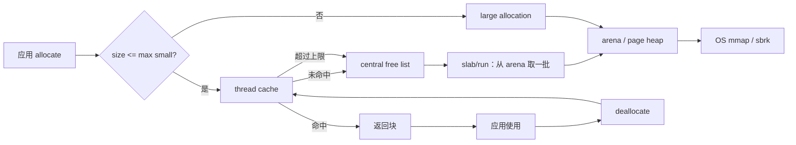

# Day 05 · 内存分配器：malloc 为什么会成为瓶颈

> **一句话结论**：通用分配器慢，通常不是“分配一个块”本身慢，而是它背后的**全局锁、元数据、碎片和 cache miss**。jemalloc / tcmalloc / mimalloc 的核心，不是把 `malloc` 写得更花，而是把“分配”拆成 **size class → slab → thread cache → central → arena** 的多级结构，让大多数请求在本地完成。

---

## 0. 本次问题

1. `malloc(64)` 到底做了什么？为什么多线程下会变慢？
2. 为什么需要 size class？它和“碎片”是什么关系？
3. slab/run 是什么？为什么一次向 OS 要一大块，再切成小块？
4. thread cache 为什么能避免锁？它什么时候会把内存还回去？
5. jemalloc、tcmalloc、mimalloc 的结构有什么共同点？
6. 自己写一个 size-class allocator，最小正确实现需要哪些边界？
7. 为什么“自研分配器 benchmark 比 `operator new` 慢”不一定是失败？

---

## 1. 设计背景：分配器的四个敌人

### 1.1 敌人一：全局锁

最朴素的分配器有一个全局空闲链表：

```text
allocate:
  lock(global)
  pop a block
  unlock

deallocate:
  lock(global)
  push a block
  unlock
```

单线程时很快；多线程时，所有线程都排队抢同一把锁。核数越多，锁和 cache line 争用越严重。

### 1.2 敌人二：元数据

每个分配块都需要知道“它有多大、属于哪个 bin、是否空闲”。常见做法：

- 块头（header）存 size/class；
- 页级 bitmap/span 记录哪些块被占用；
- 空闲链表指针存在块内部。

元数据越小，内存开销越低；但元数据越少，释放时越难定位“这个块属于哪个 size class”。这就是**空间 vs 查找成本**的取舍。

### 1.3 敌人三：碎片

| 类型 | 含义 | 例子 |
|---|---|---|
| 内部碎片 | 分配了 65 B，实际给了 80 B 的块 | size class 向上取整 |
| 外部碎片 | 空闲内存总量够，但被切碎，无法满足大请求 | 大量不同大小、交错释放 |
| 元数据碎片 | header/bitmap/span 本身占空间 | 每块一个 32 B header |

分配器的目标不是“零碎片”，而是**在目标负载下把碎片控制在可接受范围**。jemalloc 的很多设计（arena、size class、decay）都是在处理这个问题。

### 1.4 敌人四：cache/NUMA 局部性

一个线程分配的对象，最好在它所在的 CPU/NUMA 节点上使用。如果内存来自远端 NUMA 节点，访问延迟会显著上升。分配器需要：

- 每线程/每 CPU 缓存；
- arena 与 CPU/NUMA 的映射；
- 避免多个线程反复“偷”同一块内存，造成 cache line 抖动。

---

## 2. 总体架构：多级分配

现代分配器通常是这样的层次：



关键层次：

1. **size class**：把请求映射到固定尺寸；
2. **slab/run**：一次申请一批页，切成同尺寸块；
3. **thread cache**：每线程每尺寸一条空闲链表，命中时无锁；
4. **central free list**：线程缓存不足/溢出时交换；
5. **arena/page heap**：管理页、span、大块内存；
6. **OS**：`mmap`/`sbrk`/`VirtualAlloc`。

---

## 3. 主流分配器的共同结构

### 3.1 jemalloc

> 阅读入口：[`jemalloc`](https://github.com/jemalloc/jemalloc)、`src/jemalloc.c`、`include/jemalloc/internal/tcache_inlines.h`、`src/arena.c`、`src/bin.c`。

jemalloc 的核心概念：

- **size class**：把请求向上取整到一组固定尺寸；
- **arena**：一组页的管理域，多个 arena 降低全局竞争；
- **bin**：每个 arena 中按 size class 管理的空闲 run；
- **run/extent**：一组连续页，切成同尺寸块；
- **tcache**：每线程缓存，保存每个 size class 的空闲块；
- **decay**：把长时间不用的 dirty page 还给 OS；
- **background thread**：异步回收/整理。

分配路径（简化）：

```text
small:
  tcache bin 有块 -> 直接返回（无锁）
  否则 -> arena bin 取一批 -> 填充 tcache
large:
  arena 分配 extent（页级）
huge:
  直接 mmap / 独立管理
```

jemalloc 的设计重点：

- 多 arena 降低多线程竞争；
- size class 控制内部碎片；
- tcache 把大部分 small allocation 变成线程本地操作；
- decay/background thread 控制 RSS，避免“分配器占着内存不还”。

### 3.2 tcmalloc

> 阅读入口：[`tcmalloc`](https://github.com/google/tcmalloc)、`tcmalloc/thread_cache.cc`、`tcmalloc/central_freelist.cc`、`tcmalloc/page_heap.cc`。

tcmalloc 的结构与 jemalloc 类似：

```text
ThreadCache（每线程、每 size class）
  -> CentralFreeList（每 size class）
      -> PageHeap / spans（页级）
          -> OS
```

关键点：

- 每个线程有 `ThreadCache`，小对象分配通常无锁；
- 每个 size class 有 `CentralFreeList`，负责跨线程的块交换；
- `PageHeap` 管理 span（连续页），负责向 OS 要页和归还；
- 新版本支持 **per-CPU mode**，把缓存从“每线程”推进到“每 CPU”，进一步减少线程迁移带来的缓存失效；
- 大对象走 page heap，避免小块路径。

tcmalloc 的经典目标是“快速的多线程 malloc”，尤其适合大量小对象、分配密集的服务。

### 3.3 mimalloc

> 阅读入口：[`mimalloc`](https://github.com/microsoft/mimalloc)、`src/alloc.c`、`src/segment.c`。

mimalloc 的设计关键词：

- **free list sharding**：把空闲链表分片，降低竞争；
- **segment**：大块内存段，内部管理页和块；
- **per-thread heap**：线程本地堆；
- **eager/lazy purge**：控制内存归还；
- **secure mode**：加密/校验空闲链表，抵抗部分堆利用。

它和 jemalloc/tcmalloc 共享同一组思想：size class、线程本地缓存、页/段管理、批量交换。

### 3.4 glibc malloc

glibc 的 `malloc` 也有：

- **arena**：多线程下每个线程倾向使用某个 arena；
- **tcache**：每线程小对象缓存（glibc 2.26+）；
- **bins**：small/large/unsorted bins；
- **mmap threshold**：大块直接 mmap。

所以“系统 malloc”并不是一个简单的全局链表；现代 libc 已经吸收了很多分配器设计。自研分配器的价值，通常在于**特定负载、可观测性、隔离、NUMA/安全**，而不是“系统 malloc 一定慢”。

---

## 4. 关键设计技巧

### 技巧 1：size class 把“任意大小”变成“有限尺寸”

**做法**：把请求向上取整到一组固定尺寸，例如 16/32/48/64/.../4096。

**为什么有效**：

- 分配/释放只需要 O(1) 查表；
- 同尺寸块可以复用，空闲链表简单；
- slab 可以按固定块大小切分，元数据少。

**代价**：内部碎片。65 B 的请求可能拿到 80 B；极端情况下接近 2×。size class 越细，碎片越小，但类别越多、元数据/缓存越多。

**适用边界**：小对象、分配密集、生命周期多样的场景。大对象通常直接走页级分配。

### 技巧 2：slab/run 批量管理同尺寸块

**做法**：一次向 OS/arena 申请一批页，切成 N 个同尺寸块；用一个 header 或 bitmap 记录分配状态。

**为什么有效**：

- 避免每块一次 `malloc` 元数据；
- 同 slab 内块大小一致，释放时容易定位 class；
- 批量申请/释放摊薄系统调用。

**代价**：slab 内碎片、跨 slab 的空闲块难以合并；需要额外的 slab 元数据。

**适用边界**：固定大小对象池、内核 slab、用户态 size-class allocator。

### 技巧 3：thread cache 把全局锁变成线程本地操作

**做法**：每个线程为每个 size class 维护一条空闲链表；分配先看本地，释放先回本地；本地不足/过多时与 central 批量交换。

**为什么有效**：

- 绝大多数 small allocation 不需要锁；
- 批量 refill/flush 摊薄 central 竞争；
- 线程复用自己的块，cache 局部性好。

**代价**：

- 每线程缓存会占内存，线程多时放大；
- 线程退出要 flush，否则内存滞留；
- 线程迁移/NUMA 可能让缓存变成远端内存；
- 缓存上限需要调参。

**适用边界**：多线程、分配密集的服务。单线程或低分配率未必划算。

### 技巧 4：central free list 做批量交换

**做法**：central 按 size class 维护全局空闲链表；tcache 一次取一批（如 32），溢出时批量还回。

**为什么有效**：把“每次分配一次锁”变成“每 32 次分配一次锁”，显著降低竞争。

**代价**：central 仍是竞争点；批量大小影响内存滞留和延迟；需要处理线程退出、跨线程释放。

**适用边界**：所有带 tcache 的分配器。进一步可以用 per-CPU cache、lock-free stack、sharded central 降低竞争。

### 技巧 5：大对象走页级路径

**做法**：超过最大 size class 的请求直接向 arena/page heap 申请连续页，或 `mmap`。

**为什么有效**：大对象复制/切分的成本高；页级分配避免小块元数据；可以直接 `madvise`/`munmap` 归还。

**代价**：页级碎片、对齐、TLB；频繁大块分配会触发系统调用。

**适用边界**：大 buffer、文件缓存、列式内存。小对象不要走大块路径。

### 技巧 6：把“归还 OS”当成独立策略

**做法**：区分 `free`（应用释放）和 `purge/decay`（真正还给 OS）；按时间/压力/后台线程决定。

**为什么有效**：频繁 `munmap` 会让下一次分配重新缺页；完全不还则 RSS 只涨不降。分离两者可以兼顾性能和内存。

**代价**：RSS 滞后、策略复杂、需要监控。

**适用边界**：长时间运行的服务、容器内存限制、多租户。

---

## 5. 反例与边界

| 看起来对的用法 | 实际问题 | 正确做法 |
|---|---|---|
| 所有分配都套一层自研池 | 大对象/长生命周期对象浪费；增加复杂度 | 按对象生命周期/大小分层 |
| thread cache 无上限 | 线程多时内存暴涨 | 设置缓存上限 + 线程退出 flush |
| size class 越细越好 | 类别多、元数据多、cache 命中下降 | 按分配分布选择，测量内部碎片 |
| 用 `malloc`/`new` 混用 | 跨 CRT/模块释放崩溃 | 同一模块分配/释放；使用匹配 API |
| 自定义 allocator 不做对齐 | SIMD/原子/缓存行类型崩溃或变慢 | 支持 `alignof(T)`/过对齐 |
| 认为分配器能防住 UAF | 分配器不是安全检查器 | 用 ASan/guard page/隔离，别依赖 |
| 单线程 benchmark 快就上线 | 多线程/NUMA/碎片下可能反转 | 真实负载 + 多线程 + 长稳测试 |
| 频繁 `munmap` 小对象 | 系统调用/缺页成本高 | 批量回收/decay |
| 在信号处理里 `malloc` | 非异步信号安全，可能死锁 | 预分配/无锁池 |
| 不做双重释放检测 | 空闲链表被破坏，后续崩溃 | 调试模式 canary/隔离，生产权衡 |

### 压力下会发生什么

- **多线程分配风暴**：central 锁成为瓶颈；tcache 命中率下降；分配延迟抖动。
- **内存碎片**：RSS 高但可用内存少；大块分配失败/触发 OS OOM。
- **线程频繁创建/销毁**：tcache 反复 flush/refill，失去本地性；线程池可缓解。
- **线程迁移/NUMA**：对象在远端节点，访问延迟上升；per-CPU/NUMA-aware 分配。
- **长稳运行**：slab 不归还、tcache 滞留、decay 不及时，RSS 慢慢上涨。
- **堆破坏**：越界/双重释放不会立刻崩，而是在下一次分配时炸；需要调试工具。

---

## 6. C++20 最小实现

完整代码在 [`code/`](code/)：

- [`size_class_allocator.hpp`](code/size_class_allocator.hpp)：size class + slab + thread cache + central；
- [`main.cpp`](code/main.cpp)：5 个行为测试 + 单线程微基准；
- [`CMakeLists.txt`](code/CMakeLists.txt)：构建配置。

### 6.1 结构

```text
allocate(size):
  size <= 4096?
    ├─ 是：查 size class
    │    ├─ thread cache 有块 -> pop 返回
    │    └─ 没有 -> central refill 一批
    └─ 否：operator new(header + size)

deallocate(ptr):
  header 在 ptr 前 16 B
    ├─ large -> operator delete(header)
    └─ small -> push 到 thread cache
         └─ 超过上限 -> flush 一半到 central
```

块布局：

```text
+----------------+---------------------------+
| Header (16 B)  | user payload              |
+----------------+---------------------------+
^                ^
block base       allocate() 返回的指针（16 B 对齐）
```

Header：

```cpp
struct Header {
    std::uint64_t magic;       // 调试校验
    std::uint32_t class_index; // small class / kLargeClass
    std::uint32_t requested;   // 原始请求大小
};
static_assert(sizeof(Header) == 16);
```

### 6.2 size class 与 slab

```cpp
static constexpr std::array<std::size_t, 17> kSizes = {
    16,  32,  48,  64,  80,   96,   128, 160, 192,
    256, 320, 384, 512, 768, 1024, 2048, 4096,
};
```

每个 class 的块大小：

```cpp
block_size = round_up(kHeaderSize + kSizes[i], 16);
```

一次 slab 的块数：

```cpp
count = max(1, 64 KiB / block_size);
bytes = count * block_size;
```

slab 的收益：

- 一次 `operator new` 拿 64 KiB，切成上千个 32 B 块；
- 每块只需要 16 B header，不需要单独 `malloc` 元数据；
- 同 slab 内块大小一致，释放时通过 header 找到 class。

代价：

- slab 不归还 OS（本实现），RSS 会保留；
- 不同 class 的 slab 不能互相复用；
- 内部碎片由 size class 决定。

### 6.3 thread cache

```cpp
struct ThreadCache {
    std::array<FreeNode*, kNumClasses> heads;
    std::array<std::uint32_t, kNumClasses> counts;

    ThreadCache() : heads{}, counts{} {}
    ~ThreadCache() {
        SizeClassAllocator::instance().flush_cache(*this);
    }
};
```

分配：

```cpp
auto& cache = thread_cache();
if (cache.heads[index] == nullptr) {
    refill(cache, index);  // central -> cache，一次 32 个
}

FreeNode* node = cache.heads[index];
cache.heads[index] = node->next;
--cache.counts[index];
```

释放：

```cpp
node->next = cache.heads[index];
cache.heads[index] = node;
++cache.counts[index];

if (cache.counts[index] > kCacheLimit) {
    flush_class(cache, index, cache.counts[index] / 2);
}
```

关键参数：

```text
kBatch = 32         // 一次 refill 取多少
kCacheLimit = 128   // 每 class 缓存上限
```

调参方向：

- batch 太小 -> central 锁频繁；
- batch 太大 -> 单次延迟高、内存滞留；
- cache limit 太小 -> 频繁 flush，失去本地性；
- cache limit 太大 -> 线程多时内存放大。

### 6.4 central free list

```cpp
void refill(ThreadCache& cache, std::size_t index) {
    std::lock_guard<std::mutex> lock(classes_[index].mutex);
    auto& state = classes_[index];

    if (state.free_list == nullptr) {
        add_slab(index);
    }

    const auto count = std::min(kBatch, state.free_count);
    for (std::size_t i = 0; i < count; ++i) {
        FreeNode* node = state.free_list;
        state.free_list = node->next;
        --state.free_count;

        node->next = cache.heads[index];
        cache.heads[index] = node;
        ++cache.counts[index];
    }
}
```

这里用 `std::mutex`，教学上足够；生产会考虑：

- 每 class 一把锁，还是分片锁；
- lock-free stack + ABA 处理；
- per-CPU central；
- 批量 refill/flush 的无锁协议。

### 6.5 线程缓存的生命周期

这部分很容易被忽略。示例把 `ThreadCache` 放在堆上，TLS 里只保存一个很小的 holder：

```cpp
static ThreadCache& thread_cache() {
    struct CacheHolder {
        ThreadCache* cache = new ThreadCache();
        ~CacheHolder() { delete cache; }
    };
    static thread_local CacheHolder holder;
    return *holder.cache;
}
```

为什么？

- 线程退出时要 flush tcache，否则块会滞留在已结束线程的缓存里；
- 线程局部对象的析构时机受平台/运行时影响；
- 把较大的 `ThreadCache` 放堆上，TLS 只保存 holder，可以缩小“TLS 析构阶段对象存储被覆盖”的风险；
- 生产实现通常有更严格的 TLS/线程退出协议。

> 这是本课调试时踩到的一个真实问题：直接把 `ThreadCache` 作为 `thread_local` 大对象，在 MinGW 下线程退出时析构读到了被覆盖的链表。改成“TLS 只放 holder，缓存放堆上”后稳定。**分配器的正确性很大程度上是生命周期正确性。**

### 6.6 大对象 fallback

```cpp
void* allocate_large(std::size_t size) {
    if (size > UINT32_MAX) throw std::bad_alloc();
    void* raw = ::operator new(kHeaderSize + size);
    auto* header = static_cast<Header*>(raw);
    header->magic = kMagic;
    header->class_index = kLargeClass;
    header->requested = static_cast<std::uint32_t>(size);
    return static_cast<char*>(raw) + kHeaderSize;
}
```

大对象直接走 `operator new`，避免小块路径的 slab 元数据。生产实现会用 `mmap`/`VirtualAlloc`、页对齐、`madvise`。

### 6.7 测试与基准

```bash
cmake -S . -B build -G Ninja
cmake --build build
ctest --test-dir build --output-on-failure
# 或
./build/size_class_allocator_demo
```

Windows（PowerShell）：

```powershell
cmake -S . -B build -G Ninja -DCMAKE_CXX_COMPILER=g++
cmake --build build
.\build\size_class_allocator_demo.exe
```

实测输出（本机示例，数值仅示意）：

```text
[  OK  ] basic
[  OK  ] size_classes_and_reuse
[  OK  ] large_allocation
[  OK  ] multithreaded
[  OK  ] stats

All 5 tests passed.
micro-benchmark (single thread, 64 B alloc+free):
  size-class allocator: 62 ns/op
  operator new/delete:  22 ns/op
```

这个结果很重要：**单线程下，系统 `operator new` 比我们的教学分配器快**。原因包括：

- Windows 堆本身有 fast path；
- 我们的实现有 header、class 查表、TLS 访问、cache 上限判断；
- 单线程没有 central 锁竞争，tcache 的优势发挥不出来；
- 我们的 slab 不释放，benchmark 也没有真实分配模式。

这不代表 size-class allocator 没价值，而是说明：

> **分配器优化必须针对负载。** 多线程竞争、碎片、NUMA、可观测性、隔离，才是自研分配器的主要收益来源；“我写了一个 allocator”本身不是。

生产级 allocator 还会用：

- 无锁/per-CPU central；
- 更细的 size class、批量 refill；
- span/页级管理；
- NUMA-aware arena；
- 后台 decay/purge；
- 安全加固（canary、quarantine、freelist 加密）。

### 6.8 生产化缺口

- slab 不归还 OS，RSS 会保留；
- 没有页级合并/外部碎片整理；
- 只有 16 B 对齐，不支持过对齐类型；
- 双重释放只做 magic 校验，错误指针仍可能 UB；
- central 用互斥锁，不是 per-CPU/lock-free；
- 没有统计 tcache 命中率、central 等待、碎片；
- 没有 `madvise`/decay；
- 没有 NUMA/arena 映射；
- 没有安全加固；
- 没有和 `std::pmr`/全局 `operator new` 集成。

---

## 7. 如何借鉴到自己的项目

### 7.1 模式卡片

```text
模式名称：size class + slab + thread cache
解决什么问题：大量小对象分配/释放时的锁竞争、元数据和碎片。
核心机制：
  1. 请求映射到固定 size class；
  2. slab 批量切块；
  3. thread cache 本地命中；
  4. central 批量交换；
  5. 大对象走页级/系统分配。
代价/限制：
  - 内部碎片；
  - 线程缓存内存滞留；
  - 生命周期/线程退出复杂；
  - 单线程未必比系统 malloc 快。
不适用场景：
  - 少量大对象/一次性分配；
  - 分配模式简单、系统 malloc 已足够；
  - 无法控制跨模块释放边界。
一个最小例子：本课的 SizeClassAllocator。
```

### 7.2 接口清单

```text
[ ] 分配/释放是否在同一模块/CRT 边界？
[ ] 对齐要求是什么？支持 over-aligned 吗？
[ ] 小对象/大对象的分界在哪里？
[ ] size class 的依据是实测分配分布吗？
[ ] thread cache 上限、batch 大小是否压测过？
[ ] 线程退出时缓存如何 flush？
[ ] central 竞争如何观测/分片？
[ ] 内存如何归还 OS？RSS 目标是什么？
[ ] 是否支持 NUMA/arena/租户隔离？
[ ] 双重释放/UAF 的检测策略是什么？
[ ] 是否有分配延迟、命中率、碎片指标？
```

### 7.3 迁移步骤

1. **先量**：分配大小分布、线程数、分配率、p99 延迟、RSS、碎片。
2. **判断瓶颈**：是锁、系统调用、碎片，还是 cache/NUMA？
3. **优先用成熟分配器**：jemalloc/tcmalloc/mimalloc；先替换全局分配器，量收益。
4. **再做专用池**：只对热点对象/固定生命周期使用 slab/pool。
5. **加观测**：分配延迟、tcache 命中率、central 等待、RSS、碎片。
6. **做长稳/故障测试**：多线程、线程频繁退出、内存压力、OOM。

---

## 8. 练习

**基础**

1. 给 allocator 增加 `size_class_index(size)` 的直方图，统计每个 class 的分配次数和内部碎片。
2. 调整 `kBatch`/`kCacheLimit`，压测吞吐和 RSS，画出取舍曲线。
3. 用 `std::pmr::memory_resource` 包装这个 allocator，接入 `std::pmr::vector`。

**进阶**

1. 实现 slab 归还：当某个 class 的 slab 全空时，把整块还给 OS；注意 tcache 中还可能持有块。
2. 把 central 换成 lock-free stack，处理 ABA 和内存序；对比 mutex 版本的 p99。
3. 支持 64/128 字节过对齐分配，并验证 `alignof(std::max_align_t)` 以上类型。

**挑战**

1. 实现 per-CPU cache（或 per-NUMA arena），在多线程 + 线程迁移下比较吞吐和远端访问。
2. 做一个“分配器压测 + 碎片可视化”：随机分配/释放、长稳运行，统计 RSS 与可用大块。
3. 对比 jemalloc/tcmalloc/mimalloc/系统 malloc 在真实服务负载下的 p99、RSS、碎片；不要只用微基准。

---

## 9. 自测题

<details>
<summary>点击展开答案</summary>

**1. 为什么 size class 能加速分配？**

请求被映射到有限的固定尺寸，分配/释放只需查表和对空闲链表操作，不需要在任意大小中搜索合适的块；slab 也可以按固定大小切分，元数据更简单。代价是内部碎片。

**2. slab 的作用是什么？**

一次向 OS/arena 申请一批连续页，切成多个同尺寸块，避免每块一次系统分配和复杂元数据；同 slab 的块大小一致，释放时容易定位 class。代价是 slab 内碎片和跨 slab 合并困难。

**3. thread cache 为什么能避免锁？**

每个线程有本地空闲链表，分配/释放先操作本地；只有缓存不足/溢出时才与 central 批量交换。绝大多数 small allocation 不需要全局锁。代价是内存滞留、线程退出 flush、NUMA/迁移问题。

**4. 为什么还需要 central free list？**

线程缓存不能无限大，而且块可能在不同线程间流动；central 按 size class 管理全局空闲块，负责批量 refill/flush。它是 tcache 的后备层，也是跨线程回收的汇合点。

**5. 大对象为什么不走 size class？**

大对象的块很大，切分/缓存成本高；数量通常少，直接走页级分配/`mmap` 更简单，也更容易归还 OS。size class 主要针对大量小对象。

**6. 内部碎片和外部碎片有什么区别？**

内部碎片是“分配块比请求大”浪费的空间（size class 向上取整）；外部碎片是“总空闲够，但分散在不同 slab/页，无法满足大请求”。两者需要不同策略：size class 调细/调粗 vs 页级合并/arena。

**7. 为什么自研分配器单线程 benchmark 可能比 `operator new` 慢？**

系统分配器有高度优化的 fast path；自研实现有 header、查表、TLS、缓存判断等额外开销。单线程没有锁竞争，tcache 优势不明显。自研分配器的价值通常在多线程、碎片、NUMA、隔离和可观测性。

**8. 线程退出时为什么必须处理 thread cache？**

否则缓存中的空闲块会滞留在已结束线程的 TLS 中，既不能复用也不能归还，造成内存泄漏/ RSS 上涨。需要 flush 到 central，并处理析构顺序。

</details>

---

## 10. 模式卡片

```text
模式名称：多级 size-class 分配器
解决什么问题：小对象高频分配下的锁竞争、元数据开销和碎片。
核心机制：
  1. size class；
  2. slab/run 批量切块；
  3. 每线程缓存；
  4. central 批量交换；
  5. 大对象页级 fallback。
代价/限制：
  - 内部碎片；
  - 缓存滞留；
  - 线程生命周期复杂；
  - 单线程未必更快。
不适用场景：
  - 少量大对象；
  - 简单生命周期；
  - 跨模块释放边界不清。
一个最小例子：本课的 SizeClassAllocator。
```

---

## 11. 下次预习

下一次进入 **无锁环形队列 / Disruptor**。带着三个问题读：

1. RingBuffer 如何在没有锁的情况下协调生产者和消费者？
2. sequence、gating、memory barrier 分别解决什么问题？
3. 为什么 cache line padding 和批量发布能显著降低争用？

阅读入口：LMAX Disruptor `RingBuffer`、`Sequencer`、`SequenceBarrier`、`BatchEventProcessor`；对照 C++ 的 `rigtorp/SPSCQueue`、`moodycamel::ConcurrentQueue`，以及 Rust 的 `crossbeam`/`rtrb`。

---

## 参考资料

- jemalloc, [`jemalloc`](https://github.com/jemalloc/jemalloc)：arena、bin、tcache、decay。
- jemalloc, [`tcache_inlines.h`](https://github.com/jemalloc/jemalloc/blob/dev/include/jemalloc/internal/tcache_inlines.h)：线程缓存快路径。
- tcmalloc, [`thread_cache.cc`](https://github.com/google/tcmalloc/blob/master/tcmalloc/thread_cache.cc)、[`central_freelist.cc`](https://github.com/google/tcmalloc/blob/master/tcmalloc/central_freelist.cc)：thread cache / central free list。
- mimalloc, [`mimalloc`](https://github.com/microsoft/mimalloc)：free list sharding、segment、secure mode。
- glibc, [`malloc`](https://sourceware.org/glibc/wiki/MallocInternals)：arena、tcache、bins。
- C++ reference：[`operator new`](https://en.cppreference.com/w/cpp/memory/new/operator_new)、[`std::pmr::memory_resource`](https://en.cppreference.com/w/cpp/memory/memory_resource)。
- 《What Every Programmer Should Know About Memory》Ulrich Drepper：cache/NUMA 基础。
