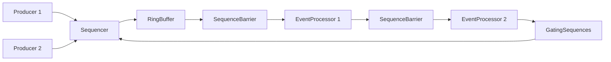

# Day 06 · 无锁环形队列：Disruptor 的机械同情

> **一句话结论**：Disruptor 快，不是因为它“没有锁”，而是因为它把并发协议压缩成几个**单调递增的 sequence + 预分配槽位 + 内存屏障 + 批量发布/消费**，让生产者和消费者尽量在自己的 cache line 上工作。

---

## 0. 本次问题

1. 环形队列为什么用 `index & (capacity - 1)` 而不是 `%`？
2. `sequence` 和数组下标有什么区别？为什么不能只维护 head/tail？
3. 生产者如何知道“这个槽位还没被消费者处理完”，不能覆盖？
4. 消费者如何知道“数据已经写完”，不会读到半成品？
5. `release`/`acquire` 在发布和消费中分别保护什么？
6. cache line padding 为什么能显著影响吞吐？
7. LMAX Disruptor 的 gating/SequenceBarrier 和普通无锁队列有什么不同？
8. 为什么“无锁”不等于“更快”，也不等于“无等待”？

---

## 1. 设计背景：锁队列的机械代价

一个最朴素的有界队列：

```cpp
std::mutex m;
std::condition_variable cv;
std::deque<T> q;

push(T v) {
    lock_guard lock(m);
    q.push_back(std::move(v));
    cv.notify_one();
}

pop(T& out) {
    unique_lock lock(m);
    cv.wait(lock, [&] { return !q.empty(); });
    out = std::move(q.front());
    q.pop_front();
}
```

它有几种成本：

- **锁竞争**：生产者和消费者抢同一把锁；
- **上下文切换**：条件变量唤醒/睡眠；
- **cache line 抖动**：head/tail/count 在同一 cache line，多个核心反复写；
- **内存分配**：每个节点一次 `new`，cache locality 差；
- **不可预测的尾延迟**：锁排队、调度器介入。

对于高频交易、日志、事件总线这类**事件小、速率高、消费者固定**的场景，这些成本会盖过“队列逻辑本身”。

Disruptor 的思路：

```text
预分配一个环
生产者：claim 一个 sequence -> 写槽位 -> publish
消费者：等待 sequence -> 读槽位 -> 更新消费 sequence
```

没有链表节点分配，没有全局锁，只有原子变量和内存屏障。

---

## 2. 环形缓冲的基本结构

```text
capacity = 8, mask = 7

slot:     0     1     2     3     4     5     6     7
index:   [ ]   [ ]   [ ]   [ ]   [ ]   [ ]   [ ]   [ ]
sequence: 0     1     2     3     4     5     6     7
```

生产/消费位置是**单调递增的 sequence**，不是环下标：

```text
sequence 8  -> slot 0
sequence 9  -> slot 1
sequence 10 -> slot 2
```

所以：

```text
slot = sequence & (capacity - 1)
```

为什么容量必须是 2 的幂？

- 位掩码比整数除法快；
- `sequence & mask` 在硬件上是一条简单指令；
- 环形回绕不需要分支。

代价：容量只能是 2、4、8、16……；不能精确设置成 1000。

---

## 3. 三个核心问题

### 3.1 生产者不能覆盖未消费的槽位

假设 capacity=8，生产者已经写到 sequence 20，消费者只处理到 12。下一个 sequence 21 对应的 slot 是 5，但 slot 5 里可能还有 sequence 13 的数据（如果消费者落后超过一圈）。

生产者必须知道：

```text
sequence - slowest_consumer_sequence <= capacity
```

否则就要等待/拒绝。这个“最慢消费者”就是 **gating**。

### 3.2 消费者不能读到半成品

生产者写槽位分两步：

```text
1. 写 data
2. 发布 sequence（release）
```

消费者：

```text
1. 等待 sequence 可见（acquire）
2. 读 data
```

如果顺序反了，消费者可能看到“sequence 已发布，但 data 还没写完”的槽位。`release/acquire` 建立 happens-before：

```text
producer: data write -> sequence.store(release)
consumer: sequence.load(acquire) -> data read
```

### 3.3 生产者和消费者要批量推进

如果每处理一条消息就更新一次 sequence：

- 原子写多；
- cache line 抖动；
- 消费者每次只处理一个，系统调用/分支开销高。

Disruptor 的 `BatchEventProcessor` 会一次拿到“当前可用到的最大 sequence”，批量处理，再更新一次消费进度。

---

## 4. LMAX Disruptor 的完整模型

Disruptor 不只是一个 ring，它是一套**并发拓扑**：



核心对象：

| 对象 | 作用 |
|---|---|
| `RingBuffer` | 预分配的事件槽位数组 |
| `Sequencer` | 分配/发布 sequence，维护生产者游标 |
| `Sequence` | 单调递增的进度（生产者/消费者） |
| `SequenceBarrier` | 消费者等待某个 sequence 可见 |
| `EventProcessor` | 批量消费事件，更新 sequence |
| `WaitStrategy` | 没数据时怎么等（Block/Sleep/Yield/BusySpin） |
| gating sequences | 最慢消费者，限制生产者不能覆盖 |

### 4.1 Sequencer

- `SingleProducerSequencer`：只有一个生产者，协议最简单；
- `MultiProducerSequencer`：多个生产者用 CAS 分配 sequence，并维护 published 标记，消费者只能读到连续已发布区间。

生产者：

```text
next = sequencer.next()       // 分配一个/一批 sequence
ringBuffer.get(next).set(...) // 填事件
sequencer.publish(next)       // 发布
```

消费者：

```text
available = barrier.waitFor(nextSequence)
for seq in nextSequence..available:
    handler.onEvent(ring[seq & mask], seq, endOfBatch)
```

### 4.2 gating

生产者分配新 sequence 前，会检查所有 gating sequence：

```text
wrapPoint = next - capacity
if wrapPoint > min(gatingSequences):
    // 消费者还没处理到，不能覆盖
    spin / wait
```

这就是“环形队列不覆盖未消费数据”的核心。

### 4.3 WaitStrategy

消费者没数据时：

| 策略 | 行为 | 适用 |
|---|---|---|
| `BlockingWaitStrategy` | 锁 + 条件变量 | CPU 敏感、延迟不极端 |
| `SleepingWaitStrategy` | 自旋 + `parkNanos` | 平衡 |
| `YieldingWaitStrategy` | 自旋 + `Thread.yield` | 低延迟，占 CPU |
| `BusySpinWaitStrategy` | 纯自旋 | 极低延迟，绑核 |
| `TimeoutBlockingWaitStrategy` | 带超时的阻塞 | 需要退出/超时 |

选择 wait strategy 就是选择“延迟 vs CPU”的取舍。

### 4.4 机械同情

Disruptor 的“机械同情”（mechanical sympathy）包括：

- 预分配事件，避免 per-event 分配；
- 顺序访问 ring，cache 友好；
- sequence 字段 padding 到独立 cache line，避免 false sharing；
- 批量发布/消费，减少原子操作；
- 用内存屏障而不是锁；
- 生产者/消费者尽量在自己的核上工作。

---

## 5. 实现取舍：为什么本课不直接复刻 Disruptor

完整 Disruptor 包含：

- 单/多生产者 sequencer；
- 消费者依赖图（gating）；
- 多种 event processor；
- 多种 wait strategy；
- 生命周期/异常处理；
- 预分配事件对象和 `EventFactory`。

把这些全塞进一个 C++ 示例，会让“sequence/内存序/cache line”这三个核心机制被框架细节淹没。

所以本课实现一个**更小的有界无锁环形队列**：

- 支持 MPSC/MPMC；
- 每个 slot 一个 sequence；
- 生产者/消费者用 CAS 推进位置；
- cache line padding；
- release/acquire 发布/消费；
- 自旋背压 + close。

它采用 Dmitry Vyukov 的 bounded MPMC queue 结构，不是 Disruptor 的完整 sequencer/barrier 模型，但能让你亲手处理：

```text
槽位何时可写？
数据何时可见？
生产者/消费者如何推进？
满了怎么办？
```

这些是 Disruptor 的地基。

---

## 6. C++20 实现

完整代码在 [`code/`](code/)：

- [`bounded_ring_buffer.hpp`](code/bounded_ring_buffer.hpp)：有界无锁环形队列；
- [`main.cpp`](code/main.cpp)：5 个行为测试；
- [`CMakeLists.txt`](code/CMakeLists.txt)：构建配置。

### 6.1 槽位与 padding

```cpp
struct alignas(64) PaddedIndex {
    std::atomic<std::size_t> value{0};
    char padding[64 - sizeof(std::atomic<std::size_t>)]{};
};

struct alignas(64) Cell {
    std::atomic<std::size_t> sequence{0};
    T data{};
};
```

- `PaddedIndex`：生产位置/消费位置各占一个 cache line；
- `Cell`：每个槽位的 sequence 和 data 从独立 cache line 开始；
- 代价：内存放大。capacity=1024 时，padding 可能比数据还大；但在高争用场景，cache line 抖动更贵。

### 6.2 初始化：每个 slot 的 sequence = 下标

```cpp
for (std::size_t i = 0; i < capacity_; ++i) {
    cells_[i].sequence.store(i, std::memory_order_relaxed);
}
```

为什么初始值不是 0？

- 生产者要判断“slot 是否可写”；
- 消费者要判断“slot 是否已发布”；
- 初始 sequence = i 让第一个生产者看到 `dif == 0`，表示可写。

### 6.3 入队：CAS 抢位置，写完再发布

```cpp
bool try_push_impl(T& value) {
    std::size_t pos = enqueue_pos_.value.load(std::memory_order_relaxed);

    for (;;) {
        Cell& cell = cells_[pos & mask_];
        const std::size_t seq =
            cell.sequence.load(std::memory_order_acquire);
        const auto diff = static_cast<std::ptrdiff_t>(seq) -
                          static_cast<std::ptrdiff_t>(pos);

        if (diff == 0) {
            if (enqueue_pos_.value.compare_exchange_weak(
                    pos, pos + 1, std::memory_order_relaxed)) {
                cell.data = std::move(value);
                cell.sequence.store(pos + 1, std::memory_order_release);
                return true;
            }
        } else if (diff < 0) {
            return false;  // 队列满
        } else {
            pos = enqueue_pos_.value.load(std::memory_order_relaxed);
        }
    }
}
```

关键点：

- `diff == 0`：slot 的 sequence 正好等于当前生产位置，说明可以写；
- `diff < 0`：slot 还没被消费者释放，队列满；
- `diff > 0`：另一个生产者已经推进了位置，重新读；
- CAS 成功后，**先写 data，再 release 发布 sequence**；
- 消费者 acquire 到 `seq+1`，才能安全读 data。

### 6.4 出队：等 sequence，读完再释放槽位

```cpp
bool try_pop(T& out) {
    std::size_t pos = dequeue_pos_.value.load(std::memory_order_relaxed);

    for (;;) {
        Cell& cell = cells_[pos & mask_];
        const std::size_t seq =
            cell.sequence.load(std::memory_order_acquire);
        const auto diff = static_cast<std::ptrdiff_t>(seq) -
                          static_cast<std::ptrdiff_t>(pos + 1);

        if (diff == 0) {
            if (dequeue_pos_.value.compare_exchange_weak(
                    pos, pos + 1, std::memory_order_relaxed)) {
                out = std::move(cell.data);
                cell.sequence.store(pos + capacity_,
                                    std::memory_order_release);
                return true;
            }
        } else if (diff < 0) {
            return false;  // 没有已发布数据
        } else {
            pos = dequeue_pos_.value.load(std::memory_order_relaxed);
        }
    }
}
```

关键点：

- 消费者等待 `seq == pos + 1`，表示生产者已发布；
- CAS 成功后，读 data，再把 slot 的 sequence 改成 `pos + capacity`，告诉生产者“这个槽位可以复用”；
- 先读 data，再 release 更新 sequence，避免生产者提前覆盖。

### 6.5 为什么容量至少是 2？

这个算法用 `pos + capacity` 表示“槽位已释放”。如果 capacity=1：

- 生产者写 slot 0，sequence 变成 1；
- 下一个生产者位置也是 1，看到 `seq == pos`，误以为可写；
- 消费者还没读，数据就被覆盖。

所以本实现要求：

```cpp
capacity >= 2 && (capacity & (capacity - 1)) == 0
```

这不是“环形队列不能为 1”，而是**这个 sequence 协议的最小容量约束**。很多 lock-free 队列都有类似的边界条件，必须写进契约。

### 6.6 自旋、关闭与背压

```cpp
bool push(T value) {
    for (;;) {
        if (try_push_impl(value)) return true;
        if (closed_.load(std::memory_order_acquire)) return false;
        std::this_thread::yield();
    }
}

bool pop(T& out) {
    for (;;) {
        if (try_pop(out)) return true;
        if (closed_.load(std::memory_order_acquire) && empty()) return false;
        std::this_thread::yield();
    }
}
```

- `try_push`/`try_pop` 不阻塞，适合自己实现等待策略；
- `push`/`pop` 自旋 + yield，适合教学/短临界区；
- 生产环境应换成 Block/Sleep/Yield/BusySpin 等等待策略，或接入事件循环；
- `close()` 让等待中的消费者退出；生产者关闭后拒绝新数据；
- 如果有生产者 claim 了槽位但崩溃，消费者可能永远等不到发布——lock-free 不等于 fault-tolerant。

### 6.7 测试

```bash
cmake -S . -B build -G Ninja
cmake --build build
ctest --test-dir build --output-on-failure
# 或
./build/ring_buffer_demo
```

Windows（PowerShell）：

```powershell
cmake -S . -B build -G Ninja -DCMAKE_CXX_COMPILER=g++
cmake --build build
.\build\ring_buffer_demo.exe
```

实测输出：

```text
[  OK  ] fifo_and_full
[  OK  ] wraparound
[  OK  ] mpsc
[  OK  ] mpmc
[  OK  ] backpressure_and_close

All 5 tests passed.
```

> 验证环境：Windows 11 + MinGW-w64 g++ 15.2 + CMake 4.2 + Ninja；`-std=c++20 -Wall -Wextra -Wpedantic -Werror` 编译通过，并重复运行 20 次无失败。

### 6.8 生产化缺口

- 没有 Disruptor 的 sequencer/SequenceBarrier/gating 依赖图；
- 没有批量 claim/publish，只有单条 CAS；
- 等待策略只有自旋/yield；
- 没有超时、取消、异常处理；
- `close()` 不处理 in-flight producer 崩溃；
- 没有 sequence 溢出/长时间运行测试（`size_t` 64 位下实际很难溢出）；
- 没有 NUMA/绑核；
- 没有 per-consumer 进度和动态消费者；
- 没有和异步日志框架集成；
- 没有 benchmark 对比 mutex 队列。

---

## 7. 反例与边界

| 看起来对的用法 | 实际问题 | 正确做法 |
|---|---|---|
| 容量不是 2 的幂 | 取模慢、索引计算复杂 | 向上取整到 2 的幂 |
| 只维护 head/tail，不做 gating | 生产者覆盖未消费数据 | 检查最慢消费者 sequence |
| 先发布 sequence 再写 data | 消费者读到半成品 | release 发布，acquire 消费 |
| 不加 padding | 生产/消费位置共享 cache line，性能抖动 | 对齐到 cache line |
| 用无锁队列做阻塞任务 | 消费者慢，生产者自旋烧 CPU | 有界 + 背压/阻塞策略 |
| 认为 lock-free = wait-free | CAS 可能一直失败/饥饿 | 明确 progress guarantee |
| 每条消息一次 CAS/sequence 更新 | 原子操作成为瓶颈 | 批量 claim/publish/consume |
| 生产环境用 `yield` 自旋 | CPU 占用高、尾延迟不可控 | Block/Sleep/BusySpin 按场景选 |
| 关闭时直接销毁 ring | 生产者/消费者访问已释放内存 | 先停止生产、drain、join、再销毁 |
| 以为无锁队列一定比 mutex 快 | 低争用/慢消费者下可能更慢 | 用真实负载 benchmark |

### 压力下会发生什么

- **生产者远快于消费者**：ring 满，`push` 自旋，CPU 打满；需要背压/丢弃/扩容。
- **消费者远快于生产者**：空轮询，CPU 浪费；需要 Block/Sleep wait strategy。
- **多生产者 CAS 冲突**：高争用下 CAS 失败率上升，吞吐下降；可考虑单生产者或分段 ring。
- **false sharing**：sequence/position 在同一 cache line，核间反复同步；padding 是必需项。
- **消费者崩溃/卡住**：gating 推进不了，生产者最终阻塞；需要超时/健康检查。
- **关闭竞争**：in-flight 生产者/消费者与 close 竞态；需要明确生命周期协议。

---

## 8. 如何借鉴到自己的项目

### 8.1 模式卡片

```text
模式名称：有界无锁环形队列（sequence + gating）
解决什么问题：高频小消息的生产者-消费者传输，避免锁和 per-event 分配。
核心机制：
  1. 2 的幂容量 + mask；
  2. 单调 sequence；
  3. 每 slot 发布状态；
  4. release/acquire；
  5. cache line padding；
  6. 有界背压 + 批量消费。
代价/限制：
  - 实现复杂，内存放大；
  - 无锁不等于无等待/公平；
  - 慢消费者/阻塞任务不适合；
  - 关闭/异常处理困难。
不适用场景：
  - 低频、粗粒度消息；
  - 需要优先级/严格公平；
  - 消费者可能长时间阻塞；
  - 团队没有并发测试能力。
一个最小例子：本课的 BoundedRingBuffer。
```

### 8.2 接口清单

```text
[ ] 容量是否 2 的幂？最小容量约束是什么？
[ ] 生产者是否会覆盖未消费槽位？gating 在哪里？
[ ] 发布/消费的内存序是否正确？
[ ] 生产/消费位置是否做了 cache line padding？
[ ] 队列满时是自旋、阻塞还是丢弃？
[ ] 消费者慢时如何背压/降级？
[ ] close/shutdown 如何唤醒等待者、处理 in-flight？
[ ] 是否有 MPSC/MPMC 的真实并发测试？
[ ] 是否有吞吐/p99/CPU 占用的 benchmark？
[ ] 是否真的需要无锁？mutex 队列是否已足够？
```

### 8.3 迁移步骤

1. **先量**：消息速率、消息大小、消费者数量、p99、CPU。
2. **先试成熟队列**：`moodycamel::ConcurrentQueue`、`rigtorp/SPSCQueue`、`crossbeam`、`rtrb`。
3. **确认瓶颈**：锁竞争、分配、false sharing，还是消费者处理慢？
4. **从小规模开始**：SPSC 优先；确实需要多生产者再上 MPSC/MPMC。
5. **做并发测试**：多生产者/消费者、关闭、回绕、长时间运行、压力。
6. **加可观测性**：队列深度、CAS 失败、自旋次数、消费延迟。

---

## 9. 练习

**基础**

1. 给 `BoundedRingBuffer` 增加 `try_pop_batch(std::span<T>, max)`，一次取多条。
2. 增加 `size_approx`、`empty`、`full` 的测试，观察并发下的近似语义。
3. 把 `push` 的自旋改成 `Sleep/Yield/BusySpin` 三种策略，压测 CPU 与延迟。

**进阶**

1. 实现单生产者版本 `SpscRingBuffer`，去掉生产者 CAS，比较大吞吐。
2. 实现 Disruptor 风格的 **gating**：多个消费者各自维护 sequence，生产者等待最慢消费者。
3. 增加批量 publish：生产者一次 claim 多个 sequence，写完统一发布；消费者批量处理。

**挑战**

1. 用这个 ring 替换 Day 04 异步日志的 `deque`，对比吞吐、p99、CPU 和丢弃行为。
2. 实现一个带超时的 `push_for`/`pop_for`，处理关闭和慢消费者。
3. 用 Rust 的 `crossbeam`/`rtrb` 或 C++ 的 `moodycamel::ConcurrentQueue` 做对照 benchmark，解释差异。

---

## 10. 自测题

<details>
<summary>点击展开答案</summary>

**1. 为什么容量要是 2 的幂？**

这样 `sequence & (capacity - 1)` 可以代替 `% capacity`，回绕无分支、指令更便宜。代价是容量不能任意设置。

**2. sequence 和数组下标有什么区别？**

sequence 单调递增，不随环回绕；下标是 `sequence & mask`。sequence 还承载“进度/发布/消费”的语义，是生产者和消费者协调的核心。

**3. 生产者如何避免覆盖未消费数据？**

检查最慢消费者的 sequence（gating）：如果 `next - capacity > slowest_consumer`，说明要覆盖的槽位还没被消费，必须等待或拒绝。Disruptor 用 gating sequences；本课用每个 slot 的 sequence 做类似判断。

**4. 为什么发布 sequence 要用 release，消费要用 acquire？**

release 保证“data 写在 sequence 之前”，acquire 保证“看到 sequence 后能读到 data”。没有这对内存序，消费者可能看到已发布的 sequence 但读到旧/半成品数据。

**5. cache line padding 解决什么问题？**

生产位置、消费位置、sequence 如果共享 cache line，多个核心写不同字段会互相使 cache line 失效（false sharing）。padding 让热点字段各自独占 cache line，代价是内存放大。

**6. Disruptor 的 gating 和普通无锁队列有什么不同？**

普通队列通常只维护 head/tail；Disruptor 显式维护多个消费者的 sequence（gating），生产者必须等最慢消费者推进后才能覆盖。它还支持消费者依赖图、批量处理和多种 wait strategy。

**7. lock-free 等于 wait-free 吗？**

不等于。lock-free 保证系统整体有进展，但某个线程可能一直 CAS 失败/饥饿；wait-free 保证每个线程在有限步内完成。无锁队列在高争用下仍可能很慢。

**8. 为什么本实现要求 capacity >= 2？**

sequence 协议用 `pos + capacity` 标记槽位释放。capacity=1 时，下一个生产位置与刚发布的 sequence 重合，生产者会误判槽位可写，覆盖未消费数据。最小容量是协议约束，不是环形数组本身的限制。

</details>

---

## 11. 模式卡片

```text
模式名称：sequence-based ring buffer
解决什么问题：高频消息的低延迟、无锁传输。
核心机制：
  1. 2 的幂 ring + mask；
  2. 单调 sequence；
  3. 每 slot 发布状态；
  4. release/acquire；
  5. cache line padding；
  6. 有界背压。
代价/限制：
  - 实现/测试复杂；
  - 内存放大；
  - 无锁不等于无等待；
  - 慢消费者会反噬。
不适用场景：
  - 低频/粗粒度消息；
  - 优先级/公平性要求；
  - 消费者可能阻塞；
  - 团队缺少并发测试能力。
一个最小例子：本课的 BoundedRingBuffer。
```

---

## 12. 下次预习

下一次是 **Day 07 · 周复盘：有界、可观测的执行器**。这次不再引入新工具，而是把前 6 天的东西拼起来：

- Day 01 的线程池：任务准入、拒绝、关闭；
- Day 03 的时间轮：超时/周期任务；
- Day 04 的异步日志：有界队列 + 批量消费；
- Day 06 的 ring：低延迟队列；
- 目标：一个能跑、能过载、能关闭、能观测的最小执行器。

带着三个问题：

1. 队列满了以后，线程池、日志、ring 分别让谁承担代价？
2. 关闭时，四种组件的顺序应该是什么？
3. 哪些指标能证明“系统在过载下仍然可预测”？

---

## 参考资料

- LMAX, [`Disruptor`](https://github.com/LMAX-Exchange/disruptor)：`RingBuffer`、`Sequencer`、`SequenceBarrier`、`BatchEventProcessor`。
- LMAX, [`Sequence.java`](https://github.com/LMAX-Exchange/disruptor/blob/master/src/main/java/com/lmax/disruptor/Sequence.java)：sequence 与 cache line padding。
- LMAX, [`RingBuffer.java`](https://github.com/LMAX-Exchange/disruptor/blob/master/src/main/java/com/lmax/disruptor/RingBuffer.java)：ring 结构与发布。
- Dmitry Vyukov, [Bounded MPMC queue](https://www.1024cores.net/home/lock-free-algorithms/queues/bounded-mpmc-queue)：本课 ring 的算法来源。
- `rigtorp/SPSCQueue`：C++ 单生产者单消费者 ring 参考。
- `moodycamel::ConcurrentQueue`：C++ 多生产者多消费者队列参考。
- Rust `crossbeam` / `rtrb`：Rust 生态的并发队列/环形缓冲对照。
- C++ reference：[`std::atomic` memory_order](https://en.cppreference.com/w/cpp/atomic/memory_order)。
