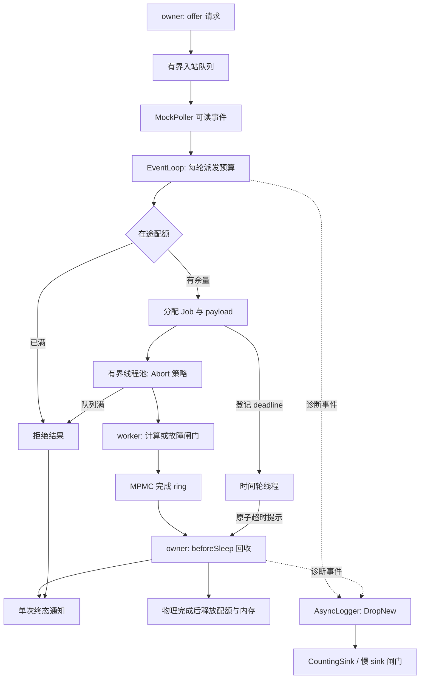

# Day 07 · 阶段实验：有界、可观测的任务处理管线

> 将前六课拼成一个能接收请求、执行工作、报告结果、承受过载并排空关闭的小系统。
>
> 实验假设：队列和在途数受限时，过载应表现为明确拒绝；超时只能结束响应，资源必须等任务实际结束后回收；诊断日志丢失不应丢失业务结果。

这是 W1 的综合实验，占原路线图中的 Day 07；Day 14 之后的工作坊 A 仍用于存储恢复。本实验直接引用前六课头文件，需在完整仓库中构建。

**交付状态：已于 2026-11-03 完成 MinGW-w64 x64 GCC 15.1.0 Debug 构建，CTest 7/7 通过。** 实际计数和证据边界见 [EXPERIMENT_REPORT.md](EXPERIMENT_REPORT.md)，原始场景输出见 [验证记录](verification/2026-11-03-mingw64-debug.txt)。下文仍保留运行前预测，方便你独立重做实验。

## 0. 先写预测

运行前先回答，实验后用指标核对：

1. 一个任务已经超时，为什么新的请求仍可能被在途配额拒绝？
2. 两个 worker 都完成了，但主循环还没消费 ring，此时任务资源归谁？
3. 日志 sink 被闸门卡住时，业务结果能不能先完成？
4. 如果先关闭结果队列、再等待 worker，可能丢失什么？
5. `offer()` 返回 true 后，任务还可能在哪些地方被拒绝？

## 1. 六个单元在同一条路径上的职责

| 单元 | 直接复用的实现 | 本实验中的职责 | 组合后需要处理的边界 |
|---|---|---|---|
| Day 01 线程池 | [BoundedThreadPool](../day-001-thread-pool/code/bounded_thread_pool.hpp) | 执行业务工作，满队列采用 Abort | Reactor 线程不能采用 CallerRuns 执行慢工作 |
| Day 02 事件循环 | [EventLoop / MockPoller](../day-002-redis-event-loop/code/event_loop.hpp) | 接收逻辑可读事件；beforeSleep 回收完成事件、观察超时 | EventLoop 只在 owner 线程操作；每轮有处理预算 |
| Day 03 时间轮 | [HashedWheelTimer](../day-003-timing-wheel/code/hashed_wheel_timer.hpp) | 为接纳任务设置超时提示 | timer 回调只写原子标志，不能做慢工作 |
| Day 04 异步日志 | [AsyncLogger](../day-004-async-logging/code/async_logger.hpp) | 捕获接纳与终态日志，后台消费 | DropNew 允许丢诊断日志；业务结果走独立 ring |
| Day 05 分配器 | [SizeClassAllocator](../day-005-memory-allocator/code/size_class_allocator.hpp) | 分配 Job 对象及 payload；归还内存 | owner 分配、worker 使用、最后一个持有者释放；slab 会保留 |
| Day 06 环形队列 | [BoundedRingBuffer](../day-006-lock-free-ring/code/bounded_ring_buffer.hpp) | 多个 worker 向 owner 发布完成事件 | claim 不等于 publish；所有生产者退出后才 close |

`normal` 场景的每个成功任务都会经过这六个组件；大 payload 还会走分配器的大对象回退路径。

## 2. 架构与资源边界



默认配置：2 个 worker、16 个入站位置、16 个线程池等待位置、16 个在途任务、16 个完成槽位。日志队列容量 64，每次消费 1 条，便于稳定注入慢日志故障。

请求 id 必须大于 0，且在仍有同 id 的排队或在途任务时不能复用；实验输入进一步要求全程不重复。工作时长为 0–60000ms，timeout 为 1–60000ms；payload 为 1 至配置的最大字节数，默认上限 8192。

注意三个容量的口径：

- `ingress_capacity` 限制尚未由 Reactor 派发的请求数量。
- `worker_queue` 只限制等待 worker 的任务，不含正在执行的任务。
- `max_in_flight` 包括排队、运行、已超时但尚未真正结束，以及完成事件尚未回收的任务。

输入队列、在途配额、worker 队列分别拒绝，输出中分别计数。不能把它们合并成一个笼统的“系统忙”。

## 3. 一次任务的完整状态变化

```text
offer
  ├─ 已停止 / 入站队列满 → 拒绝通知
  └─ 进入入站队列
       ↓ owner 的文件事件回调
     在途检查 → 分配 Job/payload → 注册 timer → 提交线程池
       ├─ 配额满 / 提交失败 → 拒绝通知、回收部分资源
       └─ 接纳
            ↓ worker 执行
          发布唯一完成事件
            ↓ owner 消费
          成功 / 失败 / 超时 → 终态通知 → 回收配额与内存
```

超时还有另一条路径：

```text
时间轮写 timeout_hint
  → owner 同时校验绝对 deadline
  → 发送一次 TimedOut 结果
  → Job 继续占用在途配额
  → worker 以后发布完成事件
  → owner 只回收，不再次通知结果；late_completed + 1
```

`Job::responded` 只由 owner 访问，因此使用普通 bool。`timeout_hint` 跨线程访问，使用原子变量。payload 的写入通过 ring 的 release/acquire 交给消费端。

**deadline 的定义**：从创建 Job、准备接纳时起算，包含线程池等待、执行和主循环观察结果的时间；不包含入站队列中的等待。返回 TimedOut 后不会强杀任务，也不会撤销已经发生的业务副作用。

时间轮有 tick 量化和调度延迟。owner 必须同时检查 `now >= deadline`，不能仅凭 timer 提示判定超时；实验也不把截止时间当作硬实时承诺。

## 4. 必须始终成立的不变量

在关闭并排空后检查：

```text
offered = admitted + ingress_rejected + admission_rejected
          + pool_rejected + admission_errors + stopped_rejected

admitted = succeeded + failed + timed_out
retired = admitted = pool.completed
终态结果数量 = offered，且本次输入中的每个 id 只出现一次

ingress = 0，in_flight = 0
max_ingress <= ingress_capacity
max_active <= max_in_flight
pool.max_queued <= worker_queue

logger.accepted = logger.processed（Drain 结束后）
本实验新增的 allocator.allocations = allocator.deallocations
allocator.active 回到实验前基线
```

这些检查在 `scenarios.cpp::verify()` 中实现。`failed` 是业务失败数；worker 内将异常转换成完成事件，因此不能用线程池自身的 `failed` 代替业务失败数。

## 5. 构建与运行

要求 CMake ≥ 3.20、C++20 编译器和线程库。没有额外第三方依赖。GCC/Clang 开启 `-Wall -Wextra -Wpedantic -Werror`，MSVC 开启 `/W4 /permissive- /utf-8`。

从仓库根目录运行，`g++` 请指向你要验证的工具链：

```powershell
# 本机已验证的是这套 x64 工具链；按自己的安装位置调整。
$env:PATH = 'C:\msys64\mingw64\bin;' + $env:PATH
cmake -S days/day-007-observable-executor/code -B days/day-007-observable-executor/code/build -G Ninja -DCMAKE_CXX_COMPILER=g++ -DCMAKE_BUILD_TYPE=Debug
cmake --build days/day-007-observable-executor/code/build -j 2
ctest --test-dir days/day-007-observable-executor/code/build --output-on-failure

& ./days/day-007-observable-executor/code/build/executor_lab.exe --scenario normal
& ./days/day-007-observable-executor/code/build/executor_lab.exe --scenario overload
& ./days/day-007-observable-executor/code/build/executor_lab.exe --scenario deadline
& ./days/day-007-observable-executor/code/build/executor_lab.exe --scenario slow-log
& ./days/day-007-observable-executor/code/build/executor_lab.exe --self-test
& ./days/day-007-observable-executor/code/build/executor_lab.exe --input ./days/day-007-observable-executor/data/requests.txt
```

Linux/macOS 跳过 PowerShell 的 PATH 设置，使用上述 CMake 命令，运行可执行文件时去掉 `&` 和 `.exe`；本次没有在这些平台实测。MSVC 多配置生成器需在构建和 CTest 命令中指定 Debug 配置，并使用 `build/Debug/executor_lab.exe`。

CMake 注册 6 个故障/行为场景和 1 个样例输入，共 7 个 CTest 项。每项设有 15 秒外部超时，防止错误的生命周期改动令验证进程永久等待。

## 6. 六组实验

下表是**代码中的预期断言**；本次运行均满足，具体实测计数已写入实验报告。

| 场景 | 注入方法 | 预期结果 | 要解释的现象 |
|---|---|---|---|
| `normal` | 6 个任务，最后一个 payload 为 8192 字节 | 接纳 6、成功 6；checksum 正确；触发大对象分配 | 六个组件如何形成完整闭环 |
| `ingress` | 入站容量 2，pump 前提交 5 个请求 | 成功 2、入站拒绝 3 | 请求还没进入线程池就可能被拒绝 |
| `overload` | 1 个 worker 被闸门卡住，等待容量 1，再提交 4 个请求 | 接纳 2、线程池拒绝 3 | 用闸门稳定制造饱和，不依赖调度运气 |
| `deadline` | 在途上限 1；首任务卡住，20ms deadline；超时后再提交请求 | 超时 1、配额拒绝 1、迟到回收 1；无重复终态 | 响应结束与物理执行结束是两个时刻 |
| `slow-log` | 卡住 sink，日志容量 2，累计执行 9 个任务 | sink 放开前业务已经排空；日志丢弃数大于 0；成功 9 | 允许丢失的日志与必须处理的完成事件分别承担什么代价 |
| `failure-shutdown` | 单 worker 首任务抛异常，第二个正常；关闭两次，再提交 | 失败 1、成功 1、关闭拒绝 1 | 异常隔离、幂等关闭和拒绝边界 |

### 实验执行方法

每个场景按“预测 → 运行 → 读结果 → 改一个条件 → 再解释”推进。先完整跑一次 `normal`，再依次运行其余场景。

每次记录：配置、接纳/拒绝数量、终态分布、峰值队列、日志丢弃、分配与释放数量。`elapsed_us` 的完成顺序和具体值可能变化；闸门场景的关键计数应满足上述断言。

程序的 `[PASS]` 仅在该进程的断言通过后输出。`sample_p99_us` 使用小样本的最近秩统计，只用于观察这次实验，不用于宣称性能优势。

## 7. 为什么完成 ring 的容量不能随便减小

实验要求 `ring_capacity >= max_in_flight`，且 ring 容量是至少为 2 的 2 的幂。

理由是：每个接纳任务最多发布一个完成事件；在 owner 消费这个事件之前，对应 Job 不会从在途表移除。因此完成事件占用的槽位数受在途上限约束。

时间轮不向 ring 投递第二条超时事件，而是设置 Job 的原子提示，避免破坏这个数量关系。worker 仍使用 `push()` 的重试协议；这不构成等待时间或公平性保证。

owner 的 `try_pop()` 暂时读不到队首时，会结束本轮回收，下轮重试。`size_approx()` 不参与资源准入和内存释放决定。

## 8. 关闭顺序与生命周期

```text
停止接收新的 offer
  → 继续派发已进入入站队列的请求，继续 pump
  → 等所有接纳任务的完成事件被回收
  → stop 时间轮并 join
  → Drain 线程池并 join
  → close 完成 ring
  → 移除逻辑 fd、停止 EventLoop
  → Drain logger 并 join
  → sink 和其他成员才可销毁
```

`shutdown()` 只有 Drain 语义。先 join worker 再消费 ring，会让 worker 等消费者、owner 等 worker，形成关闭死锁。

工作闸门和日志闸门都由 `ReleaseOnExit` 兜底：即使断言失败，也先解开注入的阻塞，再析构 Pipeline。真实业务若永久阻塞，当前实现同样可能永远等待；`drain_for()` 返回 false 只表示尚未排空，不会安全地“强杀”任务。

## 9. 源码阅读顺序

详细检查点见 [STUDY_GUIDE.md](STUDY_GUIDE.md)。建议按下面顺序读：

1. `code/lab.hpp`：配置、TaskSpec、Result、Snapshot 和 owner 约束。
2. `code/scenarios.cpp::normal()`：看一个完整调用者如何使用管线。
3. `code/lab.cpp::offer()`、`dispatch_inputs()`、`admit()`：追准入与失败清理。
4. `make_job()`、`PooledBytes`、`JobDeleter`：追对象与 payload 的所有权。
5. `perform()`、`collect_completions()`：追 ring 的生产与消费。
6. `observe_deadlines()`、`respond()`：解释为什么只能通知一次、却可以迟到回收。
7. `shutdown()` 和三个 Gate 场景：检查谁必须先退出。
8. 返回前六课对应头文件，只追本实验调用到的关键路径。

## 10. 练习与迁移

### 基础

1. 将 `completion_budget` 改为 1，记录 pump 轮数和结果观察延迟；不要修改其他变量。
2. 增加一个场景：提交 10 个请求，在途上限 2，明确区分入站拒绝和在途拒绝。
3. 把 `data/requests.txt` 中 payload 改为 96、128、4096、4097、8192，跟踪尺寸分级和 large fallback。

### 进阶

4. 增加 `started`、`finished` 时间戳，分别统计 worker 排队、执行、完成事件等待时间。
5. 将 deadline 起点提前到 `offer()`，为“进入入站队列时就过期”的请求设计独立终态和计数。
6. 在慢日志场景中对照 Block 策略。先预测主循环会卡在哪里，再给实验加外部超时与可靠的闸门释放方式。

### 挑战

7. 增加协作取消令牌。要求任务主动检查、退出并发布完成事件；超时后仍不能立即销毁 payload。
8. 将 MockPoller 换成真实平台后端，设计跨线程唤醒；在通知 owner 之前先完成 ring 发布。
9. 增加吞吐和等待延迟的基准，对比不同预算；固定负载、线程数、容量及编译配置后再解释变化。

迁移到自己的项目时，先选择一个已知会积压的入口，补准入上限、拒绝原因和关闭协议。验收时至少检查终态不重复、资源最终回收、慢下游不会让队列无限增长；回滚时恢复原入口，并先排空新增管线。

## 11. 本阶段模式卡片

| 模式 | 解决什么问题 | 代价 / 不适用边界 |
|---|---|---|
| 有界准入与显式拒绝 | 让过载可预测 | 必须让调用者处理失败 |
| owner 线程统一提交状态变化 | 缩小共享可变状态范围 | owner 慢会推迟结果观察 |
| 定时提示与绝对 deadline | 将时间轮接入响应协议 | tick、线程调度和慢 owner 都会带来延迟 |
| 诊断链路与业务完成链路分别设定可靠性 | 慢日志时继续回收业务资源 | DropNew 会损失诊断信息，不适合审计日志 |
| RAII 与跨线程所有权交接 | 超时、异常、拒绝时仍能回收 | 分配器缓存保留内存，不能据 active=0 宣称 RSS 回落 |
| 单次响应、物理完成后回收 | 避免超时释放配额造成隐性过载 | 不提供强制取消；永久阻塞任务会影响关闭 |

## 12. 自测

1. `offer(true)` 与 `admitted + 1` 分别发生在哪里？
2. 为什么 timer 回调不直接操作 EventLoop？
3. 如果超时通知后立即从 `jobs_` 删除任务，会破坏哪个容量关系？
4. 为什么不能用 `completions_.empty()` 决定所有业务已经完成？
5. `allocator.active` 回到基线，能说明哪些对象已释放，又不能说明什么？
6. 为什么要同时保留 `timed_out`、`retired` 和 `late_completed`？
7. 哪个实验能证明主循环不等待慢 sink？证据应该在哪个时刻采集？
8. 如果结果回调抛异常，管线是否还会回收？哪个指标能暴露这个问题？

## 13. 实验边界与下次预习

- 网络入口使用 MockPoller；没有真实 socket、epoll、IOCP 或网络压测证据。
- CountingSink 只计数，没有文件、fsync 或崩溃持久性保证。
- Job 和 payload 使用 Day 05 分配器；shared_ptr 控制块、容器、日志消息仍可能使用标准堆。
- 任务数量与队列长度受限，不代表整个进程的内存固定。slab/TLS 缓存会保留，时间轮的 lazy cancellation 也会延后清理节点。
- 没有 NUMA、绑核、弱内存架构验证或长期 sequence 回绕测试。
- 实验没有进程崩溃恢复；下一阶段的 WAL 与恢复实验才处理持久化边界。

下一课 Day 08：LSM-tree。带着“接纳一条写入后，什么时候可以向调用者承诺持久化？”这个问题进入存储专题。
