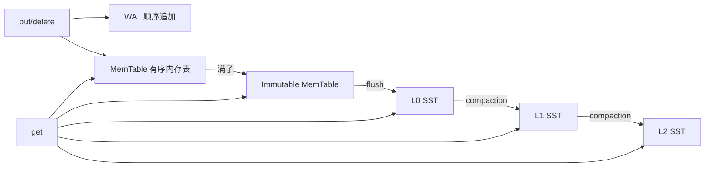

# Day 08 · LSM-tree：用顺序写换随机写

> **一句话结论**：LSM-tree 不是“更快的 B+ 树”，而是把随机写变成“WAL 顺序写 + 内存写 + 后台顺序合并”，用**写放大**换**写吞吐**；读路径则用 memtable、SST 索引、Bloom filter 和 block cache 去偿还读放大。

---

## 0. 本次问题

1. 为什么数据库写入会怕随机 I/O？LSM 如何把随机写变顺序写？
2. WAL、MemTable、Immutable MemTable、SSTable 各自解决什么问题？
3. 为什么 SST 一旦写出就不可变？不可变带来了什么好处和代价？
4. compaction 到底在合并什么？为什么会有写放大、读放大、空间放大？
5. tombstone 为什么不能随便删？什么时候可以丢？
6. LevelDB 的 L0 和 L1+ 有什么不同？为什么 L0 文件多了会写停顿？
7. 自己写一个最小 LSM，最容易在哪些地方“看起来对，实际会丢数据”？
8. 什么时候该用 LSM，什么时候 B+ 树更合适？

---

## 1. 设计背景：随机写为什么贵

### 1.1 B+ 树的写路径

B+ 树索引通常按页组织。一次写入可能：

```text
定位叶子页
  -> 修改页
  -> 如果页满，分裂
  -> 更新父节点
  -> 可能继续分裂
  -> 随机写多个页
```

好处是**读路径短、范围扫描稳定**；代价是：

- 随机写多，SSD 写放大/HDD 寻道贵；
- 页分裂、锁、buffer pool 管理复杂；
- 写放大来自“页级更新”，不是“记录级追加”。

### 1.2 LSM 的核心交换

LSM（Log-Structured Merge Tree）把写变成：

```text
写入 WAL（顺序追加）
  -> 写入 MemTable（内存有序结构）
  -> MemTable 满了变 Immutable
  -> 后台 flush 成 SST（顺序写）
  -> 后台 compaction 合并 SST（顺序读写）
```

它换来了：

- **写吞吐高**：大部分写是顺序追加 + 内存操作；
- **不可变 SST**：没有页内原地更新，缓存/并发简单；
- **压缩友好**：SST 按 key 排序，块压缩效果好。

代价是：

- **写放大**：compaction 反复重写数据；
- **读放大**：一次读可能要查 memtable + 多个 SST；
- **空间放大**：旧版本、tombstone 占用空间；
- **后台 compaction 的 I/O/CPU 竞争**：可能造成写停顿、尾延迟。

### 1.3 三种放大

| 放大 | 含义 | 来源 | 优化 |
|---|---|---|---|
| 写放大 | 用户写 1 B，磁盘实际写多少 B | WAL、flush、compaction 重写 | 分层/分层大小、压缩、tiered |
| 读放大 | 一次读要查多少个位置 | memtable + 多层 SST | Bloom filter、block cache、level 设计 |
| 空间放大 | 磁盘占用 / 逻辑数据量 | 旧版本、tombstone、未合并 | compaction、TTL、谨慎删除 |

这三个是互相拉扯的。Leveled compaction 通常写放大较高、读/空间放大较低；tiered/universal 写放大较低，但读/空间放大可能更高。

---

## 2. 总体架构



一次写入：

```text
1. 追加 WAL（可配置 fsync/group commit）
2. 写入 MemTable（skiplist / map）
3. MemTable 达到阈值 -> 冻结为 Immutable
4. 后台线程把 Immutable 写成 L0 SST
5. L0 文件过多 -> compaction 到 L1/L2...
6. 更新 Manifest/Version，删除旧文件
```

一次读取：

```text
1. 查 MemTable
2. 查 Immutable
3. 从新到旧查 L0（L0 文件可能重叠）
4. 查 L1+（每层 key 范围不重叠，可二分）
5. 找到最新版本；tombstone 表示删除
```

---

## 3. LevelDB/RocksDB 的关键结构

> 阅读入口：[`leveldb`](https://github.com/google/leveldb)、[`rocksdb`](https://github.com/facebook/rocksdb)。下面以 LevelDB 的经典结构为主线，RocksDB 在其上做了大量工程增强。

### 3.1 WAL

写入先追加 WAL，再写 MemTable：

```text
WriteBatch -> WAL append -> MemTable insert -> 返回
```

WAL 保证：进程崩溃后，未 flush 的 MemTable 可以从 WAL 重放。

关键工程点：

- 单条 fsync 很贵 -> group commit 批量 fsync（Day 09）；
- WAL 文件滚动/归档；
- 校验和、部分写、torn write；
- WAL 与 Manifest 的恢复顺序。

### 3.2 MemTable

LevelDB 的 MemTable 是 **skiplist + arena**：

- 按 internal key 排序：`(user_key, sequence, type)`；
- 支持并发读、单写者；
- 内存分配用 arena，减少 malloc 开销；
- 达到阈值后变 Immutable，等待 flush。

为什么用 skiplist 而不是红黑树？

- 实现相对简单，范围扫描友好；
- 并发读不需要锁（配合原子指针）；
- 插入不需要旋转/再平衡；
- 代价是指针多、cache 局部性不如 B 树。

### 3.3 SSTable

SST（Sorted String Table）是**不可变**的：

```text
[data block 0][data block 1]...[filter block][index block][footer]
```

关键组件：

- **data block**：按 key 排序的键值对，前缀压缩，restart points；
- **index block**：key -> data block 偏移；
- **filter block**：Bloom filter，快速判断“key 不在这张 SST”；
- **footer**：索引/过滤器/元数据偏移；
- **checksum**：检测损坏；
- **compression**：Snappy/Zstd 等。

不可变的好处：

- 不需要页内锁/原地更新；
- 可以被多个读者无锁共享；
- 方便缓存、校验、压缩、复制。

代价：

- 更新 = 写新文件 + 旧文件失效；
- 空间回收依赖 compaction；
- 文件数量多，读放大。

### 3.4 Manifest / Version

LSM 的磁盘状态不是“一个文件”，而是一组 SST + 层级 + 每层的 key 范围。LevelDB 用：

- `MANIFEST`：记录 VersionEdit（新增/删除哪些 SST、层级变化）；
- `CURRENT`：指向当前 Manifest；
- `VersionSet`：当前/历史版本，支持快照读。

为什么不能只靠“扫描目录里的 SST”？

- 需要知道每个文件属于哪一层、key 范围；
- compaction 中途崩溃时，磁盘上可能同时存在新旧文件；
- 需要原子地切换“当前版本”；
- 需要避免读到“已经删除但还没清理”的文件。

这是 LSM 工程里非常容易低估的部分：**数据文件只是状态的一部分，Manifest 才是版本的真相。**

### 3.5 Compaction

LevelDB 的 leveled compaction：

- **L0**：文件之间 key 范围可能重叠，读时要都查；
- **L1+**：每层内部 key 范围不重叠，按 key 二分；
- 每层有大小上限，超过就选文件合并到下一层；
- compaction 输入：上一层若干文件 + 下一层重叠文件；
- 多路归并，保留每个 key 的最新版本；
- 输出新文件，写 Manifest，删旧文件；
- 通过 `slowdown/stop` 控制 L0 文件数，防止读放大失控。

RocksDB 增强：

- leveled / universal / FIFO 多种 compaction；
- 多线程 compaction；
- 限速（rate limiter）；
- 分区索引、Bloom filter、压缩字典；
- 写停顿/流控、subcompaction；
- column family、快照、事务。

### 3.6 tombstone

删除不是立即删数据，而是写一个 tombstone：

```text
delete("k") -> internal record (k, seq, DELETION)
```

读路径：

- 先遇到新 tombstone -> 返回“不存在”；
- 老 SST 里的 value 被 tombstone 遮住；
- compaction 只有在**确认没有更老版本**时才能丢弃 tombstone。

如果过早丢 tombstone，老数据会“复活”。这是 LSM 最经典的 bug 之一。

---

## 4. 关键设计技巧

### 技巧 1：WAL 先于 MemTable

**做法**：写入先追加 WAL，再修改内存表；恢复时先重放 WAL。

**为什么有效**：内存表易失，WAL 提供崩溃恢复；顺序追加比随机写页便宜。

**代价**：写放大 + fsync 延迟；需要处理部分写、校验和、group commit。

**适用边界**：所有需要持久化的 LSM；可以按 durability 配置权衡 fsync。

### 技巧 2：MemTable 用有序结构 + arena

**做法**：skiplist/有序 map + arena；写内存，读时按 key 查找。

**为什么有效**：内存随机访问快；有序结构让 flush 直接顺序写 SST；arena 降低分配开销。

**代价**：内存占用、skiplist 指针开销、并发控制。

**适用边界**：写密集、需要范围扫描；内存预算要留足。

### 技巧 3：SST 不可变

**做法**：一次写一个新文件，永不原地修改；旧文件由 compaction 替代。

**为什么有效**：读无锁、缓存简单、校验/压缩/复制容易；崩溃恢复只需版本切换。

**代价**：空间放大、文件数量、compaction 重写。

**适用边界**：几乎所有 LSM；需要配合 Manifest 做原子版本切换。

### 技巧 4：分层 compaction

**做法**：L0 允许重叠，L1+ 按 key 范围不重叠；按层大小/文件数触发合并。

**为什么有效**：限制读放大；把写放大分摊到多层；范围查询可二分。

**代价**：实现复杂；compaction 可能造成 I/O 峰值和写停顿。

**适用边界**：通用 KV/OLTP；写放大敏感可用 tiered/universal。

### 技巧 5：Bloom filter + block cache

**做法**：每个 SST 带 Bloom filter；读时先判断 key 是否可能存在；热 block 缓存。

**为什么有效**：LSM 读放大主要来自“查了很多不包含 key 的 SST”；Bloom 把大多数无效查找挡在磁盘外。

**代价**：内存/CPU；false positive；过滤器需要随 SST 生命周期管理。

**适用边界**：读多写少或点查多的 LSM；范围扫描收益有限。

### 技巧 6：用 Manifest 管理版本，而不是目录扫描

**做法**：所有 SST 变更先写 Manifest/VersionEdit，再原子切换 CURRENT；旧文件延迟删除。

**为什么有效**：compaction 崩溃时，磁盘上可能同时有新旧文件；Manifest 决定“哪些文件属于当前版本”。

**代价**：实现复杂；需要 fsync/原子 rename；恢复逻辑必须严谨。

**适用边界**：任何生产级 LSM。目录扫描只适合教学 demo。

---

## 5. 反例与边界

| 看起来对的用法 | 实际问题 | 正确做法 |
|---|---|---|
| 不写 WAL，直接写 MemTable | 进程崩溃丢数据 | WAL + 恢复 |
| 每条写都 fsync | 吞吐崩、延迟高 | group commit/批量 fsync |
| tombstone 立即物理删除 | 老 SST 数据复活 | 确认无更老版本再丢 |
| compaction 阻塞所有写 | 写停顿、p99 爆炸 | 后台 compaction + 限速/流控 |
| L0 文件无限增长 | 读放大、写停顿 | slowdown/stop + compaction |
| 删除旧 SST 先于 Manifest 持久化 | 崩溃后版本引用不存在的文件 | Manifest 先落盘，再延迟删文件 |
| 只扫描目录恢复 | 无法知道层级/版本/临时文件 | Manifest/VersionSet |
| 认为 LSM 一定比 B+ 树快 | 读放大/compaction 可能更差 | 按读写比例/延迟目标选型 |
| memtable 无限大 | 内存爆、恢复慢 | 阈值 + immutable + flush |
| compaction 不限速 | 打满磁盘，影响前台 | rate limiter、优先级、分时 |

### 压力下会发生什么

- **写洪峰**：MemTable 快速切换，L0 文件堆积；触发 slowdown/stop，写入被限流。
- **compaction 落后**：读放大上升、空间放大上升；最终写停顿。
- **大量删除**：tombstone 占空间；compaction 才能回收。
- **范围扫描**：Bloom filter 帮助有限；需要合并迭代器/block cache。
- **崩溃恢复**：WAL 重放 + Manifest 版本恢复；部分写/损坏校验。
- **磁盘满**：compaction 无法写新文件，LSM 可能进入只读/停写。

---

## 6. C++20 最小实现

完整代码在 [`code/`](code/)：

- [`mini_lsm.hpp`](code/mini_lsm.hpp)：WAL + MemTable + SST + 全量 compaction；
- [`main.cpp`](code/main.cpp)：4 个行为测试；
- [`CMakeLists.txt`](code/CMakeLists.txt)：构建配置。

### 6.1 结构

```text
put:
  WAL append -> memtable (std::map) -> 达到阈值 -> flush
flush:
  memtable -> SST（排序、二进制）-> 清空 WAL -> 必要时 compact
get:
  memtable -> SST（从新到旧，二分查找）
compact:
  合并全部 SST，保留最新版本，丢弃 tombstone
```

### 6.2 WAL

```cpp
void append_wal(bool tombstone,
                const std::string& key,
                const std::string& value) {
    const std::uint32_t key_size = key.size();
    const std::uint32_t value_size = value.size();
    const std::uint8_t flag = tombstone ? 1 : 0;

    wal_out_.write(&key_size, sizeof(key_size));
    wal_out_.write(&value_size, sizeof(value_size));
    wal_out_.write(&flag, sizeof(flag));
    wal_out_.write(key.data(), key.size());
    if (!tombstone) wal_out_.write(value.data(), value.size());
    wal_out_.flush();
}
```

教学实现每条 flush；生产要 batch fsync、校验和、WAL 滚动。

### 6.3 MemTable

```cpp
std::map<std::string, std::optional<std::string>> memtable_;
```

- `value` 有值 = put；
- `nullopt` = tombstone；
- `std::map` 有序，flush 时直接按 key 顺序写 SST；
- 用估算字节数触发 flush。

生产用 skiplist + arena + 并发读；`std::map` 只适合教学。

### 6.4 SST

```text
magic "SST1"
entry count
for each entry:
  key_size, value_size, tombstone
  key bytes, value bytes
```

SST 加载后是 `std::vector<Entry>`，按 key 排序，读时 `lower_bound`。

生产 SST 会有：

- data block + restart points；
- index block；
- Bloom filter；
- block checksum；
- compression；
- block cache；
- footer。

### 6.5 flush

```cpp
void flush() {
    if (memtable_.empty()) return;

    auto sst = write_sst(memtable_, false);
    sstables_.push_back(std::move(sst));
    memtable_.clear();
    memtable_bytes_ = 0;
    reset_wal();
    ++stats_.flushes;

    if (sstables_.size() >= options_.compaction_trigger) {
        compact();
    }
}
```

顺序很重要：

1. 写 SST；
2. 加入内存版本；
3. 清空 memtable；
4. 截断 WAL；
5. 必要时 compaction。

生产还要 fsync SST、写 Manifest、原子切换，再删旧 WAL/SST。

### 6.6 get

```cpp
auto it = memtable_.find(key);
if (it != memtable_.end()) return it->second;

for (auto sst = sstables_.rbegin(); sst != sstables_.rend(); ++sst) {
    auto found = lower_bound(sst->entries, key);
    if (found != end && found->key == key) {
        return found->tombstone ? std::nullopt
                                : std::optional(found->value);
    }
}
return std::nullopt;
```

- memtable 最新；
- SST 从新到旧；
- 第一个命中决定结果（包括 tombstone）；
- 如果所有 SST 都没有，返回不存在。

### 6.7 compaction

```cpp
std::map<std::string, std::optional<std::string>> merged;
for (auto it = sstables_.rbegin(); it != sstables_.rend(); ++it) {
    for (const auto& entry : it->entries) {
        if (merged.find(entry.key) != merged.end()) continue;
        merged.emplace(entry.key,
                       entry.tombstone ? std::nullopt
                                       : std::optional(entry.value));
    }
}
auto compacted = write_sst(merged, true); // 全量合并，可丢 tombstone
```

这是“全量 compaction”：

- 所有 SST 合并成一个；
- 新 SST 优先，保留最新版本；
- 因为合并了所有更老数据，tombstone 可以丢；
- 实现简单，但 O(总数据量)，生产不可接受。

生产是分层、增量、多路归并，并控制写放大/读放大。

### 6.8 测试

```bash
cmake -S . -B build -G Ninja
cmake --build build
ctest --test-dir build --output-on-failure
# 或
./build/mini_lsm_demo
```

Windows（PowerShell）：

```powershell
cmake -S . -B build -G Ninja -DCMAKE_CXX_COMPILER=g++
cmake --build build
.\build\mini_lsm_demo.exe
```

实测输出：

```text
[  OK  ] basic_put_get_remove
[  OK  ] wal_recovery
[  OK  ] flush_and_compaction
[  OK  ] overwrite_and_tombstone_persistence

All 4 tests passed.
```

> 验证环境：Windows 11 + MinGW-w64 g++ 15.2 + CMake 4.2 + Ninja；`-std=c++20 -Wall -Wextra -Wpedantic -Werror` 编译通过，重复运行 10 次无失败。

一个容易忽略的细节：本实现的析构函数只关闭 WAL，不强制把 memtable 写成 SST。因为每条 WAL 记录都已 flush，下一次打开会重放 WAL；显式 `close()` 才会 flush + 截断 WAL。生产实现需要把“析构/关闭/崩溃恢复”的语义写清楚，不能依赖析构顺序。

### 6.9 生产化缺口

- 没有 Manifest/VersionSet，靠扫描目录加载 SST；
- 没有分层 compaction，只有全量合并；
- 没有 immutable memtable/后台 flush/compaction；
- 没有 fsync/原子 rename/崩溃一致性协议；
- 没有 block index/Bloom filter/block cache/压缩/checksum；
- 没有 sequence number/MVCC/快照；
- 没有并发控制（本实现单线程）；
- 没有写停顿/限速/rate limiter；
- 没有 WAL 滚动/group commit；
- 没有 tombstone 的安全丢弃条件（全量合并才丢）；
- 没有大文件/分块读写，SST 全量加载内存。

---

## 7. 如何借鉴到自己的项目

### 7.1 模式卡片

```text
模式名称：LSM-tree（WAL + MemTable + SST + compaction）
解决什么问题：写密集场景下，把随机写变成顺序写，提高写吞吐。
核心机制：
  1. WAL 持久化；
  2. MemTable 有序内存表；
  3. 不可变 SST；
  4. 分层/全量 compaction；
  5. tombstone + 版本；
  6. Manifest 管理版本。
代价/限制：
  - 写放大、读放大、空间放大；
  - compaction 影响前台 I/O；
  - 崩溃恢复/版本管理复杂；
  - 范围读/事务不如 B+ 树直接。
不适用场景：
  - 读多写少、点查/范围查询极重；
  - 强事务/复杂索引；
  - 小数据量、单机嵌入式简单场景。
一个最小例子：本课的 MiniLSM。
```

### 7.2 接口清单

```text
[ ] 写 WAL 和写 MemTable 的顺序是什么？
[ ] WAL 是否 group commit/校验和/部分写处理？
[ ] MemTable 满了如何冻结/切换？
[ ] flush 与 Manifest 的原子性如何保证？
[ ] get 的查找顺序是什么？如何避免读放大？
[ ] tombstone 什么时候可以丢？
[ ] compaction 是分层还是全量？写放大多少？
[ ] L0 文件数如何限制？写停顿策略？
[ ] 旧 SST 何时删除？崩溃后如何恢复版本？
[ ] 是否有 Bloom filter/block cache/压缩/checksum？
[ ] 读/写/空间放大是否有指标？
```

### 7.3 迁移步骤

1. **先量**：写吞吐、读 p99、数据量、读写比、删除比例。
2. **判断是否真的需要 LSM**：写密集、顺序写友好、能接受 compaction 成本。
3. **优先用成熟引擎**：LevelDB/RocksDB、Badger、Pebble、Redb；不要一上来自研。
4. **先做 WAL + MemTable + 单层 SST**：验证恢复和基本读写。
5. **再加分层/Manifest/Bloom/限速**：按瓶颈逐步加，不要一次全上。
6. **做崩溃/长稳/压测**：kill -9、磁盘满、compaction 落后、删除风暴。

---

## 8. 练习

**基础**

1. 给 `MiniLSM` 增加 `scan(start, end)`，按 key 顺序合并 memtable + SST。
2. 给 SST 增加 CRC32 校验和，检测损坏/部分写。
3. 统计每次 compaction 的输入/输出字节，计算写放大。

**进阶**

1. 实现两级 compaction：L0 -> L1，L1 内按 key 不重叠；比较读放大和写放大。
2. 加 Bloom filter（每个 SST 一个），测量点查命中率/磁盘读次数。
3. 把 flush/compaction 放到后台线程，加写停顿/限速；测量 p99。

**挑战**

1. 实现 Manifest/VersionSet：原子切换版本、崩溃恢复、旧文件延迟删除。
2. 加 sequence number + snapshot，支持“读旧版本”；处理 tombstone 的可见性。
3. 用 RocksDB/LevelDB 做对照 benchmark：写吞吐、读 p99、写放大、空间放大。

---

## 9. 自测题

<details>
<summary>点击展开答案</summary>

**1. LSM 为什么能把随机写变顺序写？**

写入先追加 WAL（顺序），再写内存 MemTable；MemTable 满了按 key 排序 flush 成 SST（顺序写）。更新不原地修改页，而是写新版本，由后台 compaction 合并。

**2. 为什么 SST 要不可变？**

不可变让读无需加锁、缓存/校验/压缩/复制简单，崩溃恢复只需版本切换。代价是更新要写新文件，空间回收依赖 compaction。

**3. tombstone 什么时候可以删？**

只有当 compaction 确认没有更老的版本可能包含该 key 时才能删。全量合并所有 SST 后可以丢；分层 compaction 中，如果 tombstone 还要下沉到更老层，就不能丢。

**4. L0 和 L1+ 有什么区别？**

L0 文件之间 key 范围可能重叠，读时要查多个文件；L1+ 每层内部 key 范围不重叠，可以二分/有序合并。L0 文件过多会导致读放大和写停顿。

**5. 写放大、读放大、空间放大分别是什么？**

写放大：用户写 1 B，磁盘实际写多少 B（WAL/flush/compaction 重写）；读放大：一次读要查多少个 memtable/SST/block；空间放大：磁盘占用/逻辑数据量（旧版本、tombstone）。

**6. 为什么需要 Manifest？**

Manifest 记录当前版本包含哪些 SST、在哪一层、key 范围/版本变更；compaction 崩溃时磁盘可能同时有新旧文件，必须靠 Manifest 原子切换“当前版本”，不能只扫描目录。

**7. LSM 一定比 B+ 树快吗？**

不一定。LSM 适合写密集、顺序写友好；B+ 树读路径短、范围查询/事务更直接。LSM 的 compaction 会带来写放大和尾延迟，读放大也可能更高。选型要看读写比、延迟目标和运维能力。

**8. 为什么 compaction 会造成写停顿？**

L0 文件堆积/compaction 落后时，读放大上升；引擎会限制写入（slowdown/stop）等待 compaction。compaction 本身占 I/O/CPU，如果无限速会拖慢前台。

</details>

---

## 10. 模式卡片

```text
模式名称：WAL + MemTable + SST + compaction
解决什么问题：写密集场景的顺序写吞吐。
核心机制：
  1. 先 WAL 后内存；
  2. 有序 MemTable；
  3. 不可变 SST；
  4. 分层合并；
  5. tombstone/版本；
  6. Manifest。
代价/限制：
  - 三种放大；
  - compaction 抖动；
  - 崩溃恢复复杂；
  - 读放大。
不适用场景：
  - 读多写少/复杂事务；
  - 小数据量；
  - 无法接受 compaction 运维成本。
一个最小例子：本课的 MiniLSM。
```

---

## 11. 下次预习

下一次进入 **WAL 与 group commit**。带着三个问题读：

1. WAL 记录如何保证“部分写/断电”后仍可恢复？
2. 为什么每次写都 fsync 很慢？group commit 如何把多个事务的 fsync 合并？
3. LSN、checkpoint、WAL 归档/截断之间是什么关系？

阅读入口：PostgreSQL `xlog.c` / `wal.c`、etcd `wal`、LevelDB `log_writer.cc` / `log_reader.cc`。

---

## 参考资料

- LevelDB, [`db_impl.cc`](https://github.com/google/leveldb/blob/main/db/db_impl.cc)：写入、flush、compaction、恢复。
- LevelDB, [`memtable.cc`](https://github.com/google/leveldb/blob/main/db/memtable.cc)：skiplist/arena。
- LevelDB, [`table_builder.cc`](https://github.com/google/leveldb/blob/main/table/table_builder.cc)：SST 块格式。
- RocksDB, [`compaction_job.cc`](https://github.com/facebook/rocksdb/blob/main/db/compaction/compaction_job.cc)：分层 compaction。
- O'Neil et al., [The Log-Structured Merge-Tree (LSM-Tree)](https://www.cs.umb.edu/~poneil/lsmtree.pdf)。
- RocksDB Wiki, [Compaction](https://github.com/facebook/rocksdb/wiki/Compaction)。
- C++ reference：[`std::map`](https://en.cppreference.com/w/cpp/container/map)、[`std::filesystem`](https://en.cppreference.com/w/cpp/filesystem)。
