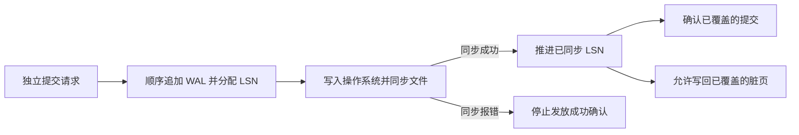

# Day 09 · WAL 与 group commit：fsync 的批量艺术

> 同步提交可以让多个请求共用一次 WAL 文件同步。成功响应只发给该次同步覆盖的请求。

## 0. 本次问题

Day 08 把更新追加到 WAL，再写入 MemTable。今天把这个顺序拆开，追踪从一条记录进入日志到系统可以回复成功之间发生了什么。

1. 哪个条件允许同步提交返回成功？哪个条件允许脏页写盘？
2. 为什么一次文件同步可以覆盖多条独立提交？批次越大时，谁承担等待成本？
3. 恢复如何识别有效前缀？checkpoint、归档和回收分别改变哪个边界？

## 1. 设计背景

一次事务可能同时修改几个数据页和索引页。如果其中一个页已经写回，系统就在其余页写回前掉电，磁盘会留下更新了一部分的状态。WAL 要求先同步覆盖这些改动的日志，之后才能把对应脏页写盘。恢复时可以根据持久化的日志补齐应当重做的更新。提交路径因此可以只同步 WAL，数据页留给后台写回。[PostgreSQL 18 · Write-Ahead Logging](https://www.postgresql.org/docs/18/wal-intro.html)

| 约束 | 设计选择 | 代价 |
|---|---|---|
| 每条请求都发起同步会重复承担同步延迟 | 让多个已就绪的请求共享同一次同步 | 请求会在队列和存储同步上等待 |
| I/O 可能失败，文件末尾可能只剩部分记录 | 记录分帧、校验并跟踪最后一个完整偏移 | 增加编码、校验和恢复分支 |
| 日志持续增长，重启时要重新读日志 | checkpoint 建立恢复起点，按保留需求回收旧段 | checkpoint 写回有 I/O 成本，归档或副本落后会保留更多日志 |

## 2. 架构与数据流



| 边界 | 含义 |
|---|---|
| `insert_lsn` | 已经分配并写入 WAL 缓冲的连续前缀末端 |
| `write_lsn` | 已经交给操作系统的连续前缀末端 |
| `flush_lsn` | 文件同步成功后可确认的连续前缀末端 |
| checkpoint 的 redo 起点 | 恢复需要开始扫描的位置，受数据页持久化与 checkpoint 元数据共同约束 |

用同一种坐标表示前三个边界时，通常有 `flush_lsn ≤ write_lsn ≤ insert_lsn`。例如 A、B、C 等待的提交 LSN 分别为 101、102、103，同步覆盖到 103 就可以一起确认。下一条 104 仍需等待覆盖它的同步。对带 `pageLSN` 的脏页，写回前应保证 `pageLSN ≤ flush_lsn`。PostgreSQL 的 LSN 是 WAL 字节位置，练习里用从 1 递增的记录号表示 LSN。[PostgreSQL 18 · WAL Internals](https://www.postgresql.org/docs/18/wal-internals.html)

## 3. 源码关键路径

### PostgreSQL 18.0 · 追一次本地同步提交

1. `xact.c::RecordTransactionCommit` 通过 `XactLogCommitRecord` 插入提交记录。进入同步分支时调用 `XLogFlush(XactLastRecEnd)`，之后才更新事务提交状态。这里跟踪的是本地 WAL，配置了同步副本时还有远端等待。[xact.c · RecordTransactionCommit](https://github.com/postgres/postgres/blob/REL_18_0/src/backend/access/transam/xact.c#L1390-L1430)
2. `xlog.c::XLogFlush` 先检查当前已同步位置。若已覆盖目标就返回。需要同步时，多个进程竞争 `WALWriteLock`，拿到锁的一方会再检查目标是否已被其他进程覆盖。[xlog.c · XLogFlush](https://github.com/postgres/postgres/blob/REL_18_0/src/backend/access/transam/xlog.c#L2578-L2675)
3. 持锁者根据可写的连续前缀调用 `XLogWrite`。负载高时，前一轮同步期间就会积累新的提交，`commit_delay=0` 也能出现 group commit。设置非零 `commit_delay` 可以扩大凑批窗口，同时会增加等待时间。`synchronous_commit=off` 则允许在本地同步前响应，改变了成功响应的持久性承诺。[xlog.c · XLogWrite 调用](https://github.com/postgres/postgres/blob/REL_18_0/src/backend/access/transam/xlog.c#L2676-L2730) · [WAL Configuration](https://www.postgresql.org/docs/18/wal-configuration.html) · [Asynchronous Commit](https://www.postgresql.org/docs/18/wal-async-commit.html)

### etcd 3.6.0 · 追一次 Raft WAL 写入与恢复

- `server/storage/wal/wal.go::Save` 串行写入 `Entry` 和 `HardState`。未到换段条件时，`raft.MustSync` 决定是否走 `sync`。`sync` 先刷编码缓冲，正常配置下再调用 `fileutil.Fdatasync`。这里的 Raft 持久化条件由协议决定。[wal.go · Save / sync](https://github.com/etcd-io/etcd/blob/v3.6.0/server/storage/wal/wal.go)
- `decoder.go::decodeRecord` 读取帧并校验 CRC。`Repair` 针对最后一个 WAL 文件中的 `ErrUnexpectedEOF` 尝试截断。读源码时对照普通 CRC 错误和被识别为尾部撕裂的分支。[decoder.go](https://github.com/etcd-io/etcd/blob/v3.6.0/server/storage/wal/decoder.go) · [Repair API](https://pkg.go.dev/go.etcd.io/etcd/server/v3@v3.6.0/storage/wal#Repair)
- C++ 对照可以追 RocksDB 的 WAL 生命周期。一个 WAL 可覆盖多个 column family，旧 WAL 的回收取决于相关更新是否已经进入 SST，以及是否还有保留需求。[RocksDB · Write Ahead Log](https://github.com/facebook/rocksdb/wiki/Write-Ahead-Log-(WAL))

## 4. 关键设计技巧

1. **按已同步位置确认。** 先追加，再同步，最后确认所有目标位置已被覆盖的请求。同步可能阻塞或报错，调用方要能区分成功与结果未知。数据页写回也检查对应日志是否已同步。
2. **先利用自然成批，再调整等待窗口。** 正在执行一次同步时，下一批请求可以继续排队。生产实现通常同时限制批记录数、字节数和最老请求等待时间。稀疏负载下，强制等满会直接抬高延迟。对比时一起看吞吐、排队 p99 和同步 p99。[PostgreSQL 18 · WAL Configuration](https://www.postgresql.org/docs/18/wal-configuration.html)
3. **在分配内存前验证记录头。** 示例先验证头 CRC、长度上限和 LSN 连续性，再读取正文并验证 CRC。读到短尾可以标出截断位置，完整帧校验失败则保留现场并报错。CRC 检测意外损坏。整段被删除等缺失还需要段序列、持久化元数据或副本发现。
4. **用确定性的操作重做。** 从空表按 LSN 回放 `SET(k, v)`，每次恢复都得到相同结果。对原地 `balance += 10`，需要用持久化的 `pageLSN` 或事务去重记录来识别已经应用的变更。客户端超时重试还要考虑请求幂等键，原请求可能已同步但响应丢失。
5. **分别管理恢复起点和保留边界。** LSN 用来定位 WAL，segment 是轮换、归档和回收的文件单位。checkpoint 确立 redo 起点，缩短恢复扫描。某段在本地恢复不再需要后，仍可能因为归档、备份或副本需要而继续保留。故障短尾的截断发生在文件末端，回收旧段则从日志历史的一端推进。[PostgreSQL 18 · WAL Configuration](https://www.postgresql.org/docs/18/wal-configuration.html)

## 5. 反例与边界

| 做法 | 故障时的后果 |
|---|---|
| `fwrite` 或 `fflush` 成功就响应 | 用户态缓冲清空后，数据仍可能只在操作系统缓存。掉电可能使已响应的记录丢失。 |
| 把同步错误当成确定回滚，直接重试扣款 | 一部分或全部日志可能已经到达介质，重试可能二次生效。 |
| 遇到第一条坏记录就搜索下一个看似合法的帧 | 会跳过历史中的更新，让后续操作在错误状态上重放。 |
| 用一次同步包住四条记录，就把它当作四条记录的原子事务 | 同步前的故障可能留下可重放的部分记录。多记录原子性需要提交标记或可校验的事务帧。 |

文件同步完成后的保证也依赖文件系统、存储设备和文件名持久化约定。以 Linux 为例，新建或重命名 WAL 段后，目录项的持久化需要单独处理。[Linux `fsync(2)`](https://man7.org/linux/man-pages/man2/fsync.2.html)

## 6. C++20 最小实现

[mini_wal.hpp](code/mini_wal.hpp) 实现单写者 `Writer::commit(span<Put>)` 和 `recover(path)`。[main.cpp](code/main.cpp) 负责组批和注入故障。每次调用最多提交 64 条，每条 payload 最多 64 KiB。组批由调用方显式完成，便于重复比较。真实并发队列和等待窗口留给练习。

```text
记录（整数均为小端）
| payload 字节数 u32 | LSN u64 | 头 CRC32 u32 | payload | payload CRC32 u32 |
payload = | key 字节数 u32 | key | value |
```

写入器先编码整批，再依次调用 `fwrite`、`fflush` 和文件同步。文件同步使用 Windows `_commit` 或 POSIX `fsync`。成功后返回该批末尾 LSN。写入或同步报错后，当前写入器拒绝后续提交。恢复从空表重放已校验的完整前缀。发现短尾时由实验显式截断至 `valid_bytes`，下一次成功的文件同步同时覆盖修复后的文件长度和新记录。[Microsoft `_commit`](https://learn.microsoft.com/en-us/cpp/c-runtime-library/reference/commit) · [Linux `fsync(2)`](https://man7.org/linux/man-pages/man2/fsync.2.html)

在仓库根目录运行以下命令。多配置生成器给构建命令加 `--config Debug`，给 CTest 加 `-C Debug`。

```sh
cmake -S days/week-02-storage/day-009-wal-group-commit/code -B build/day009
cmake --build build/day009
ctest --test-dir build/day009 --output-on-failure -V
```

| 场景 | 观察点 |
|---|---|
| `batching` | 12 条请求按 1 条和 4 条分组，成功的文件同步次数为 12 和 3。恢复结果一致，包括同一个 key 的覆盖写。 |
| `short-tail` | 手动截断临时文件，依次留下短正文和短头。两次恢复都保留 LSN 1–2，修复后从 LSN 3 继续追加。 |
| `corrupt-record` | 翻转中间记录的长度字段或正文 CRC，恢复在第二条记录处报错。 |
| `sync-failure` | 在同步调用处注入异常，提交没有返回成功位置，当前写入器拒绝后续提交。 |

示例使用预先创建的临时 WAL 文件，按单文件和进程内独占访问设计。checkpoint、段轮换、事务和目录项持久化属于扩展范围。故障实验覆盖格式和响应语义。断电验证需要独立环境，吞吐结论需要测量真实负载。

## 7. 如何借鉴到自己的项目

| 维度 | 检查项 |
|---|---|
| 接口 | 定义成功确认覆盖的位置，明确结果未知时的查询或重试语义。给批大小和等待时间设上限。 |
| 测试 | 注入半条记录、完整帧损坏、同步失败、同步后回复前退出。逐条核对已确认请求是否能恢复。 |
| 监控 | 记录每批请求数和字节数、同步与排队 p99、同步失败次数、WAL 保留量和 checkpoint 年龄。 |

迁移时先测现有请求的同步次数和等待时间，再用相同输入对比逐条同步和自然组批。改变批处理策略时保持确认条件一致，先跑一轮恢复和重试实验。

## 8. 练习

1. **基础**：把 `batching()` 的 `group_size` 从 4 改成 5。先预测同步次数和每次返回的 LSN，再运行验证。增加一组重复 key 的写入，核对最后一次赋值是否生效。
2. **进阶**：在 `Writer` 前放一条有界队列，由一个写线程按“达到大小上限或最老请求超时”取批。用 `steady_clock` 计时，为每条请求记录目标 LSN，只在同步覆盖目标后完成它。测试低流量等待和同步失败时的批内唤醒。
3. **挑战**：为恢复表增加带 LSN 的快照。列出快照同步、原子发布、目录项持久化和 WAL 回收的先后关系，为每一步之后的崩溃写出应选择的恢复起点。

## 9. 自测题

<details>
<summary>点击展开答案</summary>

1. 三个请求等待 LSN 10、11、12，当前 `write_lsn=12`、`flush_lsn=11`。谁能收到同步提交的成功响应？为什么？

   **答案**：10 和 11。12 已交给操作系统，但尚未进入已同步前缀。
2. 一次同步返回错误，恢复时却看到该批的完整记录，是否矛盾？

   **答案**：同步错误表示持久化结果未知。完整记录可能已到达介质，或者进程重启时仍能从操作系统缓存读到。调用方不能从同步失败推断写入已回滚。
3. checkpoint 已将本地恢复起点推进到新段，为什么旧段仍可能占空间？

   **答案**：归档还没成功，或者备份、复制槽等消费者还需要历史。回收要满足所有仍然生效的保留约束。
4. 为什么示例可以重跑 `recover()`，却不能直接把 `SET` 改成对现有表执行 `+=`？

   **答案**：示例每次从空表按同一顺序重建。对现有表再次增量修改会重复计数，需要知道哪些日志已经应用。

</details>

## 10. 模式卡片

| 项目 | 记录 |
|---|---|
| 模式 | 预写日志 + group commit |
| 解决的问题 | 保证同步提交可恢复，摊薄每条记录承担的同步成本 |
| 机制 | 顺序追加、共享同步、按已同步 LSN 确认、按有效前缀重放 |
| 代价 | 排队与 I/O 尾延迟，日志空间、校验和恢复成本 |
| 适用边界 | 写入能共享同一个持久化域，且可以按日志位置确认。低流量和严格延迟预算下优先限制等待。 |
| 最小例子 | 同样的 12 条 PUT，每批 4 条同步 3 次，恢复后值一致 |

## 11. 下次预习

Day 10 学习 **Buffer Pool**。从 `buf0lru.cc` 的 LRU 入队路径开始，带着两个问题读。一次大表扫描为什么会污染普通 LRU？淘汰一个脏页前，页写回和 WAL 同步如何配合？[MySQL 8.4 · InnoDB `buf0lru.cc`](https://github.com/mysql/mysql-server/blob/mysql-8.4.0/storage/innobase/buf/buf0lru.cc)
