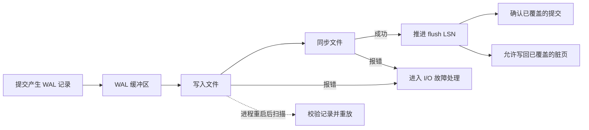
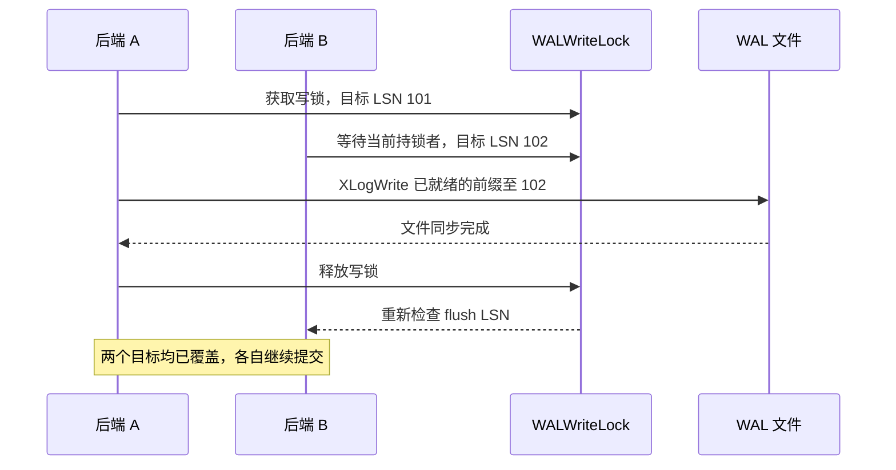

# Day 09 · WAL 与 group commit：fsync 的批量艺术

> **一句话结论**　WAL 用持久化的日志保证数据可恢复，group commit 让多个独立提交共享一次文件同步，每个请求仍要等到自己的日志位置被覆盖。

---

## 0. 本次问题

Day 08 把更新追加到 WAL，再写入 MemTable。今天沿着这条日志继续追，直到调用方收到成功，或者重启时根据日志重建状态。

1. 一次更新已经在内存中生效，什么时候可以确认提交？什么时候可以写回脏页？
2. 三个请求各自有提交位置，为什么只做一次文件同步就能让它们全部返回？
3. 重启时遇到短尾、完整记录校验失败、客户端结果未知，分别该怎么处理？

**本次产出**

- 画出插入、写入与持久化位置，标出提交确认和脏页回写各自的门槛。
- 运行 C++20 示例，对比同一组 PUT 的同步次数，再验证截断、损坏和同步失败。
- 写一张「按持久化位置确认」模式卡片。

---

## 1. 设计背景

### 1.1 数据页可以晚一点落盘

假设一次更新修改了一条订单和一张索引页。两个页的写回时间不同，事务提交时如果强制把两页都写盘，前台就得等待散落在不同位置的 I/O。

WAL 给页写回加了一条顺序约束。**写出某个脏页之前，先持久化该页所依赖的日志。** 这样同步提交只需要持久化覆盖该事务的 WAL，数据页可以留在缓存中。崩溃后，恢复程序从 WAL 重做缺失的修改。同步提交和脏页回写等待的目标不同，前者看事务的提交位置，后者看数据页的日志位置。 [PostgreSQL 18 · Write-Ahead Logging](https://www.postgresql.org/docs/18/wal-intro.html)

| 约束 | 具体表现 | 设计选择 |
|---|---|---|
| 数据页散布在文件中 | 一次更新可能涉及多个页 | 前台顺序追加 WAL，数据页另行写回 |
| 文件同步有延迟 | 每条请求单独等待一次同步 | 让同一持久化前缀覆盖多个提交 |
| 崩溃可能留下半条记录 | 恢复无法重放完整操作 | 分帧并校验，记录最后一个有效偏移 |
| 日志不断增长 | 重启扫描和磁盘占用上升 | 用 checkpoint 建立 redo 起点，再按保留条件回收旧段 |

### 1.2 一批请求如何分摊同步成本

设固定同步开销为 `T_sync`，一轮覆盖 `B` 个请求。只看这项开销，平均每个请求分摊 `T_sync / B`，而单个请求的等待仍包含排队、写入和整次同步。批次变大可以减少同步调用次数，最先入队的请求也可能承担更长的等待。

前一轮同步阻塞时，后续提交自然积累起来，下一轮就有机会一起处理。只有一个请求且每次都等到成功才发下一个时，系统没有自然凑批的机会。

---

## 2. 总体架构



### 2.1 三个位置与两道门槛

| 位置 | 含义 |
|---|---|
| `insert_lsn` | 已填完 WAL 缓冲区的连续前缀末端 |
| `write_lsn` | 已交给操作系统的连续前缀末端 |
| `flush_lsn` | 已完成文件同步的连续前缀末端 |
| `page_lsn` | 某页当前内容所依赖的日志位置 |

用同一坐标度量前三个位置时，`flush_lsn ≤ write_lsn ≤ insert_lsn`。PostgreSQL 用 WAL 字节位置表示 LSN，本课实验用递增的记录号表示 LSN，另外维护恢复用的文件偏移。

- **同步提交**等待 `commit_lsn ≤ flush_lsn`。
- **持久化数据页**要求写回前满足 `page_lsn ≤ flush_lsn`。

### 2.2 一轮同步覆盖哪些请求

| 时刻 | `write_lsn` | `flush_lsn` | 等待中的提交 |
|---|---:|---:|---|
| 追加并写出三条记录 | 103 | 100 | A 等 101，B 等 102，C 等 103 |
| 同步覆盖到 103 | 103 | 103 | A、B、C 可以成功返回 |
| 下一轮写出新记录 | 104 | 103 | D 等 104 |

同步期间到达的 D 进入下一轮。实现应以这轮**实际完成同步的位置**为准，避免用队尾位置提前确认刚到达的请求。

---

## 3. 源码关键路径

### 3.1 PostgreSQL 18.0 的本地同步提交

先读 `RecordTransactionCommit`，再跟进 `XLogFlush`。对这条路径，重点记住目标位置、锁和持久化位置的检查顺序。

1. **插入提交记录。** `xact.c::RecordTransactionCommit` 把事务提交记录插入 WAL 缓冲区。在同步分支里调用 `XLogFlush(XactLastRecEnd)`，之后才执行该分支的 `TransactionIdCommitTree`。这里追到本地 WAL 完成同步为止，配置同步复制时提交路径还可能等待副本。 [xact.c · RecordTransactionCommit](https://github.com/postgres/postgres/blob/REL_18_0/src/backend/access/transam/xact.c#L1393-L1411)
2. **检查目标是否已覆盖。** `xlog.c::XLogFlush` 比较请求位置和 `LogwrtResult.Flush`。需要推进时会等待相关 WAL 插入完成并竞争 `WALWriteLock`。等其他持锁者释放锁后，等待者重新检查，可能已经能直接返回。拿到锁后也会再检查一次。 [xlog.c · XLogFlush](https://github.com/postgres/postgres/blob/REL_18_0/src/backend/access/transam/xlog.c#L2578-L2678)
3. **同步已完成插入的前缀。** 持锁者用可写的连续位置设置 `WriteRqst.Write` 和 `WriteRqst.Flush`，再调用 `XLogWrite`。配置了非零 `commit_delay`，且满足 `fsync` 和活跃事务数条件时，持锁者会先短暂等待，再检查能把同步范围推多远。默认的零延时也能利用前一轮 I/O 期间积累的提交。 [xlog.c · XLogWrite 调用](https://github.com/postgres/postgres/blob/REL_18_0/src/backend/access/transam/xlog.c#L2679-L2711) · [PostgreSQL 18 · WAL Configuration](https://www.postgresql.org/docs/18/wal-configuration.html)



### 3.2 同一条规则在脏页写回中的落点

在 `bufmgr.c::FlushBuffer` 找到 `BM_PERMANENT` 分支。永久表的页写出之前先调用 `XLogFlush(recptr)`，这里的 `recptr` 来自页上的 LSN。接着才沿 `smgrwrite` 写出数据页。读 Day 10 的页淘汰时，可以回到这里核对日志与数据文件的先后关系。 [bufmgr.c · FlushBuffer](https://github.com/postgres/postgres/blob/REL_18_0/src/backend/storage/buffer/bufmgr.c#L4052-L4093)

### 3.3 etcd 3.6.0 的记录校验与短尾修复

在 `wal.go::Save` 中，先写入 Raft 的 `Entry` 和 `HardState`，未换段时由 `raft.MustSync` 决定是否调用 `sync`。从 `ReadAll` 跟进 decoder，可以看到打开 WAL 后怎样读取快照位置之后的日志。 [etcd · wal.go](https://github.com/etcd-io/etcd/blob/v3.6.0/server/storage/wal/wal.go)

etcd 的 Raft WAL 提供了分帧和修复的对照。先读 `decoder.go::decodeRecord` 的帧长度、CRC 校验和 `lastValidOff` 更新，再读 `repair.go::Repair`。修复器只针对最后一个 WAL 文件中识别出的 `ErrUnexpectedEOF` 尝试截断。它备份原文件，截断到最后有效偏移，并同步截断后的文件。 [etcd · decoder.go](https://github.com/etcd-io/etcd/blob/v3.6.0/server/storage/wal/decoder.go) · [etcd · repair.go](https://github.com/etcd-io/etcd/blob/v3.6.0/server/storage/wal/repair.go)

**阅读检查点**　找到 `isTornEntry` 的调用，说明在什么条件下一个解码或校验错误会被归到短尾。再和本课固定帧示例比较，本课只在文件末端读到不足一帧时提供截断位置。

---

## 4. 关键设计技巧

### 技巧 1 · 按持久化位置发放确认

一次同步只推进它实际覆盖的前缀。成功后再释放所有目标位置落在该前缀内的请求。同步报错时，本轮已提交给操作系统的数据可能部分可见，应用层需要为结果未知保留查询或幂等重试路径。

### 技巧 2 · 利用同步期间的积压组批

写线程在锁内接管队列，锁外执行文件 I/O。这样前台可以在当前批次同步期间继续入队，下一轮直接取积累好的请求。队列上限控制内存开销和过载行为。若另加凑批窗口，要同时观察批大小、排队时间和提交 p99。低流量下主动等待的成本主要由第一条请求承担。

### 技巧 3 · 把恢复边界落到字节偏移

每读完并校验一条记录，再推进 `valid_bytes`。文件末尾只剩一段不完整字节时，恢复器可以报告最后一个有效偏移。若完整帧校验失败，保留现场并报错，后续帧交给离线诊断或从可信副本恢复。CRC 用于检测意外损坏，检测整段缺失还需要文件序列或独立元数据。

### 技巧 4 · 按确定顺序重放

本课从空表依序应用 `SET(key, value)`，同一个 key 的最终值由最后一条有效记录决定。真实数据库如果从已有数据页重做增量操作，需要用页 LSN 等信息识别已经应用的变更。客户端请求去重是另一层问题，通常需要可持久化的请求 ID 和执行结果。

### 技巧 5 · 分开管理 redo 起点与回收边界

checkpoint 推进本地恢复的起点。旧 WAL 段能否删除，还取决于归档、备份和复制消费者是否需要它。生产中分别观测 checkpoint 的年龄、redo 起点和最老保留位置，才能判断磁盘增长来自页写回慢，还是历史仍有消费者。 [PostgreSQL 18 · WAL Configuration](https://www.postgresql.org/docs/18/wal-configuration.html)

---

## 5. 反例与边界

| 看起来可行的做法 | 故障时的表现 | 应检查的条件 |
|---|---|---|
| `fflush` 完成就确认 | 数据可能仍在操作系统缓存 | 成功响应需要文件同步覆盖 |
| 以入队位置更新持久化水位 | I/O 期间到达的请求被提前确认 | 记录本轮实际同步的末尾 |
| 一次同步包含多个请求就视为一个原子事务 | 故障可留下部分完整帧 | 多记录原子提交需要事务边界和提交协议 |
| 同步报错后立即重试扣款 | 原写入可能已经生效 | 查询执行状态或使用持久化幂等键 |
| 在坏帧后搜索下一帧继续重放 | 丢失前序更新，后续记录在错误状态上执行 | 从可信前缀、备份或副本恢复 |

### 压力下会发生什么

- **同步变慢**。批次通常变大，队列等待也随之增加。达到队列容量时，本课示例拒绝新的请求。
- **同步失败**。当前批次的持久化结果未知，尚未写出的队列请求被取消。写线程停止接收新工作，重新启动写入器前要检查文件。
- **文件刚创建或改名**。文件内容和文件名的持久化需要分别考虑。Linux 上，同步文件之后还可能需要同步所在目录。 [Linux · fsync(2)](https://man7.org/linux/man-pages/man2/fsync.2.html)
- **异步提交**。PostgreSQL 的 `synchronous_commit=off` 可以在本地 WAL 同步前响应，故障时最近确认的事务可能丢失。与同步提交对比吞吐时，要分别记录这两种成功响应的语义。 [PostgreSQL 18 · Asynchronous Commit](https://www.postgresql.org/docs/18/wal-async-commit.html)

---

## 6. C++20 最小实现

示例和四个行为实验集中在 [main.cpp](code/main.cpp)，构建和测试入口见 [CMakeLists.txt](code/CMakeLists.txt)。每个实验在独立临时目录创建 WAL。日志只保存整数键值对，便于把注意力留给组批、同步和恢复。

### 6.1 记录格式和源码入口

```text
固定 20 字节，小端序
| LSN u64 | key u32 | value u32 | CRC32 u32 |
CRC32 覆盖前 16 字节
```

| 入口 | 职责 |
|---|---|
| `GroupCommit::submit` | 接收单条 PUT，返回等待确认的 future |
| `GroupCommit::run` | 接管已入队的请求，释放队列锁后执行 I/O |
| `GroupCommit::flush_batch` | 连续分配 LSN，追加帧，完成一次同步后逐个确认 |
| `recover` | 校验每帧的 CRC 和 LSN，重放 PUT 并记录有效偏移 |

### 6.2 取批和确认

队列最多容纳 64 条待处理请求，写线程手上还可能持有一批。写线程用 `batch.swap(pending_)` 取走整批，前台随后可以填下一批。示例会把这一批写入文件，执行 `fflush`，再通过 Windows `_commit` 或 POSIX `fsync` 同步文件。 [Microsoft · _commit](https://learn.microsoft.com/en-us/cpp/c-runtime-library/reference/commit) · [Linux · fsync(2)](https://man7.org/linux/man-pages/man2/fsync.2.html)

```cpp
// GroupCommit::flush_batch 中的确认顺序
sync_(file_.get());

flush_lsn_ = next - 1;
++sync_count_;
Lsn committed = first;
for (auto& request : batch) {
    request.completion.set_value(committed++);
}
```

在 `sync_` 之前报错，或者 `sync_` 本身报错，都会走 `fail_batch`。当前批次和待处理队列中的 future 收到异常，后续入队也会报错。正常关闭时，写线程处理已入队的请求后退出。

### 6.3 短尾与重新打开

恢复逐帧读取，遇到完整记录就先校验再应用。读到零字节的正常 EOF 时结束，读到 1–19 字节的 EOF 时标记短尾。写入器启动时先扫描旧文件，遇到短尾会要求调用方修复，遇到坏帧会报错。实验在独占状态下截断到 `valid_bytes`。重新打开时，写入器先同步非空的有效前缀，再从最后一条 LSN 加一继续写。

### 6.4 编译与行为实验

在仓库根目录运行。Windows PowerShell 和 Bash 共用前三条命令。

```sh
cmake -S days/week-02-storage/day-009-wal-group-commit/code -B build/day009 -G Ninja
cmake --build build/day009
ctest --test-dir build/day009 --output-on-failure
```

PowerShell 中直接运行四个场景，也可以传入一个场景名。

```powershell
.\build\day009\mini_wal_demo.exe
.\build\day009\mini_wal_demo.exe batching
```

| 场景 | 操作 | 验证点 |
|---|---|---|
| `batching` | 提交相同的五次 PUT。第一轮逐条等待，第二轮用同步门闩把后四条积累在队列里 | 文件同步次数从 5 次降到 2 次，第一条在同步前仍在等待，两份日志重放一致 |
| `short-tail` | 把第三帧截短 3 字节 | 保留 LSN 1–2，修复后从 LSN 3 继续追加 |
| `corrupt-record` | 翻转第二帧的值字段中的一位 | CRC 报出损坏帧的位置，恢复和打开写入器均失败 |
| `sync-failure` | 在 `fflush` 后、文件同步前注入异常 | 当前和队列中的请求都收到错误，后续提交被拒绝。回读可以看到当前帧，队列里的帧从未写出 |

实测输出

```text
[  OK  ] batching (5 serial syncs, 2 grouped syncs)
[  OK  ] short-tail (kept LSN 1-2, resumed at 3)
[  OK  ] corrupt-record (CRC rejected the second frame)
[  OK  ] sync-failure (active and queued requests both received errors)

All 4 tests passed.
```

> 在 Windows（MinGW-w64 GCC 15.2、CMake 4.2、Ninja）和 WSL Ubuntu（GCC 13.3、CMake 3.28、Make）分别验证。两端 C++20 Release 构建均使用 `-Wall -Wextra -Wpedantic -Wconversion -Wshadow -Werror`，CTest 各 4/4 通过。

### 6.5 生产化缺口

示例以单文件独占写入、固定帧和从空表重放为边界。段轮换、目录持久化、checkpoint、跨进程写入协调及多记录事务需要额外协议。实验中的门闩用于控制并发顺序，比较的是同步次数。性能和真实断电恢复需要在目标存储上分别测量。

---

## 7. 如何借鉴到自己的项目

### 7.1 复用清单

| 维度 | 核对项 |
|---|---|
| 接口 | 定义提交成功时覆盖的位置。区分队列拒绝、已接纳但取消和持久化结果未知。 |
| 测试 | 分别在写入途中、同步失败、同步成功但回复前退出时注入故障。用确认列表逐条核对恢复结果。 |
| 监控 | 记录每批条数、每批字节数、队列深度、排队和同步 p99，以及 WAL 保留量。 |

### 7.2 迁移步骤

1. 找到当前成功响应的发放位置，测量每个请求平均触发几次文件同步。
2. 把独立提交收敛到同一个 WAL 写入器，先验证逐条同步与重放。
3. 打开组批并保留原成功条件。对同一输入比较同步次数、尾延迟和故障后的可恢复范围。

---

## 8. 练习

**基础**

1. 修改 `batching`，让第二轮积累 7 条请求。先预测每次同步覆盖的 LSN，再修改断言和输出验证。
2. 将短尾实验改为只保留第三帧的一个字节，比较 `valid_bytes`、`last_lsn` 与修复前的文件长度。

**进阶**

1. 把固定队列上限改为可配置参数，增加最大批大小。让积压超过一批，检查确认 LSN 连续性和队列满的行为。
2. 在成功同步和 future 完成之间注入失败，模拟响应丢失。让调用方用持久化请求 ID 查询这次 PUT 是否已执行。

**挑战**

1. 增加带 LSN 的快照。为「写快照、同步、发布、回收旧 WAL」各步骤设计崩溃点，写出每个崩溃点的恢复选择，并用故障注入验证。

---

## 9. 自测题

1. 当前 `write_lsn=12`、`flush_lsn=11`，目标为 10、11、12 的三个提交，哪些可以返回成功？
2. 已经修改的页上 `page_lsn=12`。什么条件满足后才能写出这张页？
3. `commit_delay=0` 时，多个后端如何共享一次同步？
4. 同步报错后立刻重读，为什么可能看见完整记录？收到错误的调用方该如何理解这条记录？
5. 为什么短尾和完整帧 CRC 错误采用不同的恢复策略？

<details>
<summary>点击展开答案</summary>

1. 目标为 10 和 11 的请求可以成功返回。12 仍要等一次覆盖它的同步。
2. 先让 WAL 的 `flush_lsn` 达到至少 12，然后写出该页。
3. 前一轮 I/O 期间可以积累新的提交。下一轮同步覆盖多条记录后，其他后端重新检查各自的目标位置，已覆盖的可以继续。
4. 记录可能已进入操作系统缓存，或者部分 I/O 已到达介质。可读性和同步成功是两个条件，报错批次的持久化结果未知。
5. 短尾提供了上一个完整帧的末尾作为候选截断点。完整坏帧可能是历史数据损坏，跳过它会让后续操作在缺失更新的状态上重放。

</details>

---

## 10. 模式卡片

```text
模式名称      WAL + group commit
解决的问题    允许数据页延后写回，并分摊同步提交的 I/O 开销
核心机制      连续追加 → 文件同步 → 推进 flush LSN → 按目标 LSN 确认
恢复协议      校验帧与位置，按有效顺序重放，区分短尾和完整帧损坏
代价与边界    共享同一个日志持久化域，权衡排队延迟、同步成本和保留空间
最小例子      五次 PUT 形成 1+4 两批，做两次同步后按相同顺序重放
```

---

## 11. 下次预习

下一次进入 **Buffer Pool**。从 `pageLSN ≤ flush_lsn` 出发，想一想页缓存何时能复用一个 frame。

1. 页还被执行器使用时，怎样避免它被淘汰？
2. 淘汰候选是脏页时，怎样协调 WAL 同步和数据页写回？
3. 为什么页的访问热度和回写顺序适合用两套结构维护？

阅读入口见 [Day 10 · Buffer Pool](../day-010-buffer-pool/README.md)。

---

## 参考资料

- PostgreSQL 18 的 WAL 基本规则与 checkpoint。 [Write-Ahead Logging](https://www.postgresql.org/docs/18/wal-intro.html) · [WAL Configuration](https://www.postgresql.org/docs/18/wal-configuration.html)
- PostgreSQL 18.0 的提交、日志同步与页回写源码。 [xact.c](https://github.com/postgres/postgres/blob/REL_18_0/src/backend/access/transam/xact.c) · [xlog.c](https://github.com/postgres/postgres/blob/REL_18_0/src/backend/access/transam/xlog.c) · [bufmgr.c](https://github.com/postgres/postgres/blob/REL_18_0/src/backend/storage/buffer/bufmgr.c)
- etcd 3.6.0 的 WAL 解码与尾部修复。 [decoder.go](https://github.com/etcd-io/etcd/blob/v3.6.0/server/storage/wal/decoder.go) · [repair.go](https://github.com/etcd-io/etcd/blob/v3.6.0/server/storage/wal/repair.go)
