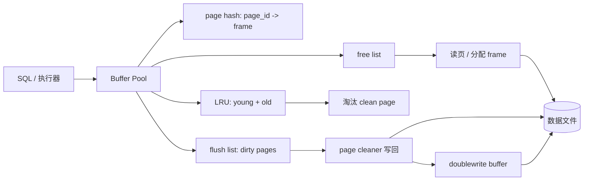

# Day 10 · Buffer Pool：数据库的页缓存

> **一句话结论**：Buffer Pool 不是“把磁盘页放进一个 HashMap”这么简单。它要同时管理**固定 page frame、page table、pin、LRU、脏页回写、checkpoint 和崩溃恢复**；核心矛盾是“内存有限，但热数据、扫描流量和写回压力同时在抢它”。

---

## 0. 本次问题

1. 数据库为什么不能直接读文件？Buffer Pool 和 OS page cache 有什么区别？
2. 一个 page 被读进内存后，为什么还要 pin？谁可以淘汰它？
3. 为什么 InnoDB 的 LRU 要分 young/old？midpoint insertion 解决什么问题？
4. 全表扫描为什么不能把热数据全部冲掉？
5. 脏页什么时候写回？flush list 和 LRU 为什么是两套链表？
6. doublewrite 为什么存在？它和 WAL 是一回事吗？
7. 自己写一个 Buffer Pool，最容易在哪些地方“看起来对，实际丢数据”？
8. Buffer Pool 调优到底看哪些指标？

---

## 1. 设计背景：磁盘页 vs 内存页

数据库以**页（page）**为最小 I/O 单位。InnoDB 默认页大小是 16 KiB（本课代码用 4 KiB 便于演示）。一次查询可能访问：

```text
索引根页 -> 内部页 -> 叶子页 -> 溢出页/undo 页 ...
```

如果每次都从磁盘读：

- 随机 I/O 延迟高；
- 同一页被反复读取；
- 无法在内存中维护页的锁/事务状态；
- 写操作需要原地改磁盘页，随机写更贵。

Buffer Pool 是数据库自己的 page cache：

```text
SQL/执行器 -> Buffer Pool -> page frame
                  |  miss
                  v
               磁盘/文件系统
```

它和 OS page cache 的差异：

| 维度 | OS page cache | Buffer Pool |
|---|---|---|
| 管理单位 | 文件页 | 数据库 page |
| 淘汰 | 内核 LRU/回收 | 数据库自己的 LRU/young-old |
| 脏页 | 内核 writeback | flush list + checkpoint |
| 并发 | 内核锁 | page latch + buffer pool mutex |
| 一致性 | 文件语义 | 事务/日志/恢复协议 |
| 预读 | 内核 readahead | 数据库预读/线性预读 |

很多数据库会用 `O_DIRECT` 绕过 OS page cache，避免双重缓存；也有数据库依赖 OS cache。选型取决于 I/O 模式、控制力和平台。

---

## 2. 总体架构



核心对象：

| 对象 | 作用 |
|---|---|
| page frame | 固定大小的内存页槽 |
| page table/hash | page_id -> frame，O(1) 查找 |
| pin/fix count | 正在被使用的页不能被淘汰 |
| free list | 空闲 frame |
| LRU list | 热数据管理，分 young/old |
| flush list | 脏页按最早修改 LSN 排序，供 checkpoint/回写 |
| page latch | 保护页内容（读写锁） |
| doublewrite | 防止页写一半（torn page） |
| page cleaner | 后台刷脏页 |

---

## 3. InnoDB Buffer Pool 的关键设计

> 阅读入口：[`buf0buf.cc`](https://github.com/mysql/mysql-server/blob/trunk/storage/innobase/buf/buf0buf.cc)、[`buf0lru.cc`](https://github.com/mysql/mysql-server/blob/trunk/storage/innobase/buf/buf0lru.cc)、[`buf0flu.cc`](https://github.com/mysql/mysql-server/blob/trunk/storage/innobase/buf/buf0flu.cc)、[`buf0dblwr.cc`](https://github.com/mysql/mysql-server/blob/trunk/storage/innobase/buf/buf0dblwr.cc)。

### 3.1 page hash 与 frame

Buffer Pool 启动时分配固定数量的 frame：

```text
frames[capacity]  // 每帧一个 page
page_hash: page_id -> buf_page_t*
free_list: 空闲 frame
```

查找页：

```text
hash(page_id)
  ├─ hit  -> pin + 可能调整 LRU
  └─ miss -> 从 free/LRU 拿 frame -> 读磁盘 -> 插入 hash
```

为什么要 page hash？

- 按 page_id O(1) 找到内存页；
- 避免遍历 LRU/所有 frame；
- 支持多个 buffer pool instance 分片（每实例独立 hash）。

### 3.2 pin / fix count

一个 page 被读进 frame 后，执行器可能正在：

- 读索引；
- 修改记录；
- 持有 page latch；
- 等待 I/O。

这时不能把它淘汰。InnoDB 用 `buf_fix_count`（pin count）表示“正在被引用”：

```text
fetch -> fix_count++
release -> fix_count--
只有 fix_count == 0 才能从 LRU 淘汰
```

还有 `io_fix` 表示页正在读/写磁盘，避免并发 I/O 状态冲突。pin 和 latch 不是一回事：

- **pin**：这个 page 不能被换出；
- **latch**：这个 page 的内容不能被并发修改/读取（读写锁）；
- 一个 page 可以 pin 但没持有 latch，也可以持有 latch 但仍有 pin。

### 3.3 young/old 两段 LRU

普通 LRU 的问题：

```text
全表扫描 -> 大量只访问一次的页 -> 插到 LRU 头 -> 热数据被冲到尾部 -> 淘汰
```

InnoDB 把 LRU 分成两段：

```text
young（热） | old（冷/新读入）
```

- 新读入的页插入 **midpoint**，即 old 段的头部，而不是整个 LRU 的头部；
- 页在 old 段被再次访问，且满足 `innodb_old_blocks_time`，才提升到 young 头部；
- young 段超预算时，把 young 尾部降级到 old 头部；
- 淘汰从 old 尾部开始。

参数：

- `innodb_old_blocks_pct`：old 段占比，默认约 37%（3/8）；
- `innodb_old_blocks_time`：页进入 old 后，至少多久再访问才允许提升，默认 1000 ms。

为什么这样有效？

- 顺序扫描的页只访问一次，待在 old 段，很快从 old 尾部淘汰；
- 热数据在 young 段，不会被一次扫描冲掉；
- 新页仍有进入缓存的机会，不会“冷启动就被淘汰”。

代价：

- LRU 管理更复杂；
- 扫描流量大时，old 段可能竞争激烈；
- `old_blocks_time` 会延迟真正的热页提升；
- 需要监控 young/old 比例和 eviction。

### 3.4 flush list：脏页不是按 LRU 回写

脏页需要写回磁盘，但**不能只按 LRU 顺序回写**：

- LRU 关心“最近是否访问”；
- 回写/checkpoint 关心“页的最早修改 LSN”；
- 需要按 LSN 推进 checkpoint，才能安全截断 redo log。

InnoDB 用独立的 flush list：

```text
flush_list: 按 oldest_modification LSN 排序的脏页
```

页第一次变脏时加入 flush list；后续修改只更新 `new_modification`，不重复插入。page cleaner 从 flush list 取最老的脏页写回，推进 checkpoint。

这带来一个重要设计分离：

| 链表 | 目的 | 排序 |
|---|---|---|
| LRU | 内存淘汰 | 访问时间/young-old |
| flush list | 脏页回写/checkpoint | 最早修改 LSN |

如果只有 LRU，checkpoint 很难知道“哪些 redo 可以截断”；如果只有 flush list，内存淘汰又会失去热度信息。

### 3.5 脏页回写与 WAL

写页之前必须保证对应的 redo 已经持久化（write-ahead logging）：

```text
修改页 -> 生成 redo -> redo 落盘（或至少满足 WAL 规则）
      -> 页标记 dirty -> flush list
      -> page cleaner 写数据页
```

如果先写数据页、后写 redo，崩溃后可能无法恢复。数据库通常用：

- `log_write_up_to(lsn)` 确保 redo 到位；
- checkpoint 推进；
- `innodb_max_dirty_pages_pct` 控制脏页比例；
- `innodb_io_capacity` 控制回写速率；
- `innodb_lru_scan_depth` 控制每次扫描深度；
- page cleaner 线程/自适应刷新。

### 3.6 doublewrite：防止 torn page

磁盘/文件系统可能只写了页的一部分（断电、崩溃），产生 **torn page**。InnoDB 的 doublewrite：

```text
1. 把脏页写到 doublewrite buffer（连续区域）
2. fsync doublewrite
3. 再把页写到数据文件
4. 崩溃恢复时，如果数据页损坏，从 doublewrite 找回完整页
```

doublewrite 不是 WAL：

- WAL 记录的是逻辑/物理变更，用于恢复事务；
- doublewrite 保存的是**完整页副本**，用于修复写坏的页；
- 两者解决不同层次的崩溃问题。

代价：

- 额外写放大；
- doublewrite 区域 I/O；
- 但换来了 torn page 的可恢复性。

MySQL 8.0.20+ 使用独立的 doublewrite 文件，并支持更细的控制；核心思想不变。

### 3.7 buffer pool instances

单个 buffer pool 的 mutex/hash/LRU 会成为多核瓶颈。InnoDB 支持多个 buffer pool instance：

```text
page_id -> hash -> instance
每个 instance 有独立 hash、LRU、free list、flush list、mutex
```

好处：

- 降低锁竞争；
- 更好的 NUMA/局部性；
- 并行 page cleaner。

代价：

- 页不能跨 instance 共享；
- 内存分配/调优更复杂；
- 需要按 instance 监控命中率。

---

## 4. 读路径与写路径

### 4.1 读路径

```text
buf_page_get(page_id)
  -> page_hash 查找
      ├─ hit: pin；如果页在 old 且满足条件，提升到 young
      └─ miss:
           -> 从 free list 取 frame
           -> 没有 free：从 LRU old 尾部淘汰 clean page
           -> 若 victim dirty：先写回（或等待 flush）
           -> 从磁盘读页
           -> 插入 page_hash、LRU
           -> pin 返回
```

关键点：

- 淘汰前必须 `fix_count == 0`；
- 脏 victim 必须先写回，或者选择 clean victim；
- 读 I/O 期间用 `io_fix` 标记，避免其他线程重复读/淘汰；
- 读完成后要释放 latch/pin。

### 4.2 写路径

```text
修改记录
  -> 持有 page latch
  -> 修改 page 内容
  -> 标记 dirty
  -> 设置 oldest_modification（首次变脏）
  -> 加入 flush list
  -> 释放 latch
  -> 事务提交时确保 redo 持久化
  -> 后台 page cleaner 择机写数据页
```

写路径不一定立即写数据页；这正是 Buffer Pool 的价值：把随机写聚合成后台批量写。但代价是：

- 脏页占用内存；
- 崩溃后需要 redo 恢复；
- checkpoint 必须追上；
- 脏页比例过高会导致写停顿。

---

## 5. 反例与边界

| 看起来对的用法 | 实际问题 | 正确做法 |
|---|---|---|
| 淘汰 pinned page | 执行器继续访问已释放内存 | fix_count/pin 保护 |
| 脏页直接丢弃/覆盖 | 数据丢失 | 先写回或走 WAL 恢复 |
| 只有 LRU，没有 flush list | checkpoint 无法按 LSN 推进 | 独立 flush list |
| 全表扫描直接插 LRU 头 | 热数据被冲掉 | midpoint + old_blocks_time |
| 每次修改都立即写数据页 | 随机写、吞吐崩 | 脏页批量回写 |
| 只写数据页不写 redo | 崩溃无法恢复 | WAL 先于数据页 |
| 关闭 doublewrite 不提风险 | torn page 可能无法恢复 | 理解风险/硬件保证后再关 |
| buffer pool 越大越好 | 内存挤占/swap、恢复变慢 | 按工作集/内存预算设置 |
| 单实例大锁 | 多核争用 | 多 buffer pool instances |
| 只看命中率 | 扫描/预读会污染命中率 | 看 young/old、eviction、磁盘读、脏页 |

### 压力下会发生什么

- **热数据工作集 > buffer pool**：频繁 eviction，磁盘读上升，命中率下降。
- **全表扫描**：old 段被扫描页占满，热页被降级/淘汰；midpoint/old_blocks_time 缓解但不能消除。
- **写洪峰**：脏页比例上升，flush list 变长，checkpoint 压力大；可能触发写停顿。
- **page cleaner 跟不上**：脏页堆积，redo 空间紧张，最终影响写入。
- **doublewrite I/O 瓶颈**：写放大导致吞吐下降；需要独立设备/参数调优。
- **buffer pool 太大**：内存压力、swap、重启预热慢；不是“越大越好”。

---

## 6. C++20 最小实现

完整代码在 [`code/`](code/)：

- [`buffer_pool.hpp`](code/buffer_pool.hpp)：page table + frame + young/old LRU + pin + flush；
- [`main.cpp`](code/main.cpp)：5 个行为测试；
- [`CMakeLists.txt`](code/CMakeLists.txt)：构建配置。

### 6.1 与 InnoDB 的映射

| InnoDB | 本实现 | 说明 |
|---|---|---|
| 16 KiB page | 4 KiB `PageData` | 教学简化 |
| page hash | `unordered_map<PageId, Frame*>` | O(1) 查找 |
| `buf_fix_count` | `Page::pin_count` | pin 保护 |
| LRU young/old | `young_` / `old_` 两条 list | midpoint + promotion |
| flush list | 未实现 | 只做同步 flush |
| page cleaner | 无 | `flush_all` 同步 |
| doublewrite | 无 | 文章讲概念 |
| buffer pool instances | 无 | 单实例 |
| page latch | 无 | 单线程测试 |

### 6.2 frame 与 page

```cpp
struct Page {
    PageId id = kInvalidPageId;
    PageData data{};
    std::size_t pin_count = 0;
    bool dirty = false;
};

struct Frame {
    Page page;
    bool in_young = false;
    std::list<Frame*>::iterator lru_it;
};
```

- `id` 无效表示 frame 空闲；
- `pin_count` 防止淘汰；
- `dirty` 决定淘汰时是否写回；
- `lru_it` 让 O(1) 从 young/old 链表中移除。

### 6.3 fetch：命中与未命中

```cpp
Page* fetch(PageId id) {
    auto found = page_table_.find(id);
    if (found != page_table_.end()) {
        ++stats_.hits;
        Frame* frame = found->second;
        ++frame->page.pin_count;
        touch(frame);  // 提升/移动到 young
        return &frame->page;
    }

    ++stats_.misses;
    Frame* frame = acquire_frame();
    store_.read(id, frame->page.data);

    frame->page.id = id;
    frame->page.pin_count = 1;
    frame->page.dirty = false;
    page_table_[id] = frame;
    insert_old_front(frame);  // midpoint insertion
    return &frame->page;
}
```

- 命中：pin + 调整 LRU；
- 未命中：选 frame、读盘、插入 old 头部；
- 新页不直接进 young，避免扫描污染。

### 6.4 touch：old -> young，young 超预算降级

```cpp
void touch(Frame* frame) {
    remove_from_lru(frame);
    frame->in_young = true;
    frame->lru_it = young_.insert(young_.begin(), frame);

    while (young_.size() > young_target_ && !young_.empty()) {
        Frame* demoted = young_.back();
        young_.pop_back();
        demoted->in_young = false;
        demoted->lru_it = old_.insert(old_.begin(), demoted);
    }
}
```

- 访问过的页进入 young 头部；
- young 超过预算，尾部降级到 old 头部；
- 这不是 InnoDB 的精确实现（InnoDB 有更复杂的 `old_blocks_time`/批量调整），但机制一致。

### 6.5 淘汰：从 old 尾部找 unpinned

```cpp
Frame* acquire_frame() {
    if (!free_.empty()) return pop_free();

    Frame* victim = find_unpinned(old_);   // 从尾部
    if (!victim) victim = find_unpinned(young_);
    if (!victim) throw BufferPoolFull("all frames are pinned");

    if (victim->page.dirty) {
        store_.write(victim->page.id, victim->page.data);
    }
    page_table_.erase(victim->page.id);
    remove_from_lru(victim);
    // 重置 frame ...
}
```

- 优先淘汰 old 尾部；
- 全部 pin 住时抛 `BufferPoolFull`，而不是覆盖；
- 脏页同步写回（生产由 page cleaner 异步做）。

### 6.6 flush

```cpp
bool flush_page(PageId id) {
    Frame* frame = find_frame(id);
    if (!frame->page.dirty) return false;
    store_.write(id, frame->page.data);
    frame->page.dirty = false;
    ++stats_.flushes;
    return true;
}
```

本实现同步 flush；生产是后台 page cleaner + flush list + checkpoint。

### 6.7 测试

```bash
cmake -S . -B build -G Ninja
cmake --build build
ctest --test-dir build --output-on-failure
# 或
./build/buffer_pool_demo
```

Windows（PowerShell）：

```powershell
cmake -S . -B build -G Ninja -DCMAKE_CXX_COMPILER=g++
cmake --build build
.\build\buffer_pool_demo.exe
```

实测输出：

```text
[  OK  ] load_modify_evict_reload
[  OK  ] hit_promotes_and_evicts_old
[  OK  ] pin_blocks_eviction
[  OK  ] scan_resistance
[  OK  ] flush_all

All 5 tests passed.
```

> 验证环境：Windows 11 + MinGW-w64 g++ 15.2 + CMake 4.2 + Ninja；`-std=c++20 -Wall -Wextra -Wpedantic -Werror` 编译通过，重复运行 10 次无失败。

### 6.8 生产化缺口

- 没有 page latch/并发控制；
- 没有 flush list/checkpoint/page cleaner；
- 没有 WAL-before-data-page 的协作；
- 没有 doublewrite；
- 没有 buffer pool instances；
- 没有预读、压缩页、unzip LRU；
- 没有 `old_blocks_time` 的精确语义；
- 没有 LRU 批量调整/scan depth；
- 没有内存分配/大页/NUMA；
- 没有崩溃恢复/损坏检测。

---

## 7. 如何借鉴到自己的项目

### 7.1 模式卡片

```text
模式名称：page cache + pin + 两段 LRU
解决什么问题：用有限内存缓存磁盘页，兼顾热数据、扫描流量和脏页回写。
核心机制：
  1. page table；
  2. pin/fix count；
  3. young/old LRU + midpoint；
  4. dirty/flush；
  5. flush list/checkpoint；
  6. doublewrite。
代价/限制：
  - 实现复杂；
  - 内存/锁/回写压力；
  - 崩溃一致性协议；
  - 调参依赖工作集。
不适用场景：
  - 纯内存数据；
  - 简单一次性读取；
  - 无法控制页生命周期的小工具。
一个最小例子：本课的 BufferPool。
```

### 7.2 接口清单

```text
[ ] page_id -> frame 查找是否 O(1)？
[ ] pin/fix count 是否覆盖所有使用路径？
[ ] 淘汰是否只选 unpinned？
[ ] 新页是否从 midpoint 进入？
[ ] 扫描流量是否会冲掉热数据？
[ ] 脏页是否按 LSN 进入 flush list？
[ ] 写数据页前 redo 是否已持久化？
[ ] 是否有 doublewrite/页校验？
[ ] 是否有 buffer pool instance 分片？
[ ] 是否监控命中率、young/old、eviction、脏页比例、磁盘读？
```

### 7.3 迁移步骤

1. **先量**：工作集大小、读写比、页大小、命中率、磁盘 IOPS、脏页比例。
2. **先调现成参数**：buffer pool size、instances、old blocks pct/time、flush 相关参数。
3. **再考虑自研缓存**：只有明确瓶颈/特殊页格式时才自研。
4. **先把 pin/latch 分清楚**：pin 保护生命周期，latch 保护内容。
5. **先做同步 flush**：验证正确性，再加后台 page cleaner/flush list。
6. **最后做 doublewrite/崩溃恢复**：这是“数据不丢”的底线，不是可选项。

---

## 8. 练习

**基础**

1. 给 `BufferPool` 增加 `old_blocks_time`：页在 old 中停留不足时间，不提升到 young。
2. 记录每个 page 的访问次数/最后访问时间，输出 young/old 分布。
3. 增加 `flush_list`（按 dirty 顺序），实现简单的后台 flush。

**进阶**

1. 实现 page latch（读写锁），支持多线程 fetch/unpin；测试并发淘汰。
2. 实现 page cleaner：后台按脏页比例/IO 能力刷页，前台写入不被长时间阻塞。
3. 模拟 doublewrite：写页前先写副本，注入 torn write，验证恢复。

**挑战**

1. 实现多 buffer pool instance：按 page_id 哈希分片，比较锁竞争和命中率。
2. 对比 LRU / young-old / CLOCK / LRU-K 在扫描 + 热点混合负载下的命中率。
3. 用真实文件 + `O_DIRECT` 实现 `FilePageStore`，测量 buffer pool vs OS page cache 的差异。

---

## 9. 自测题

<details>
<summary>点击展开答案</summary>

**1. Buffer Pool 和 OS page cache 的区别？**

Buffer Pool 管理数据库 page，拥有自己的 page table、pin/latch、LRU、flush list、checkpoint 和 doublewrite 协议；OS page cache 管理文件页，由内核回收。数据库可能用 `O_DIRECT` 绕过 OS cache，避免双重缓存。

**2. 为什么需要 pin/fix count？**

页被读进内存后，执行器可能正在使用它；如果被淘汰/复用，会访问已释放内存。pin 计数保证 `fix_count > 0` 的页不能被淘汰。pin 保护生命周期，latch 保护内容，两者不同。

**3. 为什么 LRU 要分 young/old？**

全表扫描会把大量只访问一次的页插入 LRU 头，冲掉热数据。midpoint insertion 让新页先进入 old，只有再次访问且满足时间条件才提升到 young；扫描页很快从 old 尾部淘汰，保护热数据。

**4. 为什么 flush list 和 LRU 要分开？**

LRU 按访问热度淘汰；flush list 按最早修改 LSN 排序，用于 checkpoint/redo 截断。两者目标不同，不能用一个链表同时表达。

**5. doublewrite 和 WAL 的区别？**

WAL 记录变更，用于事务恢复；doublewrite 保存完整页副本，用于修复 torn page（页写了一半）。WAL 不能直接修复损坏的数据页，doublewrite 也不能替代事务日志。

**6. 脏页什么时候写回？**

可以同步（淘汰时/提交时）或异步（page cleaner 按脏页比例、LSN、IO 能力）。写数据页前必须保证对应 redo 持久化（WAL 规则），否则崩溃后无法恢复。

**7. 为什么 buffer pool 不是越大越好？**

内存会被挤占，可能触发 swap；重启预热更慢；脏页/checkpoint 管理成本更高。应按工作集、内存预算、IO 能力设置，并监控命中率和脏页。

**8. 淘汰时如果所有 frame 都 pinned 怎么办？**

不能覆盖；应等待/报错/触发 flush，让执行器释放 pin。生产实现会结合 latch、io_fix、flush 和超时策略，而不是简单崩溃。

</details>

---

## 10. 模式卡片

```text
模式名称：Buffer Pool（页缓存 + pin + 两段 LRU）
解决什么问题：有限内存下缓存磁盘页，保护热数据并管理脏页回写。
核心机制：
  1. page table；
  2. pin/fix count；
  3. young/old LRU；
  4. midpoint insertion；
  5. flush list/checkpoint；
  6. doublewrite。
代价/限制：
  - 复杂度和内存开销；
  - 锁/回写/崩溃一致性；
  - 调参依赖工作集。
不适用场景：
  - 纯内存；
  - 一次性顺序读；
  - 无法控制页生命周期的场景。
一个最小例子：本课的 BufferPool。
```

---

## 11. 下次预习

下一次进入 **B+ 树页面**。带着三个问题读：

1. 一个 InnoDB page 内部到底怎么组织记录、空闲空间和目录？
2. 页分裂时，锁和父节点指针如何变化？
3. 为什么 B+ 树的页布局要兼顾顺序扫描、点查和更新？

阅读入口：InnoDB `page0page.cc`、`page0cur.cc`、`rem0rec.cc`、`btr0btr.cc`；对照 B+ 树论文/教材。

---

## 参考资料

- MySQL, [`buf0buf.cc`](https://github.com/mysql/mysql-server/blob/trunk/storage/innobase/buf/buf0buf.cc)：buffer pool、page hash、frame。
- MySQL, [`buf0lru.cc`](https://github.com/mysql/mysql-server/blob/trunk/storage/innobase/buf/buf0lru.cc)：young/old LRU、midpoint、eviction。
- MySQL, [`buf0flu.cc`](https://github.com/mysql/mysql-server/blob/trunk/storage/innobase/buf/buf0flu.cc)：flush list、page cleaner、checkpoint。
- MySQL, [`buf0dblwr.cc`](https://github.com/mysql/mysql-server/blob/trunk/storage/innobase/buf/buf0dblwr.cc)：doublewrite。
- MySQL Reference Manual, [InnoDB Buffer Pool](https://dev.mysql.com/doc/refman/8.0/en/innodb-buffer-pool.html)。
- MySQL Reference Manual, [InnoDB Doublewrite Buffer](https://dev.mysql.com/doc/refman/8.0/en/innodb-doublewrite-buffer.html)。
- C++ reference：[`std::list`](https://en.cppreference.com/w/cpp/container/list)、[`std::unordered_map`](https://en.cppreference.com/w/cpp/container/unordered_map)。
