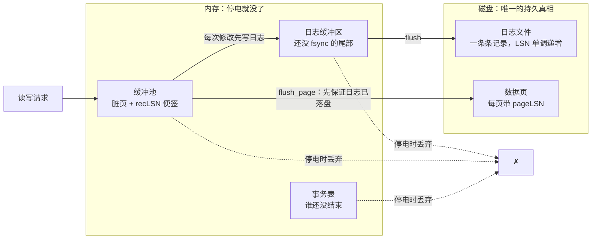
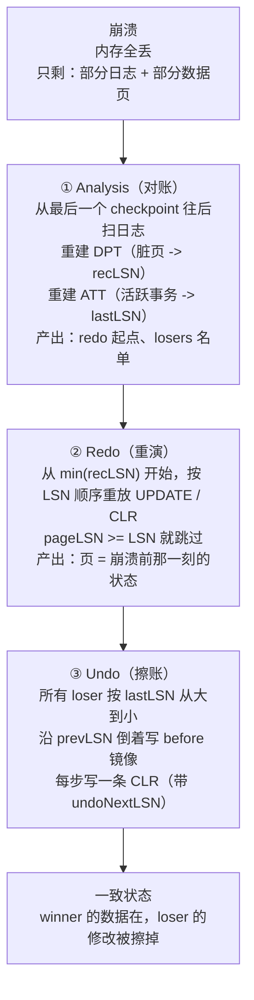
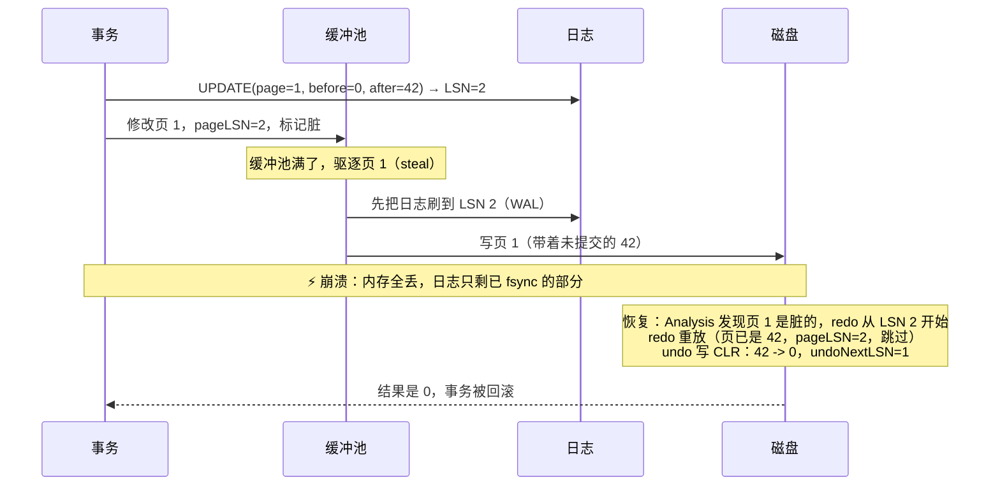

# Day 13 · ARIES：崩溃恢复的教科书

> **一句话结论**：崩溃恢复不是"把没写完的补上"，而是**先老老实实把历史重演一遍（连后来被撤销的也重演），再把没结账的事倒着擦掉；每擦一笔就在日志里补记一笔**。前者靠 `pageLSN` 保证幂等，后者靠 `CLR` 保证"擦到一半再崩"也能接着擦。

---

## 0. 本次问题

先说清楚这一课要解决的那个"真问题"。数据库有两个看起来很危险的习惯：

1. **它允许把"还没提交的修改"写进磁盘**（steal）。
2. **它允许"提交"这个动作不等数据页落盘**（no-force）。

这两条不是偷懒，是性能和内存逼出来的（下一节讲）。但只要接受它们，崩溃之后磁盘上就会同时躺着三种东西：

```text
已经提交、也已经落盘的数据     -> 这是对的，别动
已经提交、但还没落盘的数据     -> 丢了，要从日志补回来
还没提交、却已经落盘的数据     -> 脏的，要擦掉
```

恢复算法要做的，就是**只靠日志和磁盘上这些半成品**，把三种情况分开处理。ARIES 是 1992 年 IBM 的 Mohan 等人给出的答案，后来几乎所有商业数据库（DB2、SQL Server、InnoDB、Oracle 的某些部分）都沿用了它的骨架。

本次要能回答的八个问题：

1. steal 和 no-force 分别意味着什么？为什么数据库"必须"这么做？
2. `pageLSN`、`recLSN`、`flushedLSN` 分别在恢复的哪一步用？
3. 为什么 redo 必须重放"注定要回滚的事务"？只重做已提交的不行吗？
4. 为什么 redo 必须幂等？不幂等会坏在哪里？
5. CLR 到底解决什么问题？没有它会怎样？
6. 恢复做到一半又崩了，怎么既不重复也不遗漏？
7. 检查点怎么设计，才不会让恢复时间随运行时间线性增长？
8. 自己实现时，最容易在哪三个地方写错？

**前置**：Day 09 的 WAL、Day 10 的缓冲池、Day 12 的 MVCC。如果这三课的直觉还没建立，先回去读"一句话直觉"那两节，不用读源码。

---

## 0.5 先建立直觉

### 生活类比：夜班记账 + 突然停电

想象一个老式仓库，还是用纸质账本记账：

```text
档案柜（磁盘）      ：真正的账本，放进去就不会丢
桌上的作业本（缓冲池）：正在改的账本，停电就没了
值班日记（WAL 日志） ：每改一笔，先在这一行写清楚
                       谁改的、哪本、第几格、改前是多少、改后是多少
```

规矩是这样的：

- 改账本之前，**必须先在值班日记上写一行**（WAL）。
- 桌子放不下那么多作业本，所以**没结账的本子也可能被塞回档案柜**（steal）。
- 有人说"这笔账结清了"，值班员就在日记上记一行 COMMIT，**但不会立刻把所有相关本子搬回档案柜**（no-force）。
- 每本作业本封面上盖一个章，写着"我已改到日记第几条"（`pageLSN`）。
- 桌边贴一张便签，写着"哪本从第几条开始还没归档"（`recLSN`，合起来就是 DPT）。
- 值班员还记着"日记本身复印归档到第几条了"（`flushedLSN`）。

然后，**停电了**。桌子上的一切消失，只剩档案柜里的半成品和日记的复印件。

第二天早上的三件事，就是 ARIES 的三个阶段：

```text
① 对账（Analysis）
   翻日记，从最后一次"交接记录"（checkpoint）往后看：
   - 哪些本子还没归档？（重建 DPT）
   - 哪些账还没结？（重建事务表 ATT）
   顺便算出：要从日记的第几条开始重演。

② 重演（Redo）—— "repeat history"
   从最早的那本脏账本对应的那一行开始，把日记上的修改
   一条条重新做一遍。注意：连"后来被撤销的账"也要重演。
   每本作业本盖的章能告诉你"这条我已经做过了"，做过就跳过。

③ 擦账（Undo）
   停电时还没结账的人，把他的修改倒着擦掉。
   关键：擦一笔，就在日记上补一行"我擦了第 N 条"（CLR）。
   这样如果擦到一半又停电，第二天一看就知道擦到哪了，
   接着擦，不用从头再来。
```

一句话直觉：

> **先把历史重演一遍（哪怕有的历史后来被撤销了），再把没做完的倒着擦掉；擦一笔补记一笔。**

### 术语翻译表

| 术语 | 人话 | 本课代码里的名字 |
|---|---|---|
| LSN | 值班日记上的"行号" | `Lsn` |
| `pageLSN` | 这本作业本"改到第几行了" | `Page::page_lsn` |
| `recLSN` | 这本作业本"从第几行开始还没归档" | `rec_lsn_` |
| `flushedLSN` | 日记"复印归档到第几行" | `durable_hw_` |
| DPT（Dirty Page Table） | 便签：哪些本子还没归档 | `dirty_page_table` |
| ATT（Active Transaction Table） | 名单：哪些账还没结 | `active_table` |
| winner / loser | 停电时已结账 / 没结账的人 | `losers` |
| `prevLSN` | 同一个人上一笔记的是第几行（倒着擦的链） | `LogRecord::prev_lsn` |
| CLR | "我擦了第 N 条"的补记 | `LogType::Clr` |
| `undoNextLSN` | 擦完这条，下一条该擦第几行 | `undo_next_lsn` |
| redo-only | 这种补记只会被重做，永远不会被撤销 | CLR 的性质 |
| steal | 没结账的本子也允许归档 | `evict_if_needed()` |
| no-force | 结账时不要求把本子归档 | `commit()` 不刷数据页 |
| fuzzy checkpoint | 不收拾桌子，只在便签上记下"此刻的状态" | `checkpoint()` |
| repeat history | 连被撤销过的历史也重演一遍 | 第 ② 步 |

### 概念图



恢复就是**只用左下角（日志）和右上角（数据页）**，把内存里的三样东西重新推出来。

### 两条阅读路线

- **直觉路线（第一遍，45–60 分钟）**：读 0.5 → 1 → 2 → 4 → 5 → 10，跳过所有源码坐标和代码。目标是能画出"对账 → 重演 → 擦账"这张图，并说清楚三个 LSN 各管什么。
- **源码路线（第二遍，120 分钟）**：读 3（InnoDB / PostgreSQL）→ 6（代码走读）→ 跑一次 `--trace` → 做练习 2 和 3。目标是能指着日志说出"这条 CLR 的 `undoNextLSN` 为什么指向那里"。

### 只需要记住的三件事

1. **重演全部，再擦掉没结账的**（repeat history + undo losers）。
2. **`pageLSN >= LSN` 就跳过** —— redo 的幂等全靠这一条。
3. **擦账也要写日志**（CLR），否则"擦到一半再崩"就没法收场。

**第一遍可以先跳过**：CLR 的 `undoNextLSN` 精确语义、嵌套顶层动作（SMO）、日志截断与归档、两阶段提交的恢复。

---

## 1. 设计背景：约束从哪里来

ARIES 是 1992 年的论文（Mohan、Haderle、Lindsay、Pirahesh、Schwarz，ACM TODS）。它不是凭空设计的，而是被 80 年代大机上的四个硬约束逼出来的。

**关键约束**

| 约束 | 具体表现 | 对设计的影响 |
|---|---|---|
| 内存装不下整个库 | 缓冲池只有几 MB～几 GB，必须能把任意页换出去 | 必须允许 **steal**：未提交事务的脏页也可以写盘 |
| 提交延迟要低 | 一次随机写 + fsync 是毫秒级，提交路径上不能等一堆页 | 必须允许 **no-force**：提交只保证日志落盘 |
| 崩溃是常态 | 断电、进程被杀、磁盘故障 | 恢复算法必须能"从任意半成品状态"收敛 |
| 并发不能停 | 不能为了恢复方便而退化成串行 | 恢复要与细粒度锁、部分回滚（savepoint）兼容 |

**天真方案为什么都不行**

| 方案 | 为什么不行 |
|---|---|
| 提交时把所有脏页刷盘（force） | 提交延迟被 fsync 拖死，还把无关页的写放大带进提交路径 |
| 只允许干净页换出（no-steal） | 缓冲池要装下所有活跃事务的修改，内存需求爆炸 |
| 崩溃后只重做"已提交事务"的日志 | 页上已经混入了 loser 的数据，无法按字节区分哪部分是 winner 的；同一行可能先后被 winner 和 loser 改过 |
| 用逻辑逆操作回滚（"余额减 10"） | 重复执行会重复扣款，不幂等 |
| 崩溃后直接对外服务，边跑边修 | 页上混合了已提交和未提交的数据，读到的就是脏数据 |

**ARIES 的五个核心决定**（论文原文的贡献点，值得单独记住）：

1. **三阶段**：Analysis → Redo → Undo，职责严格分离。
2. **LSN**：全局单调的日志序号；每个页记录 `pageLSN`，每条记录记录 `prevLSN`。
3. **Repeat history**：redo 重演**所有**历史，不区分提交与否。
4. **CLR**：撤销动作本身也写日志，且**只重做、不撤销**。
5. **与细粒度锁和部分回滚兼容**：一条事务可以只回滚到某个保存点。

第 3 条是很多人第一次读会卡住的地方：**为什么要重做一个注定要回滚的事务？** 因为恢复时你没法"只重做一半"——日志是线性的，页的状态是"某条 LSN 之后"的快照，你必须把页推进到崩溃前的那一刻，才能保证之后 undo 时看到的是完整、确定的状态。**先恢复原状，再擦掉脏的部分**，比"一边重放一边判断该不该重放"简单得多，也快得多。

这和 Day 12 的 MVCC 是同一个思想的两面：**先把历史完整保留，再用"可见性"决定谁看得到。** 只不过 MVCC 的可见性是给读者看的，ARIES 的可见性是给恢复过程看的。

---

## 2. 架构与数据流

### 2.1 日志记录的类型

| 类型 | 谁写 | 关键字段 | 恢复时怎么用 |
|---|---|---|---|
| `BEGIN` | 事务开始 | `prevLSN` | undo 链的头，走到这里说明撤完了 |
| `UPDATE` | 每次改页 | `page`、`slot`、`before`、`after`、`prevLSN` | redo 写 `after`；undo 写 `before` |
| `COMMIT` | 提交 | `prevLSN` | Analysis 里把这个事务从 ATT 删掉 |
| `ABORT` | 事务结束 | `prevLSN` | 同上（本课用它同时表示"回滚完成"） |
| `CLR` | 撤销一步 | `page`、`slot`、`after`（= 恢复值）、`undoNextLSN` | **只 redo**；undo 时沿 `undoNextLSN` 跳过 |
| `CHECKPOINT` | 检查点 | `DPT`、`ATT` | Analysis 的初值 |

真实系统里 `before` / `after` 是任意字节（物理日志）或"页内偏移 + 字节串"（生理日志，physiological）。本课为了能读，用 8 字节整数代替。

### 2.2 三条不变式

这三条是整个算法的地基，剩下的一切都是它们的推论。

```text
不变式 1（WAL / 日志先行）
    写数据页之前，必须保证 pageLSN <= flushedLSN。
    换句话说：页上任何一处修改，都已经有对应的日志落了盘。

不变式 2（redo 幂等）
    如果 page.pageLSN >= record.lsn，就跳过这条记录。
    页是"从磁盘读出来的、已经包含到某个 LSN 为止的全部修改"，
    所以只要页的 LSN 追上了，这条记录（以及它之前的）就一定已经生效。

不变式 3（undo 安全 / 严格两阶段锁）
    一个未提交事务改过的数据，在它结束之前不能被别的事务覆盖。
    否则 undo 会用一个"旧值"盖掉别人已提交的"新值"。
```

不变式 3 最容易被忽略，但它是**正确性**的前提，不是性能优化。后面"反例"一节会专门演示它被破坏时会发生什么。

### 2.3 恢复的三个阶段



三个阶段的输入输出非常干净：

```text
Analysis : 日志(尾部) + checkpoint 记录  ->  DPT, ATT, redo_start, losers
Redo     : DPT + 日志[redo_start .. 末尾] ->  页（含 loser 的修改）
Undo     : losers + 日志链               ->  页（擦掉 loser 的修改）+ 新的 CLR
```

### 2.4 一次崩溃的时序



### 2.5 关键对象

| 对象 | 职责 | 生命周期 |
|---|---|---|
| Log sequence（日志） | 唯一的持久真相，所有修改的历史 | 永不修改，只追加 |
| Data page | 缓存数据 + `pageLSN` | 内存里改，按需写回磁盘 |
| DPT | 记 `page -> recLSN`，决定 redo 起点 | 运行时维护；检查点快照一份 |
| ATT | 记 `tx -> lastLSN`，决定谁是 loser | 运行时维护；检查点快照一份 |
| CLR | 撤销动作的 redo-only 记录 | undo 时追加，永不删除 |
| Checkpoint | DPT + ATT 的一份快照 | 每次检查点追加一条 |

---

## 3. 源码关键路径

### 3.1 InnoDB：C++ 世界里最值得读的 ARIES 变体

InnoDB 是 C/C++，又长期开源，是这条路径最好的阅读对象。只追一条主线：**页 -> 日志 -> 恢复**。

**入口 1：页上的 `pageLSN`**

InnoDB 的每个页头固定 38 字节，第一个字段就是 `FIL_PAGE_LSN`：

```c
/* storage/innobase/include/fil0types.h */
constexpr uint32_t FIL_PAGE_LSN = 16;
// 注释原文：lsn of the end of the newest modification log record to the page
```

也就是说，`pageLSN` 在页内偏移 16 的位置，8 字节。它和本课的 `Page::page_lsn` 是同一个东西。

**入口 2：日志与"刷到哪儿了"**

```text
log_sys->lsn                 已经写进日志缓冲区的最大 LSN
log_sys->write_lsn           已经 write(2) 出去的最大 LSN
log_sys->flushed_to_disk_lsn 已经 fsync 落盘的最大 LSN   <- 本课的 flushedLSN
log_write_up_to(lsn, flush)  推进上面三个值                <- 本课的 flush_log
```

`flushed_to_disk_lsn` 就是"日记复印到第几行了"。每次刷数据页前，InnoDB 会先调 `log_write_up_to(page.LSN, true)`，这就是不变式 1 的落地位置。

**入口 3：恢复主流程**

```text
log0recv.cc
  recv_recovery_from_checkpoint_start()   从 checkpoint 开始恢复
    └─ recv_recovery_begin()              读日志、找到起点
       └─ recv_scan_log_recs()            扫描日志段，边扫边解析
          └─ recv_parse_log_recs()        把记录按 (space, page) 哈希
             └─ recv_apply_hashed_log_recs()   哈希表满了就应用
                └─ recv_recover_page()    真正改页的地方
                   └─ recv_parse_or_apply_log_rec_body()   按 MLOG_* 类型分派
```

对比本课：`recv_scan_log_recs + recv_parse_log_recs` 相当于 Analysis + Redo 的交织实现（InnoDB 把两者合并成"边扫边应用"，用哈希表按页聚合），`recv_recover_page` 里同样有 `page.pageLSN >= lsn` 的判断。

**入口 4：InnoDB 为什么没有 CLR？**

这是最值得停下来想的一点。教科书 ARIES 的 CLR 解决"撤销做到一半又崩"，InnoDB 用了另一条路：

```text
InnoDB 的 undo 记录本身也存放在 undo 页里，
而 undo 页和其他页一样受 redo 保护。
回滚的进度体现在 undo 页头（undo log header）里，比如
TRX_UNDO_... 的 top address 往后推。
```

于是恢复顺序变成：

```text
① redo 把所有页（含 undo 页）恢复到崩溃前的最新状态
② 从 undo 链里找出未提交事务，继续回滚剩下的部分
③ 回滚对 undo 页的修改同样产生 redo，所以进度天然可重启动
```

**"让 undo 页也受 redo 保护" ≈ "CLR 的另一种实现"**：两者都是把"撤销动作"变成可重放的历史。区别只是 CLR 是独立记录，InnoDB 是复用 undo 页的 redo。代价也不同：CLR 更简单直接，但日志里多一类记录；复用 undo 页则让 undo 和 MVCC 共用一套结构（Day 12 的版本链就是它），省了空间，但 undo 的生命周期被 MVCC 拉长，于是有了长事务导致 undo 膨胀的问题。

**入口 5：检查点**

```text
log_sys->last_checkpoint_lsn          最近一次检查点的 LSN
buf_pool_get_oldest_modification*()   所有脏页里最老的修改 LSN（低水位）
```

InnoDB 的检查点**不强制刷所有脏页**，而是把"日志可以被覆盖的起点"推进到**脏页最老修改 LSN** 这个低水位。这和 ARIES 的 `redo_start = min(recLSN)` 是同一个量，只是 ARIES 存的是整张 DPT，InnoDB 存的是一个 LSN 标量。

### 3.2 PostgreSQL：干脆不要 undo

PostgreSQL 走了另一条路，理解它的取舍比记住函数名更重要。

```text
PostgreSQL 没有 undo，也没有 CLR。
为什么可以没有？因为 MVCC（Day 12）。
   事务回滚 = 让它的元组对所有人不可见（xmin/xmax 判断）
   物理清理 = 之后由 VACUUM 慢慢做
   于是"撤销"不需要在恢复期完成，"擦到一半再崩"这个问题根本不存在
```

代价是：回滚不是立即的、表会膨胀、需要 VACUUM（Day 12 已经讲过）。

**redo 的入口**

```text
src/backend/access/transam/xlogrecovery.c
  InitWalRecovery()        读控制文件、找 checkpoint、决定 redo 起点
  PerformWalRecovery()     主循环
    ReadRecord()           读一条 WAL 记录
    ApplyWalRecord()       应用（调用 rmgr 的 redo 例程）
```

**幂等在哪里保证**

PostgreSQL 把"这条记录要不要重放"的判断**上移到了缓冲区管理器**，而不是散落在每个 redo 函数里：

```c
/* src/backend/access/transam/xlogutils.c */
XLogReadBufferForRedo(record, block_id, &buffer)
    if (PageGetLSN(page) >= lsn)  return BLK_DONE;   // 已经生效，跳过
    else                          return BLK_NEEDS_REDO;
```

各 redo 例程只写 `if (XLogReadBufferForRedo(...) == BLK_NEEDS_REDO) { ...; PageSetLSN(page, lsn); }`。`PageSetLSN` 就是在盖那个"改到第几行"的章，对应本课的 `frame.page_lsn = record.lsn`。

**半写页怎么办**

ARIES 假设"页写入是原子的"。真实的 4KB/16KB 页写在断电时可能是**半页**，redo 也救不了。两家的解法不同：

```text
PostgreSQL：full_page_writes + XLOG_FPI
            checkpoint 之后第一次改某页时，把整页镜像写进 WAL
            恢复时先用整页镜像覆盖，再重放后续记录
InnoDB    ：doublewrite buffer
            写页前先顺序写一份到 doublewrite 区，恢复时先修复坏页
```

本课代码不模拟半写页（见"生产化缺口"）。

### 3.3 三家对比

| 维度 | ARIES（论文/本课） | InnoDB | PostgreSQL |
|---|---|---|---|
| redo 起点 | `min(recLSN)` over DPT | 脏页最老修改 LSN（低水位） | `checkpoint.redo` |
| 检查点是否刷脏页 | 不刷（fuzzy） | 不刷，只推进低水位 | 刷（sharp checkpoint） |
| undo 记录 | **CLR**（显式、redo-only） | undo 页 + redo 保护 | **没有 undo** |
| 回滚怎么完成 | 恢复期 undo 阶段 | 恢复期继续回滚，进度在 undo 页头 | 不物理回滚，靠 MVCC 可见性 + VACUUM |
| 半写页保护 | 假设原子 | doublewrite | full_page_writes + FPI |
| 谁处理 loser 的脏数据 | undo 阶段擦掉 | 回滚 + purge | 元组不可见，等 VACUUM |

一句话总结这张表：

> **ARIES 用"日志"解决回滚，InnoDB 用"受 redo 保护的 undo 页"解决回滚，PostgreSQL 用"可见性"绕开回滚。**

三条路都能得到正确的数据库，区别在代价：ARIES 恢复期要做 undo（恢复时间不稳定），InnoDB 把 undo 摊到运行期（长事务会膨胀），PostgreSQL 把清理摊给 VACUUM（表会膨胀）。

### 3.4 语言对照

- **C++ 对应实现**：InnoDB（C++）、Microsoft SQL Server（C++）、LeanStore / Umbra（C++ 研究引擎）。教学向的 CMU BusTub 有 redo 部分，但没有完整 ARIES 的 undo + CLR，适合对照阶段 ②。
- **Rust 生态**：`redb`、`sled` 都不是 ARIES 路线。`redb` 是 MVCC B 树 + 两阶段提交的页分配协议，`sled` 是 log-structured。想找 Rust 版 ARIES 只能自己写，这本身就是个不错的练习。
- **为什么 LSM 引擎里 ARIES 的 undo 基本消失**：LSM（Day 08）从不原地覆盖，loser 的写入躺在不可变的 MemTable/SST 里，用序列号 + 可见性过滤掉就行——和 PostgreSQL 的 MVCC 思路一样。**ARIES 是为"原地更新"的 B+ 树引擎设计的**；换成 append-only 结构，"undo" 就退化成"忽略"。
- **LSN 不在 LSM 里出现**：RocksDB 的 WAL 只有序号（sequence number），因为不需要"按 LSN 判断某页是否已经包含某次修改"。

### 3.5 为什么本课还是引用 Java/C 的实现

因为 **InnoDB 和 PostgreSQL 是这条路径上被抄得最多的两个实现**，而它们的语言恰好是 C/C++。这一课没有 Java 代码，只是因为数据库内核这个领域 Java 不是主流（H2、Derby 有，但参考价值低）。

---

## 4. 关键设计技巧

### 技巧 1：物理日志 + LSN，让"重放"有一个确定的比较基准

- **做法**：每次修改都记 `(page, 字节/槽位, before, after)`，并给整条日志一个单调递增的 LSN；页上存 `pageLSN`。
- **为什么有效**：`pageLSN` 把"这个页已经吸收到哪条日志"变成一个**可以比较的整数**。于是幂等判断退化成一次比较：`page.pageLSN >= record.lsn` 就跳过。不需要记录"哪些记录执行过"，也不需要全局的"已重放集合"。
- **代价**：每个页头要有 8 字节；每条日志要带 `LSN` 和 `prevLSN`；日志不能回退 LSN（崩溃后重新编号会让 `pageLSN` 比较失效，PostgreSQL 用 timeline 概念处理分叉）。
- **适用边界**：原地更新的页式存储。append-only 结构（LSM）不需要这一套。

### 技巧 2：Repeat history —— redo 不做判断，只重演

- **做法**：redo 从 `min(recLSN)` 开始，把区间内**所有** `UPDATE` / `CLR` 都重放一遍，包括属于 loser 的。
- **为什么有效**：页的状态因此被确定地推进到"崩溃前那一刻"，undo 阶段面对的是一个**完整、可预期**的历史。如果 redo 时就要判断"这条属于 winner 还是 loser"，你必须先完整地重建事务状态，而且同一条记录可能被 winner 和 loser 都改过，判断会变成逐字节的取证。
- **代价**：loser 的修改被"先写一遍再擦一遍"，写放大；恢复时间与脏页量成正比，而不是与"需要保留的数据量"成正比。
- **适用边界**：几乎所有页式存储引擎。反例是"重做日志只记已提交事务"的设计（某些逻辑复制），它牺牲了恢复的简单性来换恢复速度。

### 技巧 3：DPT + recLSN，把"从哪里开始重放"变成可计算的下界

- **做法**：每个页第一次变脏时记下 `recLSN`（**只记第一次，且取最小值**）；检查点把整张 DPT 存进日志；恢复时 `redo_start = min(recLSN)`。
- **为什么有效**：`recLSN` 是"这个页上最早的、还没保证落盘的修改"。任何早于它的修改，要么已经随页落盘，要么本来就不需要重放。于是 redo 只需要从这个下界开始，而不是从日志开头。
- **代价**：维护 DPT（每次弄脏、每次刷页都要改）；检查点要存一份快照；`recLSN` 取大了会漏 redo（正确性事故），取小了只是多做功（性能损失）。**这是"宁小勿大"的典型**。
- **适用边界**：只要允许 steal 就需要它。InnoDB 把它压缩成一个低水位 LSN，代价是"一个脏页就能把检查点卡住"。

### 技巧 4：CLR —— 把"撤销"也变成可重放的历史

- **做法**：undo 每撤销一条 `UPDATE`，就写一条 `CLR`：`{page, slot, after=恢复值, undoNextLSN=被撤记录的 prevLSN}`。CLR 是 **redo-only** 的：redo 阶段会重放它，undo 阶段会沿 `undoNextLSN` 跳过它。
- **为什么有效**：三个问题一次解决。
  1. **可重启动**：恢复再崩，Analysis 会把 CLR 的 LSN 当成 loser 的 `lastLSN`，undo 从 `undoNextLSN` 继续，已经撤过的不会撤第二遍。
  2. **撤销本身也受 WAL 保护**：页上被撤销后的值有日志覆盖，`pageLSN` 可以合法地推进到 CLR 的 LSN，于是 redo 不会把"撤销后的值"又改回"撤销前的值"。
  3. **进度单调**：每撤一步，游标严格向更小的 LSN 移动，不会活锁。
- **代价**：日志多一类记录、多一次写；实现上要区分"当前是在 undo 还是在 redo"，容易写错。
- **适用边界**：需要物理 undo 的引擎。PostgreSQL 不需要（不物理 undo）；InnoDB 用"undo 页受 redo 保护"达到同样效果。

### 技巧 5：steal + no-force，用日志换内存和延迟

- **做法**：允许驱逐未提交的脏页（steal）；提交时只保证日志落盘，不要求数据页落盘（no-force）。
- **为什么有效**：把"持久化"的**粒度**从页（16KB）降到日志记录（几十字节），提交路径上只有一次顺序写 + fsync。缓冲池可以随意换出，不必为活跃事务预留空间。
- **代价**：崩溃后必须同时 redo（补已提交未落盘）和 undo（擦未提交已落盘）；需要**严格两阶段锁**保证 undo 安全；恢复时间与脏页量挂钩。
- **适用边界**：几乎所有 OLTP 引擎。反过来，"force + no-steal"（比如某些嵌入式配置）恢复极快，但写延迟和内存都不可接受。

### 技巧 6：检查点的三种策略

- **做法**（三选一）：
  ```text
  fuzzy（ARIES）：不刷页，只把 DPT + ATT 记进日志。
                  恢复从 min(recLSN) 开始，可能早于检查点。
  低水位（InnoDB）：不刷页，只把"脏页最老修改 LSN"推进到 checkpoint_lsn。
                  恢复从 checkpoint_lsn 开始。
  sharp（PostgreSQL）：刷全部脏页，然后记 checkpoint。
                  恢复从 checkpoint.redo 开始，redo 区间最短。
  ```
- **为什么有效**：三者都在回答同一个问题——"我能不能宣称某一刻之前的日志不需要再重放了"。fuzzy 的答案是"逐页看"，低水位是"看最差的那页"，sharp 是"让所有页都干净"。
- **代价**：fuzzy 恢复慢但运行时抖动小；sharp 恢复快但检查点瞬间有 I/O 峰值；低水位介于两者之间，但一个长期不刷的脏页会把整个检查点卡住（InnoDB 历史上有过 `log file full` 的经典故障）。
- **适用边界**：写多读少的 OLTP 用 fuzzy 或低水位；对恢复时间有硬指标的（比如内存数据库）用 sharp。

---

## 5. 反例与边界

| 看起来对的用法 | 实际问题 | 正确做法 |
|---|---|---|
| 从最后一个 checkpoint 开始 redo | 检查点时还有脏页，它们的 `recLSN` 在检查点之前，漏掉就是**永久损坏** | `redo_start = min(recLSN)`，可能早于 checkpoint |
| redo 时只重放已提交事务 | 页上 loser 的修改无法定位，undo 时不知道哪些字节该擦 | repeat history，全重放 |
| undo 不写 CLR，直接改页 | 撤销效果没有日志覆盖；恢复再崩就重复撤销或丢进度 | 每步写 CLR，`undoNextLSN` 指向下一站 |
| 用逻辑逆操作做 undo（"余额 -10"） | 重复执行会重复扣款，不幂等 | 物理 before-image，或幂等的逻辑 undo |
| 允许非严格 2PL（读完就放锁） | loser 的 undo 会覆盖别人已提交的新值 | 锁持有到事务结束 |
| 崩溃后先对外服务，后台慢慢恢复 | 读到的页混合了已提交和未提交数据 | 恢复完成前不接流量 |
| checkpoint 只记 LSN，不记 DPT | 恢复时不知道哪些页脏，只能全量 redo 或漏页 | 存 DPT + ATT |
| 提交只写日志不 fsync（`fsync=off`） | "提交成功"的事务在掉电后消失 | 提交路径上必须 fsync（Day 09） |
| 崩溃后 LSN 从日志末尾重新编号 | `pageLSN` 比较失效，老页被误判为"已重放" | LSN 单调，永不复用 |
| 认为有 redo 就不怕半写页 | 页一半新一半旧，redo 的字节级修改会写坏 | 校验和 + doublewrite / full_page_writes |

### 压力下会发生什么

- **崩溃时脏页很多**：redo 时间 ∝ 脏页数，恢复可能从秒级变成分钟级。fuzzy checkpoint 让这个问题变成"检查点越久不做，恢复越慢"。
- **恢复途中反复崩溃**：CLR 让进度单调，每次重启都往前推进；没有 CLR 就会重复做功，极端情况下永远恢复不完。
- **大事务 / 长事务**：undo 链很长，恢复被拖长。ARIES 的"部分回滚"就是为这个设计的（回滚到保存点，而不是整条事务）。
- **日志暴涨**：检查点推进不动（脏页太多或刷得太慢），日志空间被占满，写入被阻塞。这是生产上最常见的 ARIES 相关故障。
- **大量随机写 + 半写页**：doublewrite / FPI 会把写放大 2 倍左右，这是"恢复正确性"的固定成本。

---

## 6. 最小实现（C++20）

完整代码在 [`code/`](code/)：

- [`aries.hpp`](code/aries.hpp)：日志、缓冲池、三个恢复阶段、CLR、模糊检查点；约 630 行（含注释）。
- [`main.cpp`](code/main.cpp)：9 个行为测试 + 一个 `--trace` 演示模式。
- [`CMakeLists.txt`](code/CMakeLists.txt)：构建与 CTest 配置。

> 建议先读本文第 0–5 节，再读代码。代码里的注释是"为什么"，不是"是什么"。

### 6.1 数据结构

```cpp
struct Page {
    std::array<std::uint64_t, kPageSlots> slots{};  // 8 个槽，代替任意字节
    Lsn page_lsn = kNoLsn;                          // FIL_PAGE_LSN
};

struct LogRecord {
    Lsn lsn = kNoLsn;
    Lsn prev_lsn = kNoLsn;      // 同事务的上一条：undo 链
    TxId txid = 0;
    LogType type = LogType::Begin;

    PageId page = kNoPage;
    SlotId slot = 0;
    std::uint64_t before = 0;   // undo 写这个
    std::uint64_t after = 0;    // redo 写这个

    Lsn undo_next_lsn = kNoLsn; // 仅 CLR：撤完这条该去哪

    // 仅 Checkpoint：DPT + ATT 的快照
    std::map<PageId, Lsn> dirty_page_table;
    std::map<TxId, Lsn> active_table;
};
```

日志存在 `std::map<Lsn, LogRecord>` 里，`next_lsn_` 单调递增。**崩溃时刻意不回退 LSN**——回退会让 `pageLSN` 的比较失效，这是真实系统里用 timeline 概念解决的问题。

### 6.2 每次修改：先写日志，再改页

```cpp
void AriesEngine::update(TxId tx, PageId page, SlotId slot, std::uint64_t value) {
    const auto state = active_.find(tx);
    if (state == active_.end()) {
        throw std::logic_error("update: transaction " + std::to_string(tx) + " is not active");
    }
    if (slot >= kPageSlots) {
        throw std::out_of_range("slot out of range");
    }

    // 先把页读进来（可能触发驱逐，见 steal）。
    Page& frame = fetch(page);

    LogRecord record;
    record.prev_lsn = state->second.last_lsn;
    record.txid = tx;
    record.type = LogType::Update;
    record.page = page;
    record.slot = slot;
    record.before = frame.slots[slot];  // 旧值：undo 用
    record.after = value;               // 新值：redo 用
    const Lsn lsn = append(std::move(record));

    frame.slots[slot] = value;
    frame.page_lsn = lsn;               // 盖章：改到第几行了

    // 只有第一次弄脏才记 recLSN，而且必须取最小值
    if (dirty_.insert(page).second) {
        rec_lsn_[page] = lsn;
    }
    state->second.last_lsn = lsn;
}
```

`if (dirty_.insert(page).second)` 这一行是**正确性关键**：`recLSN` 只能取"这个页第一次变脏"的 LSN。如果每次都覆盖成最新的 LSN，`min(recLSN)` 就会偏大，redo 起点太晚，漏重放。

### 6.3 写页：WAL 规则的唯一落地点

```cpp
void AriesEngine::flush_page(PageId page) {
    auto it = frames_.find(page);
    if (it == frames_.end()) return;

    flush_log(it->second.page_lsn);  // 不变式 1：日志先于数据页
    disk_[page] = it->second;
    dirty_.erase(page);
    rec_lsn_.erase(page);
}
```

整个引擎里只有这一处写数据页，所以"日志先行"只需要在这里保证一次。

### 6.4 Analysis：重建 DPT 和 ATT

```cpp
// 从 checkpoint 的 DPT/ATT 作为初值，往后扫
for (; cursor != log_.end(); ++cursor) {
    const LogRecord& record = cursor->second;
    switch (record.type) {
    case LogType::Update:
    case LogType::Clr:
        att[record.txid] = record.lsn;             // 最新的 undo 起点
        if (record.page != kNoPage)
            dpt.emplace(record.page, record.lsn);  // 只记第一次 = 最小 recLSN
        break;
    case LogType::Commit:
    case LogType::Abort:
        att.erase(record.txid);                    // 已结束，不是 loser
        break;
    case LogType::Begin:
        att.emplace(record.txid, record.lsn);
        break;
    case LogType::Checkpoint:
        dpt = record.dirty_page_table;             // 遇到更新的检查点就以它为准
        att = record.active_table;
        break;
    }
}

// redo 起点 = 所有脏页里最小的 recLSN
Lsn redo_start = kNoLsn;
for (const auto& [page, reclsn] : dpt)
    if (redo_start == kNoLsn || reclsn < redo_start) redo_start = reclsn;
if (redo_start == kNoLsn) redo_start = last_lsn() + 1;  // 没有脏页，没什么可重放
```

`att` 最后剩下的，就是 **losers**。

### 6.5 Redo：两个比较，顺序不能反

```cpp
for (auto it = log_.lower_bound(redo_start); it != log_.end(); ++it) {
    const LogRecord& record = it->second;
    if (record.type != LogType::Update && record.type != LogType::Clr) continue;

    // 比较 1：这个页的修改是否都在本记录的 LSN 之后才可能落盘？
    const auto rec = dpt.find(record.page);
    if (rec == dpt.end() || rec->second > record.lsn) { ++report.redo_skipped; continue; }

    Page& frame = fetch(record.page);

    // 比较 2：幂等的核心
    if (frame.page_lsn >= record.lsn) { ++report.redo_skipped; continue; }

    frame.slots[record.slot] = record.after;
    frame.page_lsn = record.lsn;
    if (dirty_.insert(record.page).second) rec_lsn_[record.page] = record.lsn;
    ++report.redo_applied;
}
```

两个比较各管一件事：

```text
比较 1（recLSN <= lsn）：这个页是否"可能需要"重放？
                        页在崩溃时是干净的，说明它的修改都落盘了，不用碰。
比较 2（pageLSN < lsn）：这个页是否"已经"重放过了？
                        已重放就跳过，这就是幂等。
```

**为什么要两个？** 只有比较 2 的话，一个干净的页会被无谓地读进来（性能问题）；只有比较 1 的话，恢复跑第二遍就会重复应用（正确性问题）。真实实现里两者都有。

### 6.6 Undo：全局最大 LSN 优先 + CLR

ARIES 的 undo 不是"一个事务撤完再下一个"，而是**所有 loser 一起，每次挑 `lastLSN` 最大的那个撤一步**：

```cpp
std::map<Lsn, TxId> pending;  // undoNextLSN -> txid
for (const auto& [tx, last] : att) pending.emplace(last, tx);

std::size_t budget = max_undo_actions;
while (!pending.empty()) {
    auto pick = std::prev(pending.end());       // LSN 最大的 loser
    const TxId tx = pick->second;
    const Lsn target = next_undo_target(pick->first);

    if (target == kNoLsn) {                     // 这条事务撤完了
        pending.erase(pick);
        write_end_record(tx);                   // 写 ABORT
        continue;
    }
    if (budget == 0) { report.undo_incomplete = true; break; }
    --budget;

    pending.erase(pick);
    const LogRecord copy = log_at(target);
    const Lsn clr_lsn = undo_one(copy, tx);     // 写 CLR + 写回 before
    pending.emplace(clr_lsn, tx);               // 下一轮从 CLR 继续
}
```

`next_undo_target` 是"沿链找下一条真正要撤的记录"，它会**跳过 CLR**：

```cpp
Lsn AriesEngine::next_undo_target(Lsn cursor) const {
    while (cursor != kNoLsn) {
        const LogRecord& record = log_at(cursor);
        if (record.type == LogType::Clr) {
            cursor = record.undo_next_lsn;   // CLR 不能被 undo，只能跳过去
            continue;
        }
        if (record.type != LogType::Update) {
            cursor = record.prev_lsn;        // BEGIN/COMMIT/ABORT：继续往前
            continue;
        }
        return cursor;
    }
    return kNoLsn;
}
```

`undo_one` 就是写 CLR + 写回 before 镜像：

```cpp
LogRecord clr;
clr.prev_lsn = state->second.last_lsn;
clr.txid = tx;
clr.type = LogType::Clr;
clr.page = record.page;
clr.slot = record.slot;
clr.before = record.after;               // 被撤销掉的值
clr.after = record.before;               // 撤销后页上应该是什么（redo 写这个）
clr.undo_next_lsn = record.prev_lsn;     // 下次从哪继续
const Lsn lsn = append(std::move(clr));

Page& frame = fetch(record.page);
frame.slots[record.slot] = record.before;
frame.page_lsn = lsn;                    // 撤销也盖章，这很关键
```

最后那行 `frame.page_lsn = lsn` 是 CLR 存在的一半理由：**没有它，页上"被撤销后的值"就没有日志覆盖，第二次 redo 会把撤销前的值又写回来。**

### 6.7 运行

```bash
cmake -S . -B build -G Ninja
cmake --build build
ctest --test-dir build --output-on-failure
# 或直接跑
./build/aries_demo
./build/aries_demo --trace
```

Windows（PowerShell）：

```powershell
cmake -S . -B build -G Ninja -DCMAKE_CXX_COMPILER=g++
cmake --build build
.\build\aries_demo.exe
.\build\aries_demo.exe --trace
```

**实测输出**

```text
[  OK  ] redo_replays_committed_updates
[  OK  ] steal_writes_uncommitted_page_then_undo
[  OK  ] redo_is_idempotent
[  OK  ] aborted_change_does_not_resurrect
[  OK  ] crash_during_undo_resumes_with_clr
[  OK  ] clean_checkpoint_advances_redo_start
[  OK  ] dirty_checkpoint_keeps_redo_start_early
[  OK  ] unflushed_commit_is_lost
[  OK  ] wal_flushes_log_before_page

All 9 tests passed.
```

> 验证环境：Windows 11 + MinGW-w64 g++ 15.2 + CMake 4.2 + Ninja；`-std=c++20 -Wall -Wextra -Wpedantic -Werror` 编译通过（clang++ 18 同样零警告），重复运行 20 次无失败。ASan/UBSan 的运行时库在当前 MinGW 发行版里缺失，未启用（代码没有裸指针和手动 `new`）。

### 6.8 一次 `--trace` 走读

```text
== 1. 正常运行：两个事务交错，缓冲池只有 1 帧（强制 steal）==
LSN 1  tx1  BEGIN  (prev=0)
LSN 2  tx1  UPDATE  page=1 slot=0  0 -> 111  (prev=1)
LSN 3  tx2  BEGIN  (prev=0)
LSN 4  tx2  UPDATE  page=2 slot=0  0 -> 222  (prev=3)
LSN 5  tx2  UPDATE  page=1 slot=1  0 -> 333  (prev=4)
flushedLSN = 5
disk page 1  pageLSN=2  [0]=111
disk page 2  pageLSN=4  [0]=222
```

停下来看这两行磁盘状态，它是整个算法的前提：

```text
页 1 上有 111，但产生它的 tx1 还没提交 —— steal 已经发生
页 1 的 pageLSN 是 2，说明页上只有 LSN 2 及之前的修改
```

于是"崩溃后要做什么"已经能推出来了：

```text
页 1：有未提交的 111        -> 必须 undo
页 2：有未提交的 222        -> 必须 undo
页 1 上 LSN 5 的修改不在页上 -> 必须 redo
页 1 上 LSN 2 的修改已在页上 -> 跳过
页 2 上 LSN 4 的修改已在页上 -> 跳过
```

```text
== 3. 恢复 ==
  checkpoint   = 0
  redo window  = 2 .. 5
  analysis     = 5 records
  redo         = 1 applied, 2 skipped
  undo         = 3 actions, 3 CLRs, incomplete=no
  losers       = tx1, tx2
```

`1 applied, 2 skipped` 正是上面推出来的结果：LSN 2 和 LSN 4 被 `pageLSN` 挡掉，只有 LSN 5 被重放。

```
恢复后的日志（只截取新增的 LSN 6–10）：
LSN 6  tx2  CLR  page=1 slot=1  333 -> 0  undoNext=4  (prev=5)
LSN 7  tx2  CLR  page=2 slot=0  222 -> 0  undoNext=3  (prev=6)
LSN 8  tx2  ABORT  (prev=7)
LSN 9  tx1  CLR  page=1 slot=0  111 -> 0  undoNext=1  (prev=2)
LSN 10  tx1  ABORT  (prev=9)
```

三处值得逐个读：

1. **`CLR 6` 的 `undoNext=4`**：它撤的是 LSN 5，而 LSN 5 的 `prev=4`。所以"撤完这条，下一条撤 LSN 4"。
2. **tx2 先被撤完（LSN 5 > LSN 2）**：全局按 `lastLSN` 从大到小，不是按事务轮转。这样能保证"后写的先擦"，和栈的顺序一致。
3. **`CLR 9` 的 `undoNext=1`**：撤的是 LSN 2，它的 `prev=1` 是 `BEGIN`，`next_undo_target` 走下去会得到 `kNoLsn`，于是写 `ABORT 10` 收尾。**链走到 `BEGIN` 就到头了**——这就是为什么每条事务都要记一条 `BEGIN`。

### 6.9 破坏性实验：检查点到底省了多少 redo

用同一个引擎跑三种检查点策略，数字来自实际运行（`redo_records` 是窗口内的日志条数，含 `BEGIN`/`COMMIT`）：

| 场景 | checkpoint LSN | redo 起点 | 窗口内记录数 | 真正重放 |
|---|---|---|---|---|
| 不写检查点 | 0 | 2 | 5 | 4 |
| 干净检查点（先刷页） | 7 | 9 | 2 | 1 |
| 有脏页的检查点 | 7 | 2 | 9 | 5 |

第三行是重点：**检查点写了，但页没刷干净，redo 起点反而回到了 LSN 2**。这就是"fuzzy checkpoint 不等于'从检查点开始 redo'"。如果实现成后者，第一行和第三行就会漏掉页 1 的修改，而页 1 当时并没有落盘——直接是数据损坏。

### 6.10 恢复中途再崩一次

`crash_during_undo_resumes_with_clr` 这个测试做的事：

```text
三条更新 LSN 2,3,4，然后崩溃
第一次 recover(1)：只允许撤一步
    -> 撤 LSN 4（slot 0: 30 -> 10），写 CLR 5，undoNext=3
    -> 预算用完，undo_incomplete = true
    -> 日志刷到 LSN 5（CLR 必须落盘），页不写（等价于恢复还没跑完就崩了）
第二次 crash + recover：
    -> Analysis 看到 CLR 5，loser 的 lastLSN = 5
    -> redo 重放 LSN 2,3,4,CLR 5（页上一片空白，全部要重放）
    -> undo 从 CLR 5 的 undoNext=3 继续：撤 LSN 3、LSN 2，写 CLR 6、7
    -> 两步就收尾，而不是把 3 条重撤一遍
```

如果没有 CLR，第二次恢复只能从 `prevLSN` 链重新走一遍——结果**碰巧**还是对的（因为 before-image 是幂等的），但代价是重复做功；而当页已经在两次崩溃之间落过盘时，"重复做功"就会变成"把已经撤掉的值又写回去"。

### 6.11 生产化缺口

这个实现刻意省略了：

- **锁管理器与严格 2PL**：undo 的安全性靠假设，没有真锁；
- **半写页**：没有校验和、没有 doublewrite / full-page image；
- **日志截断与归档**：日志只增不减，LSN 永不回退但也不会被归档；
- **多线程**：没有 latch、没有并发日志写、没有后台刷脏线程；
- **索引页与 SMO**：没有嵌套顶层动作（nested top action），B+ 树分裂的 undo 是另一个话题；
- **真正的日志格式**：记录是结构体，不是字节流，没有长度、校验和、版本号；
- **组提交**：`flush_log` 是同步的，没有 group commit（Day 09 讲的）；
- **部分回滚**：只有整事务 undo，没有 savepoint；
- **2PC**：没有 prepared transaction 的恢复；
- **恢复进度与限流**：真实系统要能边恢复边观测、限制 I/O 速率。

---

## 7. 如何借鉴到自己的项目

### 7.1 可以复用的模式

- **给任何"原地修改 + 崩溃恢复"的存储加上 `pageLSN + recLSN + redo`**：哪怕没有事务，这三个数也能让恢复从"全量扫描"变成"从脏页开始"。
- **把"撤销"也记进日志**：任何需要"可中断、可重启"的补偿流程（数据迁移回滚、批处理补偿、分布式 Saga 的逆向操作）都可以借用 CLR 的形状：`{动作, 被补偿的对象, 下一步}`。
- **检查点 = 一份"恢复所需的元数据快照"**，而不是"一次全量落盘"。这个思路可以直接搬到缓存、索引、消息队列的恢复设计里。

### 7.2 接口清单

```text
[ ] 每个可修改的持久对象，是否记录了"最后修改它的日志位置"？
[ ] 日志位置是否全局单调、永不复用？
[ ] 写数据之前，是否保证对应日志已落盘？
[ ] 是否有"从哪开始重放"的下界（最老脏对象），而不是全量重放？
[ ] 重放是否幂等？判据是一次比较，还是需要外部状态？
[ ] 撤销动作本身是否可重放、可续做？进度存在哪？
[ ] 撤销是否依赖"别人不能覆盖我"的并发前提？这个前提有锁保证吗？
[ ] 检查点记录里，恢复需要的元数据是否完整（脏对象表 + 活跃事务表）？
[ ] 完成恢复之前，是否拒绝对外服务？
[ ] 有没有半写/坏块保护（校验和 + 全页镜像 / 双写）？
```

### 7.3 迁移步骤

1. **先加观测**：把 `pageLSN`、最老脏页、已落盘日志位置打出来，不改行为。
2. **先做 redo-only**：只保证"已提交的数据不丢"，不做 undo（相当于 PostgreSQL 路线）。这一步能覆盖 80% 的崩溃场景。
3. **再加 undo**：从"重启后把整个存储标记为只读、离线修复"开始，再变成恢复期 undo。
4. **最后加 CLR**：只有在"恢复可能被打断"（大库、长事务、容器频繁重启）时才值得。
5. **做故障注入**：在每一个阶段随机 `kill -9`，验证"任意时刻崩溃后重复恢复 N 次，结果一致"。

---

## 8. 练习

**基础**

1. 给 `RecoveryReport` 加一个 `redo_window_bytes` 字段（假设每条记录 64 字节），打印三种检查点下的差异。
2. 把 `kPageSlots` 改成 1，只保留一个槽，重跑全部测试，观察 `before` 镜像链的变化。
3. 在 `--trace` 里再加一个事务，制造"同一页被三个事务先后修改"的链，手工推出 undo 顺序。

**进阶**

1. 实现"部分回滚"：`abort_to(tx, lsn)`，只撤到某个 LSN 为止，验证 CLR 链仍然正确。
2. 把 `flush_page` 改成"批量刷"（一次刷多个页、只 fsync 一次日志），对比 `flushedLSN` 的推进次数。
3. 实现"恢复中途限流"：`recover(max_undo_actions, max_redo_pages)`，让恢复可被打断且可续做，验证多次中断后结果不变。

**挑战**

1. 加一个最简单的锁管理器（页级排他锁 + 严格 2PL），然后**故意**在测试里提前放锁，写出一个"undo 覆盖已提交数据"的失败用例，再修好它。
2. 实现"sharp checkpoint"（恢复前先刷全部脏页），对比两种策略的 `redo window` 和恢复耗时，写一页结论。
3. 把日志改成真正的字节流（带长度、校验和、`XLOG` 风格的头部），实现"尾部半条记录被截断"的检测与丢弃。

---

## 9. 自测题

<details>
<summary>点击展开答案</summary>

**1. `pageLSN`、`recLSN`、`flushedLSN` 分别在哪一步用？**

- `flushedLSN`：**运行期**。写数据页之前检查 `pageLSN <= flushedLSN`（WAL 规则）。
- `recLSN`：**Analysis 结束 / Redo 开始**。所有脏页的 `recLSN` 取最小值，就是 redo 起点；redo 时还用它判断某页是否"可能没落盘"。
- `pageLSN`：**Redo 阶段**。`pageLSN >= record.lsn` 说明这条记录已生效，跳过——这就是幂等。

**2. 为什么 redo 必须重放"注定要回滚的事务"？**

因为恢复时页的状态必须被确定地推进到崩溃前那一刻。如果 redo 阶段就试图区分 winner/loser，你需要先完整重建事务状态，而同一页可能先后被 winner 和 loser 修改过，逐字节判断几乎不可行。先全量重演、再统一 undo，逻辑上更简单，也更快。

**3. 为什么 redo 必须幂等？不幂等会坏在哪里？**

恢复可能被中断并重跑；即使不中断，同一个页也可能被重放多次（比如页被驱逐后又读回来）。不幂等的话，"设置值为 42"这种操作重复执行无害，但"加 10"、"插入一行"就会出错。ARIES 选择用 `pageLSN` 比较来保证幂等，代价是每个页要有 8 字节的 LSN 和全局单调的日志序号。

**4. CLR 解决什么问题？没有它会怎样？**

CLR 让 undo 可重启动，并让"撤销后的页状态"有日志覆盖：
- 没有 CLR，恢复再崩就只能从 `prevLSN` 链重走，重复做功；如果撤销后的页已经落盘，第二次 redo 会把撤销前的值写回去，撤销白做。
- 有 CLR，`undoNextLSN` 精确记录"擦到哪了"，重放 CLR 能恢复"已撤销"的状态，且 CLR 本身永远不会被 undo。

**5. 为什么检查点写了，redo 还可能从检查点之前开始？**

因为 ARIES 的检查点是 **fuzzy** 的：它不刷脏页，只记录"此刻哪些页脏、从哪个 LSN 开始脏"（DPT）。如果检查点时页 1 已经脏了很久，它的 `recLSN` 远早于检查点，那么 redo 起点就是那个更早的 LSN。只有"检查点时没有脏页"或"sharp checkpoint（刷全部脏页）"，redo 才能从检查点之后开始。

**6. steal 和 no-force 分别带来什么后果？**

- **steal**（未提交的脏页可以写盘）：崩溃后磁盘上有"脏数据"，必须 **undo**。
- **no-force**（提交不要求数据页落盘）：崩溃后磁盘上缺"已提交的数据"，必须 **redo**。
两个都开，就是 ARIES 的完整三阶段；只开一个，可以省掉一个阶段（但会付出内存或延迟的代价）。

**7. 为什么 InnoDB 没有 CLR 也能正确恢复？**

InnoDB 的 undo 记录存放在 undo 页里，而 undo 页和其他页一样受 redo 保护，回滚进度体现在 undo 页头的链指针上。恢复时先把所有页（含 undo 页）redo 到最新，再沿 undo 链继续回滚。**"让撤销动作本身受 redo 保护"就是 CLR 的核心目的**，InnoDB 只是用另一种结构实现了它。

**8. 为什么 PostgreSQL 可以完全没有 undo？**

因为 MVCC：事务回滚时，它写过的元组靠 `xmin/xmax` 判断为不可见，物理清理交给 VACUUM。于是"撤销"不需要在恢复期完成，"撤销做到一半崩溃"这个问题根本不存在。代价是表会膨胀、需要 VACUUM、长事务会卡住清理（Day 12 讲过）。

**9. 如果 undo 时不遵守严格两阶段锁，会发生什么？**

用一个具体场景：T1 把 `x` 从 0 改成 1（未提交就放锁），T2 接着把 `x` 从 1 改成 2 并提交。此时 T1 崩溃回滚，undo 写回 before=0——**把 T2 已提交的 2 覆盖成了 0**。数据从"正确"变成"错误"，而且日志上看不出任何异常。这就是为什么 undo 的安全性依赖锁，而不是依赖日志。

</details>

---

## 10. 模式卡片

```text
模式名称：三阶段崩溃恢复（Analysis / Redo / Undo + CLR）
解决什么问题：
  允许"未提交的脏页落盘"和"提交不等数据页落盘"之后，
  崩溃时磁盘上必然混着已提交未落盘、未提交已落盘的数据；
  需要一个只靠日志就能收敛到一致状态的算法。
核心机制：
  1. 每条日志带 LSN，每个页带 pageLSN，页第一次变脏时记 recLSN；
  2. Analysis：从 checkpoint 的 DPT/ATT 往后扫，重建状态，
     算出 redo 起点 = min(recLSN)，以及 losers；
  3. Redo：repeat history，重放全部 UPDATE/CLR，
     pageLSN >= LSN 就跳过（幂等）；
  4. Undo：loser 按 lastLSN 从大到小，沿 prevLSN 倒着写 before，
     每步写一条 CLR（redo-only，带 undoNextLSN）；
  5. 检查点只记 DPT + ATT，不刷页（fuzzy）。
代价/限制：
  - 恢复时间与脏页量成正比；
  - 日志多一类记录（CLR），实现要区分 redo/undo 语境；
  - undo 的正确性依赖严格两阶段锁；
  - 半写页需要额外保护（doublewrite / full page image）；
  - 日志只增不减，检查点推进不动就会卡死写入。
不适用场景：
  - append-only / LSM 引擎：没有原地覆盖，undo 退化为"忽略"；
  - 纯内存、可整体重建的缓存；
  - 能接受"重启后全量重建"的小数据集（全量重放比维护 DPT 更便宜）。
一个最小例子：本课的 AriesEngine（650 行，9 个行为测试）。
```

---

## 11. 下次预习

下一次是 **Day 14 · 周复盘：Mini KV Engine** —— 把 W2 的七块拼起来，做一个能跑、能坏、能恢复的小存储引擎。

动手之前，带着三个问题回顾本阶段：

1. **WAL（Day 09）、Buffer Pool（Day 10）、B+ 树页（Day 11）、MVCC（Day 12）、ARIES（Day 13）分别负责哪一层？** 试着画一张"一条写入从 SQL 到磁盘"的全链路图，标出每一层在哪里加日志、在哪里判断可见性。
2. **哪两个组件之间的接口最容易设计错？** 提示：Buffer Pool 的 `pin/unpin` 和 WAL 的 `flush 到哪个 LSN` 是同一件事的两面。
3. **如果只能保留三个机制，你保留哪三个？** 为每个写下"去掉它会立刻坏在哪里"。

阅读入口：本阶段七篇文章的"模式卡片"（不要重读全文），以及 `workshops/README.md` 里工作坊 A 的实验要求——Day 14 的 Mini KV Engine 就是工作坊 A 的被测对象。

---

## 参考资料

- Mohan, Haderle, Lindsay, Pirahesh, Schwarz, *ARIES: A Transaction Recovery Method Supporting Fine-Granularity Locking and Partial Rollbacks Using Write-Ahead Logging*, ACM TODS 17(1), 1992：原始论文，第 3–5 节是分析/重做/撤销的形式化描述。
- MySQL, [`log0recv.cc`](https://dev.mysql.com/doc/dev/mysql-server/8.0.46/log0recv_8cc.html)：InnoDB 的恢复扫描与应用（`recv_recovery_from_checkpoint_start`、`recv_scan_log_recs`、`recv_apply_hashed_log_recs`）。
- MySQL, [`fil0types.h`](https://dev.mysql.com/doc/dev/mysql-server/8.0.46/fil0types_8h.html)：`FIL_PAGE_LSN = 16`，页头的 pageLSN 字段。
- MySQL, `storage/innobase/log/log0log.cc`：`log_sys->lsn` / `write_lsn` / `flushed_to_disk_lsn`、`log_write_up_to`。
- MySQL, `storage/innobase/trx/trx0rec.cc`、`trx0roll.cc`、`trx0undo.cc`：undo 记录的解析、回滚、undo 页分配。
- PostgreSQL, `src/backend/access/transam/xlogrecovery.c`：`InitWalRecovery`、`PerformWalRecovery`、`ReadRecord`、`ApplyWalRecord`。
- PostgreSQL, `src/backend/access/transam/xlogutils.c`：`XLogReadBufferForRedo` 里的 `PageGetLSN(page) >= lsn` 幂等判断。
- PostgreSQL, `src/backend/access/heap/heapam_xlog.c`（PG 16 起）：堆表的 redo 例程；更早版本在 `heapam.c`。文件名随版本会变，函数名（`heap_xlog_insert` / `heap_xlog_update`）相对稳定。
- PostgreSQL 文档, [Write-Ahead Logging (WAL)](https://www.postgresql.org/docs/current/wal-intro.html)：WAL 与 `full_page_writes` 的入门说明。
- MySQL 文档, [InnoDB Recovery](https://dev.mysql.com/doc/refman/8.0/en/innodb-recovery.html)：崩溃恢复与 doublewrite 的官方描述。
- CMU 15-445 BusTub, `src/storage/recovery/`：教学向的 redo 实现，适合对照本文阶段 ②。
