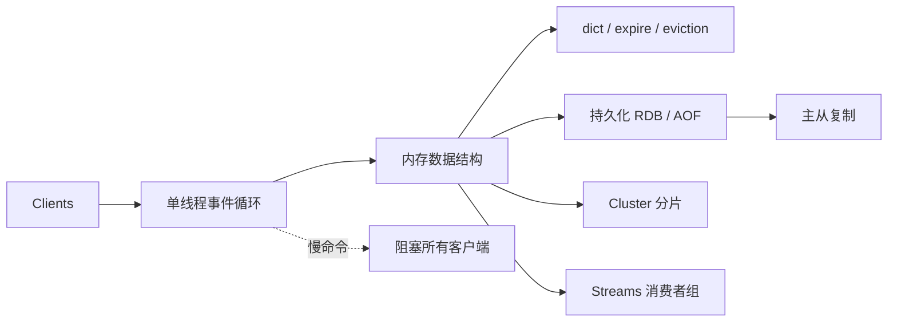

# Week 03 入门：Redis 专题

> 一句话：Redis 像一个**只有一个服务员的超快小餐馆**——菜单都在内存里，服务员一次只做一件事，但动作极快；一旦有人点了一道要炖三小时的菜，整家店都得等。

## 0. 为什么先读这篇

Week 03 会连续出现这些词：

- 单线程、事件循环、epoll；
- 渐进式 rehash、过期删除、内存淘汰；
- RDB、AOF、fork、COW；
- 主从复制、PSYNC、backlog；
- Cluster、槽、MOVED/ASK；
- Streams、消费者组、PEL。

如果直接看源码，很容易变成“每个词都认识，连起来不知道在干嘛”。这篇先用一个餐馆类比，把整周串起来。

读完你应该能用自己的话解释：

1. Redis 为什么敢用单线程？
2. 它怎么做到“内存有限还能一直跑”？
3. 它怎么做到“宕机/扩容/多副本”？

## 1. 一句话直觉

> Redis 把“等网络”交给操作系统，把“算数据”留给自己；所以它不需要很多线程，但绝对不能在执行命令时阻塞。

## 2. 一个贯穿本周的小例子

```text
用户请求 1：SET user:1 Alice
用户请求 2：GET user:1
用户请求 3：EXPIRE user:1 60
用户请求 4：SUBSCRIBE news
用户请求 5：XADD orders * id 100 amount 30
```

本周的所有机制，都可以围绕这几个请求问：

- 谁先执行？会不会互相阻塞？
- 数据放在内存的哪个结构里？
- 60 秒后谁负责删除？
- 宕机后怎么恢复？
- 从库怎么追上主库？
- 数据太大时怎么分到多台机器？
- 一条消息被谁消费、没确认怎么办？

## 3. 生活类比

| Redis 里的东西 | 生活里的东西 | 为什么像 |
|---|---|---|
| 单线程事件循环 | 一个服务员 + 一张总订单 | 一次只处理一件事，但顺序清楚 |
| epoll / 非阻塞 socket | 服务员只问“谁举手了” | 不挨个站在桌边等 |
| 命令执行 | 服务员做菜 | 必须快，慢了所有桌都等 |
| 过期键 | 冰箱里的保质期 | 不会每秒全翻一遍，而是抽查 + 用到时检查 |
| 内存淘汰 | 冰箱满了扔什么 | 按 LRU/LFU/随机等策略 |
| RDB | 给餐馆拍一张全景照 | 快照，恢复快，但可能丢最后一段 |
| AOF | 记流水账 | 每条写操作追加，重放恢复 |
| 主从复制 | 分店抄总店的账 | 先全量抄，再增量同步 |
| Cluster | 多家分店各管一部分菜单 | 按 key 分片，走错店就重定向 |
| Streams | 带签收单的传菜窗口 | 消息有 ID、消费者组、未确认列表 |

## 4. 概念地图



## 5. 术语翻译表

| 术语 | 先用一句人话解释 | 本周会在哪里出现 |
|---|---|---|
| Reactor | 一个循环：谁准备好了就处理谁 | Day 02 已铺垫，Day 15 会回看 |
| 渐进式 rehash | 搬家不一次搬完，每次搬一格 | 大字典扩容 |
| 惰性删除 | 用到这个 key 时才检查过期 | 过期键 |
| 定期抽样 | 每秒随机抽查一批，清理过期 | 主动过期 |
| RDB | 某一刻的全量照片 | 持久化 |
| AOF | 所有写命令的流水账 | 持久化 |
| fork + COW | 复印时先共享，写了才复制 | RDB/AOF rewrite |
| PSYNC | 从库断线后尽量续传，而不是全量重抄 | 主从复制 |
| slot | 把 key 分到 16384 个格子 | Cluster |
| MOVED / ASK | “这件商品不归我管，去那家店” | Cluster 重定向 |
| PEL | 已投递但还没签收的消息清单 | Streams |

## 6. 本周要回答的问题

1. 单线程为什么能快？瓶颈到底在哪？
2. 内存有限时，过期、淘汰、碎片怎么处理？
3. 持久化、复制、集群分别牺牲了什么？
4. 缓存穿透/击穿/雪崩/热 key 应该怎么防？
5. Streams 和 Kafka 的“消费组”有什么相同/不同？

## 7. 两条阅读路线

**直觉轨道（第一遍）**

- 读：单线程模型、过期/淘汰的比喻、RDB/AOF 的区别、主从/Cluster 的目标、缓存五坑。
- 跳过：`dict.c` 的 rehash 细节、`replication.c` 的协议字段、Cluster gossip 的具体报文。
- 目标：能画出“客户端 → 事件循环 → 内存 → 持久化/复制/分片”的图。

**源码轨道（第二遍）**

- Day 15：`dict.c` 的双表 + `rehashidx`；
- Day 16：`expire.c` / `evict.c`；
- Day 17：`rdb.c` / `aof.c`；
- Day 18：`replication.c`；
- Day 19：`cluster.c`；
- Day 20：`t_stream.c`。

## 8. 先记住这几句话

1. **Redis 的快，是“避免等待和锁”，不是“每个命令都神奇地快”。**
2. **单线程的代价是：一个慢命令会阻塞所有人。**
3. **过期不是每个 key 一个定时器，而是惰性删除 + 定期抽样。**
4. **RDB 是照片，AOF 是流水账；一个恢复快，一个丢得少。**
5. **主从解决读扩展/备份，Cluster 解决容量和写扩展；两者不是一回事。**
6. **缓存问题优先用“边界 + 降级 + 过期策略”解决，不要只靠加机器。**

## 9. 常见误解

| 容易误解 | 更准确的理解 |
|---|---|
| Redis 是单线程，所以所有工作都在一个线程 | 命令执行是单线程；持久化/关闭文件/网络读写可能用后台线程或 I/O 线程 |
| 单线程一定比多线程快 | 只在“内存操作 + 大量连接 + 短命令”下成立；慢命令会拖垮全局 |
| 过期键一到时间就立刻删除 | 惰性删除 + 定期抽样，存在延迟 |
| RDB 一定比 AOF 安全 | RDB 可能丢最后一次快照后的数据；AOF 取决于 fsync 策略 |
| 主从复制是强一致 | 默认异步复制，存在延迟和丢数据窗口 |
| Cluster 能解决所有扩展问题 | 多 key 操作、事务、跨槽查询都受限制 |

## 10. 本周实验与不变量

- 实验：用一个慢命令（如 `KEYS *` 或大 Lua）观察其他请求的 p99；
- 不变量：单条命令执行期间，不会插入另一条命令；
- 失败注入：杀掉从库/主库、模拟网络分区、让 AOF fsync 变慢；
- 观察：内存、命中率、过期键数量、复制延迟、Cluster 槽分布。

## 11. 下一步

从 **Day 15 · 渐进式 rehash** 开始。

第一遍只读“为什么要双表 + 怎么渐进搬”，不要一开始啃 `dict.c` 的每个宏。
