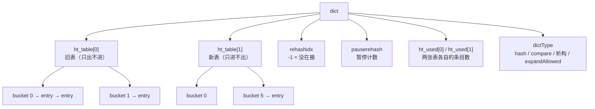
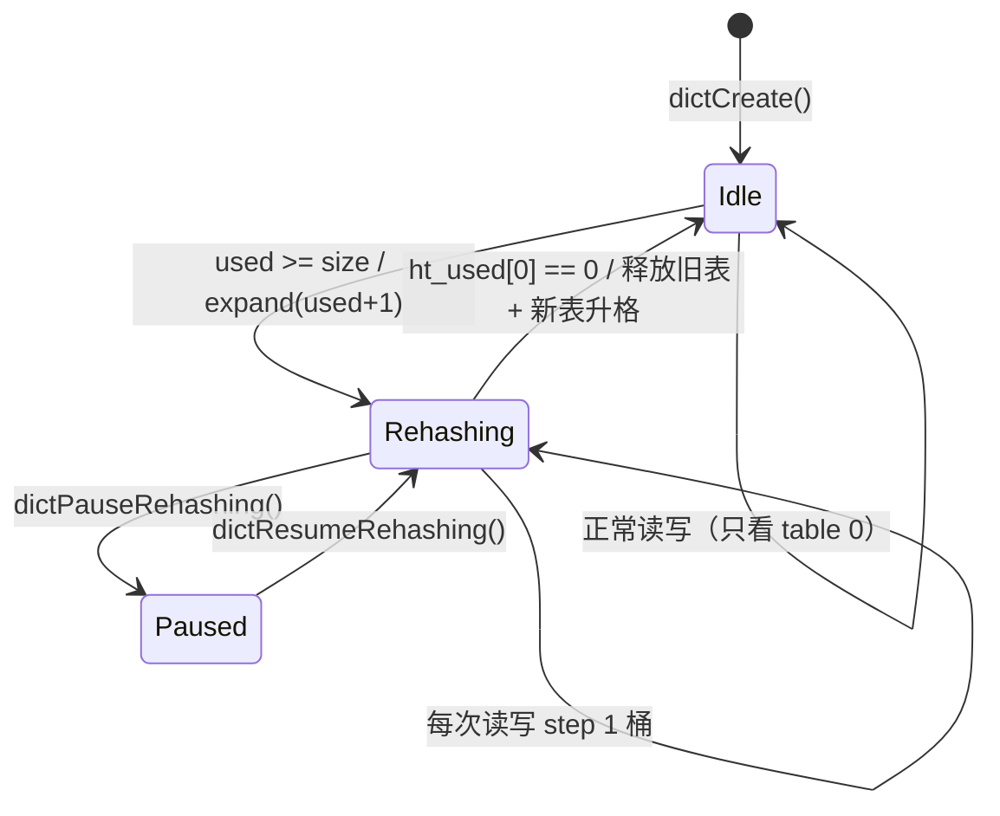
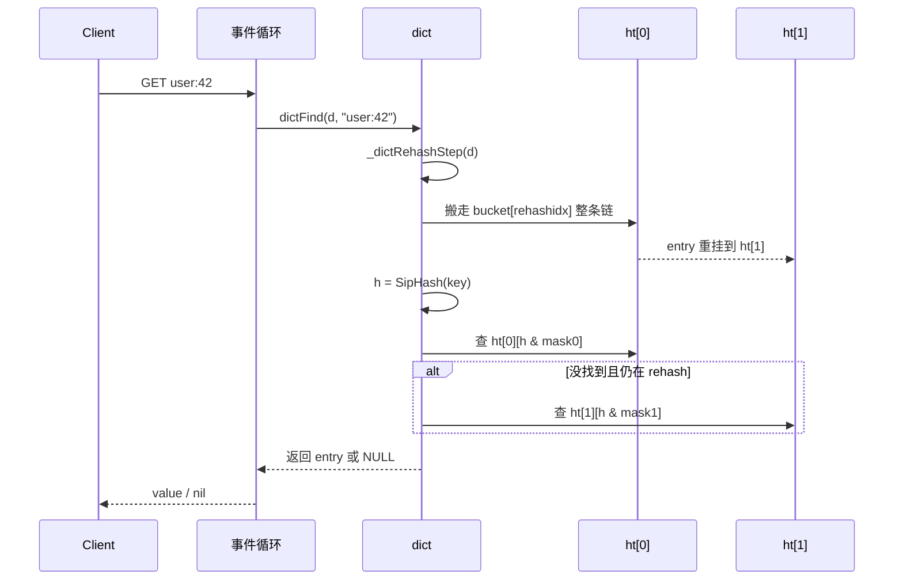

# Day 15 · 渐进式 rehash：大字典不能一次搬完

> **一句话结论**：扩容不是“申请一张更大的表，然后把所有 key 重挂一遍”，而是“留一张旧表、记一个游标，谁访问就顺手搬一格”。总工作量没变，但把一次 O(n) 的停顿，摊成了 n 次 O(1) 的小步。

---

## 0. 本次问题

一个 Redis 实例里有 400 万个 key。某次写入让主字典的负载因子到达 1，需要从 4M 个桶扩到 8M 个桶。

- 如果一次性搬完：要重新哈希 400 万个 key、重挂指针、释放旧表。单线程上这是一次**几十到上百毫秒**的停顿——期间所有客户端一起排队。
- 如果不搬：链会越来越长，GET 从 O(1) 退化，延迟慢慢烂掉。

Redis 选了第三条路：**不闭馆搬家**。这次课要能回答三个具体问题：

1. 为什么单线程数据库宁可用接近 2 倍的桶内存，也不肯“停 100ms 搬完”？
2. 一个 `rehashidx` 整数，怎么同时支撑“暂停、恢复、双表查找、缩容”？
3. 搬迁途中做 `SCAN`，为什么可能重复、却承诺不遗漏？

---

## 0.5 先建立直觉

### 一句话直觉

> 图书馆要换更大的书架，但不闭馆：门口挂一块牌子写着“旧馆 0 号到 3 号架已搬空”，读者找书时两个馆都看一眼，管理员每接待一位读者就顺手搬一格书。

### 生活类比

| Redis 里的东西 | 图书馆里的东西 | 为什么像 |
|---|---|---|
| `ht[0]` 旧表 | 旧馆的书架 | 只往外搬，不再进新书 |
| `ht[1]` 新表 | 新馆的书架 | 新到的书直接放这里 |
| `rehashidx` | 门口那块“搬到哪了”的牌子 | 一个整数就够描述进度 |
| 一次 `_dictRehashStep` | 管理员接待一位读者，顺手搬一格 | 工作被摊到每次访问里 |
| `empty_visits` | “一次最多跳过 n×10 个空架” | 防止在几乎空的馆里站太久 |
| 搬完整张表 | 退掉旧馆、把新馆改名成主馆 | 只剩一张表，快路径恢复 |
| `dictPauseRehashing` | 盘点时挂“暂停搬馆” | 盘点员按固定路线走，不能被搬动干扰 |
| `dictScan` 的反序游标 | 盘点员倒着数架号 | 馆变大了也不会重复走或漏走 |

### 只需要记住三个词

1. **双表**：迁移期间旧表和新表同时存在，读要覆盖两张表。
2. **游标**：`rehashidx` 指向旧表里下一个待搬的桶，进度是一个可保存的整数。
3. **摊还**：每次读写顺手搬一格；没有后台线程，也没有“迁移线程”。

### 第一遍可以先跳过

- `dictScan` 反序游标的正确性证明（先记住结论：可能重复、不会遗漏）；
- `empty_visits` 为什么是 `n*10` 这个具体常数；
- Redis 7.0 把 `size` 改成 `ht_size_exp` 的内存细节；
- 本文第 6 节的 C++ 实现细节。

### 两种做法的对比

```text
一次性 rehash（大多数语言的标准库）：
  申请新表 -> 遍历旧表所有桶 -> 每个 entry 重新挂到新表 -> 释放旧表
  一条命令内完成。延迟尖刺 = O(n)。

渐进式 rehash（Redis / Go map）：
  申请新表 -> rehashidx = 0
  之后每次 GET/SET/DEL：如果正在搬迁，先搬旧表的一个桶，再干正事
  空闲时 cron 再补一点
  旧表 used 归零的那一步：释放旧表，新表升格
  延迟尖刺 = O(1)（严格说是 O(最长链)）
```

---

## 1. 设计背景：约束从哪里来

### 1.1 Redis 的字典无处不在

先别把 `dict` 只当成“存 key 的那个表”。在 Redis 里它是通用基础设施：

| 位置 | 存什么 | 规模量级 |
|---|---|---|
| `server.db[i].dict` | 整个 keyspace：key → `robj` | 百万到千万 |
| `server.db[i].expires` | key → 过期时间戳 | 最多与 keyspace 同量级（只有设了 TTL 的 key） |
| 大 hash 的底层编码 | field → value | 单 key 可到百万 field |
| 大 set / zset 的成员表 | member → 分值/空 | 单 key 可到百万 member |
| 命令表 | 命令名 → `redisCommand` | 几百，永远很小 |

小对象根本不用 `dict`：默认 `hash-max-listpack-entries 128`，小 hash/set/zset 用 listpack 存。所以 `dict` 的常数因子只对**大 key 空间**和**大集合**重要——而正是这些场景，扩容的 O(n) 最疼。

### 1.2 为什么不能“停一下搬完”

因为 Redis 的命令执行是单线程的（Day 02）。单线程的好处是没有锁、没有竞态、缓存友好；代价是**一条命令的延迟等于所有人的延迟**。

更糟的是扩容的触发时机：它不是 cron 定时做的，而是**下一次写入**发现负载因子到 1 时顺手触发的。也就是说，这次百毫秒级停顿最可能发生在：

- 写入高峰（大家都在 SET）；
- 某个大 key 正在被批量写入；
- 主从复制、AOF 重写也在抢 I/O 的时候。

这是一条典型的“延迟长尾”事故：平均延迟没变，p99 突然从 2ms 变成 150ms，而且找不到慢命令——因为慢的不是命令，是扩容。

### 1.3 算一笔账

400 万 key、负载因子 1，扩到 800 万桶：

```text
新表指针数组：8M × 8B = 64 MB       （旧表 32 MB 还没释放）
每个 entry 约 24B，jemalloc 尺寸类 32B：4M × 32B = 128 MB
搬迁工作量：400 万次「重新算 hash + 挂链」
  - SipHash 对短 key 约 10–20ns
  - 加上指针重连和缓存不命中，按 30–100ns/条估
  => 120ms–400ms 的一次性停顿（量级估算，不是实测）
```

单线程上停 120ms，意味着这 120ms 内所有客户端的最小延迟都是 120ms。对 p99 要求 10ms 的系统，这是灾难。

渐进式把同样的 400 万次搬迁摊到 400 万次操作上：每次操作多花几十纳秒，p99 几乎不动。**代价是这段时间内内存多占一张表，且每次查找最多要看两张表。**

### 1.4 关键约束

| 约束 | 具体表现 | 对设计的影响 |
|---|---|---|
| 延迟 | 单线程，一条命令阻塞所有人；p99 要求毫秒级 | 扩容不能产生 O(n) 停顿 → 必须分批 |
| 吞吐 | 40 万 QPS 时，每秒有 40 万次“顺手搬”的机会 | 摊还成本必须小到测不出来 |
| 内存 | 迁移期旧表 + 新表同时存在，接近 2× 桶内存 | 迁移期不能太长；fork 时更敏感 |
| 一致性 | 单条命令是原子的，不能出现“两个表都没有” | 查找必须覆盖两张表；写入只能进新表 |
| 运维复杂度 | fork/COW、maxmemory、碎片、持久化 | 扩容时机需要策略层（暂停/延后） |

### 1.5 历史与失败案例

**哈希洪水（hash flooding）**。链地址法的单步成本是 O(链长)。如果攻击者能构造大量落到同一个桶的 key，链会变成几千长：不仅 GET 退化，**搬一个桶**也会变成一次长停顿——渐进式的前提“单步 O(1)”被破坏。Redis 从 4.0 起（2017 年，commit "Use SipHash hash function to mitigate HashDos attempts"）把哈希函数换成带随机种子的 SipHash，让攻击者无法离线构造同桶 key。

**fork 与 COW**。RDB 快照、AOF 重写都靠 `fork` + 写时复制。父进程这时如果扩容，会大面积改写旧表页，触发大量 COW 页复制，RSS 直接翻倍。Redis 的策略是：

```c
/* server.c: updateDictResizePolicy() */
if (server.in_fork_child != CHILD_TYPE_NONE)
    dictSetResizeEnabled(DICT_RESIZE_FORBID);   /* fork 子进程里：禁止 */
else if (hasActiveChildProcess())
    dictSetResizeEnabled(DICT_RESIZE_AVOID);    /* 有子进程：尽量别搬 */
else
    dictSetResizeEnabled(DICT_RESIZE_ENABLE);
```

`DICT_RESIZE_AVOID` 下，`dictRehash` 发现新旧表大小比小于 5 就直接返回——**暂停搬迁**，等子进程结束再说。`databasesCron` 里也一样：有子进程在保存时，连 cron 的 rehash 都不做。

**maxmemory 下的扩容**。`dictType` 有一个 `expandAllowed` 回调，`dbDictType` 指向 `dictExpandAllowed`：如果扩容后内存会超过 `maxmemory`，就先不扩；只有负载因子超过安全阈值才强制扩。这时系统选择“忍长链”，用延迟换内存——一个典型的策略与机制分离。

**空桶扫描**。如果旧表很稀疏（删了很多 key），一次 `dictRehash` 可能连续遇到成千上万个空桶。搬 0 个 entry 却扫了 100 万个桶，同样是长停顿。这就是 `empty_visits` 存在的原因。

### 1.6 为什么是“双表”，不是“后台线程”

你可能会问：开个后台线程慢慢搬不行吗？在 Redis 里不行：

- 后台线程要搬表，就得和主线程并发读写同一张表 → 需要锁或原子操作，把“无锁单线程”的简单性毁了；
- 主线程改一个 entry 的 `next` 指针时，后台线程可能正在读它 → 数据竞争；
- 持久化、复制都假设“命令原子、状态一致”，引入并发迁移会把边界扩散到整个代码库。

双表 + 游标的妙处在于：**迁移状态是纯内存布局，不参与任何语义**。命令看到的永远是“一个逻辑字典”，至于某个 key 在旧表还是新表，对命令透明。所以它不需要锁，不需要事务，也不需要写进 RDB/AOF。

---

## 2. 架构与数据流

### 2.1 数据结构



Redis 7.2 的 `dict` 结构（`dict.h`，省略了 metadata 等字段）：

```c
struct dict {
    dictType *type;
    dictEntry **ht_table[2];   /* 两张桶数组 */
    unsigned long ht_used[2];  /* 两张表各自装了多少 entry */
    long rehashidx;            /* -1 表示没有在 rehash，否则是旧表的下一个桶 */
    int16_t pauserehash;       /* >0 时 _dictRehashStep 不搬 */
    signed char ht_size_exp[2];/* 7.0 起：存指数，size = 1 << exp */
};
```

几个值得注意的点：

- **`ht_size_exp` 而不是 `size`**：桶数永远是 2 的幂，存指数只占 1 字节，把每张表的 `size` 从 8 字节压到 1 字节；空表的指数是 `-1`，`DICTHT_SIZE(-1) == 0`。
- **`rehashidx` 是 `long`**：桶数可能超过 2^31，不能用 `int`。
- **`pauserehash` 是计数器**：支持嵌套暂停（SCAN 回调里又调了什么，也不会把暂停提前解除）。
- **桶数、已用数、游标三者足以描述整个迁移状态**——没有链表、没有队列、没有额外内存。

`dictEntry` 本体（常见字典，无 metadata）：

```c
struct dictEntry {
    void *key;          /* 8B */
    union {             /* 8B：指针 / uint64 / int64 / double */
        void *val;
        uint64_t u64;
        int64_t s64;
        double d;
    } v;
    struct dictEntry *next;  /* 8B：同桶链 */
};
```

24 字节，但 jemalloc 的尺寸类里会落到 32 字节。桶数组是 8 字节/桶。所以负载因子 1 时，每个 key 的字典开销约 `32 + 8 = 40B`（不含 key/value 本身）。这个数字决定了“双表期间多占多少内存”。

### 2.2 状态机



“暂停”不是独立状态，只是 `pauserehash > 0` 的标记：读写在暂停期间照常工作（照样能查两张表、照样往新表写），只是**不推进游标**。

### 2.3 一次 GET 的路径



注意顺序：**先搬一格，再干正事**。这意味着“搬迁”搭的是每个命令的便车，不需要额外的调度。

### 2.4 三条推进路径

| 路径 | 谁触发 | 一次搬多少 | 什么时候用 |
|---|---|---|---|
| 命令路径 | 每次 `dictFind` / `dictAddRaw` / `dictGenericDelete` | 1 个桶（`dictRehash(d,1)`） | 有读写流量时 |
| 定时路径 | `serverCron` → `databasesCron` → `incrementallyRehash` | 1ms 预算的批量（每批 100 桶，可能略超） | 空闲实例，避免“永远两张表” |
| 扩容入口 | `_dictExpandIfNeeded` → `dictExpand` | 0 个桶（只建新表、置游标） | 负载因子到 1 时 |

三条路径共享同一个 `dictRehash`，区别只是 `n` 和预算。**没有专门的迁移线程**，这是单线程设计能成立的关键。

### 2.5 关键对象

| 对象 | 职责 | 生命周期 |
|---|---|---|
| `dict` | 逻辑字典，持有两张表与游标 | 与 key 空间同寿命 |
| `ht[0]` | 当前主表；rehash 时是“旧表”，只出不进 | 扩容时被 `zfree`，缩容时被换掉 |
| `ht[1]` | 迁移目标表；平时为 NULL | rehash 期间存在，完成后升格 |
| `rehashidx` | 旧表下一个待搬桶号；-1 表示空闲 | 迁移期有效 |
| `pauserehash` | 暂停计数 | 短暂（SCAN、安全迭代器） |
| `dictType` | 哈希、比较、析构、`expandAllowed` 策略钩子 | 静态配置 |

### 2.6 两个必须记住的不变量

> **不变量 1：旧表只出不进。**
> 迁移期间的新写入一律进 `ht[1]`。所以 `ht_used[0]` 单调不增。

> **不变量 2：`ht_used[0] == 0` 就是“搬完了”。**
> 判据不是“游标走到表尾”，而是“旧表空了”。空桶不用搬，游标只是在跳过它们；只要旧表还有 entry，游标后面就一定有非空桶（否则那些 entry 无处可放）。所以“旧表空”与“搬完”等价，收尾时也不必关心游标停在哪。

这两条不变量后面会反复用到：查找为什么可以只看两张表、删除为什么可以直接删旧表、SCAN 为什么不会漏。

---

## 3. 源码关键路径（Redis 7.2）

> 只追一条路径：一次 `GET` 如何顺便推进 rehash，以及满/空/缩容三种边界如何收尾。
> 源码：<https://github.com/redis/redis/blob/7.2/src/dict.c>（访问日期 2026-11-18）。

### 3.1 入口：三个操作都先“搬一格”

```c
/* dict.c */
dictEntry *dictFind(dict *d, const void *key) {
    if (dictSize(d) == 0) return NULL;          /* 空字典直接返回，不推进 */
    if (dictIsRehashing(d)) _dictRehashStep(d); /* 顺手搬一格 */
    h = dictHashKey(d, key);
    for (table = 0; table <= 1; table++) {
        idx = h & DICTHT_SIZE_MASK(d->ht_size_exp[table]);
        he = d->ht_table[table][idx];
        while (he) { ... }
        if (!dictIsRehashing(d)) break;         /* 只有一张表时不用查第二张 */
    }
    return NULL;
}
```

`dictFindPositionForInsert`（插入路径）和 `dictGenericDelete`（删除路径）的第一行也是同样的 `if (dictIsRehashing(d)) _dictRehashStep(d);`。三个热路径各加一行，就把迁移完全“寄生”进了正常流量。

### 3.2 一步到底做什么

```c
static void _dictRehashStep(dict *d) {
    if (d->pauserehash == 0) dictRehash(d, 1);
}
```

`dictRehash` 是全部魔法所在（省略了 resize 策略判断后的主干）：

```c
int dictRehash(dict *d, int n) {
    int empty_visits = n * 10;   /* 最多跳过这么多空桶 */
    if (!dictIsRehashing(d)) return 0;
    /* 省略：DICT_RESIZE_FORBID / AVOID 的判断 */

    while (n-- && d->ht_used[0] != 0) {
        dictEntry *de, *nextde;

        /* 跳过空桶；空桶预算用完就退出，但游标已经前进 */
        while (d->ht_table[0][d->rehashidx] == NULL) {
            d->rehashidx++;
            if (--empty_visits == 0) return 1;   /* 1 = 还没搬完 */
        }

        de = d->ht_table[0][d->rehashidx];
        /* 整条链一起搬：只改 next 指针，不重新分配 entry */
        while (de) {
            uint64_t h;
            nextde = dictGetNext(de);
            void *key = dictGetKey(de);
            if (d->ht_size_exp[1] > d->ht_size_exp[0])
                h = dictHashKey(d, key) & DICTHT_SIZE_MASK(d->ht_size_exp[1]);  /* 扩容：重算 */
            else
                h = d->rehashidx & DICTHT_SIZE_MASK(d->ht_size_exp[1]);         /* 缩容：掩码 */
            dictSetNext(de, d->ht_table[1][h]);
            d->ht_table[1][h] = de;
            d->ht_used[0]--;
            d->ht_used[1]++;
            de = nextde;
        }
        d->ht_table[0][d->rehashidx] = NULL;
        d->rehashidx++;
    }

    /* 旧表空了：释放它，把新表“升格”成主表 */
    if (d->ht_used[0] == 0) {
        zfree(d->ht_table[0]);
        d->ht_table[0] = d->ht_table[1];
        d->ht_used[0] = d->ht_used[1];
        d->ht_size_exp[0] = d->ht_size_exp[1];
        _dictReset(d, 1);
        d->rehashidx = -1;
        return 0;                 /* 0 = 搬完了 */
    }
    return 1;
}
```

逐段看，每一行都在回答一个“如果没它会发生什么”：

| 代码 | 没有它会怎样 |
|---|---|
| `empty_visits = n*10` | 稀疏表一次扫百万空桶，渐进式退化成停世界 |
| `while (n-- && ht_used[0] != 0)` | 空表时还在搬；或搬过头 |
| 跳过空桶后 `return 1` | 把“没搬 entry”误报成“搬完了”，后续查找漏表 |
| 整条链一起搬 | 每个 entry 单独找落点，搬一格变成 O(链长) 次 hash |
| 扩容时重算 hash | 新掩码多了高位，用旧下标会放错桶 |
| 缩容时 `rehashidx & mask1` | 白算一次 SipHash（代价见技巧 5） |
| 搬完 `zfree` + 升格 | 永远两张表，每次查找都要看两处，内存也降不下来 |
| `rehashidx = -1` | 状态无法区分“搬完了”和“搬到 0 号桶” |

**返回值语义容易记错**：`1` 表示“还在搬”，`0` 表示“搬完了”。`dictRehashMilliseconds` 就是靠它循环的：

```c
int dictRehashMilliseconds(dict *d, int ms) {
    if (d->pauserehash > 0) return 0;
    long long start = timeInMilliseconds();
    int rehashes = 0;
    while (dictRehash(d, 100)) {      /* 一批 100 桶 */
        rehashes += 100;
        if (timeInMilliseconds() - start > ms) break;
    }
    return rehashes;
}
```

注意它返回的是“批数 × 100”，不是精确搬了多少桶——一个不影响正确性的粗糙计数。

### 3.3 何时开始搬：`_dictExpandIfNeeded`

```c
static int _dictExpandIfNeeded(dict *d) {
    if (dictIsRehashing(d)) return DICT_OK;                 /* 已经在搬了 */

    if (DICTHT_SIZE(d->ht_size_exp[0]) == 0)                /* 第一次插入 */
        return dictExpand(d, DICT_HT_INITIAL_SIZE);         /* 4 个桶 */

    if ((dict_can_resize == DICT_RESIZE_ENABLE &&
         d->ht_used[0] >= DICTHT_SIZE(d->ht_size_exp[0])) ||   /* 负载因子到 1 */
        (dict_can_resize != DICT_RESIZE_FORBID &&
         d->ht_used[0] / DICTHT_SIZE(d->ht_size_exp[0]) > dict_force_resize_ratio))
    {                                                          /* 或超过 5 倍，强制扩 */
        if (!dictTypeExpandAllowed(d)) return DICT_OK;         /* maxmemory 策略 */
        return dictExpand(d, d->ht_used[0] + 1);
    }
    return DICT_OK;
}
```

两个细节：

1. **扩到 `used + 1` 而不是 `used * 2`**。因为 `_dictNextExp` 会向上取到 2 的幂，`used == size` 时 `used+1` 正好落在下一档，效果就是翻倍；而 `used` 远小于 `size` 的缩容场景，同一个函数也能复用。
2. **`dict_force_resize_ratio = 5`**。即使 resize 被策略禁止（`AVOID`），负载因子超过 5 倍也强制扩——否则链会长到不可接受。这是“策略可以让步，但不能让到破坏 O(1)”。

`dictExpand` 只做三件事：算目标大小、分配新表、把 `rehashidx` 置 0。它**一个 entry 都不搬**。

```c
static signed char _dictNextExp(unsigned long size) {
    if (size <= DICT_HT_INITIAL_SIZE) return DICT_HT_INITIAL_EXP;
    if (size >= LONG_MAX) return (8*sizeof(long)-1);
    return 8*sizeof(long) - __builtin_clzl(size-1);  /* 向上取 2 的幂的指数 */
}
```

### 3.4 删除路径：两张表都要找

```c
static dictEntry *dictGenericDelete(dict *d, const void *key, int nofree) {
    if (dictSize(d) == 0) return NULL;
    if (dictIsRehashing(d)) _dictRehashStep(d);
    h = dictHashKey(d, key);

    for (table = 0; table <= 1; table++) {
        idx = h & DICTHT_SIZE_MASK(d->ht_size_exp[table]);
        he = d->ht_table[table][idx];
        prevHe = NULL;
        while (he) {
            if (key == he_key || dictCompareKeys(d, key, he_key)) {
                /* 从链上摘掉 */
                ...
                d->ht_used[table]--;
                return he;
            }
            ...
        }
        if (!dictIsRehashing(d)) break;
    }
    return NULL;
}
```

删除允许直接删旧表里的 entry：`ht_used[0]--` 之后，旧表只会更空，不会破坏“旧表只出不进”。极端情况下旧表被删空（`used[0] == 0`），下一次 `dictRehash` 会直接走收尾分支释放旧表——即使游标还没扫到表尾。

### 3.5 缩容：同一套机制的另一半

扩容不是唯一会搬家的场景。删掉大量 key 后，表会变得很空：100 万个桶只装 100 个 entry，桶数组白占 8MB。Redis 在 cron 里检查：

```c
/* server.c */
int htNeedsResize(dict *dict) {
    long long size = dictSlots(dict), used = dictSize(dict);
    return (size > DICT_HT_INITIAL_SIZE && (used * 100 / size < HASHTABLE_MIN_FILL));
}

void tryResizeHashTables(int dbid) {
    if (htNeedsResize(server.db[dbid].dict)) dictResize(server.db[dbid].dict);
    if (htNeedsResize(server.db[dbid].expires)) dictResize(server.db[dbid].expires);
}
```

`HASHTABLE_MIN_FILL` 是 10（百分比）。`dictResize` 用 `minimal = max(used, 4)` 调 `dictExpand`，**复用同一套双表机制**，只是目标表更小。缩容时游标照样从 0 走到 `size_old - 1`，但落点不用重算 hash——见技巧 5。

缩容为什么放在 cron 而不是删除路径？因为“删到 10%”会反复触发（删到 9% 缩一半，插入又回到 20%……）。放到每 100ms 一次的 cron 里，天然有节流。

### 3.6 空闲时也要推进：cron 的 1ms

如果实例没有读写，命令路径就不会搬，两张表会一直挂着。`serverCron`（默认 10Hz）里的 `databasesCron` 补上这一块：

```c
/* server.c: databasesCron()（简化） */
if (!hasActiveChildProcess()) {          /* 有 fork 子进程时，连 cron 都不搬（COW） */
    for (j = 0; j < dbs_per_call; j++) {
        tryResizeHashTables(resize_db % server.dbnum);
        resize_db++;
    }
    if (server.activerehashing) {
        for (j = 0; j < dbs_per_call; j++) {
            int work_done = incrementallyRehash(rehash_db);
            if (work_done) break;        /* 做过活的库就停，下一轮继续 */
            rehash_db = (rehash_db + 1) % server.dbnum;
        }
    }
}

int incrementallyRehash(int dbid) {
    if (dictIsRehashing(server.db[dbid].dict)) {
        dictRehashMilliseconds(server.db[dbid].dict, 1);   /* 1ms 预算 */
        return 1;
    }
    if (dictIsRehashing(server.db[dbid].expires)) {
        dictRehashMilliseconds(server.db[dbid].expires, 1);
        return 1;
    }
    return 0;
}
```

三个设计点：

- **每轮最多 1ms/库，且做过活的库立即 break**：保证 cron 不会因为某个大库超时，拖慢其他定时任务（过期扫描、客户端超时检查）。
- **`activerehashing` 可关闭**：极端延迟敏感的场景可以把它关掉，让迁移完全靠命令路径推进（代价是双表期更长）。
- **`!hasActiveChildProcess()`**：与 `DICT_RESIZE_AVOID` 是同一个 COW 顾虑的两道保险。

### 3.7 resize 策略：谁有权说“先别扩”

`dict.c` 里有一个全局开关，取值是枚举：

```c
typedef enum {
    DICT_RESIZE_ENABLE,   /* 正常扩/缩 */
    DICT_RESIZE_AVOID,    /* 尽量不搬：新旧表大小比 < 5 时 dictRehash 直接返回 0 */
    DICT_RESIZE_FORBID    /* 完全禁止：dictRehash 返回 0，扩容也被 _dictExpandIfNeeded 拦住 */
} dictResizeEnable;
```

`dictRehash` 开头的判断：

```c
if (dict_can_resize == DICT_RESIZE_FORBID || !dictIsRehashing(d)) return 0;
if (dict_can_resize == DICT_RESIZE_AVOID &&
    ((s1 > s0 && s1 / s0 < dict_force_resize_ratio) ||
     (s1 < s0 && s0 / s1 < dict_force_resize_ratio)))
    return 0;   /* 先冻结，等子进程结束 */
```

注意 `AVOID` 下“暂停”的是搬迁，不是读写：查找仍然会看两张表，新写入仍然进新表，只是游标不动。系统用“更长的双表期”换“更少的 COW 页复制”。

### 3.8 SCAN：无状态游标怎么做到不遗漏

`SCAN` 要在一个可能正在搬家、甚至两次调用之间扩容的表上遍历。它的保证（Redis 官方文档）：

1. 从开始到结束**一直在**集合里的元素，至少返回一次；
2. 过程中可能重复返回同一个元素；
3. 期间新增/删除的元素，可能返回也可能不返回。

实现（`dictScanDefrag`，省略 defrag 细节）：

```c
/* 简化示意：emit_bucket() 表示“把桶内整条链交给回调”，Redis 里是内联循环 */
unsigned long dictScanDefrag(dict *d, unsigned long v, ...) {
    if (dictSize(d) == 0) return 0;
    dictPauseRehashing(d);          /* 回调期间不搬，避免边走边变 */

    if (!dictIsRehashing(d)) {
        m0 = DICTHT_SIZE_MASK(d->ht_size_exp[0]);
        emit_bucket(d, 0, v & m0);  /* 访问当前桶 */
        v |= ~m0;                   /* 掩码外的位全置 1 */
        v = rev(v); v++; v = rev(v);/* 反序 +1 */
    } else {
        /* 小表在前，大表按“同一游标的全部扩展”逐个访问 */
        if (s0 > s1) { swap(t0, t1); }
        m0 = mask(t0); m1 = mask(t1);
        emit_bucket(d, t0, v & m0);
        do {
            emit_bucket(d, t1, v & m1);
            v |= ~m1; v = rev(v); v++; v = rev(v);
        } while (v & (m0 ^ m1));
    }
    dictResumeRehashing(d);
    return v;
}
```

**为什么普通递增会漏？** 桶号是 `hash & (size-1)`，用的是**低位**。表从 8 桶扩到 16 桶时，桶 `101` 的 key 会被分到 `0101` 和 `1101`。如果游标已经走过 `101`，按普通递增接着走 `110`，那么新出现的 `1101` 永远不会被访问——它“落在游标身后”了。

**反序游标怎么解决？** 它把游标当二进制数**倒过来**再递增，等价于“先变高位、后变低位”。8 桶时的访问顺序是：

```text
cursor: 000 → 100 → 010 → 110 → 001 → 101 → 011 → 111
bucket:   0     4     2     6     1     5     3     7
```

扩容到 16 桶后，每个旧桶 `abc` 分裂成 `0abc` 和 `1abc`。上面这个顺序保证：**已经访问过的旧桶的所有分裂，要么已经访问过，要么排在游标后面**。所以“一直在集合里的元素”不会漏；代价是同一个元素可能从新旧两个位置各被访问一次。

两张表并存时，Redis 的做法更直接：小表的当前桶访问一次，再把大表里“这个游标的全部扩展”都访问一遍（`do...while (v & (m0 ^ m1))`），然后才推进游标。这样即使 key 刚从小表搬到大表，也不会漏。

> 完整证明可以跳过；第一遍记住“可能重复、不会遗漏、无状态（不占额外内存）”就够了。

### 3.9 内存账：为什么是“接近 2 倍”

| 组成 | 空闲时 | 迁移期 |
|---|---|---|
| `ht[0]` 桶数组 | 8B × size | 8B × size_old |
| `ht[1]` 桶数组 | 0 | 8B × size_new（约 2× old） |
| `dictEntry` | 24B（分配 32B）/条 | 同左（条目没有复制，只是重挂） |
| key / value 对象 | 原有 | 原有（指针没变） |

所以迁移期的额外开销主要来自**新桶数组**，约等于旧表的大小；entry 本身不复制。400 万 key、负载因子 1 时，旧表 32MB，新表 64MB，多占 32MB 左右——不算灾难，但叠加 fork 的 COW 就值得暂停了。

另外，迁移期新表的负载因子会**暂时超过 1**（旧表的 entry 还没搬完，新表已经装了一半），链会略长。这是渐进式 rehash 的固有现象，也是 `empty_visits` 和 `dict_force_resize_ratio` 存在的原因之一。

### 3.10 语言对照

| 语言/库 | 扩容方式 | 迁移粒度 | 和 Redis 的异同 |
|---|---|---|---|
| C++ `std::unordered_map`（libstdc++） | `_M_rehash` 一次搬完 | 单条命令内 O(n) | 没有增量；可用 `reserve` 预分配规避 |
| C++ Abseil `flat_hash_map` | 开放寻址，整体 rehash | O(n) | 无指针链，局部性好，但扩容停顿更大 |
| C++ Folly F14 | 分块（chunk）布局，整体 rehash | O(n) | 同上 |
| Rust `std::collections::HashMap`（hashbrown） | SwissTable，整体 resize | O(n) | 无增量；`reserve` 可预分配 |
| Java `HashMap` | `resize()` 一次搬完 | O(n) | 和 libstdc++ 同思路 |
| Java `ConcurrentHashMap` | `transfer` 多线程协作迁移 | 分段（stride） | “并行迁移”的另一个方向，不是渐进 |
| Go `runtime/map.go` | `growWork` / `evacuate`，`oldbuckets` + `nevacuate` | 每次读写搬 1–2 个桶 | **结构上最像 Redis**：旧桶+新桶+游标，读写触发搬迁 |
| Redis `dict.c` | 双表 + `rehashidx` | 每命令 1 桶 / cron 1ms | 本周主角 |

一句话总结：

> 增量 rehash 不是“更高级的哈希表”，而是**延迟敏感 + 无法用后台线程**时的一种取舍。有后台线程且能接受短暂停顿的系统，往往选“预留容量 + 一次性 rehash”，用更简单的代码和更好的局部性换一次可控的尖刺。

### 3.11 为什么这一课几乎没有 Java

这个主题的“官方实现”就是 C。Java 的 `HashMap` 只是同样的“一次性 rehash”另一个样本；真正值得对照的是 `ConcurrentHashMap` 的并行迁移和 Go map 的增量迁移。所以在第 3.10 节的表里出现它们，而不是把某一节写成 Java 源码分析。

---

## 4. 关键设计技巧

### 技巧 1：双表 + 游标，把迁移做成可暂停的状态机

- **做法**：不复制数据，只增加一张空表和 `rehashidx`。迁移的每一步都是“搬一个桶”，状态就是 `(ht[0], ht[1], rehashidx)` 三个字段。
- **为什么有效**：迁移不需要事务、不需要锁、不需要后台线程。任何时刻中断（甚至进程崩溃），最坏也只是丢掉内存里的迁移进度——重新加载 RDB/AOF 后字典从单表重建，语义完全不受影响。**“迁移状态不参与持久化语义”是它敢这么简单的根本原因。**
- **代价**：读路径要覆盖两张表；内存多一张桶数组；代码里每个热路径都要记得“先 step 再看表”。
- **适用边界**：内存态、可重建的数据结构。如果迁移状态本身要被持久化/复制（例如磁盘上的 B 树分裂），双表的复杂度会立刻上升一个量级。

### 技巧 2：按操作摊还，而不是按时间片

- **做法**：每个 `find`/`insert`/`delete` 最多搬 1 个桶；`n=1` 是硬上限。cron 只是补充，不是主力。
- **为什么有效**：搬迁成本与**流量**成正比，而不是与“墙钟时间”成正比。流量大时迁移快（每次操作多几十纳秒），流量小时迁移慢但不影响任何人（cron 兜底）。系统自动把工作放在“已经在处理请求”的时刻，缓存也是热的。
- **代价**：双表期长度不确定——低流量实例可能几分钟都搬不完（所以需要 cron）；每次操作都有一次“要不要搬”的分支和最多两次表查找。
- **适用边界**：请求驱动的服务。批处理/离线系统用一次性 rehash 更划算，因为没有“顺手”的时机，摊还反而把总时间拉长。

### 技巧 3：整桶搬迁 + 2 的幂掩码

- **做法**：一次搬一整条链，只改 `next` 指针，不重新分配 entry；桶号用 `hash & (size-1)`。
- **为什么有效**：链地址法的桶内顺序无所谓，整条链可以原样挂到新桶的链头；2 的幂让“取模”变成一次位与，扩容时新下标只需多算一个高位。
- **代价**：单步成本是 O(链长) 而不是严格 O(1)。正常负载因子下链很短；一旦被哈希洪水攻击，单步就可能变成毫秒级——所以 Redis 用 SipHash。另外扩容时要**重算每个 entry 的 hash**（SipHash 不便宜），缩容时才可以省掉（技巧 5）。
- **适用边界**：链地址法 + 2 的幂。开放寻址（SwissTable、flat_hash_map）没法“整桶搬”，必须逐个重放，增量化的成本更高。

### 技巧 4：空桶预算，把最坏步长钉死

- **做法**：`empty_visits = n * 10`，跳过空桶时递减，减到 0 就返回“还没搬完”。
- **为什么有效**：没有它，一次 `dictRehash(d,1)` 可能扫过整张稀疏表（例如 100 万个空桶），把“1 桶”变成“100 万次循环”。有了预算，单步的最坏成本只与 `n` 有关，与表的稀疏程度无关。
- **代价**：预算用完时可能一个 entry 都没搬，但游标已经前进——进度仍然单调，只是“这一步白干”。统计上会看到 `empty_buckets_skipped` 很大（本课实测 20 万插入期间跳过 9 万个空桶）。
- **适用边界**：任何“按槽位/桶扫描”的增量迁移。注意预算要和单步目标匹配：`n=1` 时最多跳 10 个空桶，`n=100` 时最多 1000 个。

### 技巧 5：缩容复用同一机制，并用掩码省掉重哈希

- **做法**：`dictResize` 调 `dictExpand(used)`，把 `ht[1]` 建成更小的表，游标照样从 0 走。但落点计算分两种：

```c
if (ht_size_exp[1] > ht_size_exp[0])
    h = dictHashKey(d, key) & mask1;   /* 扩容：必须重算 */
else
    h = rehashidx & mask1;             /* 缩容：旧下标直接掩码 */
```

- **为什么有效**：缩容时新掩码是旧掩码的**子集**（8 桶的 `111` 是 16 桶的 `1111` 的子集）。旧桶号 `rehashidx` 本身就是 `hash & mask_old`，所以 `hash & mask_new == rehashidx & mask_new`，不需要再算一次 SipHash。
- **代价**：缩容和扩容共用一套代码，`dictRehash` 里多了一个分支；缩容的触发条件（<10%）和节流（cron）需要额外策略，否则会抖动。
- **适用边界**：2 的幂 + 低位掩码的哈希表。用质数取模的实现没有这个性质，缩容也必须重算。

### 技巧 6：暂停 + 反序游标，让“无状态遍历”成立

- **做法**：`dictScan` 先 `dictPauseRehashing`，遍历期间不搬；游标用“反向二进制递增”，而不是普通 `+1`。
- **为什么有效**：暂停保证一次 `dictScan` 调用看到的两张表是“冻结”的；反序游标保证两次调用之间即使发生了扩容/缩容，也不会漏掉“全程都在”的元素。游标本身只是一个整数，服务端不保存迭代状态——客户端断开重连也能继续（只要它带着游标）。
- **代价**：① 可能重复返回；② 必须整桶返回（不能只返回桶里一半）；③ 暂停期间迁移停摆，长 SCAN 会拉长双表期；④ 游标语义对使用者不直观。
- **适用边界**：超大集合的遍历（`SCAN`/`HSCAN`/`SSCAN`/`ZSCAN`）。小集合用 `SMEMBERS` 之类一次性返回更简单；需要强一致快照的遍历应该用别的手段（例如 fork 出的快照）。

---

## 5. 反例与边界

| 看起来对的用法 | 实际问题 | 正确做法 |
|---|---|---|
| 扩容时“申请新表 + 全量重挂”一次做完 | 单线程上一次 O(n) 停顿，恰好发生在写入高峰 | 双表 + 游标，按操作摊还 |
| rehash 期间只查 `ht[0]` | 新写入的 key 在 `ht[1]`，直接“消失” | 两张表都查，直到 `rehashidx == -1` |
| 用 `for` 循环先遍历 `ht[0]` 再遍历 `ht[1]` 做统计 | 迁移中的 key 可能被数两次，或从旧表位置漏掉 | 用 `dictScan`，或先暂停迁移再统计 |
| 认为 `SCAN` 是快照 | 期间新增的 key 可能看不到，删除的 key 可能仍返回 | 只把 SCAN 当“尽力而为的遍历”；要快照就 fork/RDB |
| 认为 `SCAN` 不会重复 | rehash 期间同一个 key 可能从新旧两个位置各返回一次 | 客户端按 key 去重；文档明确允许重复 |
| 在 `SCAN` 回调里直接删除当前 key | 桶内链被改，遍历可能跳过后续元素 | 先收集 key，再批量删；或用安全迭代器 |
| 去掉 `empty_visits` 上限 | 稀疏大表一次扫过百万空桶，长停顿 | 保留预算，并让返回值区分“搬完/没搬完” |
| 无 `force_resize_ratio`，只信 resize 策略 | fork 期间永远不扩，链无限变长，延迟爆掉 | 比例超过阈值时强制扩容（Redis 用 5 倍） |
| 迁移期间把新 key 写进旧表 | 旧表 `used` 不归零，rehash 永远结束不了 | 新写入只进 `ht[1]` |
| 迁移状态写进持久化格式 | 恢复逻辑要理解“半搬完”的状态，复杂度爆炸 | 迁移只是内存布局；重启后从单表重建 |
| 小表（几十个 key）也用增量 | 4→8 的搬迁比一次 `memcpy` 还慢，代码复杂度白涨 | 小表一次性搬；Redis 小对象根本不用 dict（listpack） |
| 在 fork 期间扩容 | COW 复制大量页，RSS 峰值翻倍 | `DICT_RESIZE_AVOID` / `FORBID`，或等子进程结束 |

### 压力下会发生什么

- **写入洪峰**：每个命令搬 1 桶，迁移很快完成；但每个命令多了一次双表查找，p99 会略微抬高——这是“摊还”的正常成本。
- **实例几乎空闲**：命令路径不推进，全靠 cron 的 1ms/轮；迁移可能持续几分钟。`INFO` 里能看到 `rehashing` 状态，监控应该关注“双表期时长”。
- **fork 期间**：搬迁被 `AVOID` 冻结，双表期变长；如果此时写入很多，新表负载因子上升，链变长，延迟升高。子进程结束后自动恢复。
- **maxmemory 打满**：`expandAllowed` 拒绝扩容，链继续变长；直到负载因子超过 5 倍才强制扩——用延迟换内存的明确取舍。
- **哈希洪水**：链变长，单步从几十纳秒变成毫秒级；SipHash 让攻击者无法构造，但如果业务方自己用了弱哈希（自定义 `dictType`），问题会回来。
- **进程崩溃**：迁移进度丢失，但字典内容来自 RDB/AOF，重启后从单表重建；**不需要恢复 rehash 状态**。

---

## 6. 最小实现（C++20）

> 代码在 [`code/`](code/)，约 1160 行（含注释）。目标不是复刻 Redis，而是把“双表 + 游标 + 整桶搬迁 + 暂停 + 反序游标”做对，然后用 11 个测试把不变量钉住。

### 6.1 文件与结构

| 文件 | 内容 | 行数 |
|---|---|---|
| [`incremental_dict.hpp`](code/incremental_dict.hpp) | 双表字典、`rehash_buckets`、`scan`、统计 | 583 |
| [`main.cpp`](code/main.cpp) | 11 个行为测试 + `--trace` + `--bench` | 537 |
| [`CMakeLists.txt`](code/CMakeLists.txt) | C++20、Release 默认、每个用例一个 CTest | 41 |

和 Redis 的差异（有意为之）：

- 桶用 `std::list<Entry>`，`splice` 就是“整条链搬走”，不用手写指针重连；
- 哈希用 FNV-1a（确定、无密钥），便于复现实验；Redis 用随机种子的 SipHash 防攻击；
- 没有 fork/COW、maxmemory、active-defrag 这些策略层，只保留机制。

### 6.2 数据结构

```cpp
struct Table {
    std::vector<std::list<Entry>> buckets;
    std::size_t used = 0;
};

Table tables_[2];
std::int64_t rehash_index_ = -1;   // -1 = 空闲；否则旧表下一个待搬的桶
int pause_depth_ = 0;              // 对应 pauserehash

struct Stats {
    std::size_t slots[2], used[2];
    std::int64_t rehash_index;
    std::size_t buckets_moved, entries_moved, steps;
    std::size_t max_buckets_per_step;
    std::size_t empty_buckets_skipped;
    std::size_t step_time_ns, max_step_time_ns;
};
```

`Stats` 不是“给测试看的”，它对应的就是生产系统里应该暴露的指标：迁移进度、单步成本、空桶比例。没有这些，你无法判断“双表期是不是太长了”。

### 6.3 一步搬迁（核心 30 行）

```cpp
bool IncrementalDict::rehash_buckets(std::size_t buckets) {
    if (buckets == 0 || pause_depth_ > 0 || !rehashing()) return rehashing();

    std::size_t moved_buckets = 0;
    std::size_t empty_visits = buckets * kEmptyVisitFactor;  // n * 10
    std::vector<std::list<Entry>>& old_buckets = tables_[0].buckets;

    while (buckets > 0 && tables_[0].used != 0) {
        --buckets;
        std::size_t index = static_cast<std::size_t>(rehash_index_);

        while (index < old_buckets.size() && old_buckets[index].empty()) {
            ++index;
            ++rehash_index_;
            ++empty_buckets_skipped_;
            if (--empty_visits == 0) return true;   // 预算用完，但游标已前进
        }
        if (index >= old_buckets.size()) { finish_rehash(); return false; }

        std::list<Entry>& bucket = old_buckets[index];
        const std::size_t entries = bucket.size();
        while (!bucket.empty()) {
            auto it = bucket.begin();
            const std::size_t destination = destination_index(it->key, index);
            tables_[1].buckets[destination].splice(
                tables_[1].buckets[destination].begin(), bucket, it);
            ++tables_[1].used;
            --tables_[0].used;
        }
        ++rehash_index_;
        ++moved_buckets;
        entries_moved_ += entries;
    }

    if (tables_[0].used == 0) finish_rehash();
    return rehashing();
}
```

落点计算是这一课最值得抄的三行：

```cpp
std::size_t IncrementalDict::destination_index(std::string_view key, std::size_t old_index) const {
    if (slots(1) > slots(0)) {
        return static_cast<std::size_t>(hash(key)) & mask(1);  // 扩容：重算
    }
    return old_index & mask(1);                                // 缩容：掩码复用
}
```

收尾：

```cpp
void IncrementalDict::finish_rehash() {
    tables_[0] = std::move(tables_[1]);  // 新表升格
    tables_[1] = Table{};                // 旧表销毁
    rehash_index_ = -1;
}
```

### 6.4 查找：先搬一格，再查两张表

```cpp
IncrementalDict::Entry* IncrementalDict::find(std::string_view key) {
    if (size() == 0) return nullptr;
    step();                              // 最多搬一个桶

    const std::uint64_t hashed = hash(key);
    for (int table = 0; table < 2; ++table) {
        const std::size_t index = static_cast<std::size_t>(hashed) & mask(table);
        for (Entry& entry : tables_[table].buckets[index]) {
            if (entry.key == key) return &entry;
        }
        if (!rehashing()) break;         // 只可能有一张表
    }
    return nullptr;
}
```

注意 `find` **不是 `const` 的**：一次查找会推进 rehash。这个 API 细节本身就是一个设计声明——读操作也有副作用（对布局而言）。如果想保持 `const`，就得把游标和表改成 `mutable`，或者把推进挪到调用方，反而更容易漏。

### 6.5 暂停与 SCAN

```cpp
std::uint64_t IncrementalDict::scan(std::uint64_t cursor,
                                    const std::function<void(const Entry&)>& visit) {
    if (size() == 0) return 0;
    const RehashPause guard(*this);      // 本次调用期间不搬桶

    if (!rehashing()) {
        const std::uint64_t m0 = mask(0);
        emit_bucket(0, cursor & m0, visit);
        cursor |= ~m0;
        cursor = reverse_bits(cursor);
        ++cursor;
        cursor = reverse_bits(cursor);
        return cursor;
    }

    int small = 0, large = 1;
    if (slots(small) > slots(large)) std::swap(small, large);
    const std::uint64_t m0 = mask(small), m1 = mask(large);

    emit_bucket(small, cursor & m0, visit);
    do {
        emit_bucket(large, cursor & m1, visit);
        cursor |= ~m1;
        cursor = reverse_bits(cursor);
        ++cursor;
        cursor = reverse_bits(cursor);
    } while ((cursor & (m0 ^ m1)) != 0);
    return cursor;
}
```

`RehashPause` 是 RAII 守卫，构造时 `++pause_depth_`，析构时 `--`；`step()` 在 `pause_depth_ > 0` 时直接返回。对应 Redis 的 `dictPauseRehashing` / `dictResumeRehashing`。

### 6.6 运行

```bash
cmake -S . -B build -G Ninja        # 默认 Release
cmake --build build
ctest --test-dir build --output-on-failure
./build/dict_demo                    # 跑全部测试
./build/dict_demo --trace            # 看 4 -> 8 的逐桶搬迁
./build/dict_demo --bench            # 对比渐进式与一次性搬迁
```

**预期输出（`--trace`，本机实测）**

```text
== 5 次 SET 之后：旧表 4 桶，新表 8 桶，rehash 刚开头 ==
  table 0: slots=4 used=4
    [0] key:0
    [1] key:3
    [2] key:2
    [3] key:1
  table 1: slots=8 used=1
    [0]
    [1]
    [2]
    [3]
    [4] key:4
    [5]
    [6]
    [7]
  rehash_index=0（旧表里下一个待搬的桶号）

== 每次 GET 顺手搬一个桶 ==
GET key:0 命中 -> rehash_index=1 搬走桶=0 条目=1 table0 used=3 table1 used=2
GET key:1 命中 -> rehash_index=2 搬走桶=1 条目=1 table0 used=2 table1 used=3
GET key:2 命中 -> rehash_index=3 搬走桶=2 条目=1 table0 used=1 table1 used=4
GET key:3 命中 -> rehash_index=-1 搬走桶=3 条目=1 table0 used=5 table1 used=0
  rehash 完成：旧表被释放，table1 升格为 table0
```

这四行把整个机制演完了：**每个 GET 只搬一格；搬空旧表的那一步完成升格；游标回到 -1。**

**测试结果**

```text
100% tests passed, 0 tests failed out of 11
Total Test time (real) =   0.25 sec
```

11 个用例分别钉住：基本语义、渐进扩容、单步上限、双表查找、暂停期写入新表、暂停期删双表、缩容、时间预算、稳定表 SCAN 不重不漏、迁移中 SCAN 不遗漏、随机操作与 `std::map` 对拍。

### 6.7 实测：渐进式到底省了多少

环境：Windows 11 + MinGW-w64 g++ 15.2 + CMake/Ninja，Release，200,000 次插入。

| 指标 | 数值 |
|---|---|
| 插入延迟 p50 / p99 | **0.20 µs / 0.60 µs** |
| 单次插入最大 | 753 µs（扩容时分配新表） |
| rehash 单步平均 | **0.10 µs** |
| rehash 单步最大 | 88.6 µs（某次“搬完最后桶”，要释放旧表） |
| 收尾一步（释放 13 万桶旧表） | 153.6 µs |
| 一次性搬完同规模（262,144 桶） | **13.91 ms** |
| 单步最多搬桶数 | **1** |
| 迁移中跳过的空桶 | 90,719 |
| 累计搬走条目 | 238,029（> 20 万，跨代重复搬） |

> 单次运行的结果；最大值的抖动主要来自分配器和操作系统调度（多次运行的 p50/p99 稳定在 0.2 / 0.6–0.8 µs，单次插入最大在 0.7–1.1 ms 之间波动）。

怎么读这张表：

1. **p99 = 0.6 µs，一次性 rehash 是 13.9 ms**，相差约 2 万倍。这就是“把 100ms 的尖刺摊成 0.6µs 的噪声”。
2. **p99 才是关键指标**，最大值 753µs 是扩容时分配新表（6.3MB 的桶数组 + 26 万个 list 节点）的分配停顿——这个停顿渐进式和一次性都躲不掉，只是频率不同。生产上可以用预分配/池化进一步摊平。
3. **单步最大 88.6µs 不是搬 entry 的成本**，而是“搬完最后桶”时顺带销毁旧表：本课用 `vector<list>` 表示桶，旧表有 13 万个空 list 要析构。Redis 的旧表是一条裸指针数组，`zfree` 一次就完事，不会有这个表示成本。**这正好说明：数据结构的表示方式会决定“收尾那一步”有多贵。**
4. **238,029 > 200,000**：同一个 key 在多次扩容中会被搬多次。总工作量随扩容次数线性增长，这也是“负载因子别设太低、扩容别太频繁”的原因。
5. **空桶跳过 9 万次**：负载因子 1 时大约有 1/3 的桶是空的，`empty_visits` 这个预算不是理论装饰。

### 6.8 生产化缺口

这个实现故意留了缺口，真实系统需要补：

- **SipHash + 随机种子**：否则可被构造同桶 key（哈希洪水）；
- **内存统计与 maxmemory 集成**：扩容前判断“会不会超”；
- **fork/COW 策略**：`ENABLE/AVOID/FORBID` 三态 + 子进程检测；
- **安全迭代器**：遍历期间允许删除，需要更复杂的游标/标记；
- **渐进式碎片整理（active defrag）**：`dictScanDefrag` 里做 entry 重分配；
- **并发**：多线程读写需要原子游标、发布/订阅式的表指针切换（`ConcurrentHashMap` 的 `ForwardingNode` 是另一个方向）；
- **统计与自监控**：双表期时长、单步 p99、空桶比例、迁移中查找的额外成本。

---

## 7. 如何借鉴到自己的项目

### 7.1 可以复用的模式

- **双表 + 游标**：任何“结构要变大/变小，但不能停服务”的场景：索引重建、路由表扩容、缓存分片迁移。
- **按操作摊还**：把后台工作挂到已经在处理请求的路径上，而不是另起线程抢锁。
- **整批搬迁**：迁移的单位选“一整块”（桶、段、分片），而不是“一条记录”，减少元数据操作。
- **预算化**：给每一步一个硬上限（桶数/时间），让最坏延迟可计算。
- **掩码复用**：只要新旧容量是 2 的幂，缩容/扩容的下标可以互相推导，省掉重算。
- **无状态游标**：遍历状态放在客户端，服务端不保存会话，天然支持断线重连和水平扩展。
- **暂停开关**：让“需要一致视图”的操作（导出、统计、快照）能临时冻结迁移。

### 7.2 接口清单

```text
[ ] 迁移进度是否可观测（游标、旧结构剩余量、双表期时长）？
[ ] 单步是否有硬预算（桶数或时间）？预算是可配置的吗？
[ ] 读路径是否同时覆盖新旧两份数据？
[ ] 新写入是否只落新结构（保证旧结构只减不增）？
[ ] 迁移能否暂停？暂停期间读写是否仍然正确？
[ ] 缩容是否复用同一机制？有没有抖动保护（阈值 + 节流）？
[ ] 遍历是否无状态、可跨迁移？重复/遗漏的语义是否写进文档？
[ ] 崩溃/重启后能否从持久化状态重建，而不是依赖内存游标？
[ ] 迁移期内存峰值是否有上限（约 2×）？是否会和 fork/快照叠加？
[ ] 是否有针对“迁移中”的压测：p99、长链、空桶、并发写？
```

### 7.3 迁移步骤

1. **先测量**：确认一次性 rehash 的停顿真的在你的 p99 预算之外（小表可能根本不值得做）。
2. **加观测**：先把“结构大小、负载因子、单次重建耗时”打成指标，不改行为。
3. **引入双结构**：读走“新+旧”，写只走新；旧结构只减不增。
4. **加游标与预算**：每操作搬一格；加时间片兜底（定时器/后台任务）。
5. **加收尾与回滚开关**：旧结构清空后交换；保留一个“强制一次性重建”的开关，出问题能退回。
6. **压测迁移期**：重点看 p99、内存峰值、与快照/fork 的叠加。
7. **再推广**：先在一个低风险的分片/实例上开，观察双表期时长。

### 7.4 决策表：什么时候该抄

| 场景 | 建议 |
|---|---|
| 小表（< 1 万条目） | 一次性 rehash，代码简单、局部性好 |
| 延迟敏感 + 单线程/少线程 | 渐进式，按操作摊还 |
| 有后台线程且能接受短暂停顿 | 预留容量（`reserve`）+ 一次性 rehash |
| 内存非常紧张 | 一次性，避免 2× 桶数组 |
| 需要确定性快照/序列化 | 一次性，或迁移前暂停并导出 |
| 多线程并发读写 | 需要额外的并发控制（协作式迁移/RCU/分片锁） |
| 迁移状态必须持久化 | 不要照抄；这是另一类问题（B 树分裂、LSM compaction） |

---

## 8. 练习

**基础**

1. 把 `kEmptyVisitFactor` 改成 1 和 100，跑 `--bench`，观察 `empty buckets skip` 和 `max step time` 怎么变。解释为什么它不影响正确性，只影响最坏步长。
2. 给 `Stats` 加一个 `rehash_rounds`（扩容/缩容次数），在 `--bench` 里打印。验证“20 万插入触发了几轮迁移”。
3. 在 `--trace` 里打印每次搬迁前后的桶内容，手工核对“整条链一起搬”没有改变链内相对顺序的必要性（提示：不需要保持顺序）。

**进阶**

1. 实现一个 `safe_erase_during_scan`：在 SCAN 回调里删除当前 key，用“先收集、后删除”和“边遍历边删”两种方式对比，证明后者会漏。
2. 给 `scan` 加一个 `pause` 参数：允许调用方选择“迁移中扫描”或“先排空再扫描”，比较两种语义下的重复率。
3. 把 `std::list` 换成侵入式单链表（每个 `Entry` 自带 `next` 指针），重跑 `--bench`，观察收尾那一步的耗时变化。解释为什么 Redis 的 `zfree` 没有这个问题。

**挑战**

1. 用 Rust 实现同样的双表 + 游标（`Vec<Option<Box<Node>>>` 或 `hashbrown` 的 raw table），并给出与 C++ 版本的 p99 对比。
2. 把 `rehash_buckets` 改成“时间片”版本（给定微秒预算），在 1 万、10 万、100 万条目下测量“迁移总时长 / 最大单步”的权衡曲线。
3. 设计一个“并发版”方案：两个线程同时读写，允许一个线程搬桶。写出你需要的内存序、失败模式和回滚方案（提示：先看 `ConcurrentHashMap.transfer` 的 `ForwardingNode`，再决定你是否真的需要它）。

---

## 9. 自测题

<details>
<summary>点击展开答案</summary>

1. **问题**：为什么扩容的触发条件是 `used >= size`（负载因子 1），而不是等到链变长（比如 2 或 3）再扩？
   **答案**：链地址法的期望查找成本是 `1 + α/2`（α 为负载因子）。α=1 时平均链长 1，查找仍是常数级；再往上链长和缓存不命中都会上升。更重要的是，**扩容本身要重算所有 entry 的 hash**，越晚扩、单次成本越大、停顿越长。在 α=1 时扩，是把“总搬迁成本”控制在和数据量同阶的最小值。

2. **问题**：双表期间为什么新 key 必须写进 `ht[1]`？写进 `ht[0]` 会怎样？
   **答案**：旧表“只出不进”是收尾判据 `ht_used[0] == 0` 成立的前提。如果新 key 进旧表，旧表可能永远不空，rehash 永远结束不了；而且新 key 可能落在游标已经扫过的桶里，永远不会被搬到新表。写进新表则保证：旧表单调减少，游标单调前进，两者一定在有限步内相遇。

3. **问题**：`dictRehash` 返回 1 和返回 0 分别是什么意思？为什么 `empty_visits` 用完时返回 1 而不是 0？
   **答案**：1 = 还有旧表条目没搬完；0 = 搬完了（或根本没在搬）。`empty_visits` 用完只是“这一步的预算到了”，旧表仍有 entry，所以必须返回 1；否则调用方会以为迁移结束，把 `rehashidx` 留在半路，后续查找就会漏表。

4. **问题**：缩容时为什么可以不重算 hash？这个技巧依赖什么前提？
   **答案**：桶号是 `hash & (size-1)`，缩容后的掩码是旧掩码的子集（例如 16 桶的 `1111` → 8 桶的 `111`）。旧桶号 `rehashidx` 等于 `hash & mask_old`，所以 `hash & mask_new == rehashidx & mask_new`。前提是**容量为 2 的幂且用低位掩码**；质数取模的哈希表没有这个性质。

5. **问题**：`SCAN` 在 rehash 期间为什么可能重复，却承诺不遗漏？
   **答案**：重复是因为同一个 key 可能先在新表被访问一次，之后旧表那一位又被访问（或反过来）；Redis 明确允许重复。不遗漏靠两点：① 反序二进制游标保证“已访问桶的所有分裂”要么已访问、要么在游标之后；② 两张表并存时，先扫小表当前桶，再扫大表中该游标的全部扩展。再加上 `dictPauseRehashing` 保证单次调用内表不变。

6. **问题**：为什么 fork 期间要暂停 rehash？如果强行扩容会发生什么？
   **答案**：fork 后父子进程共享页，写时复制。扩容会改写旧表的大量页（桶数组、entry 链），触发大量 COW 页复制，父进程 RSS 峰值可能接近翻倍，快照/AOF 重写变慢甚至 OOM。所以 Redis 在有子进程时用 `DICT_RESIZE_AVOID`（比例小于 5 时暂停搬迁），在 fork 子进程里用 `DICT_RESIZE_FORBID`（完全禁止），`databasesCron` 也直接跳过 rehash。

7. **问题**：这个渐进式方案在什么情况下反而比一次性 rehash 更慢、更费内存？
   **答案**：① 小表：4→8 的搬迁开销和一次 `memcpy` 差不多，双表逻辑纯属浪费；② 内存紧张：迁移期多一张桶数组，可能触发 swap/OOM；③ 极低流量：没有“顺手”的机会，双表期拖得很长，期间每次查找都要看两张表；④ 自定义弱哈希导致长链：单步成本变成 O(链长)，渐进式的“单步 O(1)”前提失效。

</details>

---

## 10. 模式卡片

```text
模式名称：双表渐进式迁移（incremental rehash）
解决什么问题：单线程/延迟敏感系统里，结构扩容不能产生 O(n) 停顿；
              同时不想引入后台线程和锁。
核心机制：旧结构 + 新结构 + 游标；
          读覆盖两份，写只进新的，旧结构只减不增；
          每个操作搬一格，定时任务兜底；
          旧结构归零时交换并释放。
代价/限制：迁移期约 2 倍结构内存；读路径最多看两份；
          单步成本仍受最长链影响；迁移期长度不确定；
          遍历语义变复杂（可能重复、不保证看到新增）。
不适用场景：小结构、内存极紧、需要确定性快照、
          迁移状态本身必须持久化的场景。
一个最小例子：code/incremental_dict.hpp 的 rehash_buckets()
              与 code/main.cpp 的 growth / no_stall / shrink 测试。
```

---

## 11. 下次预习

- 下一篇：**Day 16 · 过期删除与内存淘汰**（`expire.c` / `evict.c`）。
- 带着问题读：
  1. 过期字典 `expires` 也是一张 `dict`，它和主字典的 rehash 会互相影响吗？
  2. 惰性删除发生在查找路径上，它和“先搬一格再看两张表”怎么共存？
  3. `active expire` 的抽样循环为什么要有时间预算？和今天的 `empty_visits` 是不是同一种思路？
- 读之前先回看本周的 [Week 03 入门](../00-primer.md) 第 3 节“生活类比”，把“冰箱保质期”的画面捡回来。

---

## 参考资料

- Redis 7.2 `src/dict.c`：<https://github.com/redis/redis/blob/7.2/src/dict.c>（访问日期 2026-11-18）
- Redis 7.2 `src/dict.h`：<https://github.com/redis/redis/blob/7.2/src/dict.h>（访问日期 2026-11-18）
- Redis 7.2 `src/server.c`（`incrementallyRehash`、`tryResizeHashTables`、`updateDictResizePolicy`、`databasesCron`）：<https://github.com/redis/redis/blob/7.2/src/server.c>（访问日期 2026-11-18）
- Redis 文档 `SCAN`：<https://redis.io/docs/latest/commands/scan/>（访问日期 2026-11-18）
- SipHash 论文与参考实现：<https://131002.net/siphash/>（访问日期 2026-11-18）
- Go `runtime/map.go`（增量扩容的另一个实现）：<https://github.com/golang/go/blob/master/src/runtime/map.go>（访问日期 2026-11-18）
- OpenJDK `ConcurrentHashMap`（协作式迁移）：<https://github.com/openjdk/jdk/blob/master/src/java.base/share/classes/java/util/concurrent/ConcurrentHashMap.java>（访问日期 2026-11-18）
- 本课代码：[`code/incremental_dict.hpp`](code/incremental_dict.hpp) · [`code/main.cpp`](code/main.cpp) · [`code/CMakeLists.txt`](code/CMakeLists.txt)

> 上一课：[Day 14 · 周复盘：Mini KV Engine](../../week-02-storage/day-014-mini-kv/README.md)
> 下一课：Day 16 · 过期删除与内存淘汰（待生成）
