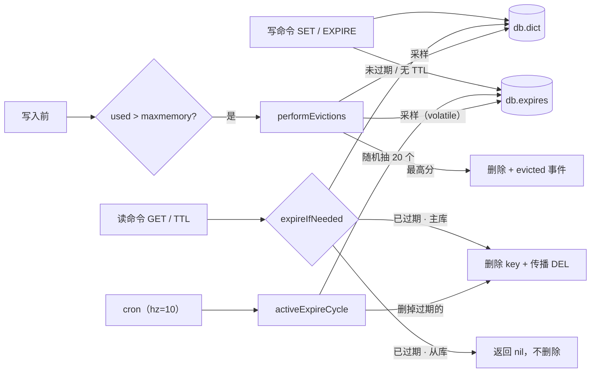
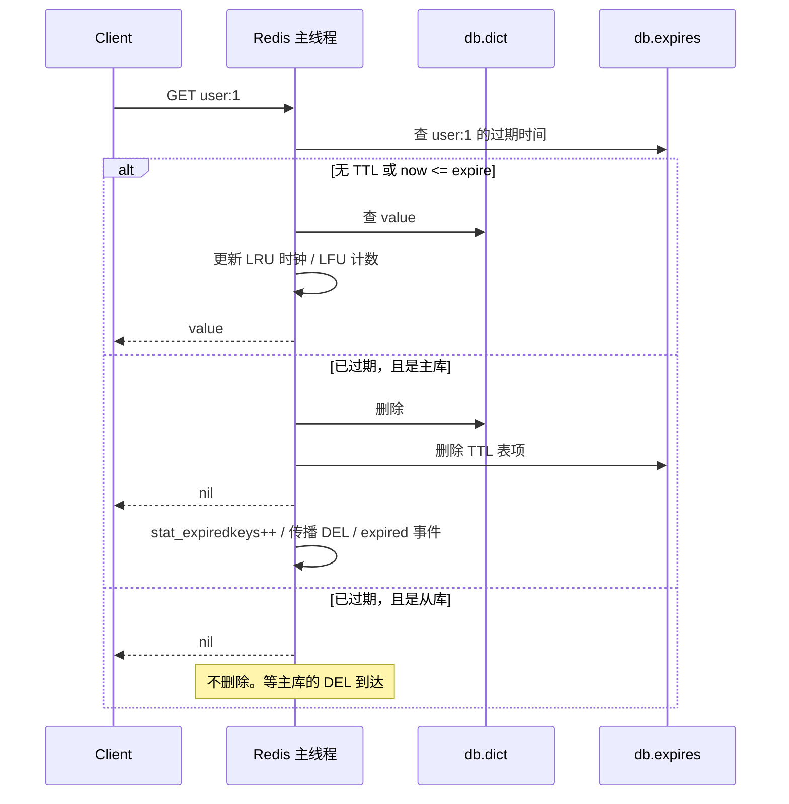
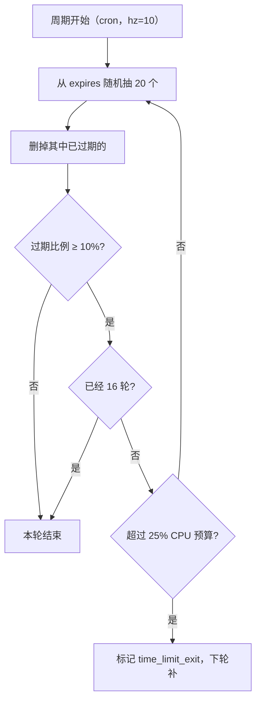
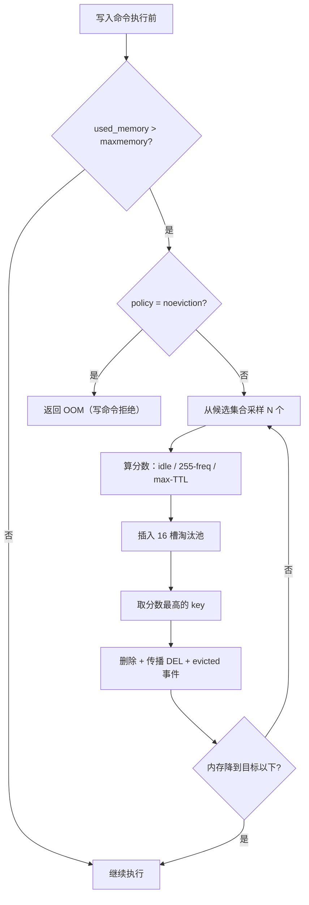

# Day 16 · 过期删除与内存淘汰：内存满了，谁该走？

> **一句话结论**：Redis 不给每个 key 配闹钟。它把「到期」拆成两件事：**逻辑上什么时候不可见**（读的时候查一下保质期）和**物理上什么时候释放内存**（cron 抽样删 + 内存满了按策略淘汰）。前者保证正确性，后者只保证「迟早会还」，两者都不追求精确。

---

## 0. 本次问题

一个 10GB 的 Redis 实例，800 万个 key，其中一半设了 TTL，`maxmemory 8gb`、`maxmemory-policy allkeys-lru`。某天写入量翻倍，你看到三个现象：

- 内存曲线一直贴着 8GB，`evicted_keys` 每秒几千；
- 有一批 key 明明早过了 TTL，`DBSIZE` 却还把它们算在内；
- 从库的内存比主库高 300MB，而且主从延迟一大就更高。

这三个现象来自同一组机制。本次要能回答三个具体问题：

1. **TTL 到点之后，到底谁负责删？** 为什么不是每个 key 一个定时器（Day 03 的时间轮不是现成的吗）？
2. **内存满了淘汰谁？** 为什么 Redis 不用精确 LRU 链表，而用「采样 5 个、挑最久没用的」这种近似？代价是什么？
3. **从库为什么不自己删过期键？** 如果它删了，会坏在哪里？

---

## 0.5 先建立直觉

### 一句话直觉

> 冰箱里每样东西都贴了保质期。你**拿到哪盒才看哪盒**（惰性删除）；店员**每隔一会儿抽查一排货架**（主动过期）；冰箱**实在塞不下时，按「最久没动过 / 最少被拿 / 最快过期」扔掉一些**（内存淘汰）。三件事都不是「到点自动消失」。

### 生活类比

| Redis 里的东西 | 生活里的东西 | 为什么像 |
|---|---|---|
| `db->dict` | 冰箱本身 | 真正放东西的地方 |
| `db->expires` | 每盒食物上贴的保质期标签 | 另一张表，只记「什么时候坏」 |
| 惰性删除 | 顾客拿起一盒才看日期 | 没人碰，就没人发现它坏了 |
| 主动过期 | 店员定时抽查一排货架 | 抽样，不是把整店翻一遍 |
| 过期比例 ≥ 10% 就继续抽 | 发现这一排全坏了，就多查几排 | 用样本估计整体，动态加工作量 |
| 25% CPU / 时间预算 | 每次最多整理 25ms，不能耽误收银 | 单线程上的硬上限 |
| `maxmemory` | 冰箱容量 | 物理上限，不是建议 |
| 淘汰策略 | 冰箱满了先扔什么 | 最久没吃 / 最少吃 / 快过期 / 随便 |
| 淘汰池（16 个候选） | 手边先留 16 个「最该扔」的 | 多轮采样累积，比单次抽样准 |
| 近似 LRU | 凭「好久没动过」的印象扔 | 不维护精确的全局队列 |
| 从库不删过期键 | 分店不自己扔，等总店通知 | 避免两边账本对不上 |
| `lazyfree` / `UNLINK` | 大件垃圾先搬到后巷再拆 | 后台线程释放，不阻塞主线程 |

### 只需要记住三个词

1. **惰性**：读/写路径顺手检查，过期就删；没人访问的过期键会一直占内存。
2. **抽样**：cron 每轮只从 `expires` 表随机抽 20 个；过期比例高就多抽几轮，低了就收工。
3. **候选池**：淘汰时不全局排序，只从样本里挑；16 个槽的池跨轮保留，把「一次采样」变成「滑动窗口」。

### 第一遍可以先跳过

- `evict.c` 里淘汰池插入的移位细节和 `EVPOOL_CACHED_SDS_SIZE` 的字符串复用；
- LFU 概率递增公式为什么长这样（先记住「对数增长 + 按分钟衰减」）；
- `activeExpireCycle` 的 fast/slow 双模式和 `timelimit_exit` 的跨周期传递；
- 本文第 6 节的 C++ 实现与基准代码。

### 两种方案，先摆在一起看

```text
方案 A：每个 key 一个定时器（时间轮 / 最小堆）
  插入或修改 TTL -> 在堆/轮里加一个节点
  到期 -> 回调里删除 key、传播 DEL
  精度：毫秒级
  代价：每个 key 多一个节点（32–48B）；而且 expires 表仍然要保留，
        因为 TTL 命令、RDB/AOF、主从传播都需要绝对过期时间
  单线程上：到期回调集中触发时，仍是一次批量的删除尖刺

方案 B：惰性 + 抽样（Redis）
  读写路径：expireIfNeeded 查一次 expires
  cron：每轮随机抽 20 个，删掉过期的
  精度：秒级到分钟级（取决于积压量和 effort）
  代价：过期键可能多活一会儿；抽样有概率漏
  好处：没有额外节点，工作量恒定、可预算，不会出现「定时器同时到期」的尖刺
```

Redis 选 B，不是因为它「更优雅」，而是因为：**TTL 的语义本来就允许延迟**。`EXPIRE` 承诺的是「大约这么久之后不可见」，不是「第 1000 毫秒准时释放内存」。

---

## 1. 设计背景：约束从哪里来

### 1.1 两个问题，其实是一个问题

「过期」和「淘汰」看起来是两件事：

- 过期：key 自己带了 deadline；
- 淘汰：整个实例的内存到了上限。

但在实现上它们共享同一套东西：**删除一个 key 时要同时清理 `dict`、`expires`、通知、传播、统计**，并且都要回答「现在删谁」。区别只在于：

- 过期是**时间驱动**的：候选集合是 `expires` 表；
- 淘汰是**压力驱动**的：候选集合取决于 `maxmemory-policy`（全部 key，或只有带 TTL 的 key）。

所以 Redis 把它们做成两条独立路径、复用同一套删除原语，而不是一个「大回收器」。

### 1.2 为什么不能每个 key 一个定时器

Day 03 的时间轮确实能做到 O(1) 插入和删除。但把它用在这里有三个问题：

**第一，内存翻倍。** 时间轮节点至少要有「过期时间 + 链表指针 + 槽位」，32–48B。800 万个带 TTL 的 key 就是 256–384MB 的额外内存。而 `expires` 表本身还要保留——`TTL` 命令、`PERSIST`、RDB 的绝对时间、主从传播的 `DEL`，都需要知道「这个 key 原本什么时候过期」。定时器是**在 expires 之外再加一份状态**，不是替代它。

**第二，每次改 TTL 都要动两个结构。** `EXPIRE`、`SET EX`、`GETEX`、`PERSIST`、`RENAME`、`RESTORE`、`MIGRATE` 都会改 TTL。定时器要支持「取消旧节点、插入新节点」，而时间轮的取消是惰性标记，节点不会立刻回收——长跑的系统里，频繁续期的 key 会留下大量墓碑节点。

**第三，删除尖刺没有消失。** 就算定时器很准，100 万个 key 在同一秒到期，回调仍然要在单线程上删 100 万个对象。Redis 的抽样至少把这件事摊平了，而且**允许删不完**。

所以 Redis 的 `expires` 只存一个 8 字节的绝对毫秒时间戳，删除时机交给两条低成本路径。

### 1.3 算一笔账：过期键堆积有多贵

假设每个 key 连同 key/value/对象头平均占 250B：

```text
100 万个已过期但未删除的 key ≈ 250MB
如果实例 maxmemory 8GB、真实数据已经 7.9GB：
  这 250MB 过期键会让 used_memory 先撞线
  -> performEvictions 开始淘汰「还活着」的 key
  -> 命中率下降，回源增加，然后更多写入……
```

更糟的是 `DBSIZE`：它返回 `dictSize(db->dict)`，**不检查过期**。所以监控上会出现「key 数量没降、内存没降、但 GET 全是 nil」的诡异状态。这不是 bug，是「逻辑过期」和「物理删除」分离的必然结果。

### 1.4 关键约束

| 约束 | 具体表现 | 对设计的影响 |
|---|---|---|
| 延迟 | 单线程；一条命令阻塞所有人；p99 要求毫秒级 | 任何回收都不能是 O(n) 全表扫；必须可中断、有预算 |
| 吞吐 | 40 万 QPS；每秒有几十万次「顺手检查」的机会 | 惰性检查必须极便宜：一次 dict 查找 + 一次比较 |
| 内存 | `expires` 表项 ~40B/key；定时器再翻一倍 | 只留绝对时间戳，不留定时器节点 |
| 一致性 | 主从的时钟不可能完全一致；删除要可复制 | 删除权归主库；从库只隐藏，等 DEL |
| 运维复杂度 | `hz`、effort、policy、samples、lazyfree、碎片、fork | 每个旋钮都要有可观测指标，否则只能拍脑袋 |

### 1.5 历史与失败案例

**缓存雪崩。** 一批 key 设了相同的 TTL（比如活动开始时间 + 1 小时），到点同时逻辑过期。主动过期每 100ms 只能处理几百个，剩下的读请求全部 miss，一起打到数据库。Redis 没有「准时删除」的承诺，所以这类事故的根因往往不是 Redis 慢，而是**业务把 TTL 当成了定时器**。常见缓解：TTL 加随机抖动、逻辑过期时间写在 value 里、singleflight 合并回源、多级缓存。

**`volatile-lru` 配错。** 运维想「只淘汰缓存，不动持久数据」，于是设了 `volatile-lru`，但大部分 key 根本没设 TTL。结果内存满了却一个候选都没有，写命令开始返回 `OOM command not allowed when used memory > 'maxmemory'`。`volatile-*` 策略的前提是「热数据带 TTL」，这个前提要在容量规划里显式检查。

**从库内存更高。** 从库不自己删过期键，等主库的 `DEL`。主从延迟 30 秒，这 30 秒内所有到期的 key 都还在从库内存里；如果从库还开着 `replica-ignore-maxmemory yes`（默认），它不会自己淘汰，RSS 可能明显高于主库。主从延迟不只是「读到旧数据」，还是**内存放大**。

**大 key 过期。** 一个 2GB 的 hash 到期，`dbSyncDelete` 在主线程里递归释放几百万元素，p99 直接飙到几百毫秒。Redis 4.0 引入 `lazyfree-lazy-expire` / `UNLINK`，把「逻辑删除」和「物理释放」再拆一层：主线程只把对象摘下来，真正的 `free` 交给后台线程。

**`WATCH` 与过期。** 一个被 `WATCH` 的 key 在 `EXEC` 前过期，事务应该失败还是成功？Redis 6.0.9 之后把「过期」视为对 key 的修改，`EXEC` 会返回 nil。这是「逻辑过期也是状态变化」的一个典型推论。

### 1.6 三个时间尺度

| 时机 | 触发者 | 工作量 | 负责什么 |
|---|---|---|---|
| 读/写路径 | 客户端命令 | O(1) | 保证**这次访问**看不到过期数据 |
| cron（`hz`） | 服务端定时 | 每轮 ≤ 16×20 个样本、≤ 25% CPU | 保证**没人访问的过期键**最终被回收 |
| 写入前 | `maxmemory` 检查 | 按需，直到腾出空间 | 保证**内存不超上限**（或明确失败） |

理解这张表，就理解了 Redis 内存回收的全部结构：**正确性靠第一行，最终一致性靠第二行，容量靠第三行。**

---

## 2. 架构与数据流

### 2.1 两张表

```text
db->dict      : key(sds) -> robj(value)        // 真正的数据
db->expires   : key(sds) -> int64 毫秒时间戳    // 只有设了 TTL 的 key 才有
```

两个细节值得记住：

1. **`expires` 的 key 和 `dict` 的 key 是同一份 sds**（`setExpire` 里 `dictAddOrFind(db->expires, dictGetKey(kde))`），不复制字符串。所以删除主表项之前必须先删 `expires` 项（`dbGenericDelete` 的顺序），否则 `expires` 里会留下悬垂指针。
2. **`expires` 本身也是一张 `dict`**。所以 Day 15 的渐进式 rehash、负载因子、链地址法，全部适用于它。一个有几百万 TTL key 的实例，`expires` 表的 rehash 也是延迟的一部分。

### 2.2 概念图



### 2.3 一次 GET 的完整路径



注意「更新 LRU 时钟」发生在**未过期**的读上；`TTL` 命令用的是 `LOOKUP_NOTOUCH`，查剩余时间不算「访问」，不会刷新热度。这个细节决定了「有人定时查 TTL 的 key」不会因此变成热 key。

### 2.4 主动过期的循环



三个数字：**20**（每轮样本数）、**10%**（继续抽的阈值）、**16**（每轮上限）。后面会看到，真正决定回收速度的是前两个，25% 的预算在常态下根本用不满。

### 2.5 淘汰的循环



### 2.6 关键对象

| 对象 | 职责 | 生命周期 |
|---|---|---|
| `db->dict` | key → value | 直到 DEL / 过期 / 淘汰 |
| `db->expires` | key → 绝对过期毫秒 | 与 TTL 同生命周期；`SET` 清 TTL 时删除 |
| `server.stat_expiredkeys` | 惰性 + 主动删除的过期键计数 | 进程级 |
| `server.stat_evictedkeys` | 淘汰计数 | 进程级 |
| `evictionPool` | 16 个候选，按分数升序 | 进程级、跨轮保留 |
| `maxmemory_policy` | 候选集合 + 评分函数 | 配置 |
| `server.lruclock` | 24 位、秒分辨率的逻辑时钟 | 每秒更新 |

### 2.7 四条不变量

1. **逻辑过期 ⇒ 不可见。** 主库上任何读写都不会返回过期值；从库上也不会，但物理删除会晚。
2. **从库不主动删。** 删除的「事实」由主库通过 `DEL`/`UNLINK` 传播；从库只在收到后释放。
3. **`expires` 是 `dict` 的索引。** `expires` 里的每个 key 必须存在于 `dict`；反之不成立。
4. **淘汰不越界。** `volatile-*` 只能删带 TTL 的 key；没有候选时返回失败（写命令 OOM），不能偷偷删别的。

---

## 3. 源码关键路径（Redis 7.2）

> 只追一条线：**TTL 怎么挂上去 → 读的时候怎么判断 → 谁删 → 内存满了怎么选**。不逐行抄源码。

### 3.1 挂 TTL：`setExpire` / `removeExpire`

`EXPIRE` / `PEXPIRE` / `EXPIREAT` / `SET EX` 最终都会走到 `setExpire`：

```c
/* expire.c / db.c 附近 */
setExpire(c, db, key, when):
    kde = dictFind(db->dict, key->ptr)
    de  = dictAddOrFind(db->expires, dictGetKey(kde))
    dictSetSignedIntegerVal(de, when)
```

两个点：

- 时间统一存**绝对毫秒**。`EXPIRE key 60` 在命令入口就算成 `now + 60000`，所以主从复制、RDB 都不需要重放「60 秒」这个相对量。
- `dictAddOrFind` 意味着重复 `EXPIRE` 只更新时间戳，不新增表项；这也是「续期」便宜的原因。

`removeExpire(db, key)` 就是 `dictDelete(db->expires, key)`。哪些命令会调用它？

| 命令 | 对 TTL 的处理 |
|---|---|
| `SET k v` | 清 TTL（除非 `KEEPTTL`） |
| `SET k v EX/PX/EXAT/PXAT` | 设新 TTL |
| `GETSET`（已废弃） | 清 TTL |
| `INCR` / `HINCRBY` / `APPEND` / `LPUSH` / `HSET` / `SADD` / `ZADD` | **保留** TTL（原地改 value，不碰 `expires`） |
| `RENAME` | 把 TTL 一起搬到新名字 |
| `PERSIST` | 删除 TTL |
| `DEL` / `UNLINK` | 同时删 `dict` 与 `expires` |
| `RESTORE` / `MIGRATE` | 由命令参数/迁移协议携带剩余 TTL，重建过期时间 |

这张表值得贴在工位上：**「改值」通常保留 TTL，「换值」通常清 TTL**。线上「为什么我的 key 突然永不过期」和「为什么续期丢了」多半出在这两类的混淆上。

### 3.2 读路径：`expireIfNeeded`

这是整个机制里最重要的 40 行。结构大致是：

```c
int expireIfNeeded(redisDb *db, robj *key, int force_delete_expired) {
    if (!keyIsExpired(db, key)) return 0;

    /* 从库：逻辑上过期，但不删。等主库的 DEL。 */
    if (server.masterhost != NULL) {
        if (server.current_client == server.master) return 0;
        if (!force_delete_expired) return 1;
    }
    if (checkClientPauseTimeoutAndReturnIfPaused()) return 1;

    deleteExpiredKeyAndPropagate(db, key);
    return 1;
}
```

逐层拆：

**第一层：`keyIsExpired`。** 没有 TTL 直接返回 0；`server.loading` 时返回 0（正在加载 RDB/AOF，不要边加载边判断）；否则比较 `server.mstime > when`。注意 `server.mstime` 是**每个事件循环迭代缓存一次**的，不是每次查找都调 `mstime()`——在几十万 QPS 下，这能省掉大量重复的时钟读取。

**第二层：从库分支。** 如果不是主库：

- 当前客户端是主库连接（正在执行主库发来的命令）→ 返回 0，即「在主库看来它还没过期」；
- 普通客户端 → 返回 1，表示「逻辑上过期」，调用方返回 nil，但**不删**；
- `force_delete_expired` 用于少数「必须拿到真实状态」的命令路径（例如需要物理删除的场景）。

**第三层：`deleteExpiredKeyAndPropagate`。** 这里是删除的全部副作用：

```c
if (lazyfree_lazy_expire) dbAsyncDelete(db, key);
else                    dbSyncDelete(db, key);

server.stat_expiredkeys++;
propagateExpire(db, key, lazyfree_lazy_expire ? UNLINK : DEL);
notifyKeyspaceEvent(NOTIFY_EXPIRED, "expired", key, db->id);
```

四个动作缺一不可：释放内存、计数、**让从库和 AOF 看到删除**、发事件。第三点是从库一致性的来源：主库说「这个 key 过期了」，从库执行的是同一条 `DEL`，不依赖两边时钟一致。

### 3.3 写路径与「立即过期」

`EXPIRE key -1` 这类命令怎么处理？`expireGenericCommand` 在算完绝对时间后有：

```c
if (when <= mstime() && !server.loading && !server.masterhost) {
    /* 主库上，把过期时间设到过去 = 立即删除 */
    dbSyncDelete(db, key);          // 或 dbAsyncDelete
    propagateExpire(db, key, DEL);
    return;
}
setExpire(...);                      // 未来时间：只写 expires 表
```

所以：

- `EXPIRE key 0` / 负数：主库上立刻删除，返回 1；
- 从库上：只写一个「已经过去」的时间戳，读的时候隐藏，等主库的 `DEL`；
- `NX` / `XX` / `GT` / `LT` 在删除之前判断，所以 `GT` 配一个过去的时间会返回 0（不满足「更大」），不会误删。

`TTL` / `PTTL` 的返回码也在这里定死：key 不存在 → `-2`；没有 TTL → `-1`；否则剩余时间。`TTL` 是四舍五入到秒：`(pttl + 500) / 1000`，所以 1900ms 显示 2 秒，1400ms 显示 1 秒——这不是 bug，是「秒级 API 的舍入」。

### 3.4 主动过期：`activeExpireCycle`

结构示意（不是逐行代码）：

```c
void activeExpireCycle(int type) {
    static unsigned int current_db = 0;   // 多 DB 公平轮转
    static int timelimit_exit = 0;        // 上轮是否超时

    timelimit = 25% * (1s / hz);          // hz=10 -> 25ms
    for (dbs = min(dbnum, 16); dbs--; ) {
        do {
            for (i = 0; i < 20; i++) {
                de = dictGetRandomKey(db->expires);
                if (de && now > expire_of(de))
                    activeExpireCycleTryExpire(db, de, now);
            }
            if (expired * 100 / sampled < 10) break;   // 过期键稀疏，收工
            if (iteration++ >= 16) break;
        } while (now_us() - start < timelimit);
    }
}
```

几个设计点：

- **随机抽 key，不是顺序扫桶。** `dictGetRandomKey` 随机挑一个非空桶再挑链上元素。顺序扫会让「刚删过的前缀」被反复扫到，随机抽样天然覆盖整个表。
- **比例反馈。** 如果样本里 ≥10% 已过期，说明过期键还很密集，值得再抽一轮；低于 10% 就停。这让 CPU 花在「有积压」的时候，而不是每天固定烧 25%。
- **每 DB 公平。** `current_db` 静态变量记录上次停在哪，下一轮从下一个 DB 开始，避免 16 个 DB 里只有 db0 被处理。
- **时间预算只是兜底。** 我们在实验 2 里会看到：最坏情况（每轮删 320 个）也只用了预算的 1%。真正限制回收速度的是「每轮 20 个 × 最多 16 轮」这个**抽样上限**。预算是防止某些极端情况（大 key 释放、字典长链）把单次 cron 拖爆。
- **fast/slow 双模式。** 上一轮如果因为时间预算提前退出，下一次事件循环的 `beforeSleep` 会补一个 fast 周期（预算约 1ms），把积压往前赶；否则积压会等到下一个 100ms。

### 3.5 淘汰：`performEvictions`

入口在 `processCommand`：只要配置了 `maxmemory`，每条命令执行前都会先尝试 `performEvictions()`；如果腾不出内存，而且这条命令会分配内存（带 `CMD_DENYOOM` 标志），就直接回 `-OOM`。读命令不带这个标志，所以「写被拒、读还能用」。

```c
int performEvictions(void) {
    if (getMaxmemoryState(&total, &logical, &tofree, &level) == C_OK)
        return EVICT_OK;

    if (policy == MAXMEMORY_NO_EVICTION)
        return EVICT_FAIL;

    while (mem_freed < mem_tofree) {
        /* 选一个非空 DB，采样并填池 */
        evictionPoolPopulate(dbid, dict, db->dict, pool);
        bestkey = pool[EVPOOL_SIZE-1].key;   /* 池尾 = 分数最高 */
        if (lazyfree_lazy_eviction) dbAsyncDelete(db, keyobj);
        else                        dbSyncDelete(db, keyobj);
        mem_freed += delta;
        server.stat_evictedkeys++;
        notifyKeyspaceEvent(NOTIFY_EVICTED, "evicted", keyobj, db->id);
    }
    return EVICT_OK;
}
```

**`getMaxmemoryState` 里的「逻辑内存」**：`used_memory` 会减去「不属于数据集」的部分——从库输出缓冲、AOF 缓冲等。为什么？如果从库很慢、主库的复制缓冲涨了 2GB，主库不应该为了这 2GB 去疯狂淘汰业务数据；它该做的是限制复制缓冲/断开慢从库。这是「内存上限保护的是数据集，不是进程 RSS」的体现。

**策略矩阵**：

| policy | 候选集合 | 评分（越大越该走） | 适用 |
|---|---|---|---|
| `noeviction` | 不淘汰 | — | 数据库、队列：宁可直接失败 |
| `allkeys-lru` | 所有 key | 空闲时间 idle | 通用缓存 |
| `allkeys-lfu` | 所有 key | `255 - 频率` | 热点稳定、要抗扫描 |
| `allkeys-random` | 所有 key | 随机 | 访问均匀、无明显热点 |
| `volatile-lru` | 仅带 TTL | idle | 一个实例混放缓存与持久数据 |
| `volatile-lfu` | 仅带 TTL | `255 - 频率` | 同上，按频率 |
| `volatile-random` | 仅带 TTL | 随机 | 同上，图简单 |
| `volatile-ttl` | 仅带 TTL | `max - 过期时间` | 希望「快过期的先走」 |

**淘汰池（`EVPOOL_SIZE = 16`）**：

- 每次从候选集合采样 `maxmemory-samples` 个（默认 5）；
- 按分数升序插入池，池满时丢掉分数最低的；
- 淘汰时取池尾（分数最高）；
- **池跨轮保留**，所以 16 个槽里积累的是「最近若干轮采样里最该走的候选」，比单轮 5 个样本准。

这里有一个容易实现错的点（我在第 6 节会讲自己踩的坑）：池是「每轮补充」的滑动窗口，不是「装满一次就慢慢倒空」的队列。如果只在池空时才补充，池里分数最低的那个候选会在每批末尾被误杀——基准里表现为热 key 误杀率和随机策略几乎一样。

### 3.6 LRU：24 位时钟

Redis 不存 64 位纳秒时间戳，只存 24 位、**秒分辨率**的逻辑时钟：

```c
#define LRU_BITS 24
#define LRU_CLOCK_RESOLUTION 1000   /* ms */
#define LRU_CLOCK_MAX ((1 << LRU_BITS) - 1)

unsigned int LRU_CLOCK(void) {
    return (mstime() / LRU_CLOCK_RESOLUTION) & LRU_CLOCK_MAX;
}
```

24 位秒 ≈ 194 天回绕一次。空闲时间计算要处理回绕：

```c
unsigned long long estimateObjectIdleTime(robj *o) {
    unsigned int lruclock = LRU_CLOCK();
    if (lruclock >= o->lru)
        return (lruclock - o->lru) * LRU_CLOCK_RESOLUTION;
    else
        return (lruclock + (LRU_CLOCK_MAX - o->lru)) * LRU_CLOCK_RESOLUTION;
}
```

代价是精度只有 1 秒：1 秒内访问的 key 看起来一样新。收益是每个对象只花 3 字节（`robj` 里的一个字段），而不是 8 字节时间戳 + 两个链表指针。

### 3.7 LFU：8 位计数器 + 对数递增 + 按分钟衰减

`robj->lru` 这个字段在 LFU 策略下换一种解释：

```text
高 16 位：上次衰减的「分钟数」（mstime/60000 & 0xFFFF）
低  8 位：访问频率计数器（0–255）
```

新对象的计数从 `LFU_INIT_VAL = 5` 开始，不是 0。为什么？如果从 0 开始，一个刚写入的 key 在第一次淘汰时几乎必死，哪怕它马上就会变成热点。给 5 的初始值相当于一个「新 key 保护期」。

每次访问：

```c
counter = LFUDecrAndReturn(o);        // 先按经过的分钟数衰减
counter = LFULogIncr(counter);        // 再按概率 +1
o->lru = (LFUGetTimeInMinutes() << 8) | counter;
```

递增不是每次 +1，而是：

```c
double p = 1.0 / ((counter - 5) * lfu_log_factor + 1);
if (rand() < p) counter++;
```

`lfu-log-factor` 默认 10。效果：

- 计数 5 → 6：p = 1，第一次访问必涨；
- 6 → 7：p = 1/11；
- 10 → 11：p = 1/51；
- 越往上越难涨。

这是**对数增长**：100 次访问大概到 9–10，1000 次访问也就十几。好处是 8 位计数器能覆盖很宽的频率范围，不会一千次访问就饱和到 255，也不会让「100 次」和「101 次」看起来没差别。

衰减：每经过 `lfu-decay-time` 分钟（默认 1），计数减 1，减到 0 为止。所以一个 10 分钟没被访问的热 key，计数会掉 10，给新热点让位。

两个边界：

- `OBJECT IDLETIME` 在 LFU 策略下不可用（Redis 直接报错），因为 `lru` 字段已经不是时钟了；
- 运行时把策略从 LRU 切到 LFU，旧对象的 `lru` 会被当成「很久以前的分钟数」，计数瞬间衰减到 0。切换后要等对象被访问才会恢复；生产上要么别热切，要么接受一段「所有 key 都是冷的」的窗口。

### 3.8 配置项地图

| 配置 | 默认 | 作用 | 调大的代价 |
|---|---|---|---|
| `maxmemory` | 0（不限） | 数据集上限 | 太大：OOM killer / fork 失败；太小：频繁淘汰 |
| `maxmemory-policy` | `noeviction` | 淘汰策略 | 选错：OOM 或误删 |
| `maxmemory-samples` | 5 | 每次采样数 | CPU ↑，精度 ↑（收益递减） |
| `hz` | 10 | cron 频率 | CPU ↑，过期/淘汰更及时 |
| `active-expire-effort` | 1（7.0+） | 每轮回收力度（1–10） | CPU ↑，积压清得更快 |
| `lazyfree-lazy-expire` | no | 过期删除异步释放 | 内存释放略延迟，换低尾延迟 |
| `lazyfree-lazy-eviction` | no | 淘汰异步释放 | 同上 |
| `lfu-log-factor` | 10 | 计数增长难度 | 越大越难涨，区分度越高 |
| `lfu-decay-time` | 1 分钟 | 计数衰减周期 | 越大，历史热度保留越久 |
| `maxmemory-eviction-tenacity` | 10（7.0+） | 淘汰时愿意花多久 | 越大越能腾出内存，尾延迟越高 |

### 3.9 语言对照：别人怎么解决同一个问题

- **Java / Caffeine**：W-TinyLFU。一个小的 LRU 窗口做准入，主区用 SLIM（分段 LRU），再用 Count-Min Sketch 记录频率。它在**扫描型负载**（一次性遍历大量 key）下明显优于纯 LRU，因为「只访问一次」的 key 会被频率草图挡住。代价是多一块频率草图的固定内存。
- **C++ / Folly**：`LRUCache` / `TLRUCache` 是精确 LRU（侵入式链表 + 哈希表），适合 key 数量在几十万以内、每次访问都能承受链表更新的场景。
- **C++ / RocksDB**：`LRUCache` 分 shard，每个 shard 一把锁 + 精确 LRU。它面对的是「几万个 block」，不是「几亿个 key」，所以精确结构的开销可以接受。
- **Rust**：`lru` crate 是精确 LRU；`moka` 走 W-TinyLFU 路线，适合高并发缓存。
- **Memcached**：分段 LRU（hot/warm/cold）+ bump，介于精确和采样之间。

共同规律：**key 数量越大、淘汰越不频繁，越倾向采样；key 数量小、命中率要求极致，越倾向精确结构。** InnoDB 的 buffer pool（Day 10）只有几万个页，所以它用精确的两段 LRU + midpoint insertion；Redis 有几千万个 key，所以它用采样。不是谁更先进，是约束不同。

### 3.10 为什么这一课仍然读 C 源码

Redis 的 `expire.c` / `evict.c` 是「机制与策略分离」的教科书：数据结构简单（两张 dict + 一个数组池），没有模板元编程，也没有复杂的并发。你可以在一下午里把「抽样—评分—删除—传播」整条链读完，然后把结构搬到任何语言里。本文的 C++ 实现就是一次这样的搬运。

---

## 4. 关键设计技巧

### 技巧 1：逻辑过期与物理删除分离

- **做法**：读路径只判断「现在是否过期」，返回 nil；真正的删除交给惰性删除、cron 或淘汰。两者用同一套删除原语，但触发时机不同。
- **为什么有效**：正确性只需要「不可见」，不需要「立刻释放」。把两个目标解耦，读路径可以做到 O(1)，回收可以批量、可延迟、可预算。
- **代价**：内存可能晚释放；`DBSIZE`、`RANDOMKEY` 等命令会看到「逻辑上不存在但物理上还在」的 key（部分命令会过滤，`DBSIZE` 不会）。
- **适用边界**：TTL 是「软 deadline」的场景。如果业务要求「到点必须释放」（比如合规删除），这套机制不够，需要额外的审计/强制清理。

### 技巧 2：抽样 + 比例反馈，把 O(n) 变成 O(样本)

- **做法**：每轮固定抽 20 个；样本里过期比例 ≥10% 就再抽一轮，最多 16 轮。
- **为什么有效**：过期键密集时，样本很容易命中，回收速度快；稀疏时，抽一轮就收工，不浪费 CPU。工作量自动跟着积压量走。
- **代价**：有概率漏；积压很大时回收速度有上限（单库约 3200 个/秒，hz=10、effort=1）。
- **适用边界**：适合「删除成本低、允许延迟」的对象。大 key 的释放要另做异步（lazyfree），否则一次删除就能吃掉整个预算。

### 技巧 3：时间预算是兜底，不是主控制

- **做法**：每轮最多花 `25% × 1s / hz`（hz=10 时 25ms）；超了就标记，下轮 fast 模式补。
- **为什么有效**：防止极端情况（字典长链、大对象释放、16 个 DB 都有积压）把一次 cron 拖成几百毫秒。常态下预算根本用不满——实验里最坏只用 1%。
- **代价**：预算本身不提高回收速度；调大预算只是在「极端情况」下多干一点。
- **适用边界**：任何单线程后台任务都该有这种「软截止时间」。注意预算检查要放在**每轮之间**，不能放在每个 key 之间，否则计时开销本身就很贵。

### 技巧 4：固定候选池，把「单次采样」变成「滑动窗口」

- **做法**：16 个槽，按分数升序；每轮采样后合并进池，池满丢最低分；淘汰取池尾。
- **为什么有效**：单次采样 5 个的命中率是 `1-(1-p)^5`；池跨轮保留后，16 个候选里通常已经积累了多轮采样中最好的那些。内存固定 16 个条目，不随 key 数量增长。
- **代价**：池容量是精度上限，采样数超过 16 后收益递减；池里的 key 可能已经被删除，需要跳过。
- **适用边界**：淘汰是「低频、允许近似」的操作。如果每次淘汰都要严格全局最优，老实维护有序结构。

### 技巧 5：一个字段，两种解释

- **做法**：`robj->lru` 只有 24 位。LRU 策略下是秒级时钟；LFU 策略下拆成 16 位分钟 + 8 位计数。
- **为什么有效**：对象头是内存大户（几千万个对象，每个省 4 字节就是几百 MB）。用同一个字段承载两种策略，省掉一个 union 或额外字段。
- **代价**：策略切换时字段语义变化，旧值会被误读；`OBJECT IDLETIME` 在 LFU 下不可用；代码里到处要判断策略。
- **适用边界**：字段语义由配置决定、且切换不频繁的场景。如果两种策略要同时生效（比如 LRU 和 LFU 混合评分），就需要额外字段。

### 技巧 6：策略与机制分离

- **做法**：`performEvictions` 的骨架（检查内存 → 采样 → 填池 → 删除 → 循环）对所有策略都一样；策略只决定「候选集合」和「评分函数」。`volatile-*` 与 `allkeys-*` 的差别只是从 `expires` 还是 `dict` 采样。
- **为什么有效**：新增策略是十几行的事；测试可以只测评分函数；「没有候选就失败」的语义统一。
- **代价**：策略之间的差异被压平成「一个分数」，像 `volatile-ttl` 这种「先看 TTL 再看 LRU」的复合策略就表达不了（除非编码进分数）。
- **适用边界**：淘汰、限流、负载均衡这类「选一个牺牲者」的问题都适用。

---

## 5. 反例与边界

| 看起来对的用法 | 实际问题 | 正确做法 |
|---|---|---|
| 用 `EXPIRE` 做延迟队列 | 过期不保证准时；没有「到期通知」的可靠投递；主从延迟下更晚 | 用 ZSET 按时间轮询、Streams + 消费者组，或专门的消息队列 |
| 大批 key 设相同 TTL | 同一秒集中过期，主动回收跟不上，回源打爆数据库 | TTL 加随机抖动（±10%）；逻辑过期 + singleflight；多级缓存 |
| 用 TTL 做分布式锁 | 过期可能延迟；时钟/主从切换会破坏「唯一持有者」 | 租约 + fencing token（Day 40）；Redlock 也有争议 |
| `volatile-lru` 但大部分 key 没 TTL | 没有候选，写命令 OOM；监控上只看到「内存满了但不淘汰」 | 确认候选集合；要么全量 TTL，要么用 `allkeys-*` |
| `maxmemory` 设成物理内存的 100% | fork/COW、复制缓冲、碎片会让 RSS 超过物理内存，触发 OOM killer | 留 20–30% 余量；监控 `used_memory_rss` 与 `mem_fragmentation_ratio` |
| 大 key 依赖同步过期 | 删除时阻塞主线程，p99 毛刺 | 开 `lazyfree-lazy-expire`；拆分大 key；用 `UNLINK` |
| 从库读到「主库已删」的旧值 | 淘汰和 DEL 都以复制流为准，延迟期间从库仍有旧值；过期键虽然会按本地时钟隐藏，但主从时钟偏差时也可能多活一会儿 | 强一致读走主库；或接受最终一致并做版本校验 |

### 压力下会发生什么

- **写入打满**：`performEvictions` 每个写命令前都可能跑；淘汰速度跟不上写入速度时，写命令开始 OOM，读仍然可用。监控要看 `evicted_keys` 的斜率和 `oom` 错误数。
- **大量 key 同时过期**：主动回收按抽样上限工作，积压可能持续几分钟；期间内存不降、淘汰可能误伤活 key。这就是「雪崩」的机制层解释。
- **从库延迟**：从库不删过期键，内存随延迟线性增长；`replica-ignore-maxmemory yes` 时它不会自救。
- **进程崩溃/重启**：RDB 里存的是绝对过期时间，加载时主库会跳过已过期的键；AOF 重放同样要处理「写到一半过期」的情况，否则重启会让过期数据复活。
- **时钟跳跃**：TTL 用的是墙上时钟（`mstime`）。NTP 大幅回拨会让 key 多活一段；向前跳会让一批 key 同时过期。主从之间不要求时钟一致，因为删除以主库的 `DEL` 为准——这是这套设计最巧妙的地方之一。
- **扩缩容/迁移**：`MIGRATE` 会带上绝对 TTL；迁移到时钟偏差大的机器上，TTL 会立刻变化。跨机房迁移要校验时钟。

---

## 6. 最小实现（C++20）

> 目标：把「惰性删除 + 抽样回收 + 淘汰池」做成一个能跑、能测、能破坏的小系统。两张表 + 三条路径，加上测试和基准大约两千行；不是生产级 Redis，但每条不变量都有测试。

### 6.1 文件与结构

```text
day-016-expire-evict/
├── README.md
└── code/
    ├── CMakeLists.txt
    ├── main.cpp                  # 命令行入口（--case/--demo/--bench）
    ├── demo.cpp                  # 三条机制的讲解式输出
    ├── bench.cpp                 # 回收速率 / CPU / 淘汰精度
    ├── src/
    │   ├── common.hpp            # Config / Entry / Policy / ExpireFlags
    │   ├── clock.hpp/.cpp        # 可注入的逻辑时钟
    │   ├── eviction_pool.hpp/.cpp  # 16 槽候选池
    │   ├── store.hpp             # Store 接口与状态
    │   ├── store_core.cpp        # 槽位/expires、内存账、SET/GET/DEL/TTL
    │   ├── store_expire.cpp      # 惰性过期、删除、抽样、active cycle
    │   ├── store_evict.cpp       # 填池、单次淘汰、perform_evictions
    │   └── store_access.cpp      # LRU/LFU 时钟、衰减、热度更新
    └── tests/
        ├── test_support.hpp/.cpp # 断言与公共构造
        ├── test_registry.cpp     # 14 个用例的注册表
        ├── tests_semantics.cpp   # SET/GET/DEL/TTL + 惰性读写
        ├── tests_expire.cpp      # 主动过期 + 预算 + 比例反馈
        ├── tests_evict.cpp       # 五种淘汰策略 + 候选池
        └── tests_replica_model.cpp # 从库隐藏 + 4000 步模型
```

拆分原则：**一个文件只回答一个问题**。`store.hpp` 只描述状态与接口；`store_core.cpp` 负责“表怎么维护”；`store_expire.cpp` 负责“什么时候删”；`store_evict.cpp` 负责“内存满了删谁”；`store_access.cpp` 负责“热度怎么记”。测试按不变量分组，演示/基准不再和测试挤在一个 `main.cpp` 里。

核心类型：

```cpp
struct Entry {
    std::string key;
    std::string value;
    i64 expire_at_ms = -1;   // -1 = 无 TTL
    u32 lru = 0;             // LRU：24 位时钟；LFU：16 位分钟 + 8 位计数
};

class Store {
    std::vector<Slot> slots_;                 // dict：稠密槽位
    std::unordered_map<std::string, u32> index_;
    std::vector<ExpiresNode> expires_nodes_;  // expires：key -> 绝对时间
    std::unordered_map<std::string, u32> expires_index_;
    EvictionPool pool_;                       // 16 个候选
    ...
};
```

和 Redis 的对应关系：

| 本实现 | Redis | 说明 |
|---|---|---|
| `slots_ + index_` | `dict` | 稠密槽位 + 哈希索引，支持 O(1) 随机采样 |
| `expires_nodes_ + expires_index_` | `db->expires` | 复制了一份 key（Redis 共享 sds），内存账更悲观 |
| `expire_if_needed` | `expireIfNeeded` | 含从库分支 |
| `active_expire_cycle` | `activeExpireCycle` | 20 个/轮、10% 阈值、16 轮、25ms 预算 |
| `perform_evictions` | `performEvictions` | 采样 + 池 + 策略评分 |
| `EvictionPool` | `evictionPool` | 固定 16 槽、升序、跨轮保留 |

### 6.2 惰性过期（核心 15 行）

```cpp
bool Store::expire_if_needed(const std::string& key) {
    Entry* e = find_entry(key);
    if (e == nullptr) return false;
    if (e->expire_at_ms < 0) return false;
    if (clock_.now() <= e->expire_at_ms) return false;

    if (cfg_.replica) {
        ++stats_.replica_hidden;   // 从库：只隐藏，不删
        return true;
    }

    delete_key(key, DeleteReason::Expired);
    ++stats_.lazy_expired;
    return true;
}
```

`delete_key` 同时维护四件事：`memory_used_`、`expires` 表、主表索引、统计。任何一条路径（过期/淘汰/DEL）都只走它，避免「删了主表忘了 expires」。

### 6.3 主动过期（核心循环）

```cpp
for (int iteration = 0; iteration < kMaxIterations; ++iteration) {
    int sampled = 0, expired = 0;
    for (int i = 0; i < keys_per_loop; ++i) {
        if (expires_live_.empty()) break;                 // 表已经空了
        const u32 id = expires_live_[rng_() % expires_live_.size()];
        ++sampled;
        if (clock_.now() > expires_nodes_[id].when_ms) {
            const std::string victim = expires_nodes_[id].key;  // 先拷贝
            delete_key(victim, DeleteReason::Expired);
            ++expired;
        }
    }
    if (sampled == 0) break;
    if (expired * 100 / sampled < 10) break;       // 稀疏，收工
    if (elapsed_us(start) >= budget_us) {           // 预算兜底
        result.time_limit_exit = true;
        break;
    }
}
```

「先拷贝 key」不是风格问题：`delete_key` 会把 `expires` 槽位清空，原来的引用立刻悬垂。

### 6.4 淘汰：采样 + 池 + 评分

```cpp
bool Store::evict_one() {
    if (is_random_policy(cfg_.policy)) {
        const std::string victim = random_key(is_volatile_policy(cfg_.policy));
        if (victim.empty()) return false;            // volatile 池空了
        delete_key(victim, DeleteReason::Evicted);
        return true;
    }

    // 每轮都补样本：池是滑动窗口，不是一次装填的队列
    (void)populate_eviction_pool();

    for (;;) {
        auto item = pool_.pop_best();
        if (!item) return false;
        if (index_.count(item->key) == 0) continue;  // 池里的陈旧候选
        delete_key(item->key, DeleteReason::Evicted);
        return true;
    }
}
```

评分函数：

```cpp
u64 Store::eviction_score(const Entry& e, i64 now_ms) const {
    switch (cfg_.policy) {
        case AllKeysLru:
        case VolatileLru:  return estimate_idle_ms(now_ms, e.lru);
        case AllKeysLfu:
        case VolatileLfu:  return 255 - lfu_counter_after_decay(e.lru, now_ms);
        case VolatileTtl:  return UINT64_MAX - e.expire_at_ms;
        default:           return 0;
    }
}
```

`volatile-ttl` 的「越小越该走」通过 `MAX - value` 翻成「越大越该走」，这样池只需要一种排序方向。

### 6.5 运行

```bash
cmake -S . -B build -G Ninja
cmake --build build
ctest --test-dir build --output-on-failure

./build/expire_evict_demo            # 14 个用例
./build/expire_evict_demo --demo     # 三条机制的讲解式输出
./build/expire_evict_demo --bench    # 回收速率 / CPU / 淘汰质量
```

14 个用例覆盖：

`semantics`（TTL/PERSIST/SET 清 TTL/NX/XX/GT/LT/立即删除/秒级舍入）、`lazy_get`、`lazy_write`、`active_drain`、`active_budget`、`active_ratio_gate`、`evict_noeviction`、`evict_allkeys_lru`、`evict_volatile_only`、`evict_lfu`、`evict_ttl`、`replica_hidden`、`pool_order`、`model`（4000 步随机操作对照参考模型，逐步校验内存账与两张表的一致性）。

### 6.6 预期输出（节选）

```text
== 演示 1：惰性删除 ==
插入 3 个 key，TTL=1s；2 秒后（没有人访问）：
  size=3  expires=3  memory=621 B  （全部过期，但都还在内存里）
GET k0 -> nil；这会顺手删掉它：size=2  lazy_expired=1

== 演示 2：主动过期（cron 抽样）==
插入 2000 个 TTL 已过期的 key，然后跑第一个周期：
  cycle 1: iterations=16 sampled=320 expired=320 elapsed=40us
共 7 个周期清空 2000 个 key；每周期最多 16*20=320 个样本。

== 演示 3：淘汰（采样近似 LRU）==
100 个 key，一半内存要腾出来：evicted=51，耗时 24us
10 个被反复访问的热 key 里，活着 10 个
```

### 6.7 实测：三组基准

环境：Windows 11 + MinGW-w64 g++ 15.2，Release（`-O3`），单线程。数字只说明量级和相对关系，不是 Redis 的 benchmark。

**实验 1：10 万个已过期 key（TTL 60s，61 秒后），惰性 vs 主动**

| effort | 1000 次惰性访问后 | 主动清空周期 | 主动 CPU | 模拟墙钟 |
|---|---|---|---|---|
| 1 | 24.81 MB，仍剩 99000 个 | 310 | 38 ms | 31 s |
| 10 | 24.81 MB，仍剩 99000 个 | 31 | 31 ms | 3.1 s |

三个结论：

1. **惰性回收是杯水车薪**：访问 1000 次只删 1000 个（1%），剩下 99000 个继续占 24.8MB。
2. **主动回收的总 CPU 基本不变**（38ms vs 31ms，同一量级）：100k 次删除就是 100k 次删除，effort 改变的是「多久删完」，不是「总共花多少」。
3. **回收速度 ≈ 抽样率**：310 个周期 × 100ms = 31 秒，正好是 100k / 3200；effort=10 时 3.1 秒。

**实验 2：主动过期的 CPU 占用（20 万 key）**

| 场景 | 每周期耗时 | 占 100ms 周期 | 说明 |
|---|---|---|---|
| 1% 已过期 | 0.79–0.83 µs | 0.0008% | 第一轮抽到 0 个过期就收工 |
| 全部过期 | 260–284 µs | ≈1.1% | 16 轮 × 20 个，删 320 个 |

预算 25ms，最坏只用 1.1%。**时间预算不是常态约束，抽样上限才是**。

**实验 3：采样淘汰的精度（20k key，随机访问 + 500 个热 key，淘汰 20%）**

| 场景 | 采样 | 命中真冷 20% | 平均分位 | 热类误杀 |
|---|---|---|---|---|
| allkeys-lru | 5 | 68.7% | 14.9% | 0.0% |
| allkeys-lru | 16 | 90.9% | 10.6% | 0.0% |
| allkeys-lru | 64 | 96.2% | 10.1% | 0.0% |
| allkeys-lfu | 5 | 26.8% | 44.8% | 0.0% |
| allkeys-lfu | 16 | 30.5% | 42.7% | 0.0% |
| allkeys-random | — | 20.1% | 49.8% | 2.2% |

怎么读这张表：

- **精确 LRU 的理论上限**：命中 100%、平均分位 10%（淘汰最冷的 20%）；随机策略是 20% / 50%。LRU 采样 5 的 68.7% 很接近单次采样理论值 `1-(0.8)^5 = 67.2%`；采样 16 的理论值是 97.2%，实测 90.9%，差距来自 1 秒时钟的并列和 16 槽池的上限；采样 64 只涨到 96.2%，说明**池容量是精度天花板**。
- **LFU 不是「更好的 LRU」**。在这个「均匀随机 + 少量热 key」的负载里，它按频率选，和「最近是否用过」关系不大，所以冷 20% 命中率只有 26.8%；但热 key 误杀是 0。**选型先问负载：是「最近没用」还是「用得少」？**
- **热 key 误杀为 0** 是这里最该记住的数：采样会牺牲精度，但方向对了就不会伤到热点。

### 6.8 一个真实的坑：池不能「装一次慢慢倒」

第一版 `evict_one` 写成了「池空才补充」：

```cpp
if (pool_.count() == 0) populate_eviction_pool();   // 错
pop_best();
```

单元测试只淘汰 1 个 key，全部通过。但基准里淘汰 5000 个 key 时，热 key 误杀率 10.1%——和随机策略的 9.9% 几乎一样。原因：

- 每次采样 5 个，池里可能只有 4 个冷 key + 1 个热 key；
- 池按分数升序，淘汰取池尾；4 个冷 key 被取完后，池里只剩那个热 key；
- 池空才补充 → 这个热 key 被淘汰，然后下一批重新采样。

也就是「每批末尾必然误杀一个最不该走的候选」。改成每轮都 `populate_eviction_pool()`（Redis 的做法）后，池里始终有足够多的冷候选，热 key 误杀降到 0。

**教训**：淘汰池是「每轮补充的滑动窗口」，不是「装填一次的优先队列」。另外，单元测试要覆盖「批量淘汰」，不能只测「淘汰一个」——很多近似算法的 bug 只在多轮之后才显现。

### 6.9 生产化缺口

这个实现刻意省略了：

1. **没有事件循环和网络层**（Day 02 已讲），所有命令是同步函数；
2. **没有真正的 dict**：用稠密槽位 + 哈希索引，省掉了 rehash/SCAN；
3. **`expires` 复制了 key 字符串**（Redis 共享 sds），内存账偏悲观；
4. **没有 keyspace notification、没有 AOF/RDB、没有主从传播**，从库只是一个布尔开关；
5. **没有 lazyfree**：删除是同步的，大 value 会阻塞；
6. **没有多 DB、没有逐 DB 公平轮转、没有 fast cycle**；
7. **内存计量是模型**（`sizeof(Entry) + 字符串 + 固定开销`），不是 jemalloc 的真实字节；
8. **没有碎片整理（activedefrag）**，也不处理 fork/COW。

---

## 7. 如何借鉴到自己的项目

### 7.1 可以复用的模式

- **逻辑过期 vs 物理删除分离**：读路径只做可见性判断，回收异步化、批量化。
- **抽样 + 比例反馈**：任何「全表清理」都可以先抽样估计密度，再决定要不要继续。
- **固定候选池**：用 O(1) 内存把多轮采样累积成一个近似优先队列。
- **策略/机制分离**：淘汰、限流、负载均衡都只需要「候选集合 + 评分函数」。
- **近似结构替代精确结构**：先算清楚「精确结构每 key 多少字节、多久维护一次」，再决定值不值。

### 7.2 接口清单

```text
[ ] TTL 是「逻辑不可见」还是「物理删除」？读路径是否统一走一个 expireIfNeeded？
[ ] 主动回收的每轮样本数、阈值、时间预算是否可配？超时是否让出？
[ ] 淘汰的候选集合（allkeys / volatile）是否显式？没有候选时的错误语义是什么？
[ ] 是否有 expired / evicted / oom / 内存水位 / 回收滞后 的指标？
[ ] 副本是否禁止本地删除？删除是否走复制流？
[ ] 大对象删除是否异步？是否有 p99 保护？
[ ] maxmemory 是否为 fork/COW、复制缓冲、碎片留了余量？
[ ] 是否有「过期键堆积」的告警（expires 表大小 vs 逻辑 key 数）？
```

### 7.3 迁移步骤

1. 先加观测：`expired_keys`、`evicted_keys`、`oom_errors`、`expires` 表大小、内存水位、回收滞后（最老过期键的年龄）。
2. 把「读路径可见性」和「后台删除」拆成两个函数，读路径只做 O(1) 判断。
3. 后台回收先做「固定样本 + 时间预算」，跑一周看 CPU 与滞后的关系。
4. 加淘汰时，先只支持 `noeviction` 和 `allkeys-lru`，把「候选不足」的错误路径测出来。
5. 最后再上 `volatile-*`、LFU、lazyfree、fast cycle 这些优化。

### 7.4 决策表：什么时候该抄

| 场景 | 建议 | 理由 |
|---|---|---|
| key 数 < 10 万，p99 要求高 | 精确 LRU（侵入式链表） | 维护成本可接受，精度值钱 |
| key 数 > 1000 万，淘汰不频繁 | 采样近似（本文） | 每 key 省 16B 指针，精度损失可接受 |
| 扫描型负载、要抗污染 | W-TinyLFU（Caffeine 思路） | 频率草图挡住「只访问一次」的 key |
| 数据不能丢 | `noeviction` + 明确失败 | 淘汰是「静默丢数据」，比报错更危险 |
| 只是想让旧数据消失 | TTL + 惰性删除即可 | 不需要淘汰器，别把两件事混在一起 |

---

## 8. 练习

**基础**

1. 把 `kAcceptableStalePct` 从 10 改成 25，跑 `--bench`：清空周期数、CPU 时间怎么变？为什么 Redis 选 10% 而不是 50%？
2. 给 `bench_evict` 加一组 `maxmemory_samples = 1/2/4/8/32`，画出「命中真冷 20%」随采样数的曲线，和 `1-(1-p)^k` 对比。

**进阶**

1. 实现 `lazyfree`：`UNLINK` 把对象放进待释放队列，由后台线程释放；测量 1MB value 删除的 p99 变化。
2. 实现 `GETEX` 语义（读值的同时设置/清除 TTL），注意它不该刷新 LRU 的方式与普通 `GET` 有什么不同。
3. 给 `active_expire_cycle` 加「逐 DB 公平轮转」：有 16 个 DB 时，验证每个 DB 都能在 16 个周期内被处理到。

**挑战**

1. 实现 fast cycle：上一轮超时就记录，下一轮用 1ms 预算先补一刀；用「10 万个 key 同时过期」的场景验证积压下降速度。
2. 写一页设计说明：10 亿 key、50% 带 TTL、p99 预算 1ms、内存 200GB。选精确 LRU、采样 LRU 还是 W-TinyLFU？给出内存、命中率、复杂度的量化对比和回滚方案。

---

## 9. 自测题

<details>
<summary>点击展开答案</summary>

1. **问题**：`EXPIRE key 60` 之后第 61 秒，`GET key` 一定返回 nil 吗？`DBSIZE` 会立刻减 1 吗？
   **答案**：`GET` 一定返回 nil（主库读路径会判断逻辑过期；从库也会隐藏）。`DBSIZE` 不一定减，因为它返回 `dictSize`，物理删除可能还没发生。这正是「逻辑过期」与「物理删除」分离的表现。

2. **问题**：为什么从库收到 `GET` 时发现 key 过期，却只返回 nil、不删除？
   **答案**：删除权归主库。主从时钟不可能完全一致；如果从库按本地时钟删了一个主库认为还活着的 key，这个从库升主后数据就永久少了。正确做法是等主库传播 `DEL`/`UNLINK`，从库只做「逻辑隐藏」。

3. **问题**：主动过期为什么每轮只抽 20 个，而不是扫一遍 `expires` 表？
   **答案**：单线程上 O(n) 扫描会产生与 key 数成正比的停顿；抽样把单轮工作量固定为常数，并用「过期比例 ≥10% 就继续抽」的反馈自适应积压量。代价是回收有上限、可能延迟。

4. **问题**：既然精确 LRU 命中率更高，为什么 Redis 不用双向链表维护全局 LRU？
   **答案**：每个 key 要多两个指针（16B），几千万 key 就是几百 MB；每次访问都要改链表，开销落在最热的读路径上；而淘汰本身是低频操作，近似精度足够。用 `robj->lru` 的 24 位时钟，每个对象只花 3 字节。

5. **问题**：`volatile-lru` 在什么情况下会表现得像 `noeviction`？
   **答案**：当所有 key 都没有 TTL（或带 TTL 的 key 已经删光）时，候选集合为空，`performEvictions` 返回失败，写命令收到 OOM。监控上表现为「内存满了，但 `evicted_keys` 不涨」。

6. **问题**：LFU 的计数器为什么从 5 开始，而不是 0？为什么按概率递增而不是每次 +1？
   **答案**：从 5 开始是给新 key 一个保护期，避免刚写入就被淘汰；按概率递增是对数增长，让 8 位计数器覆盖很宽的频率范围（100 次和 1000 次访问仍然可区分），同时避免热点迅速饱和到 255。

</details>

---

## 10. 模式卡片

```text
模式名称：惰性过期 + 抽样回收
解决什么问题：海量对象带 deadline，既不能每个对象一个定时器，也不能停下来全表扫。
核心机制：读路径 O(1) 判断「逻辑过期」；后台固定抽样 + 比例反馈 + 时间预算；
          删除与可见性解耦。
代价/限制：回收有上限、可能延迟；没人访问的过期对象会占内存到被抽样到为止；
          统计口径（DBSIZE）会短暂「虚高」。
不适用场景：必须准时释放的资源（合规删除、计费窗口）；删除成本极高的大对象
          （需要 lazyfree 或拆分）。
一个最小例子：GET 时查 expires 表，过期就删；cron 每 100ms 抽 20 个，
          过期比例 ≥10% 就再抽一轮，最多 16 轮 / 25ms。
```

```text
模式名称：采样淘汰 + 候选池
解决什么问题：内存到上限时，从几千万个对象里挑一个牺牲者，不能全局排序。
核心机制：从候选集合随机采样 N 个 → 用策略评分 → 放进 16 槽有序池 →
          每轮补充、取最高分删除；候选不足则明确失败（OOM）。
代价/限制：近似而非精确，可能误杀热 key；样本数/池容量是精度上限；
          池里可能有已删除的陈旧候选，要跳过。
不适用场景：淘汰必须严格全局最优；key 数量很小、精确 LRU 成本可接受。
一个最小例子：allkeys-lru + maxmemory-samples=5，20k key 淘汰 20% 时
          命中真冷 20% 约 69%；采样 16 约 91%。
```

---

## 11. 下次预习

- **Day 17 · RDB 与 AOF：快照、COW 与日志重写**。
- 带着三个问题读：
  1. `fork` 之后父进程继续写，为什么不会把快照写脏？
  2. AOF rewrite 期间的新写入去哪了？
  3. 过期键会不会被写进 RDB/AOF？如果会，重启后为什么没有「复活」？
- 回看本文的 3.1 / 3.3：`expires` 里存的是**绝对毫秒**。这个选择让 RDB/AOF/复制都不需要重放「相对 TTL」，但也要处理「加载时已经过期」的边界。

---

## 参考资料

- Redis 官方文档：[EXPIRE](https://redis.io/commands/expire/)、[Memory optimization](https://redis.io/docs/latest/operate/oss_and_stack/management/optimization/memory-optimization/)、[Key eviction](https://redis.io/docs/latest/develop/reference/eviction/)（访问日期 2026-11-20）。
- Redis 源码 7.2：`src/expire.c`、`src/evict.c`、`src/db.c`、`src/server.c`、`src/object.c`（访问日期 2026-11-20）。
- `redis.conf` 注释：`maxmemory`、`maxmemory-policy`、`maxmemory-samples`、`hz`、`lazyfree-*`、`lfu-*`、`active-expire-effort`。
- antirez, *Redis persistence demystified*；*Random notes on improving the Redis LRU algorithm*（采样 LRU 的设计动机）。
- Caffeine 文档：*TinyLFU / W-TinyLFU*（作为「采样淘汰」的下一代对照）。
- 本仓库：[Day 15 渐进式 rehash](../day-015-incremental-rehash/README.md)、[Day 03 时间轮](../../week-01-foundations/day-003-timing-wheel/README.md)、[Day 10 Buffer Pool](../../week-02-storage/day-010-buffer-pool/README.md)。
- 本课代码：[src/](code/src/)、[tests/](code/tests/)、[main.cpp](code/main.cpp)、[CMakeLists.txt](code/CMakeLists.txt)。
