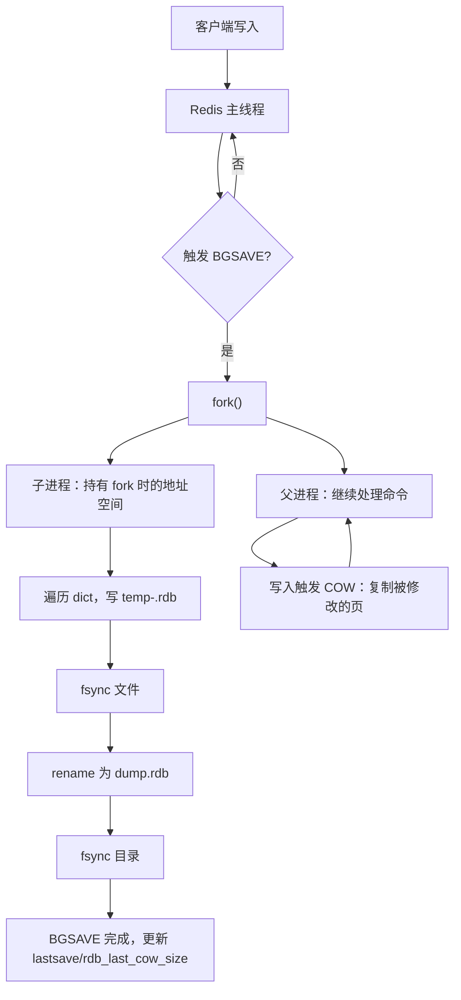
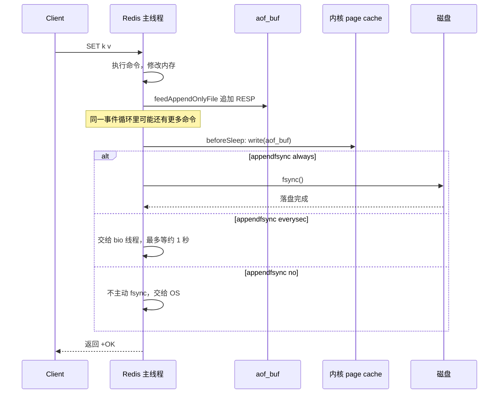
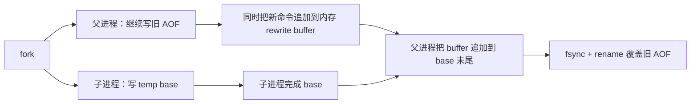
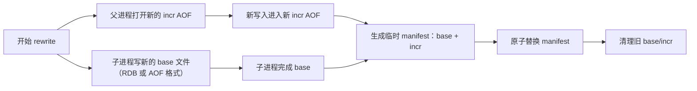
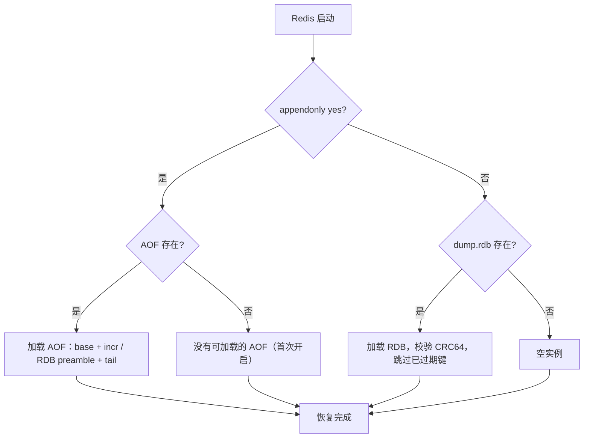

# Day 17 · RDB 与 AOF：快照、COW 与日志重写

> **一句话结论**：RDB 用 `fork + COW` 换一个「不锁住主线程的瞬时快照」，AOF 用追加日志换「更小的丢失窗口」；真正决定你丢多少数据的不是文件名，而是 **fork 何时发生、fsync 何时返回、rewrite 如何切换**。

---

## 0. 本次问题

你负责一个 40GB 的 Redis，`appendonly yes`、`appendfsync everysec`，同时保留 `save 300 100`。某天大促，出现三件事：

- 主库写入 p99 从 1ms 涨到 40ms，`INFO persistence` 里 `aof_delayed_fsync` 开始增长；
- 一次 `BGSAVE` 期间机器内存从 40GB 冲到 70GB，差点触发 OOM killer；
- AOF 每几分钟就 rewrite 一次，磁盘写入翻倍，`aof_rewrite_in_progress` 长期为 1，rewrite 期间新写入还在涨。

这三个现象不是三个独立的 bug，它们来自同一组取舍：

1. **快照为什么能「不锁」？** `fork` 到底复制了什么？父进程继续写，为什么不会把快照写脏？
2. **AOF 的 `everysec` 到底丢多少？** `write` 成功、`fsync` 没返回、机器掉电，三者之间差了什么？
3. **rewrite 期间的新写入去哪？** 如果 rewrite 失败、rename 前掉电、rename 后掉电，分别会怎样？

本次要能回答这三个问题，并且能画出一张「一条写命令从客户端到磁盘」的图。

---

## 0.5 先建立直觉

### 一句话直觉

> **RDB 是拍照，AOF 是记账。**
>
> 拍照时，店主说「现在开始，谁都不许动」——不，Redis 不这么说。它按一下快门（`fork`），让一个分身（子进程）去慢慢冲洗照片；店里继续营业。只有顾客改动了某一页账本，才把那一页复印一份给分身。这个「改了才复印」就是 **copy-on-write**。
>
> 记账则是另一套：每做一笔生意，就在流水账末尾加一行。流水账越写越厚，所以偶尔要「誊账」：把当前余额抄成一张新总账（rewrite），再把誊账期间的新流水补在后面。

### 生活类比

| Redis 里的东西 | 生活里的东西 | 为什么像 |
|---|---|---|
| `dump.rdb` | 某一刻的店内全景照片 | 只代表快门那一刻，之后的变化不在照片里 |
| `fork` | 按快门 + 分身 | 分身看到的是按快门时的世界 |
| COW | 谁改账本，才复印哪一页 | 没改的页仍然共享，省内存 |
| `rdb_last_cow_size` | 这次拍照复印了多少页 | 衡量 fork 之后的额外内存 |
| AOF | 流水账 | 每笔写操作追加一行，顺序清楚 |
| `write()` | 把字写在纸上 | 数据进了内核 page cache，但还没一定进磁盘 |
| `fsync()` | 把纸锁进保险柜 | 真正落盘，返回后才敢说「持久」 |
| `appendfsync everysec` | 每秒锁一次保险柜 | 最多丢约一秒的账 |
| `appendfsync always` | 每笔都立刻锁柜 | 最安全，也最慢 |
| AOF rewrite | 把流水账誊成「当前余额表」 | 去掉中间过程，只保留重建现状所需的最小命令 |
| rewrite tail | 誊账期间的新流水先贴便签 | 誊完后补到新账本末尾，不能丢 |
| `rename` | 新账本写完，整本换上去 | 原子替换，不会让顾客看到半本账 |
| CRC64 | 账本最后一页的防伪码 | 读的时候发现中间被改坏 |

### 只需要记住三个词

1. **快照**：RDB 是某一刻的视图，不是「实时副本」；它的正确性靠 `fork` 的瞬间。
2. **COW**：fork 不复制数据，只复制页表；父进程写哪一页，内核才复制哪一页。内存放大的上限是「父进程在快照期间改过的页」。
3. **重写**：AOF 不是「备份所有历史」，而是「用最小命令集重建当前状态」。重写必须解决「重写期间的新写入」。

### 第一遍可以先跳过

- `rdbSaveRio` 里整数/字符串的压缩编码、LZF、listpack 等对象编码；
- `aof.c` 里 multi-part AOF 的 manifest 字段和失败重试细节；
- `fsync` 在文件系统/云盘上的真实语义（O_DIRECT、写缓存、掉电保护）；
- 本文第 6 节的 C++ 实现与基准代码。

第一遍只读：**0.5、1、2、4、5**，能画出「客户端 → AOF buffer → page cache → 磁盘」和「fork → COW → 子进程写 RDB」两张图，就够了。

### 两种方案，先摆在一起看

```text
方案 A：RDB（快照）
  触发：save 配置 / BGSAVE / SHUTDOWN / 主从全量同步
  子进程：把 fork 那一刻的整个键空间写成二进制
  优点：文件紧凑、恢复快、适合备份/跨机房传输
  缺点：两次快照之间的数据会丢；fork 有延迟；COW 会吃额外内存

方案 B：AOF（追加日志）
  触发：每条写命令
  主线程：把命令按 RESP 追加到 aof_buf，write 到文件
  优点：丢失窗口小；可读；可重放
  缺点：文件更大；恢复更慢；rewrite 要额外磁盘和 CPU；fsync 影响 p99

方案 C：RDB + AOF
  AOF 负责「最近的完整性」，RDB 负责「备份/快速恢复/灾备」
  两者不是互相替代，而是两个不同的失败模型
```

Redis 允许三者（RDB only / AOF only / both / neither）任意组合。**不要问「哪个更好」，先问「我能接受丢多少、恢复要多久、磁盘和内存预算多少」。**

---

## 1. 设计背景：约束从哪里来

### 1.1 持久化不是备份

这是本课最重要的前提。

- **持久化**回答：「进程/机器重启后，数据还在不在？」
- **备份**回答：「机房炸了、误删了、被勒索了，能不能从另一个地方恢复？」

RDB 文件可以拿去做备份，但「开了 RDB」不等于「有备份」。同样，AOF 在本地磁盘上，也不等于灾备。生产上至少要有：

1. 异地/异机备份；
2. 定期恢复演练（不是只看文件存在）；
3. 对「误删/逻辑损坏」的保护（AOF 会把 `FLUSHALL` 也记下来，rewrite 之后就真的没了）。

### 1.2 RDB 的约束：快照要快，但不能停业

RDB 的目标是「在不阻塞主线程的前提下，得到一个一致的瞬时视图」。最直接的做法是：

```text
加锁 -> 遍历整个 dict -> 写文件 -> 解锁
```

问题是遍历 40GB 数据要几十秒，这期间所有客户端都得等。Redis 的单线程模型承受不了这种停顿。于是它把「遍历」交给子进程：

```text
父进程 fork()
  -> 子进程：继承一份地址空间（COW），慢慢遍历、写盘
  -> 父进程：继续处理客户端命令
```

关键点：

- `fork()` 本身要复制**页表**，不是复制数据。页表越大，fork 越慢；40GB 进程的 fork 可能是毫秒级到几十毫秒，取决于页表规模、内核配置和机器负载。
- fork 期间父进程是停住的（Redis 主线程调用 fork），所以它仍然是一个「短暂停顿」，只是从几十秒降到了毫秒级。
- 子进程看到的是 fork 那一刻的地址空间。父进程之后的写入会触发 COW：内核给父进程复制被写的那一页，子进程继续看旧页。
- COW 的单位是**页**，通常是 4KB。父进程只改一个 key，也可能复制整页（例如 4KB，开启 THP 时甚至 2MB）。所以「改 1 个 key」不等于「只多 100 字节」。
- 如果父进程在快照期间把大部分页都改了，COW 可能接近「复制整个数据集」。这就是 `BGSAVE` 期间内存翻倍的原因。

**THP（Transparent Huge Pages）** 是一个常见的放大器：大页让页表更小、TLB 命中更高，但 COW 的粒度从 4KB 变成 2MB。一个随机写密集的 Redis 在 BGSAVE 期间，COW 可能明显高于 4KB 页的预期。很多 Redis 运维文档建议关闭 THP，原因就在这里（不是 Redis 专属问题）。

另一个约束是 **overcommit**。fork 之后，内核要假装「子进程也有这 40GB」，但实际只在写时复制。Linux 的 overcommit 策略如果太保守，fork 可能直接失败；Redis 文档通常建议 `vm.overcommit_memory=1`。这不是「允许无限内存」，而是「允许承诺大于物理内存，实际由 COW 和 OOM killer 兜底」。

### 1.3 AOF 的约束：顺序写很快，fsync 很慢

AOF 的基本想法很简单：

```text
每条写命令 -> 追加到文件末尾
重启 -> 从头重放
```

顺序追加避开了随机写，通常很快；但「写进文件」与「写进磁盘」是两件事：

```text
你的进程
  -> write(fd, buf, n)      数据进入内核 page cache，通常很快
  -> fsync(fd)              等待磁盘/控制器确认，可能几毫秒到几百毫秒
  -> 返回客户端              这之后才敢说「已持久化」
```

如果只 `write` 不 `fsync`，机器掉电时 page cache 里的数据会丢。Linux 通常会在约 30 秒内回写脏页，所以 `appendfsync no` 的丢失窗口可能是几十秒。

`appendfsync everysec` 想折中：

- 主线程只负责 `write`，不等待磁盘；
- 后台线程每秒 `fsync` 一次；
- 如果上一次 fsync 还没完成，主线程可以推迟 write（最多约 2 秒），避免把 page cache 堆得更高；
- 代价是：掉电可能丢约 1 秒的数据；如果磁盘卡住，窗口可能更大。

`appendfsync always` 则是「每次 write 后都 fsync，再返回客户端」。它最安全，但每次写都要等磁盘。Redis 在这里做了一个很重要的优化：**group commit**。一个事件循环里可能积累了多个客户端/管道的命令，Redis 只做一次 `write` 和一次 `fsync`，而不是每条命令一次。所以「always」并不是「每条命令一次系统调用」；它是「每一批命令一次 fsync」。

### 1.4 AOF 的第二个问题：日志会越来越长

假设你对同一个 key 执行 100 万次 `INCR`：

```text
AOF: INCR k
     INCR k
     ...（100 万行）
```

重放这 100 万行当然能恢复，但启动要很久，文件也很大。实际上你只需要：

```text
SET k 1000000
```

这就是 **AOF rewrite**：不改变「AOF 是日志」的语义，而是生成一份「当前状态的最小命令集」。难点不在「怎么生成」，而在「生成期间新来的写命令怎么办」：

- 子进程在写新 base 文件时，父进程还在接收写入；
- 这些写入不能只写旧 AOF，否则新文件会缺一段；
- 也不能阻塞父进程，否则 rewrite 就变成了停业整理。

Redis 的解法是「两份都要」：

```text
子进程：从 fork 的快照生成 base 文件
父进程：继续写旧 AOF（保证 rewrite 失败也能恢复）
       同时把新命令记到 rewrite buffer / 新的 incr AOF
完成：把 base + 增量合并，原子替换旧文件
```

### 1.5 关键约束

| 约束 | 具体表现 | 对设计的影响 |
|---|---|---|
| 延迟 | 单线程；一条慢命令阻塞所有人；p99 要求毫秒级 | RDB 必须 fork 后台写；AOF 的 fsync 不能每条都阻塞主线程（除非选 always） |
| 吞吐 | 几十万 QPS；顺序追加比随机写便宜 | AOF 用 append-only；rewrite 顺序写新文件 |
| 内存 | 40GB 数据；fork 后 COW 可能接近翻倍 | 必须监控 `rdb_last_cow_size`；控制写入率；避免 THP 放大 |
| 磁盘 | 临时文件 + 旧文件 + 新文件可能同时存在 | rewrite 需要约 2 倍空间；磁盘满时不能覆盖好文件 |
| 持久性 | 不同业务能接受的 RPO 不同 | `appendfsync` 是显式旋钮；RDB 的 `save` 点是另一个旋钮 |
| 恢复时间 | AOF 重放可能几分钟；RDB 加载更快 | 大实例常同时保留 RDB，用于快速恢复/灾备 |
| 运维复杂度 | fork 失败、COW、fsync 卡顿、rewrite 失败、manifest | 每个旋钮都要有指标和告警 |

### 1.6 三个真实失败模式

**失败模式 1：把 RDB 当备份。**

每小时 `BGSAVE` 一次，文件放在同一块盘上。磁盘坏了，RDB 和 Redis 一起没了。RDB 只是「某个时刻的本地快照」，必须复制到另一台机器/对象存储，并且定期做恢复演练。

**失败模式 2：`everysec` 遇到慢盘。**

磁盘 latency 从 1ms 涨到 500ms，后台 fsync 一直完不成。主线程的 write 被推迟，`aof_delayed_fsync` 增长；如果此时掉电，丢失窗口可能超过 1 秒。`everysec` 是「通常约 1 秒」，不是「严格 1 秒」。

**失败模式 3：rewrite 期间内存/磁盘双杀。**

Redis 6.x 的 rewrite buffer 在内存里累积 rewrite 期间的所有写入。写入量很大时，buffer 可能涨到几 GB；同时旧 AOF + 新 base + 临时文件占用大量磁盘。Redis 7.0 改成 multi-part AOF，正是为了消掉这个无界 buffer。

### 1.7 RPO / RTO 对照表

| 配置 | 掉电可能丢 | 恢复速度 | 适合 |
|---|---|---|---|
| RDB，`save 300 100` | 最多约 5 分钟 | 快（紧凑文件） | 能接受分钟级丢失、重视恢复速度/备份 |
| AOF，`everysec` | 通常约 1 秒，慢盘时可能更多 | 中（重放日志） | 大多数在线业务 |
| AOF，`always` | 已确认的写基本不丢（除非磁盘说谎） | 中 | 支付、账务等强持久性 |
| AOF，`no` | 约 30 秒（取决于 OS） | 中 | 能接受较大窗口、追求吞吐 |
| RDB + AOF | 由 AOF 决定 | 快照可用于灾备/快速恢复 | 生产默认思路 |

> **RPO**：Recovery Point Objective，能接受丢多少数据。
> **RTO**：Recovery Time Objective，能接受停多久。

---

## 2. 架构与数据流

### 2.1 BGSAVE：fork 之后各干各的



三个容易忽略的点：

1. **子进程不写共享页**。它只读，所以不会触发 COW；COW 来自父进程的写。
2. **临时文件必须 fsync 后再 rename**。否则 rename 成功但数据没落盘，掉电后可能得到一个「名字对、内容空」的 RDB。
3. **rename 之后还要 fsync 目录**。文件内容 fsync 只保证数据，目录项（新文件名）也需要持久化。Redis 的 `rdbSave` 里调用了 `fsyncFileDir`。

### 2.2 COW 的时间线

假设有三个页 P1/P2/P3，fork 时都被父子共享：

```text
时间  父进程                          子进程                     物理页
t0    fork()                          开始遍历                   P1/P2/P3 共享
t1    SET k1（k1 在 P1）              读 P1                      P1 复制，父用新页，子用旧页
t2    SET k2（k2 在 P2）              读 P2                      P2 复制
t3    SET k3（k3 在 P1，已复制过）    读 P1（旧页）              父直接改自己的 P1，不再复制
t4    ...                             写完 RDB                   子进程退出，旧页释放
```

所以：

- COW 的成本取决于「父进程改了多少**不同的页**」，不是「改了多少 key」；
- 同一个页被改多次，只复制一次；
- 如果 key 分布很散，少量写也可能触发很多页复制；
- 如果 fork 之后几乎没有写入，COW 成本接近 0，但 fork 的页表复制仍然要花时间。

### 2.3 AOF 的写路径



注意顺序：**先 write，后回复**。即使 `everysec` 不等待 fsync，命令也已经进入 page cache；如果进程崩溃（不是机器掉电），page cache 还在，数据通常不会丢。真正危险的是机器掉电/内核崩溃。

### 2.4 rewrite：base + 增量

**Redis < 7.0（rewrite buffer 模型）**



**Redis >= 7.0（multi-part AOF）**



两个模型的共同不变量：

1. **rewrite 失败不能破坏旧 AOF**；
2. **rewrite 期间的新写入不能丢**；
3. **切换必须是原子的**（rename 或 manifest 替换）。

不同点：

- 6.x 的 buffer 在内存里，写入量大时可能 OOM；新写入会写两遍（旧 AOF + buffer）。
- 7.x 的新写入直接进新的 incr 文件，不在内存里无界累积；manifest 负责「哪些文件组成当前 AOF」。

### 2.5 启动恢复：先看谁



关键规则：

- **AOF 开启且存在时，AOF 是数据源**。即使同时有更新的 RDB，Redis 也不会把 RDB 叠加到 AOF 上；两者是替代关系，不是相加。
- **AOF 的 RDB preamble**：如果 AOF 文件以 `REDIS` 开头，先按 RDB 解析，再把剩余部分当 RESP 命令解析。这就是 `aof-use-rdb-preamble yes`。
- **AOF 尾部截断**：默认 `aof-load-truncated yes`，丢弃最后一条不完整命令，保留前面完整命令；如果中间损坏，不是「截断」而是「坏文件」，默认拒绝启动。
- **RDB 校验失败**：默认拒绝加载。不要用「忽略校验」来掩盖磁盘/内存问题。

### 2.6 关键对象

| 对象 | 职责 | 生命周期 |
|---|---|---|
| `redisDb.keys` | 主键空间 | 进程级 |
| `server.rdb_child_pid` / `child_type` | 当前后台子进程 | 一次 BGSAVE/rewrite |
| `server.aof_buf` | 待 write 的 RESP 命令 | 每个事件循环 |
| `server.aof_fd` | 当前 AOF 文件描述符 | AOF 开启期间 |
| `server.aof_manifest` | 7.x 的 base/incr 文件清单 | AOF 开启期间 |
| `server.aof_rewrite_base_size` | 上次 rewrite 后的基准大小 | 跨 rewrite |
| `server.stat_rdb_cow_bytes` | 本次 BGSAVE 的 COW 字节数 | 每次 BGSAVE |
| `server.aof_last_fsync` | 上次 fsync 时间 | 进程级 |
| `bio` 队列 | 后台 fsync/close/lazyfree | 进程级 |

### 2.7 六条不变量

1. **RDB 是点时刻的**。快照里不会出现 fork 之后的写入。
2. **RDB 文件要么完整，要么不被承认**。临时文件 + fsync + rename + CRC64。
3. **AOF 只追加，不原地改**。恢复时按顺序重放。
4. **AOF 的写入顺序 = 命令执行顺序**。同一 key 的 `SET`、`DEL`、`EXPIRE` 不能乱序。
5. **rewrite 失败不影响旧 AOF**。切换前，旧文件仍是有效数据源。
6. **持久性由 fsync 策略决定，不由「有没有 AOF」决定**。`appendonly yes` + `appendfsync no` 仍然可能丢几十秒。

---

## 3. 源码关键路径（Redis 7.2）

> 只追一条线：**RDB 怎么写/怎么读 → AOF 怎么追加/怎么 fsync → rewrite 怎么切换**。不逐行抄源码。

### 3.1 RDB 的文件结构

`rdbSaveRio` 是写 RDB 的主函数。它的骨架：

```c
int rdbSaveRio(...) {
    char magic[10];
    snprintf(magic, sizeof(magic), "REDIS%04d", RDB_VERSION);  // 7.2 -> REDIS0011
    rdbWriteRaw(rdb, magic, 9);

    rdbSaveInfoAuxFields(rdb, rdbflags, rsi);   // redis-ver / redis-bits / ctime / used-mem
    for (j = 0; j < server.dbnum; j++)
        rdbSaveDb(rdb, j, ...);                 // SELECTDB + RESIZEDB + 每个 key

    rdbSaveType(rdb, RDB_OPCODE_EOF);           // 0xFF
    cksum = rdb->cksum;
    memrev64ifbe(&cksum);
    rioWrite(rdb, &cksum, 8);                   // CRC64，小端
}
```

对应的读取端 `rdbLoadRioWithLoadingCtx`：

1. 读 9 字节魔数，检查 `REDIS`，解析版本（1..`RDB_VERSION`）；
2. 循环读 opcode：`AUX` / `SELECTDB` / `RESIZEDB` / `EXPIRETIME_MS` / `TYPE` / `EOF`；
3. 每读一个对象，更新 CRC；
4. 读到 `EOF` 后，再读 8 字节 checksum，和计算值比较；
5. 如果是主库、且不是 AOF preamble/复制加载，跳过「已经过期」的键，并计入 `rdb_last_load_keys_expired`。

RDB 的键值对顺序（`rdbSaveKeyValuePair`）值得记住：

```c
if (expiretime != -1) {
    rdbSaveType(rdb, RDB_OPCODE_EXPIRETIME_MS);
    rdbSaveMillisecondTime(rdb, expiretime);   // 绝对毫秒
}
rdbSaveObjectType(rdb, val);                   // 类型
rdbSaveStringObject(rdb, key);                 // key
rdbSaveObject(rdb, val, key, dbid);            // value
```

**过期时间写在类型/键/值之前**，而且存的是绝对毫秒。这样加载时不需要知道「写 RDB 的时候过了多久」，也不会因为加载耗时导致 TTL 被延长。这个选择和 Day 16 的 `expires` 表一致：TTL 是绝对 deadline，不是相对秒数。

### 3.2 RDB 的原子替换

`rdbSave` 的骨架：

```c
snprintf(tmpfile, sizeof(tmpfile), "temp-%d.rdb", getpid());
rdbSaveInternal(req, tmpfile, ...);   // fopen("w") + 写 + fflush + fsync
rename(tmpfile, filename);            // 原子替换
fsyncFileDir(filename);               // 目录项也落盘
server.dirty = 0;
server.lastsave = time(NULL);
```

失败路径会 `unlink(tmpfile)`，绝不碰旧 `dump.rdb`。这就是「临时文件 + 原子 rename」模式：**读的人永远只看到旧文件或新文件，不会看到半个文件**。

`rdbSaveBackground` 则：

```c
if ((childpid = redisFork(CHILD_TYPE_RDB)) == 0) {
    retval = rdbSave(req, filename, rsi, rdbflags);  // 子进程
    sendChildCowInfo(CHILD_INFO_TYPE_RDB_COW_SIZE, "RDB");
    exitFromChild(...);
} else {
    server.rdb_save_time_start = time(NULL);
    server.rdb_child_type = RDB_CHILD_TYPE_DISK;
    return C_OK;                                      // 父进程立刻返回
}
```

父进程在 `serverCron` 里用 `waitpid` 回收子进程，读取 `getrusage`/COW 信息，更新 `rdb_last_cow_size`、`rdb_last_bgsave_status`。如果失败且 `stop-writes-on-bgsave-error yes`，Redis 会拒绝写入——这是「持久化失败时宁可停写，也不要假装成功」的保守选择。

### 3.3 AOF 的追加：`feedAppendOnlyFile`

每条会修改数据集的命令，在传播阶段都会经过 `propagate()`，其中 AOF 分支调用 `feedAppendOnlyFile`：

```c
void feedAppendOnlyFile(int dictid, robj **argv, int argc) {
    sds buf = sdsempty();

    if (dictid != -1 && dictid != server.aof_selected_db) {
        // 切换 DB 时补一条 SELECT
        buf = sdscatprintf(buf, "*2\r\n$6\r\nSELECT\r\n$%lu\r\n%s\r\n", ...);
        server.aof_selected_db = dictid;
    }

    buf = catAppendOnlyGenericCommand(buf, argc, argv);  // 转成 RESP
    if (server.aof_state == AOF_ON || ...)
        server.aof_buf = sdscatlen(server.aof_buf, buf, sdslen(buf));
}
```

几个细节：

- AOF 用的是 **Redis 协议（RESP）**，不是自定义二进制格式。所以你可以用 `redis-cli --pipe`、`redis-check-aof`、甚至自己写 parser 处理它。
- 如果当前 DB 和上一条命令的 DB 不同，会补一个 `SELECT`，保证重放时上下文正确。
- 命令不是「执行完立刻 write」，而是先进入 `server.aof_buf`；在事件循环的 `beforeSleep` 里统一 flush。这样一次 write 可以带走一批命令。

### 3.4 AOF 的 fsync：`flushAppendOnlyFile`

这是整个 AOF 持久性语义的核心。简化后的结构：

```c
void flushAppendOnlyFile(int force) {
    if (sdslen(server.aof_buf) == 0) return;

    if (server.aof_fsync == AOF_FSYNC_EVERYSEC && !force) {
        if (aofFsyncInProgress()) {
            // 上一次 fsync 还没完成：先推迟 write
            if (server.aof_flush_postponed_start == 0) {
                server.aof_flush_postponed_start = server.mstime;
                return;
            } else if (server.mstime - server.aof_flush_postponed_start < 2000) {
                return;
            }
            server.aof_delayed_fsync++;
        }
    }

    nwritten = aofWrite(server.aof_fd, server.aof_buf, sdslen(server.aof_buf));
    // 处理 short write、ENOSPC、错误状态...

    if (server.aof_fsync == AOF_FSYNC_ALWAYS) {
        redis_fsync(server.aof_fd);          // Linux 上通常是 fdatasync
    } else if (server.aof_fsync == AOF_FSYNC_EVERYSEC &&
               server.mstime - server.aof_last_fsync >= 1000) {
        aof_background_fsync(server.aof_fd); // 交给 bio 线程
    }
}
```

三个关键分支：

| 策略 | write 谁做 | fsync 谁做 | 返回客户端前等什么 |
|---|---|---|---|
| `always` | 主线程 | 主线程 | 等 write + fsync |
| `everysec` | 主线程 | bio 后台线程 | 等 write；不等 fsync |
| `no` | 主线程 | OS | 等 write；不等 fsync |

`everysec` 的「推迟 write」是一个反压机制：如果磁盘一直 fsync 不完，继续 write 只会让 page cache 更脏、内存更高；推迟最多 2 秒，然后强制 write 并记录 `aof_delayed_fsync`。

### 3.5 AOF rewrite 的入口

`BGREWRITEAOF` 最终调用 `rewriteAppendOnlyFileBackground`：

```c
int rewriteAppendOnlyFileBackground(void) {
    if (hasActiveChildProcess()) return C_ERR;   // 不和 BGSAVE 并发
    server.aof_selected_db = -1;
    flushAppendOnlyFile(1);
    openNewIncrAofForAppend();                   // 7.x：先开新的 incr 文件
    if ((childpid = redisFork(CHILD_TYPE_AOF)) == 0) {
        rewriteAppendOnlyFile(tmpfile);          // 子进程写 base
        exitFromChild(...);
    }
    // 父进程继续处理命令，新命令进入新的 incr AOF
}
```

子进程的 `rewriteAppendOnlyFile`：

1. 打开临时文件；
2. 如果 `aof-use-rdb-preamble yes`，调用 `rdbSaveRio(..., RDBFLAGS_AOF_PREAMBLE)` 写 RDB 格式的 base；
3. 否则遍历每个 DB，写「重建当前值所需的最小命令」；
4. `fflush` + `fsync`，产出临时 base 文件（子进程只用这个临时名字）；
5. 父进程收到信号后，进入 `backgroundRewriteDoneHandler`，把临时 base rename 成新 base，并原子切换 manifest。

`rewriteObject` 对 string 的处理很直观：

```c
// SET key value
rioWrite(aof, "*3\r\n$3\r\nSET\r\n", ...);
rioWriteBulkObject(aof, key);
rioWriteBulkObject(aof, o);

// 如果有 TTL，再补一条绝对时间的 PEXPIREAT
if (expiretime != -1) {
    rioWrite(aof, "*3\r\n$9\r\nPEXPIREAT\r\n", ...);
    rioWriteBulkObject(aof, key);
    rioWriteBulkLongLong(aof, expiretime);
}
```

这也解释了为什么 rewrite 后的 AOF 仍然能正确恢复 TTL：**TTL 被写成绝对时间**，不依赖「rewrite 花了多久」。

### 3.6 Redis 7.x 的 multi-part AOF

7.0 之后，AOF 不再是一个大文件，而是：

```text
appendonlydir/
├── appendonly.aof.manifest
├── appendonly.aof.1.base.rdb      # 或 .base.aof
├── appendonly.aof.1.incr.aof
└── appendonly.aof.2.incr.aof
```

manifest 记录「当前由哪些文件组成」，例如：

```text
file appendonly.aof.1.base.rdb seq 1 type b
file appendonly.aof.1.incr.aof seq 1 type i
```

rewrite 完成时，`backgroundRewriteDoneHandler`：

1. 把临时 base rename 成新的 base 文件名；
2. 把当前 incr 文件标记为 history；
3. 生成新的 manifest（base + 当前 incr）；
4. **原子替换 manifest**；
5. 删除旧文件。

为什么这样做？

- 不再需要把 rewrite 期间的新命令堆在内存里（6.x 的 rewrite buffer）；
- 新写入直接进 incr 文件，失败时旧 base + 旧 incr + 新 incr 仍然能拼出完整数据；
- manifest 是唯一的「提交点」，替换它是原子的。

代价是运维复杂度：目录、manifest、历史文件、失败重试、文件清理。Redis 7 还引入了 rewrite 失败退避（`aofRewriteLimited`），避免失败后疯狂重试。

### 3.7 AOF 的加载与截断

`loadSingleAppendOnlyFile` / `loadAppendOnlyFiles` 的流程：

1. 读 manifest，按顺序加载 base，再加载 incr；
2. 如果文件以 `REDIS` 开头，先按 RDB 解析（`RDBFLAGS_AOF_PREAMBLE`）；
3. 剩余部分用 fake client 逐条执行 RESP 命令；
4. 如果最后一条命令不完整：
   - `aof-load-truncated yes`：截断到最后一个完整命令，记录 warning，继续启动；
   - `aof-load-truncated no`：拒绝启动；
5. 如果中间出现坏字节：拒绝启动，提示用 `redis-check-aof --fix`。

为什么「尾部截断」可以容忍，而「中间损坏」不能？

- 尾部截断通常是掉电/磁盘满导致的「最后一条命令写了一半」；前面的命令仍然是一个一致的历史前缀。
- 中间损坏意味着后面的字节可能被错位解释，继续执行可能把错误命令应用到数据上，比拒绝启动更危险。

### 3.8 RDB preamble 的加载细节

当 AOF 以 RDB 开头时，`rdbLoadRio` 会带 `RDBFLAGS_AOF_PREAMBLE`。一个容易被忽略的分支：

```c
} else if (iAmMaster() &&
           !(rdbflags & RDBFLAGS_AOF_PREAMBLE) &&
           expiretime != -1 && expiretime < now)
{
    // 独立 RDB：主库加载时跳过已过期键
    server.rdb_last_load_keys_expired++;
} else {
    // AOF preamble / 从库：保留过期键，交给后续命令或过期逻辑处理
    dbAdd(...);
}
```

为什么 AOF preamble 不跳过过期键？因为 RDB preamble 后面的 AOF tail 可能包含针对这些键的命令（例如 `DEL`、`PEXPIREAT`）。如果 preamble 阶段就把键删了，后面的命令仍然能执行，但语义上应该由 AOF 的完整历史决定。保留它们、让读路径隐藏，是更保守的做法。

### 3.9 配置项地图

| 配置 | 默认 | 作用 | 调大的代价 |
|---|---|---|---|
| `save` | `3600 1 300 100 60 10000` | RDB 触发点（秒 + 写次数） | 更频繁的 fork/COW/磁盘 I/O |
| `rdbchecksum` | `yes` | RDB CRC64 | 关闭后损坏可能静默通过 |
| `stop-writes-on-bgsave-error` | `yes` | BGSAVE 失败时停写 | 可用性下降，但避免「以为有持久化」 |
| `rdb-save-incremental-fsync` | `yes` | 每 4MB 增量 fsync | 降低尾延迟，略增系统调用 |
| `appendonly` | `no` | 开 AOF | 更多磁盘、rewrite、恢复时间 |
| `appendfsync` | `everysec` | fsync 策略 | `always` 延迟高；`no` 丢失窗口大 |
| `aof-use-rdb-preamble` | `yes` | rewrite base 用 RDB 格式 | 可读性下降，恢复更快/更紧凑 |
| `aof-load-truncated` | `yes` | 容忍尾部半条命令 | 关闭后掉电可能起不来 |
| `auto-aof-rewrite-percentage` | `100` | 增长 100% 触发 rewrite | 更频繁 rewrite |
| `auto-aof-rewrite-min-size` | `64mb` | 小于此值不 rewrite | 小实例可能长期不整理 |
| `no-appendfsync-on-rewrite` | `no` | rewrite 期间不 fsync | 降低卡顿，但持久性窗口变大 |
| `aof-rewrite-incremental-fsync` | `yes` | rewrite 每 4MB fsync | 降低 rewrite 尾延迟 |
| `aof-timestamp-enabled` | `no` | 写 `#TS:` 注释 | 文件略大，便于审计 |

### 3.10 语言对照

- **C++ / RocksDB**：WAL + SST 的思路和 Redis 的 AOF + RDB 很像，但 RocksDB 的 WAL 是「先写日志再写 MemTable」，Redis 是「先改内存再写 AOF」；RocksDB 的 MANIFEST 管 SST 版本，Redis 7 的 manifest 管 AOF base/incr 文件。
- **C++ / LevelDB**：`log::Writer` 用 32KB block + CRC32，和 Redis AOF 的 RESP + 单条命令不同；LevelDB 的 `MANIFEST` 是版本编辑日志，Redis 7 manifest 更像「文件清单」。
- **Rust**：很多嵌入式 KV 用 `sled` 的 log + snapshot；思路相同，但 Rust 生态更倾向「append-only + periodic compaction」。
- **PostgreSQL**：WAL + checkpoint + full page writes，比 Redis AOF 复杂得多；相同点是「先日志、后数据」和「检查点之前的日志不能删」。
- **Java / Kafka**：分段日志 + 索引 + 零拷贝，Day 22 会讲；AOF 是「单文件顺序追加」的极简版。

Redis 的持久化之所以适合作为入门，是因为它把「快照、日志、重写、校验、原子替换」这些机制压缩到了两个文件里，没有事务、没有页缓存管理、没有复杂的恢复算法。

---

## 4. 关键设计技巧

### 技巧 1：用 fork + COW 做无锁快照

- **做法**：父进程 `fork`，子进程继承地址空间；父进程继续服务，写时由内核复制被修改的页；子进程只读，遍历完写盘。
- **为什么有效**：快照的一致性由 fork 的瞬间保证，不需要在父进程的读路径上加锁；父进程的停顿只剩下 fork 本身。
- **代价**：fork 要复制页表；COW 会吃额外内存；THP 放大复制粒度；fork 可能失败（overcommit/内存不足）。
- **适用边界**：读多写少、能接受 fork 短暂停顿、内存有余量的场景。如果写入率极高、数据集远大于内存余量，COW 可能把机器打爆。

### 技巧 2：临时文件 + fsync + 原子 rename

- **做法**：先写 `temp-<pid>.rdb`，`fflush` + `fsync`，再 `rename` 到 `dump.rdb`，最后 `fsync` 目录。
- **为什么有效**：`rename` 在同一文件系统内是原子的；读者要么看到旧文件，要么看到新文件，不会看到半个文件。失败时旧文件仍然完整。
- **代价**：需要额外磁盘空间（旧文件 + 临时文件）；rename 之后还要 fsync 目录，否则目录项可能丢。
- **适用边界**：所有「原地覆盖会破坏旧版本」的持久化文件，包括 RDB、AOF rewrite、配置快照、LSM MANIFEST。

### 技巧 3：把持久性做成显式旋钮，而不是隐藏承诺

- **做法**：`appendfsync always/everysec/no` 三档，明确每档的写路径和丢失窗口；`save` 点独立控制 RDB 频率。
- **为什么有效**：不同业务的 RPO 不同。支付系统要 `always`，缓存可以 `no`；把选择权交给使用者和监控，而不是替他们做隐含假设。
- **代价**：配置错误会导致「以为持久化，其实没有」；需要文档、默认值、指标和告警。
- **适用边界**：任何持久化系统。关键不是「提供几个档位」，而是「每个档位的确切语义 + 可观测性」。

### 技巧 4：rewrite 用「base + 增量」两阶段提交

- **做法**：子进程从快照生成 base；父进程把 rewrite 期间的新命令记到 tail/新 incr；完成后合并或原子切换 manifest。
- **为什么有效**：rewrite 不需要停写；失败时旧文件仍然完整；成功时新文件包含「快照 + 快照之后的所有变更」。
- **代价**：6.x 的 tail 在内存里，可能 OOM；7.x 的 manifest/文件管理更复杂；rewrite 期间磁盘 I/O 翻倍。
- **适用边界**：所有「日志压缩/快照重建」场景，包括 LSM compaction、Kafka 日志段合并、数据库 checkpoint。

### 技巧 5：校验和 + 版本号，让损坏尽早暴露

- **做法**：RDB 末尾写 CRC64；文件头写 `REDIS0011`；加载时校验版本和 checksum。
- **为什么有效**：磁盘位翻转、部分写、传输截断都会导致校验失败；早失败比「带着坏数据启动」安全。
- **代价**：计算 CRC 需要 CPU；关闭校验会快一点，但把风险留到未来。
- **适用边界**：所有落盘/跨网络传输的二进制格式。注意：CRC 只能发现意外损坏，不能防篡改（需要签名/HMAC）。

### 技巧 6：绝对时间 + 确定性重写

- **做法**：TTL 写成绝对毫秒；`SET ... EX` 在传播时改写成 `SET ... PXAT`；rewrite 时写 `SET` + `PEXPIREAT`；非确定性命令（如 `SPOP`）在传播前改写成确定性形式。
- **为什么有效**：重放不依赖「什么时候重放」，同一份日志在任何时间、任何机器上得到相同结果；主从/AOF/RDB 可以共享同一套时间语义。
- **代价**：时钟偏差会影响 TTL 的实际表现；跨机房迁移要校验时钟；绝对时间写入后不能「延长 TTL」而不改日志。
- **适用边界**：所有需要重放的日志系统。相对时间（“60 秒后过期”）只能存在于客户端命令入口，不能存在于持久化格式里。

---

## 5. 反例与边界

| 看起来对的用法 | 实际问题 | 正确做法 |
|---|---|---|
| 开了 RDB 就等于有备份 | 文件在同一块盘/同一台机器；误删/勒索/盘坏一起没 | 异地备份 + 定期恢复演练 + 版本保留 |
| `appendonly yes` 就一定不丢 | `appendfsync no` 仍可能丢几十秒；`everysec` 慢盘时窗口更大 | 明确 RPO，选 `always` 或接受窗口；监控 `aof_delayed_fsync` |
| `BGSAVE` 不影响性能 | fork 会停顿；COW 吃内存；子进程写盘和主线程抢 I/O | 低峰期做；留内存余量；监控 `rdb_last_cow_size`；考虑关闭 THP |
| AOF 文件越大越安全 | 恢复慢、rewrite 久、磁盘压力大；rewrite 失败窗口长 | 开自动 rewrite；监控大小/增长；留 2 倍磁盘 |
| rewrite 期间可以随便写 | 6.x 的 rewrite buffer 无界；7.x 的 incr 文件也会涨 | 监控 `aof_rewrite_buffer_length`/目录大小；限流；避开大促 |
| 用 `SAVE` 做定时快照 | `SAVE` 在主线程执行，阻塞所有客户端 | 用 `BGSAVE` 或 `save` 配置 |
| AOF 可以当审计日志 | rewrite 会删除历史；`FLUSHALL` 也会被记录；没有租户隔离 | 单独审计日志/CDC；不要依赖 AOF 做合规审计 |
| 把 RDB 文件从从库直接拷走 | 从库可能滞后；RDB 版本/配置不同；拷贝时可能正在 rewrite | 在从库做 `BGSAVE`，等完成后再拷；校验版本/校验和 |
| `rename` 成功就万事大吉 | 目录项可能没落盘；文件内容可能还在 page cache | rename 前 fsync 文件，rename 后 fsync 目录 |
| 关闭 checksum 提升性能 | 损坏可能静默通过，恢复出错误数据 | 保留 `rdbchecksum yes`；性能问题从别处找 |

### 压力下会发生什么

- **写入打满**：AOF 的 `write` 频率上升，page cache 变脏；`everysec` 的 fsync 跟不上时，主线程开始推迟 write，p99 上升。监控 `aof_delayed_fsync`、`aof_pending_bio_fsync`、`aof_last_write_status`。
- **磁盘卡顿**：`fsync` 从毫秒变几百毫秒；`always` 直接拖垮吞吐；`everysec` 把窗口拉大。SSD 的写放大、云盘的突发额度、RAID 电池都可能造成这种卡顿。
- **BGSAVE + 高写入**：COW 页数快速上升，RSS 可能接近 2 倍；如果超过物理内存，OOM killer 可能杀掉 Redis 或子进程。监控 `rdb_last_cow_size`、`used_memory_rss`、`mem_fragmentation_ratio`。
- **rewrite + 磁盘满**：临时文件写失败，旧 AOF 仍在；但如果磁盘满到连旧 AOF 的 append 都失败，`aof_last_write_status` 变 `err`，写入被拒绝。留 2 倍空间，设置磁盘告警。
- **进程崩溃 vs 机器掉电**：进程崩溃时 page cache 还在，`everysec` 通常不丢；机器掉电时 page cache 丢失，才需要 fsync。很多人把这两种故障混为一谈。
- **主从切换**：从库的 AOF/RDB 可能落后；故障转移后，新的主库可能缺少最后一段。持久化不等于复制，复制也不等于备份（Day 18 会讲）。
- **时钟跳跃**：TTL 是绝对时间；NTP 回拨会让 key 多活，向前跳会让一批 key 同时过期。AOF/RDB 重放不受「重放耗时」影响，但受墙上时钟影响。

---

## 6. 最小实现（C++20）

> 目标：把「页式 COW + RDB 编解码 + RESP AOF + rewrite + 崩溃恢复」做成一个能跑、能测、能破坏的小系统。不是生产级 Redis，但每条不变量都有测试。

### 6.1 文件与结构

```text
day-017-rdb-aof/
├── README.md
└── code/
    ├── CMakeLists.txt
    ├── persistence.hpp   # PageStore / Snapshot / RDB / MemFs / RESP / AofWriter / Engine
    └── main.cpp          # 18 个 CTest 用例 + demo + bench
```

核心类型：

```cpp
struct Entry {
    std::string value;
    i64 expire_at_ms = -1;   // 绝对毫秒；-1 = 无 TTL
};

struct Page {
    std::map<std::string, Entry> entries;
};

class PageStore {
    std::vector<std::shared_ptr<Page>> pages_;  // 固定页数
    mutable CowStats stats_;
    // ...
};
```

和 Redis 的对应关系：

| 本实现 | Redis | 说明 |
|---|---|---|
| `PageStore` | `redisDb.keys` | 页式组织，方便演示 COW |
| `Snapshot` | fork 后的子进程地址空间 | 持有旧页的 `shared_ptr` |
| `writable_page` | 内核 COW | 页被共享时先复制整页 |
| `rdb_encode` | `rdbSaveRio` | 只支持 string，格式同构 |
| `rdb_decode` | `rdbLoadRio` | 校验 CRC64、版本、TTL |
| `AofWriter` | `feedAppendOnlyFile` + `flushAppendOnlyFile` | RESP + fsync 策略 |
| `Engine::begin_rewrite` | `rewriteAppendOnlyFileBackground` | 快照 + base + tail |
| `Engine::finish_rewrite` | `backgroundRewriteDoneHandler` | fsync + rename |
| `MemFs` | 文件系统 + page cache | `crash()` 丢掉未 fsync 的尾部 |

### 6.2 COW 的核心 10 行

```cpp
Page& PageStore::writable_page(std::size_t index) {
    auto& slot = pages_[index];
    if (slot.use_count() > 1) {              // 有快照还在看这一页
        auto copy = std::make_shared<Page>(*slot);
        stats_.pages_copied++;
        stats_.bytes_copied += page_bytes(*copy);
        slot = std::move(copy);              // 父进程改用副本
    }
    return *slot;
}
```

`fork()` 只复制 `shared_ptr` 数组：

```cpp
Snapshot PageStore::fork() const {
    std::vector<std::shared_ptr<const Page>> pages;
    for (const auto& page : pages_) pages.push_back(page);  // 引用计数 +1
    return Snapshot(std::move(pages), version_++, pages_.size());
}
```

当父进程写一个 key 时：

1. 找到 key 所在的页；
2. 如果这一页被快照共享（`use_count > 1`），复制整页；
3. 在副本上修改；
4. 快照仍然指向旧页，所以看到的是 fork 时的值。

这和内核 COW 的差别是：这里复制的是整页的 `std::map`，内核复制的是 4KB 物理页。但「写哪页才复制哪页」「同一页只复制一次」的语义是一样的。

### 6.3 RDB 的核心 20 行

```cpp
std::string rdb_encode(const Snapshot& snapshot, const RdbOptions& options) {
    std::string out;
    out.append("REDIS0011", 9);

    out.push_back(0xFA); rdb_write_string(out, "redis-ver");
    rdb_write_string(out, options.redis_version);
    out.push_back(0xFE); rdb_write_len(out, 0);          // SELECTDB 0
    out.push_back(0xFB);                                 // RESIZEDB
    rdb_write_len(out, snapshot.key_count());
    rdb_write_len(out, snapshot.expires_count());

    snapshot.for_each([&](const std::string& key, const Entry& entry) {
        if (entry.expire_at_ms != -1) {
            out.push_back(0xFC);                         // EXPIRETIME_MS
            put_u64_le(out, static_cast<u64>(entry.expire_at_ms));
        }
        out.push_back(0x00);                             // RDB_TYPE_STRING
        rdb_write_string(out, key);
        rdb_write_string(out, entry.value);
    });

    out.push_back(0xFF);                                 // EOF
    put_u64_le(out, options.checksum ? crc64(out) : 0);
    return out;
}
```

加载端：

- 读 9 字节魔数，检查 `REDIS` 和版本；
- 循环解析 opcode；
- 遇到 `0xFC` 先记下 TTL，遇到 `0x00` 再读 key/value；
- 读到 `0xFF` 后读 8 字节 checksum，和 `crc64(header..EOF)` 比较；
- 独立 RDB 启动时跳过 `expire_at_ms <= now` 的键，AOF preamble 不跳过。

这里有一个真实的坑：**Redis 的 CRC64 不是常见的 CRC-64/XZ**。它用 Jones 多项式 `0xad93d23594c935a9`，先 MSB-first 逐位处理，最后把 64 位结果反转。第一版实现用了「反射多项式 + 右移」的常见写法，算出来是 `caa717168609f281`，而 Redis 的已知向量是 `e9c6d914c4b8d9ca`。改回 Redis 的位序后才通过。

### 6.4 AOF 的核心：append + flush

```cpp
void AofWriter::append(const Command& command) {
    buffer_ += resp_encode(command);
}

void AofWriter::flush(i64 now_ms, bool force) {
    if (buffer_.empty()) {
        maybe_fsync(now_ms, force);
        return;
    }
    fs_.append(path_, buffer_);   // write(2)：进入 page cache
    buffer_.clear();
    maybe_fsync(now_ms, force);   // always/everysec 决定是否 fsync
}

void AofWriter::maybe_fsync(i64 now_ms, bool force) {
    if (config_.fsync == FsyncPolicy::Always) {
        fs_.fsync(path_);
    } else if (config_.fsync == FsyncPolicy::EverySec &&
               (force || now_ms - last_fsync_ms_ >= 1000)) {
        fs_.fsync(path_);
    }
}
```

`MemFs` 把「文件内容」和「已 fsync 的前缀」分开：

```cpp
struct MemFile {
    std::string data;       // 当前内容（包括未 fsync 的尾部）
    std::size_t durable = 0; // 已经 fsync 的前缀长度
};

void MemFs::crash() {
    for (auto& [path, file] : files_) {
        if (file.data.size() > file.durable)
            file.data.resize(file.durable);  // 掉电：page cache 没落盘的部分消失
    }
}
```

这让「进程崩溃」和「机器掉电」的差别可以被测试：

- 进程崩溃：`data` 还在，`durable` 只影响重启后的恢复；
- 机器掉电：`crash()` 把未 fsync 的尾部截掉。

### 6.5 rewrite 的核心：base + tail + 原子替换

```cpp
void Engine::begin_rewrite(i64) {
    rewrite_snapshot_ = store_.fork();          // fork 时的视图
    rewrite_base_ = config_.aof.use_rdb_preamble
        ? rdb_encode(*rewrite_snapshot_, config_.rdb)
        : encode_snapshot_as_aof(*rewrite_snapshot_);
    rewrite_tail_.clear();
    rewrite_active_ = true;
}

void Engine::finish_rewrite(i64 now_ms) {
    aof_.flush(now_ms, true);                   // 旧 AOF 的尾部先落盘
    const std::string new_aof = rewrite_base_ + rewrite_tail_;

    fs_.write_file("temp-rewrite.aof", new_aof);
    fs_.fsync("temp-rewrite.aof");
    fs_.rename("temp-rewrite.aof", config_.aof_path);  // 原子切换

    aof_.reset_after_rewrite(now_ms);
    rewrite_active_ = false;
}
```

`append_to_aof` 在 rewrite 期间做两件事：

```cpp
aof_.append(command);
aof_.flush(now_ms);                  // 旧 AOF 继续写，保证失败可恢复
if (rewrite_active_) {
    rewrite_tail_ += resp_encode(command);  // 新 AOF 的增量
}
```

测试覆盖了三种崩溃点：

1. **rewrite 未完成**：旧 AOF 仍然完整，新临时文件不影响恢复；
2. **rename 前掉电**：旧 AOF 是唯一提交点；
3. **rename 后掉电**：新 AOF = base + tail，包含 rewrite 期间的所有写入。

### 6.6 运行

```bash
cd days/week-03-redis/day-017-rdb-aof/code
cmake -S . -B build -G Ninja
cmake --build build
ctest --test-dir build --output-on-failure
```

Windows + MinGW 也可以不用 CMake，直接：

```bash
g++ -std=c++20 -O2 -Wall -Wextra -Wpedantic main.cpp -o persistence_demo.exe
./persistence_demo.exe
```

其他入口：

```bash
./build/persistence_demo --demo     # 机制讲解
./build/persistence_demo --bench    # 小基准
./build/persistence_demo --list     # 列出用例
./build/persistence_demo --case rdb_roundtrip
```

### 6.7 预期输出（节选）

```text
== 演示 1：RDB 文件长什么样 ==
  size=98 bytes, magic=REDIS0011
  hex: 52 45 44 49 53 30 30 31 31 fa 09 72 65 64 69 73 2d 76 65 72 ...
  EOF 后的 8 字节是 CRC64；先写 temp、fsync、rename，才覆盖 dump.rdb。

== 演示 2：fork 之后的 COW ==
  20k keys / 256 pages -> fork 后改 32 个不同页
  快照仍看到 20000 个 key
  COW 复制页数=32，复制字节≈326816 B（不是整个 20k 数据集）

== 演示 3：AOF rewrite 压缩历史 ==
  4 轮覆盖写 2000 个 key：AOF 435560 B -> 65699 B（压缩到 15%）
  rewrite 期间 50 条写入进入 tail，已包含在新文件中

== 演示 4：appendfsync 的掉电窗口 ==
  always   fsyncs=100  crash 后保留=100/100
  everysec fsyncs=0    crash 后保留=0/100
  no       fsyncs=0    crash 后保留=0/100
```

> 演示 4 的 `everysec` 是在「刚写完、还没到 1 秒 tick」时立刻掉电，所以是 0/100。它展示的是**窗口存在**，不是「everysec 每次都丢光」。如果调用 `tick()` 或等待 1 秒，数据会落盘。

### 6.8 18 个用例

| 组 | 用例 | 验证的不变量 |
|---|---|---|
| COW | `page_store_cow` | 快照隔离；写哪页复制哪页；同一页只复制一次 |
| COW | `cow_cost` | 10k key / 256 页，改 32 页只复制 32 页 |
| RDB | `rdb_roundtrip` | 魔数、版本、key/value、空值、CRC |
| RDB | `rdb_ttl` | 绝对 TTL；独立 RDB 跳过过期键；AOF preamble 保留 |
| RDB | `rdb_checksum` | 坏 checksum、截断、关闭 checksum |
| RDB | `rdb_bgsave` | 临时文件失败不覆盖旧 RDB；快照与父进程写入隔离 |
| AOF | `aof_resp` | RESP 编码/解析；尾部截断；`#TS` 注释 |
| AOF | `aof_always` | always：掉电后 20/20 |
| AOF | `aof_everysec` | 未 fsync 的尾部丢失；tick 后落盘 |
| AOF | `aof_no` | 只有显式 fsync 才持久 |
| AOF | `aof_truncated` | 尾部半条命令截断；严格模式拒绝 |
| AOF | `aof_corrupt` | 中间坏字节必须拒绝 |
| rewrite | `aof_rewrite` | 压缩历史；rewrite 期间写入不丢 |
| rewrite | `rewrite_crash` | rename 前崩溃，旧 AOF + 新写入仍完整 |
| rewrite | `rewrite_preamble` | RDB preamble + tail；TTL 绝对时间 |
| 恢复 | `recovery_precedence` | AOF 优先；关闭 AOF 回退 RDB |
| rewrite | `auto_rewrite` | 增长比例 + 最小体积触发 |
| 综合 | `model` | 500 步随机操作 + 反复快照/rewrite/掉电恢复，对照参考模型 |

### 6.9 基准（本机实测）

环境：Windows 11 + MinGW-w64 g++ 15.2，Release（`-O2`），单线程，`MemFs`（内存文件系统，不包含真实磁盘 I/O）。数字只说明量级和相对关系，不是 Redis benchmark。

| 实验 | 结果 |
|---|---|
| RDB 5 万 key（32B value） | 2,488,956 B；encode 20.7ms；decode 23.4ms；加载 50,000 |
| COW 5 万 key / 1024 页，改 64 页 | 复制 64 页；448,360 B；1.1ms；快照仍有 50,000 key |
| AOF 6 万条 SET（2 万 key × 3 轮） | 写入 30.0ms；AOF 3,326,670 B -> 648,952 B；rewrite 5.4ms |

怎么读：

- **RDB 编解码是 O(n)**：5 万 key 约 2.5MB，编/解码各 20ms 左右。真实 Redis 的 value 类型更多，但量级类似。
- **COW 的成本由页数决定**：5 万 key 只改 64 页，复制 448KB，而不是复制整个 2.5MB 数据集。这就是「写时复制」的价值。
- **rewrite 的收益来自「去掉历史」**：3 轮覆盖写让 AOF 膨胀到 3.3MB，rewrite 后只剩当前状态的 649KB。压缩比取决于覆盖/删除的比例，不是固定值。

### 6.10 三个实现坑

1. **CRC64 的位序**：Redis 用 MSB-first + 最后反射，不是常见的「反射多项式 + 右移」。已知向量 `crc64("123456789") == 0xe9c6d914c4b8d9ca` 是必须过的。
2. **`aof_enabled=false` 时仍然写 AOF**：第一版 `Engine::set` 无条件调用 `aof_.append`，结果「只用 RDB」的引擎也创建了 AOF，恢复优先级测试里 RDB 的数据被 AOF 抢先加载。加了一个 `if (!config_.aof_enabled) return;` 才符合「关闭 AOF」的语义。
3. **rewrite tail 的计数**：`aof_truncated_bytes` 统计的是「被丢弃的尾部字节数」，不是「你从原文件尾部剪掉了多少」。测试一开始断言 `==5`，实际是整条不完整命令的长度；改成 `>0` 并检查文件确实变短。

### 6.11 生产化缺口

这个实现刻意省略了：

1. **真实 fork/COW**：用 `shared_ptr` 页模拟，不涉及页表、THP、RSS、overcommit；
2. **真实磁盘 I/O**：`MemFs` 不模拟磁盘缓存、控制器缓存、`O_DIRECT`、`fdatasync`；
3. **多线程/bio**：`everysec` 的 fsync 是同步调用，不模拟后台线程和 2 秒推迟；
4. **multi-part AOF**：实现的是 6.x 的 rewrite buffer 模型，没有 manifest/base/incr 文件管理；
5. **完整数据类型**：只支持 string，没有 list/hash/set/zset/stream 的编码；
6. **RDB 压缩/编码**：没有 LZF、整数编码、listpack、quicklist；
7. **主从/复制**：没有 repl backlog、PSYNC、WAIT；
8. **错误注入**：没有 ENOSPC、short write、fsync 失败、rename 失败的完整路径；
9. **AOF rewrite 退避**：没有失败重试和 backoff；
10. **安全**：没有权限、路径穿越、文件锁、SELinux/AppArmor 的考虑。

这些缺口不影响本课的核心不变量，但在生产环境里，每一个都可能变成事故。

---

## 7. 如何借鉴到自己的项目

### 7.1 可以复用的模式

- **fork/COW 快照**：适合「读多写少、需要一致性视图、不能停写」的场景，例如配置快照、索引重建、备份。
- **临时文件 + fsync + 原子 rename**：任何「不能半写」的文件更新都适用，尤其是 MANIFEST、索引、检查点。
- **append-only + 定期重写**：日志/事件/变更流的标准组合；重写解决「历史膨胀」，追加解决「写放大」。
- **base + 增量 + 原子提交点**：rewrite、compaction、checkpoint 都可以用「新 base + 增量 + 一次原子切换」。
- **显式持久性等级**：不要把「持久化」做成一个布尔值；提供「丢失窗口/延迟/成本」的档位，并让监控能看到当前档位。
- **校验和 + 版本号**：所有跨进程/跨机器的数据格式都应该有。

### 7.2 接口清单

```text
[ ] 快照是否真的 point-in-time？fork/锁/版本号哪个保证？
[ ] 快照期间父进程的写入，内存放大上限是多少？是否监控？
[ ] 临时文件是否 fsync？rename 后是否 fsync 目录？
[ ] 旧文件在失败时是否仍然完整？失败路径是否 unlink 临时文件？
[ ] AOF/日志的 fsync 策略是否显式？RPO 是否写进文档？
[ ] 写入失败（ENOSPC/短写/fsync 错误）时，是停写、降级还是退出？
[ ] 日志重写期间的新写入去哪？内存是否有界？失败是否可恢复？
[ ] 启动时如何选择数据源？AOF/RDB 的优先级是否明确？
[ ] 尾部截断和中间损坏是否区分？修复工具是否存在？
[ ] 是否有 `last_save`、`cow_bytes`、`aof_size`、`rewrite_in_progress`、`fsync_delay` 指标？
[ ] 是否做过「rename 前/后掉电」的恢复演练？
[ ] 备份是否异地？是否定期恢复验证？
```

### 7.3 迁移步骤

1. **先量化 RPO/RTO**：业务能接受丢多少、停多久；不要先选技术。
2. **加观测，不改行为**：记录快照耗时、COW 字节、AOF 大小/增长、fsync 延迟、rewrite 时长。
3. **实现最小闭环**：先做「快照 + 原子替换 + 校验」，再做「日志 + 重放」，最后做「rewrite」。
4. **注入失败**：临时文件写失败、rename 前掉电、尾部截断、中间损坏、磁盘满。
5. **做恢复演练**：不是「文件存在」，而是「从备份恢复到一个空实例，校验行数/校验和/抽样 key」。
6. **再调参**：`save` 点、`appendfsync`、rewrite 阈值，都要在压测和故障注入之后调。

### 7.4 决策表

| 场景 | 建议 | 理由 |
|---|---|---|
| 纯缓存，丢了能回源 | RDB only 或 AOF `no` | 追求吞吐/恢复速度，接受较大窗口 |
| 在线业务，能接受秒级丢失 | AOF `everysec` + 定期 RDB | 默认组合，平衡延迟与安全 |
| 支付/账务，不能丢已确认写 | AOF `always` + 多副本/异地 | 持久性优先，接受 fsync 延迟 |
| 大数据集，恢复时间敏感 | RDB + AOF | RDB 用于快速恢复/灾备，AOF 补最近变更 |
| 写入量极大，rewrite 频繁 | 调大 `auto-aof-rewrite-min-size`；评估 7.x multi-part | 避免 rewrite 抖动；留足磁盘 |
| 只能接受极小 RPO，且能改造应用 | 外部 WAL/CDC + 幂等消费 | 不要把数据库当唯一真相；Day 27 会讲 Outbox |

---

## 8. 练习

**基础**

1. 把 `rdb_encode` 的 `RESIZEDB` 去掉，加载还能成功吗？为什么？（提示：它只是 hint。）
2. 把 `AofConfig::everysec_ms` 改成 5000，跑 `aof_everysec`，观察丢失窗口和 fsync 次数。
3. 给 `Engine` 加一个 `last_save_ms` 和 `last_rewrite_ms`，在 `--demo` 里打印。

**进阶**

1. 实现 multi-part AOF 的最小版：`base.rdb` + `incr.aof` + `manifest`，支持「rewrite 失败后旧 manifest 仍然有效」。
2. 给 RDB 加 LZF 压缩（或简单的 RLE），比较 5 万 key 的文件大小和编解码时间。
3. 实现 `SET key value EX seconds` 的传播改写：AOF 里必须出现 `PXAT`，而不是相对秒数。
4. 给 `MemFs` 加 short write / ENOSPC 注入，验证 `aof_last_write_status` 的降级路径。

**挑战**

1. 设计一个「RDB + AOF + 异地备份」的恢复演练方案：RPO 1 秒、RTO 5 分钟、40GB 数据、磁盘 2 倍空间。写出步骤、校验点、回滚方案。
2. 比较 Redis 7 multi-part AOF 与 etcd WAL + snapshot 的异同：两者的「提交点」分别是什么？失败恢复路径有什么不同？
3. 写一页设计说明：如果你的项目要存 1 亿个 key、写入 50 万 QPS、允许丢 1 秒，你会选 RDB/AOF/外部 WAL 的哪种组合？给出容量、恢复时间、复杂度的量化对比。

---

## 9. 自测题

<details>
<summary>点击展开答案</summary>

1. **问题**：`fork()` 会复制整个数据集吗？为什么 BGSAVE 期间内存可能翻倍？
   **答案**：不会。fork 只复制页表，物理页由父子共享；父进程写某一页时，内核才复制那一页（COW）。如果父进程在快照期间改了大部分页，COW 可能接近复制整个数据集，所以 RSS 可能接近 2 倍。THP 会让复制粒度变成 2MB，放大更明显。

2. **问题**：`appendfsync everysec` 下，`write()` 成功但 `fsync()` 没完成，机器掉电会怎样？
   **答案**：`write()` 只把数据放进内核 page cache；掉电后 page cache 丢失，所以这部分数据可能丢。`everysec` 通常最多丢约 1 秒；如果磁盘卡顿导致 fsync 长时间不返回，窗口可能更大（Redis 会推迟 write 最多约 2 秒并记录 `aof_delayed_fsync`）。

3. **问题**：AOF rewrite 期间的新写入，为什么不能只写旧 AOF？
   **答案**：因为新 AOF 是从 fork 时的快照生成的，不包含 fork 之后的写入。如果只写旧 AOF，rewrite 完成后用新文件替换旧文件，就会丢掉这一段的写入。所以必须同时把新写入记到 rewrite tail（6.x）或新的 incr AOF（7.x），在切换时合并/纳入 manifest。

4. **问题**：为什么 RDB 的 TTL 要存绝对毫秒，而不是「剩余秒数」？
   **答案**：因为快照/rewrite/重放可能发生在很久以后。存相对秒数会让 TTL 从「加载时刻」重新开始，延长或缩短实际生命周期；存绝对 deadline 才能保证「什么时候过期」不随加载时间变化。AOF 里的 `PEXPIREAT` 也是同样的道理。

5. **问题**：AOF 尾部截断和中间损坏，为什么处理方式不同？
   **答案**：尾部截断通常只是最后一条命令写了一半，前面的命令仍然是一个一致的历史前缀，丢弃最后半条可以继续启动；中间损坏意味着后面的字节可能被错位解释，继续执行可能把错误命令应用到数据上，所以默认拒绝启动，交给 `redis-check-aof --fix` 处理。

6. **问题**：`rename()` 是原子的，为什么还要 fsync 文件/目录？
   **答案**：`rename()` 保证「名字切换」原子，但不保证新文件内容已经落盘，也不保证目录项已经持久化。如果先 rename 再掉电，可能得到一个名字对、内容空/旧的文件。正确顺序是：写临时文件 -> fsync 文件 -> rename -> fsync 目录。

7. **问题**：AOF 和 RDB 同时存在时，Redis 启动加载哪个？为什么？
   **答案**：AOF 开启且存在时加载 AOF，因为 AOF 通常包含比 RDB 更新的写入，是更完整的恢复源；RDB 在这个组合里主要用于备份/灾备/快速恢复，不会被叠加到 AOF 上。若 AOF 关闭，才加载 RDB。

8. **问题**：为什么 `appendfsync always` 还能有不错的吞吐？
   **答案**：因为 Redis 在事件循环里批量处理命令，多个客户端/管道的命令会合并成一次 `write` 和一次 `fsync`（group commit），而不是每条命令都做一次系统调用。代价是单次 fsync 的延迟会摊到这一批命令上，磁盘慢时 p99 仍然会高。

</details>

---

## 10. 模式卡片

```text
模式名称：fork + COW 无锁快照
解决什么问题：需要在不停写的情况下，得到一个一致的瞬时数据视图。
核心机制：fork 复制页表；父子共享物理页；父进程写哪页，内核复制哪页；
          子进程只读旧页，遍历完写盘。
代价/限制：fork 要复制页表（毫秒级停顿）；COW 吃额外内存；THP 放大复制粒度；
          fork 可能因 overcommit/内存不足失败。
不适用场景：写入率极高且内存没有余量；要求零停顿（fork 本身仍有停顿）；
          数据集远大于可用内存。
一个最小例子：40GB Redis，BGSAVE 后只改 1GB 页 -> COW 约 1GB，
          而不是复制 40GB；但改 30GB 页就接近翻倍。
```

```text
模式名称：追加日志 + base/增量重写
解决什么问题：日志会无限增长，恢复越来越慢；但不能停写来做整理。
核心机制：写命令顺序追加；rewrite 从快照生成最小 base；
          rewrite 期间新写入进 tail/新 incr；完成后原子切换；
          旧文件在切换前始终是有效数据源。
代价/限制：rewrite 期间磁盘 I/O 翻倍；6.x 的 tail 在内存里可能 OOM；
          7.x 的 manifest 增加运维复杂度；需要 2 倍磁盘空间。
不适用场景：写入量极大且磁盘没有余量；不能接受 rewrite 期间的 I/O 抖动；
          需要「历史审计」而不是「当前状态」。
一个最小例子：100 万次 INCR -> rewrite 成一条 SET；
          rewrite 期间的新 INCR 进 tail，切换后仍然生效。
```

---

## 11. 下次预习

- **Day 18 · 主从复制：PSYNC、backlog 与断点续传**。
- 带着三个问题读：
  1. 从库第一次连接主库时，为什么要先做一次全量 RDB，再切到增量命令流？
  2. `repl_backlog` 是一个环形缓冲，它和 AOF 的「追加日志」有什么相同/不同？
  3. 主库在 `WAIT` 返回后，能保证从库一定持久化了吗？
- 回看本文 2.1 和 2.4：RDB 既用于本地快照，也用于主从全量同步；rewrite 的「base + 增量」和复制的「全量 + 增量」是同一个模式的两个应用。

---

## 参考资料

- Redis 官方文档：[Redis persistence](https://redis.io/docs/latest/operate/oss_and_stack/management/persistence/)（访问日期 2026-11-22）。
- Redis 源码 7.2：`src/rdb.c`、`src/aof.c`、`src/server.c`、`src/bio.c`、`src/config.c`（访问日期 2026-11-22）。
- Redis 源码：[rdb.h](https://github.com/redis/redis/blob/7.2/src/rdb.h)、[rdb.c](https://github.com/redis/redis/blob/7.2/src/rdb.c)、[aof.c](https://github.com/redis/redis/blob/7.2/src/aof.c)。
- `redis.conf` 注释：`save`、`appendonly`、`appendfsync`、`auto-aof-rewrite-*`、`aof-use-rdb-preamble`、`aof-load-truncated`、`no-appendfsync-on-rewrite`。
- antirez, *Redis persistence demystified*：<https://oldblog.antirez.com/post/redis-persistence-demystified.html>。
- Linux man pages：[fork(2)](https://man7.org/linux/man-pages/man2/fork.2.html)、[fsync(2)](https://man7.org/linux/man-pages/man2/fsync.2.html)、[rename(2)](https://man7.org/linux/man-pages/man2/rename.2.html)。
- 本仓库：[Day 09 WAL 与 group commit](../../week-02-storage/day-009-wal-group-commit/README.md)、[Day 14 Mini KV](../../week-02-storage/day-014-mini-kv/README.md)、[Day 16 过期与淘汰](../day-016-expire-evict/README.md)。
- 本课代码：[persistence.hpp](code/persistence.hpp)、[main.cpp](code/main.cpp)、[CMakeLists.txt](code/CMakeLists.txt)。
