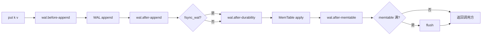

# 工作坊 A · 存储引擎压测与崩溃恢复

> **一句话假设**：只要提交顺序是对的——SST 真正落盘 → manifest 原子提交 → 最后才截断 WAL——
> 那么在任何一点断电，恢复后都能得到一份自洽的数据库；而顺序错一步，**已经向调用方确认过的写入也会消失**。

---

## 0. 先建立直觉：一家小店的记账桌

- **一句话直觉**：断电实验不是“测性能”，而是**逼问每一层缓存“你凭什么说数据还在”**。
- **生活类比**：一家小店只有四样东西。
  - **收据夹（WAL）**：每卖一件货，先夹一张收据。收据夹很薄，但夹进去就算数。
  - **分拣台（MemTable）**：手边正在整理的货，快，但一断电就没了。
  - **档案箱（SST）**：整理好的箱子，封上就不再改。
  - **箱子清单（Manifest）**：哪几个箱子是“官方”的。

  每天闭店（flush）要做的动作只有一句话：**把分拣台封成箱子、把箱子写进清单，然后才敢把收据夹清空**。

  如果你为了快，先清空收据夹，再慢慢封箱子——中间那一秒断电，收据没了、箱子也没封好，**货就真的丢了**。
  工作坊 A 就是把这一秒，拆成 14 个可以精确命中的瞬间。

- **只需要记住三个词**：
  1. **顺序**：可见 ≠ 持久；`rename` 只负责“可见”。
  2. **fsync**：`write()` 返回只代表字节进了 page cache。
  3. **幂等**：崩溃后重放几次，结果必须一样。

- **第一遍可以先跳过**：`FaultDisk` 的实现细节、CRC32 的查表、p99 的统计方式；
  先看第 7 节的表格和第 8 节的结论，再回头读代码。

> 这一课不引入新工具。它只做一件事：把 Day 08–14 学过的 WAL / MemTable / SST / compaction
> 放进一个**能坏、能复现、能断言**的实验里。

---

## 1. 本次问题

Day 14 的 Mini KV 能跑通“写入 → flush → 崩溃 → 重开”，但它有五个明确的窟窿：

- SST 写完没有 `fsync`；
- WAL 重置没有原子性；
- 没有 manifest，靠目录扫描判断哪些 SST 有效；
- compaction 先删旧 SST 再写新 SST（顺序反了）；
- 恢复时对损坏只有“截断”，没有“拒绝启动”。

这三个问题必须由实验回答，而不是靠读代码猜：

1. **哪个机制在故障下最先坏？** 是 WAL 的 fsync，还是 manifest 的提交，还是 compaction 的删除顺序？
2. **坏的时候，系统会表现为报错、变慢，还是数据不一致？** 三种后果的严重程度完全不同。
3. **什么不变量必须始终成立？** 如果一条都列不出来，就没法判断“恢复成功”还是“恢复成别的数据库”。

---

## 2. 被测系统与威胁模型

### 2.1 系统组成

| 组件 | 职责 | 持久化手段 | 崩溃后的命运 |
|---|---|---|---|
| `WAL` | 追加写、恢复、坏尾截断 | 每条记录 `fsync`（可配 group commit） | 未 fsync 的尾部丢失 |
| `MemTable` | 内存有序表 + tombstone | 无（靠 WAL） | 全部丢失，靠 WAL 重放 |
| `SST` | 不可变有序文件，带 CRC | 写临时文件 → `fsync` → `rename` | 未发布的临时文件被删 |
| `MANIFEST` | 哪些 SST 是有效的（唯一真相） | 写临时文件 → `fsync` → 原子替换 | 旧的或空的清单 |
| `compaction` | 全量合并，丢弃 tombstone | 新 SST + 新 manifest 原子切换 | 孤儿 SST 被清理 |

写入路径（每一步都标了崩溃点位）：



flush 的完整顺序（方括号是崩溃点位）：

```text
写 SST 临时文件 → fsync → [flush.sst.before-rename] → rename 发布
→ [flush.sst.after-rename] → 写 manifest 临时文件 → fsync
→ [flush.manifest.before-commit] → 原子替换 manifest → [flush.manifest.after-commit]
→ 清空 MemTable → [flush.wal.before-truncate] → 截断 WAL → [flush.wal.after-truncate]
```

### 2.2 崩溃点位

14 个点位，全部是**设计里的顺序边界**，不是随机位置：

| 点位 | 位置 | 此刻磁盘上已持久的是什么 |
|---|---|---|
| `wal.before-append` | 写记录之前 | 之前所有已 fsync 的记录 |
| `wal.after-append` | 写完、未 fsync | 同上（本条可能还在 page cache） |
| `wal.after-durability` | fsync 之后 | 本条及之前全部 |
| `wal.after-memtable` | 内存也改了 | 同上（内存状态无所谓） |
| `flush.sst.before-rename` | 临时 SST 已落盘 | WAL 全量 |
| `flush.sst.after-rename` | SST 已可见 | WAL 全量；SST 是孤儿 |
| `flush.manifest.before-commit` | 新清单未提交 | WAL 全量；SST 是孤儿 |
| `flush.manifest.after-commit` | 清单已提交 | 新 SST + 新清单 |
| `flush.wal.before-truncate` | 还没清 WAL | 同上 + WAL 全量（会重放） |
| `flush.wal.after-truncate` | WAL 已清空 | 只剩 SST + 清单 |
| `compact.sst.before-rename` | 新 SST 未发布 | 旧 SST + 旧清单 |
| `compact.sst.after-rename` | 新 SST 可见 | 旧清单仍指向旧 SST |
| `compact.manifest.after-commit` | 新清单已提交 | 新 SST + 新清单 |
| `compact.old-deleted` | 旧 SST 已删 | 同上（删除只是垃圾回收） |

### 2.3 威胁模型

| 故障 | 如何注入 | 预期表现 | 最坏后果 |
|---|---|---|---|
| 进程在任意点崩溃 | 命名点位 + 第 N 次命中，抛 `CrashSignal` | 未确认的写入可能生效 | 已确认的写入丢失 |
| 断电（page cache 丢内容） | `FaultDisk` 把所有未 `fsync` 的字节截掉 | 未 fsync 的尾部消失 | 成批丢数据 |
| 部分写 / 撕裂写 | 尾部追加 13 字节“半条记录头” | 截断坏尾，前缀保留 | 不截断则后续追加继续污染 |
| 静默损坏 | 翻转 WAL 中间 1 字节 / SST 第 20 字节 | 截断 或 拒绝启动 | 静默返回错误数据 |
| compaction 中断 | 4 个点位 | 孤儿 SST 启动时清理 | manifest 指向不存在的 SST |

### 2.4 断电模型：`FaultDisk` 做了什么，没做什么

真实系统里“断电”是不可控的。为了可复现，这里用一个 55 行的磁盘模型（`disk.hpp` / `disk.cpp`）：

```cpp
// 每个文件维护两个游标：
struct FileState {
    std::uint64_t durable = 0;   // 已经 fsync 的字节数
    std::uint64_t logical = 0;   // 已经 write 的字节数
};

// 断电 = 所有“写了但没 fsync”的字节原地消失
void Disk::power_loss() {
    for (auto& [name, state] : state_) {
        if (state.logical > state.durable) {
            truncate_to(name, state.durable);   // 真实文件也被截回去
        }
    }
}
```

三个刻意的设计决定：

1. **`rename` 只负责“可见”，不负责“持久”**：manifest 先 `fsync` 临时文件，再原子替换
   （Windows 用 `MoveFileExW(..., MOVEFILE_REPLACE_EXISTING)`，POSIX 用 `rename`）。
2. **截断是立即生效的**：`truncate` 之后 `durable = logical`，因为被丢掉的字节不可能靠 cache 回来。
3. **`power_loss()` 后对象直接废弃**：不调用 `close()`，不执行任何清理，模拟“进程没有机会善后”。

**这个模型不模拟什么**（写报告时很重要，否则会过度承诺）：

- 不模拟扇区重排、盘内缓存、`fsync` 撒谎的硬件；
- 不模拟“目录项未落盘”（Windows 没有目录 fsync；Linux 上正确做法是 `fsync(dir_fd)`，本课未实现）；
- 不模拟真实进程被 kill（本课在同一个进程内抛异常，覆盖“逻辑顺序”，覆盖不了“OS 崩溃一致性”的全部细节）。

所以下面的数字是**最坏情况的下界**，不是“这台机器上的精确行为”。这恰好是本课想要的：
如果最坏情况下都能自洽，正常情况才有资格谈性能。

---

## 3. 关键路径与源码

### 3.1 flush 的顺序（这次工作坊的主角）

`engine.cpp` 里 `flush()` 的骨架，注释就是结论：

```cpp
// 1. 先写临时文件并落盘：此刻它还是“没人认识的垃圾”，丢掉也无所谓。
disk_.write_file(name + ".tmp", payload, options_.fsync_sst);
hit(crash_, kFlushSstBeforeRename);

// 2. rename 是发布动作：要么看不到，要么完整可见。
disk_.atomic_replace(name + ".tmp", name);
hit(crash_, kFlushSstAfterRename);

// 3. 提交 manifest：这一步之后，新的 SST 才算“官方数据”。
manifest_.push_back(SSTRef{id, entries.size()});
commit_manifest(kFlushManifestBeforeCommit, kFlushManifestAfterCommit);

// 4. manifest 落盘之后，才可以丢弃内存副本和 WAL。
memtable_.clear();
disk_.truncate(std::string(wal_file), 0, true);
```

为什么必须是这个顺序？

| 顺序 | 如果反过来 | 实验结果 |
|---|---|---|
| SST 先落盘，再发布 | 先 rename 后写内容：别人可能读到半个文件 | `flush.sst.before-rename` 全部安全 |
| manifest 先提交，再清 MemTable | 先清内存：崩溃就只剩“清单里没有的新数据” | `flush.manifest.before-commit` 安全 |
| WAL 最后截断 | 先清 WAL：新数据没有第二份副本 | **X01：确认过的 13 条丢 10 条** |

### 3.2 恢复的顺序

```cpp
void Engine::recover() {
    // 0. *.tmp 一律不可信（可能是崩溃时写了一半的）
    // 1. manifest 是唯一真相：没有 manifest 就等于没有 SST
    load_manifest();
    // 2. 只加载被引用的 SST，逐个校验 magic / CRC / 有序性
    for (const auto& ref : manifest_) load_sst(ref.id);
    // 3. 没被引用的 SST 是未提交的 flush/compaction：删掉
    remove_extra_files();
    // 4. WAL 重放；遇到坏记录就从这里截断，并物理 truncate
    replay_wal();
}
```

第 4 步里最容易写错的一行是“截断”：

```cpp
if (valid_bytes < view.size()) {
    stats_.wal_truncated_bytes = view.size() - valid_bytes;
    disk_.truncate(name, valid_bytes, true);   // 不截断，下一次 append 会写在垃圾后面
}
```

Day 14 的 Mini KV 已经讲过这个坑；这次工作坊用 `D01` / `D02` 两个场景把它变成断言。

### 3.3 代码结构

```text
code/
├── CMakeLists.txt     构建 + CTest
├── codec.hpp          CRC32、小端整数读写
├── crash.hpp          14 个命名点位 + CrashSignal + CrashInjection
├── disk.hpp/.cpp      FaultDisk：durable/logical 双游标、原子替换、断电截断
├── engine.hpp/.cpp    被测系统：WAL + MemTable + SST + MANIFEST + 全量 compaction
└── harness.cpp        43 个场景 + 不变量检查 + 3 组基准
```

约 1850 行。代码刻意保持单线程、无锁、全量 compaction——**这一课的主角是顺序，不是并发**。

### 3.4 语言与实现说明

- 主实现：C++20（`<filesystem>`、`std::optional`、`starts_with`），无第三方依赖；
- 平台差异集中在一处：`fsync` / 截断 / 原子替换（`_commit`、`_chsize_s`、`MoveFileExW` 对 `fsync`、`ftruncate`、`rename`）；
- 没有被测系统之外的“魔法”：harness 只做三件事——注入、观测、断言。

---

## 4. 不变量

实验前后都必须成立的条件。前三条是“数据正确性”，后三条是“引擎还能继续工作”。

- [x] **I1 已确认的写入不消失**：`put`/`erase` 返回后，重开必须看到这个值；
  唯一例外是“崩溃瞬间正在执行的那次操作已经生效”（未确认可以提交，但不能凭空消失）。
- [x] **I2 没有幽灵键**：恢复出来的每个 key，都必须是这次运行真正写过的；
  每个 value 都必须是我们写过的某个版本。
- [x] **I3 没有复活**：已确认的删除，重开后不能返回旧值（tombstone 不能提前丢）。
- [x] **I4 坏数据要么被截断，要么让启动失败**：绝不把 CRC 不匹配的记录当成有效记录。
- [x] **I5 恢复后能继续工作**：恢复 → 再写 3 条 → 关闭 → 再开，旧数据和新数据都在。
- [x] **I6 清单自洽**：manifest 引用的每个 SST 都存在、能解析、key 有序；孤儿文件被清理。

I5 是最容易被忽略的一条：很多“恢复成功”的引擎，其实处在**半坏状态**——
能读，但再写一次就把 WAL 写坏了。所以每个场景恢复后都会真的再写三条、再重开一次。

---

## 5. 注入计划

```text
工具：      code/harness.cpp（C++20，无外部依赖，单进程）
命令：      cmake -S . -B build -G Ninja && cmake --build build
            ./build/workshop_a_harness          # Windows: .\build\workshop_a_harness.exe
点位：      14 个（WAL 4 / flush 6 / compaction 4）
频率：      每个点位命中第 1、2、5 或 37 次时崩溃（覆盖“第一次就崩”和“跑热了再崩”）
持续时间：  单次注入立即生效；整个矩阵约 25 秒（本机 22–28 秒）
如何停止：  抛 CrashSignal，无守护进程；Ctrl+C 随时可停
如何复现：  点位名 + 命中次数确定 → 表格中除 REOPEN 毫秒外的所有列完全一致（已验证两次运行逐行相同）
```

为什么不用“随机时刻 kill”：

- 随机 kill 不可复现，失败时无法重放；
- 真正有价值的崩溃点是**顺序边界**，随机 kill 大多数时候落在无关的位置；
- 命名点位让“失败”可以直接对应到源码里的一行。

还有四种“磁盘损坏”不是崩溃，而是**已经落盘的数据被改坏**：

| 场景 | 注入方式 |
|---|---|
| `D01` | WAL 尾部追加 13 字节（半条记录头） |
| `D02` | WAL 尾部追加 5 字节垃圾 |
| `D03` | WAL 中间第 `size/2` 字节翻转 |
| `D04` | SST 第 20 字节翻转 |

---

## 6. 观测指标

| 指标 | 采集方式 | 基线（正常关闭） | 故障时 | 恢复后 |
|---|---|---|---|---|
| 恢复时间 | `Engine` 构造耗时 | 3.80 ms | — | 0.45–12.23 ms |
| 数据丢失量 | `acked` 与 `dump()` 对比 | 0 | 安全配置 0；错误配置 10–15 | 0 |
| 重复处理数 | `wal_records_replayed` | 0 | flush 崩溃后 7–9 条 | 0 |
| p99 写入延迟 | 1000 次 put 采样 | 0.59 ms（无 fsync） | 10.77 ms（每条 fsync） | — |
| 错误率 | 拒绝启动的场景数 | 0 | 2 / 43（预期 fail-stop） | — |
| 写放大 | 三类写入字节 / 用户字节 | 6.14×（不 compaction） | 134.56×（trigger=2） | — |

“重复处理数”不是 bug，而是**必须发生的**：崩溃在 manifest 提交之后、WAL 截断之前时，
重放会把同一批记录再应用一次。正确性靠“重放是幂等的”保证，不靠“不重放”。

---

## 7. 实验记录

> 环境：Windows 11 + MinGW-w64 g++ 15.2 + CMake 4.2 + Ninja。
> 一次完整运行约 25 秒（本机 22–28 秒）；下表是实测输出（表格中 `REOPEN` 为毫秒）。

### 7.1 基线：正常关闭 vs 断电

| 场景 | ACK | LOST | 截断 | 重放 | REOPEN | 结论 |
|---|---|---|---|---|---|---|
| `B00-clean-reopen` | 111 | 0 | 0 | 0 | 3.80 | 对照组：全部存活 |
| `B01-nofsync-power-loss` | 100 | **100** | 0 | 0 | 0.63 | 没 fsync = 全丢 |
| `B02-fsync-power-loss` | 100 | **0** | 0 | 100 | 0.85 | 每条 fsync = 0 丢 |
| `B03-group-commit-8` | 100 | **4** | 0 | 96 | 1.81 | 丢失窗口 = 1–7 条 |

`B03` 是最有信息量的一行：group commit 把 100 次 fsync 压成 12 次，
代价是**最多 7 条已确认的写入暴露在断电风险里**。这不是 bug，是把“持久性”换成了“延迟”。

### 7.2 WAL 崩溃点位矩阵（12 个场景，全部 0 丢失）

| 点位 @ 第 N 次 | ACK | LOST | 重放 | REOPEN |
|---|---|---|---|---|
| `wal.before-append@1` | 0 | 0 | 0 | 0.45 |
| `wal.before-append@5` | 4 | 0 | 4 | 0.77 |
| `wal.before-append@37` | 33 | 0 | 8 | 6.35 |
| `wal.after-append@1` | 0 | 0 | 0 | 0.60 |
| `wal.after-append@5` | 4 | 0 | 4 | 1.27 |
| `wal.after-append@37` | 33 | 0 | 8 | 4.26 |
| `wal.after-durability@1` | 0 | 0 | 1 | 0.56 |
| `wal.after-durability@5` | 4 | 0 | 5 | 0.63 |
| `wal.after-durability@37` | 33 | 0 | 9 | 3.43 |
| `wal.after-memtable@1` | 0 | 0 | 1 | 0.67 |
| `wal.after-memtable@5` | 4 | 0 | 5 | 0.62 |
| `wal.after-memtable@37` | 33 | 0 | 9 | 3.07 |

三个读法：

1. `@1` 的 ACK 是 0：崩溃发生在第一次 `put` 里，调用方一次都没拿到确认，所以“0 丢失”是平凡成立的。
2. `after-append`（未 fsync）也 0 丢失——因为**崩溃前那条记录本来就没确认**；
   它丢了是允许的，它活着也是允许的（`after-durability@1` / `@5` 的重放列比 ACK 多 1，就是这条）。
3. `@37` 的 ACK=33 但重放只有 8–9：因为中途 flush 已经截断过 WAL，SST 接走了前面的记录。
   **“重放条数”不等于“ACK 条数”**，这是 LSM 的常态。

### 7.3 flush 崩溃点位矩阵（12 个场景，全部 0 丢失）

| 点位 @ 第 N 次 | ACK | LOST | 重放 | REOPEN |
|---|---|---|---|---|
| `flush.sst.before-rename@1` | 6 | 0 | 8 | 0.84 |
| `flush.sst.before-rename@2` | 13 | 0 | 7 | 6.31 |
| `flush.sst.after-rename@1` | 6 | 0 | 8 | 0.86 |
| `flush.sst.after-rename@2` | 13 | 0 | 7 | 2.66 |
| `flush.manifest.before-commit@1` | 6 | 0 | 8 | 1.12 |
| `flush.manifest.before-commit@2` | 13 | 0 | 7 | 3.17 |
| `flush.manifest.after-commit@1` | 6 | 0 | 8 | 2.10 |
| `flush.manifest.after-commit@2` | 13 | 0 | 7 | 7.78 |
| `flush.wal.before-truncate@1` | 6 | 0 | 8 | 2.38 |
| `flush.wal.before-truncate@2` | 13 | 0 | 7 | 3.11 |
| `flush.wal.after-truncate@1` | 6 | 0 | 0 | 2.09 |
| `flush.wal.after-truncate@2` | 13 | 0 | 0 | 3.58 |

两个关键对照：

- **`manifest.after-commit` 重放 8 条**：SST 和清单都提交了，但 WAL 还没截断，
  所以重启后把同一批记录又应用了一遍。**结果仍然 0 丢失、0 复活**——幂等生效。
- **`wal.after-truncate` 重放 0 条**：WAL 已经清空，数据只能来自 SST + 清单。
  这一行证明“SST 与清单真的落盘了”，不然这两行会直接丢 6–13 条。

另外，flush 崩溃矩阵的每一行都带有删除操作（`delete_every=5`），
复活数（`RES`）全为 0：tombstone 没有提前丢。

### 7.4 compaction 崩溃点位矩阵（8 个场景，全部 0 丢失）

| 点位 @ 第 N 次 | ACK | LOST | 重放 | REOPEN |
|---|---|---|---|---|
| `compact.sst.before-rename@1` | 14 | 0 | 0 | 8.69 |
| `compact.sst.before-rename@2` | 25 | 0 | 0 | 12.23 |
| `compact.sst.after-rename@1` | 14 | 0 | 0 | 4.64 |
| `compact.sst.after-rename@2` | 25 | 0 | 0 | 5.39 |
| `compact.manifest.after-commit@1` | 14 | 0 | 0 | 4.26 |
| `compact.manifest.after-commit@2` | 25 | 0 | 0 | 7.90 |
| `compact.old-deleted@1` | 14 | 0 | 0 | 3.33 |
| `compact.old-deleted@2` | 25 | 0 | 0 | 3.88 |

compaction 的 8 个中断点里，**没有一个影响正确性**：
新 SST 没发布 → 孤儿被删；清单没提交 → 旧清单继续有效；旧 SST 没删完 → 下次启动继续删。
compaction 只影响**空间和写放大**，不影响“数据在不在”。这就是它应该有的样子。

### 7.5 尾部破损与静默损坏（4 个场景）

| 场景 | ACK | LOST | 截断字节 | 重放 | 结论 |
|---|---|---|---|---|---|
| `D01-torn-header` | 60 | 0 | 13 | 60 | 半条记录头 → 精确截掉 13 字节 |
| `D02-garbage-tail` | 60 | 0 | 5 | 60 | 垃圾 → 截掉 5 字节，还能继续写 |
| `D03-midfile-flip` | 60 | **30** | 1530 | 30 | 中间损坏 → 保守截断到坏记录 |
| `D04-sst-corrupt` | 100 | — | — | — | **拒绝启动**（CRC 不匹配） |

`D03` 的数字值得记住：翻转 **1 个字节**，代价是**后一半数据全部丢失**。
这就是“坏尾截断”的真实含义——它是正确的（后面的记录无法信任），但**不是没有代价的**。
生产系统会用 checksum 分块、副本、scrub 来缩小这个代价。

`D04` 与 `X03` 是两次“故意让启动失败”：manifest 指向的 SST 内容被改坏，
引擎选择 `Corruption` 而不是“尽量读”。**fail-stop 比静默返回错误数据好**，
但它把“数据损坏”变成了“服务不可用”，所以生产上必须配合副本与修复流程。

### 7.6 错误配置：假设在哪里不成立

| 场景 | ACK | LOST | 结果 | 根因 |
|---|---|---|---|---|
| `X01-wal-cut-before-sst-durable` | 13 | **10** | 13 条只回来 3 条 | SST / manifest 没 fsync 就先截断了 WAL |
| `X02-manifest-not-synced` | 19 | **15** | 19 条只回来 4 条 | 把 `rename` 当成了持久化屏障 |
| `X03-sst-not-synced` | 13 | — | **拒绝启动**（`sst too small`） | manifest 已提交，但 SST 内容没落盘 |

这三行是整个工作坊的**结论所在**：

- `X01` 证明**顺序是机制，不是风格**。同样的组件、同样的代码，只是把“截断 WAL”往前挪了一步，
  就从“0 丢失”变成“丢 10/13”。
- `X02` 证明 **rename 不是 fsync**。清单文件“看得见”了，但内容还在 page cache 里；
  断电后清单被截回空文件，SST 全部变成孤儿——孤儿会被正确清理，于是数据“合法地”消失。
- `X03` 证明 **fail-stop 是最后一道防线**。如果恢复时对 0 字节 SST 视而不见，
  就会返回“key 不存在”，那才是真正的灾难：调用方以为数据被删了。

### 7.7 写放大：compaction 阈值的影响

1500 条写入、memtable 512 B、关闭 fsync（只统计字节）：

| compaction 触发 | WAL_B | SST_B | MANIFEST_B | 总写入 | 放大倍数 | SST 数 | compaction 次数 |
|---|---|---|---|---|---|---|---|
| 2 | 88,500 | 8,370,576 | 18,394 | 8,477,470 | **134.56×** | 1 | 214 |
| 4 | 88,500 | 2,842,755 | 14,935 | 2,946,190 | 46.76× | 2 | 71 |
| 8 | 88,500 | 1,252,185 | 17,366 | 1,358,051 | 21.56× | 5 | 30 |
| 关闭 | 88,500 | 79,080 | 219,457 | 387,037 | 6.14× | 215 | 0 |

三个结论：

1. **全量 compaction 是 O(n²)**：trigger=2 时，每次合并都重写全部数据，
   63 KB 用户数据写出 8.4 MB，放大 134 倍。这就是 RocksDB 要做 leveled/tiered 的原因。
2. **不 compaction 也不便宜**：215 个 SST 时，manifest 每次 flush 都整份重写，
   光清单就写了 219 KB——是用户数据的 **3.5 倍**。这解释了为什么真实系统用 append-only 的
   `VersionEdit`，而不是“每次重写整份清单”。
3. **写放大不是一个数字，而是一族曲线**：trigger 越小写放大越大、读放大越小；
   反之亦然。**选型是在曲线上选点，不是找一个“最优值”。**

### 7.8 fsync 对写入延迟的影响

1000 条写入、memtable 不 flush（避免混入 flush 成本）：

| 模式 | p50 | p99 | max | 总耗时 | fsync 次数 |
|---|---|---|---|---|---|
| 不 fsync | 0.28 ms | 0.59 ms | 2.56 ms | 0.31 s | 1 |
| 每条 fsync | 7.18 ms | 10.77 ms | 19.83 ms | 7.14 s | 1003 |

fsync 让 **p50 涨了约 25 倍、p99 涨了约 18 倍**。这就是 group commit 存在的理由：
把 N 条写入的 fsync 合并成一次，用“最多 N 条丢失窗口”换吞吐。

> 测法说明：本实现每次追加都 `fopen`/`fclose` 一次（为了让文件状态显式、可注入），
> 所以绝对值比生产实现高；有意义的是**两种模式的比值**，而不是这台机器上的绝对毫秒数。

### 7.9 恢复时间随数据量增长

| 写入条数 | 磁盘字节 | SST 数 | WAL 重放 | 恢复时间 | 写入耗时 |
|---|---|---|---|---|---|
| 500 | 25,570 | 2 | 0 | 17.96 ms | 0.23 s |
| 2,000 | 102,050 | 1 | 0 | 16.83 ms | 0.91 s |
| 5,000 | 255,163 | 6 | 0 | 41.26 ms | 2.24 s |

正常关闭后 WAL 已截断，所以恢复只需“读清单 + 读 SST”，255 KB 约 41 ms。
对比 `B02`（100 条 WAL 记录重放 + 打开）0.85 ms：**WAL 重放很便宜，读 SST 更贵**——
这也是为什么 manifest / block index / Bloom filter 值得花力气做。

### 7.10 复现

```text
第 1 次：43/43 通过
第 2 次：43/43 通过，表格中除 REOPEN 毫秒外的 43 行逐行相同
CTest：  1/1 通过（21.9 s；另一次冷构建后 28.4 s）
```

“可复现”本身就是一条结论：如果实验结果每次都不一样，就无法判断是“设计问题”还是“运气问题”。

---

## 8. 结论

### 8.1 假设是否成立

**成立，但有明确边界。**

在“安全配置”（每条 WAL 记录 fsync、SST 落盘、manifest 原子提交、最后才截断 WAL）下：

- 36 个严格场景，**0 丢失、0 幽灵键、0 复活、0 静默损坏**；
- 最慢的一次恢复 12.23 ms，最快的 0.45 ms；
- compaction 的 8 个中断点全部不影响正确性，只留下可清理的孤儿文件。

一旦越界，假设立刻不成立：`X01` 丢 10/13、`X02` 丢 15/19、`X03` 拒绝启动。
**“能不能恢复”不取决于组件多复杂，而取决于那 4 行顺序有没有写对。**

### 8.2 失败根因

不是“代码写得不好”，而是三个很常见的概念混淆：

| 混淆 | 真相 | 后果 |
|---|---|---|
| `write()` 返回 = 数据安全 | 只进了 page cache | `B01`：100 条全丢 |
| `rename()` = 文件持久 | 只保证“名字切换”的原子性 | `X02`：丢 15/19 |
| 文件存在 = 内容有效 | 可能只是 0 字节的壳 | `X03`：只能 fail-stop |

### 8.3 改机制，还是改策略

- **必须改机制**（顺序、fsync 点、原子提交）：`X01`/`X02`/`X03` 都不是调参能救的；
  它们只能通过“把持久化点纳入提交路径”解决。
- **属于策略**（group commit 大小、compaction 触发阈值、预写多少数据才 flush）：
  `B03` 的 1–7 条丢失窗口、`G` 表的 134× vs 6×，都是取舍，不存在唯一正确值。
- 判断标准：**如果改一个数字能解决，那是策略；如果必须改执行顺序，那是机制。**

### 8.4 还缺什么观测

这次实验刻意留了四个缺口，值得在生产化时补上：

1. **每次 fsync 的耗时分布**：本 harness 只统计总数，看不出“偶发 100 ms 的 fsync”；
2. **目录项持久化**：Linux 上 `rename` 之后还要 `fsync(dir)`，本课没有实现；
3. **读放大 / 空间放大**：只测了写放大，没有测 compaction 对读路径的影响；
4. **真实进程 kill**：同进程注入覆盖“逻辑顺序”，但覆盖不了 OS 崩溃一致性的全部细节。

---

## 9. 模式卡片

```text
模式名称：崩溃点位注入（Crash-Point Injection）
解决什么问题：把“断电时会怎样”从口头讨论变成可重放的实验
核心机制：在设计的顺序边界埋命名点位；第 N 次命中时抛异常，
          不执行任何清理；随后由磁盘模型丢掉未 fsync 的字节
代价/限制：必须在代码里留点位（生产代码通常用编译期开关或 fault injection 框架）；
          同进程注入不等于真实断电
不适用场景：需要验证硬件/文件系统行为时（那要用 dm-flakey、fsck、真实断电）
一个最小例子：在 rename 前后各埋一个点，比较两次恢复的结果
```

```text
模式名称：崩溃安全的提交顺序（tmp → fsync → rename → manifest → truncate）
解决什么问题：让“发布新数据”这件事要么完整发生，要么完全不发生
核心机制：临时文件先落盘；rename 只做原子发布；清单最后提交；
          只有清单持久化之后，才允许丢弃旧副本（WAL / 旧 SST）
代价/限制：每次提交至少 2 次 fsync（数据 + 清单）；清单频繁重写会带来写放大
不适用场景：可以容忍丢失最近若干秒的数据时（如日志采集），可以用异步提交换吞吐
一个最小例子：先 truncate WAL 再写 SST → X01；把顺序倒回来 → 0 丢失
```

```text
模式名称：fail-stop 恢复（宁可拒绝启动，也不返回错误数据）
解决什么问题：损坏的数据比不可用的服务更危险
核心机制：恢复时校验 magic / 长度 / CRC / 有序性；任何一项不匹配就抛 Corruption，
          由上层决定降级、报警还是人工介入
代价/限制：可用性受损；需要配套的副本、备份和修复流程
不适用场景：可用性优先且数据可重建的缓存场景（可以丢，但不能错）
一个最小例子：D04 与 X03 —— 0 字节 SST 必须让启动失败
```

---

## 10. 迁移到自己的项目

### 10.1 接口清单

```text
[ ] 是否存在一个“唯一真相”的清单/元数据文件？谁负责原子提交它？
[ ] 每个“发布”动作之前，数据是否已经 fsync？（还是只 rename 了？）
[ ] WAL / 旧文件的删除，是否严格发生在新状态持久化之后？
[ ] 恢复流程是否校验内容（CRC / 长度 / 版本），而不是只看文件在不在？
[ ] 恢复失败时的行为是 fail-stop、降级，还是静默跳过？谁来决定？
[ ] 是否有“恢复后再写一次再重开”的测试？（半坏状态只有这样才能暴露）
```

### 10.2 最小改动（按顺序做）

1. **先加观测**：统计每次 fsync 的耗时、恢复耗时、重放条数、孤儿文件数；不改行为。
2. **把清单显式化**：即使现在靠“扫描目录”，也先写一个只读的 manifest 并与扫描结果对账。
3. **补 fsync 点**：数据文件 → 清单 → 最后才删旧文件；每加一个点，跑一次崩溃注入。
4. **加 fail-stop**：恢复时对每个文件做 CRC 校验，损坏就拒绝启动并报警。
5. **再做批量**：在“能保证正确”之后，才把 group commit / 异步 flush 打开。

### 10.3 验证与回滚

- 验证：把本 harness 的 6 条不变量抄成集成测试，注入点从 14 个里挑与自己系统对应的 3–5 个；
- 回滚：提交顺序的改动是**行为改动**，必须能一键切回旧路径（配置开关 + 双写一段时间）；
- 监控：`recovery_ms`、`wal_replayed_records`、`wal_truncated_bytes`、`orphan_files`、`fsync_p99`。

---

## 11. 练习

**基础**

1. 把 `B03` 的 `group_commit` 改成 4，先**预测**丢失窗口，再跑实验验证。
2. 给 harness 加一列“本次恢复读了多少个 SST”，观察 compaction 阈值对恢复时间的影响。

**进阶**

1. 把 manifest 改成 append-only 的 `VersionEdit`，重跑 7.7 节，看“关闭 compaction”那一行的写放大降到多少。
2. 给 SST 加一个假的 Bloom filter（只统计“被跳过的 SST 数”），估算读放大的变化。

**挑战**

1. 用真实子进程 + `TerminateProcess` / `kill -9` 注入，与本课的异常注入对比，写一页差异分析。
2. 在 Linux 上补 `fsync(dir_fd)`，并设计一个“rename 已可见但目录项未落盘”的实验，验证它是否真的会丢文件。

---

## 12. 下次预习

工作坊 A 之后，W2 的存储部分正式结束。下一次是 **Day 15：渐进式 rehash**，进入 W3 · Redis 专题。

- 先读 [Week 03 入门：Redis 专题](../../week-03-redis/00-primer.md)（只求建立画面，不抠源码）；
- 带着一个问题：**“大字典不能一次搬完”和本课的“不能一次截断 WAL”是不是同一种思维？**
  （提示：都是把“不可逆的大动作”拆成“可中断的小步骤”，并保证中断后状态自洽。）

---

## 13. 如何运行

```bash
cd step1/week-02-storage/workshop-a-storage-recovery/code
cmake -S . -B build -G Ninja
cmake --build build
ctest --test-dir build --output-on-failure
./build/workshop_a_harness        # Windows: .\build\workshop_a_harness.exe
```

Windows 下如果没装 Ninja，去掉 `-G Ninja` 即可（CMake 会用默认生成器）。
只想要场景矩阵、不想要基准，可以改 `main()` 末尾的三个 `bench_*` 调用。

预期输出（节选）：

```text
工作坊 A · 存储引擎压测与崩溃恢复
编译环境: C++20 / 64-bit

-- A. 基线 --
SCENARIO                             ACK LOST  RES  TRUNC REPLAY   REOPEN  VERDICT
B00-clean-reopen                     111    0    0      0      0     3.80  PASS
B01-nofsync-power-loss               100  100    0      0      0     0.63  PASS
B02-fsync-power-loss                 100    0    0      0    100     0.85  PASS
B03-group-commit-8                   100    4    0      0     96     1.81  PASS
...
-- F. 错误配置 --
X01-wal-cut-before-sst-durable        13   10    0      0      0     1.18  PASS
X02-manifest-not-synced               19   15    0      0      0     1.63  PASS
X03-sst-not-synced                    13    0    0      0      0     1.26  PASS*
...
场景数: 43（其中严格不变量场景 36，预期失败/降级演示 7）
严格不变量断言失败: 0 / 36
场景失败: 0 / 43
基准自检: 写放大 OK / 延迟 OK / 恢复 OK
总耗时: 22944.94 ms

All 43 scenarios passed.
```

> `PASS*` 表示“启动时检测到损坏并拒绝服务”，是**预期**的 fail-stop，不是失败。
> 除 `REOPEN` 毫秒外，其余各列都由工作负载和点位唯一决定——两次运行的 43 行逐行相同（见 7.10），
> 这也是这张表能直接当断言用的原因。

---

## 参考资料

- SQLite, *Atomic Commit In SQLite*：<https://sqlite.org/atomiccommit.html>（最清晰的“journal + 提交顺序”入门，访问于 2026-11-16）
- RocksDB Wiki, *Write-Ahead Log* / *MANIFEST*：<https://github.com/facebook/rocksdb/wiki/Write-Ahead-Log>、<https://github.com/facebook/rocksdb/wiki/MANIFEST>（访问于 2026-11-16）
- PostgreSQL, *Write-Ahead Logging*：<https://www.postgresql.org/docs/current/wal-intro.html>（访问于 2026-11-16）
- Prabhakaran et al., *All File Systems Are Not Created Equal*（OSDI 2010）：<https://www.usenix.org/legacy/events/osdi10/tech/full_papers/Prabhakaran.pdf>（讲清“rename 之后还缺什么”，访问于 2026-11-16）
- 本仓库：[Day 09 · WAL 与 group commit](../day-009-wal-group-commit/README.md)、
  [Day 13 · ARIES](../day-013-aries/README.md)、
  [Day 14 · Mini KV](../day-014-mini-kv/README.md)
- 代码：[`code/`](code/)；工作坊索引：[`workshops/README.md`](../../../workshops/README.md)；
  路线图：[`ROADMAP.md`](../../../ROADMAP.md)
