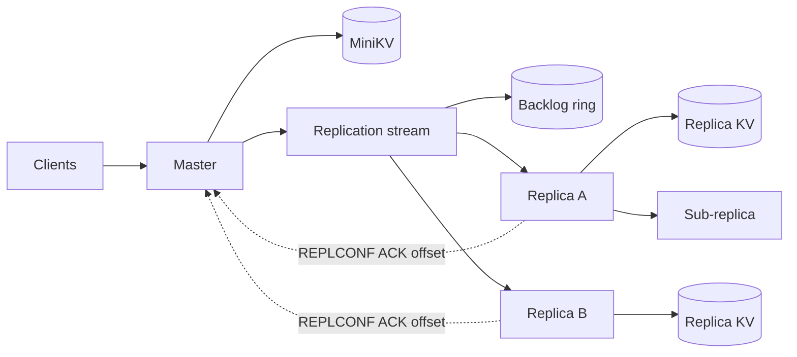
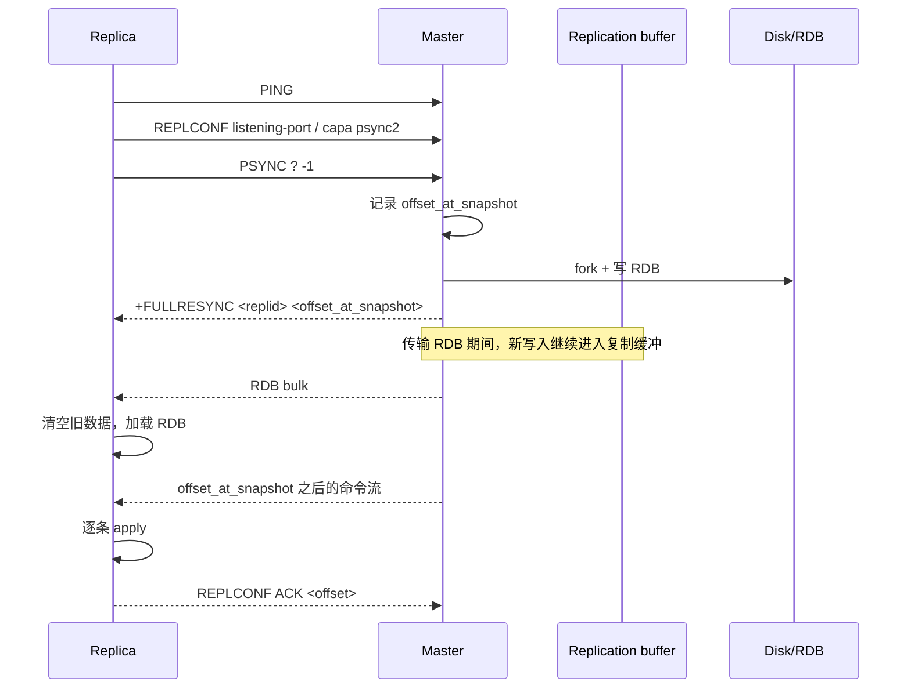
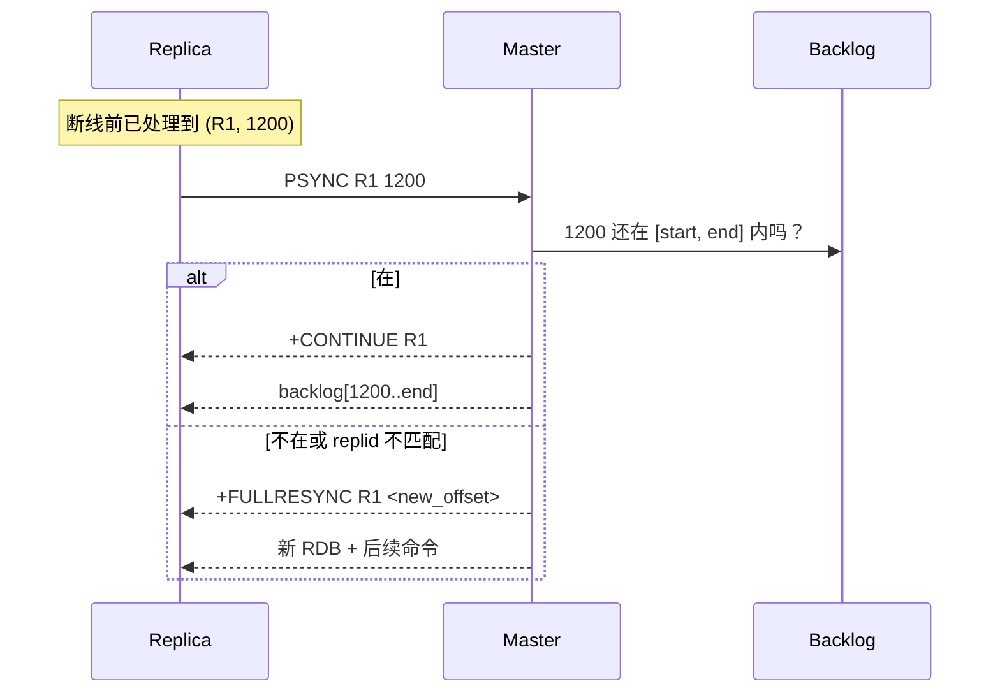
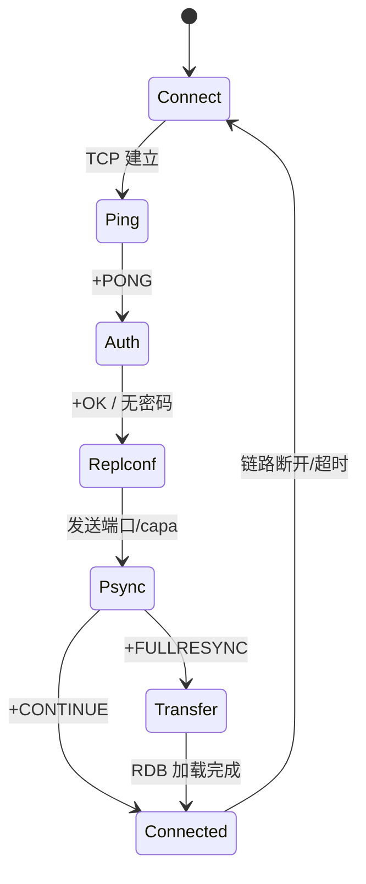

# Day 18 · 主从复制：PSYNC、backlog 与断点续传

> **一句话结论**：Redis 复制不是「把数据库同步过去」这么简单，而是维护一条**带版本号（replid）和字节偏移（offset）的日志流**；全量同步只是「先给一张快照，再补快照之后的日志」，断线续传则是「我还记得版本和行号，从 backlog 里把缺的那段补给我」。

---

## 0. 本次问题

你有一个 30GB 的 Redis 主库，两个从库。某天网络抖动了 30 秒：

- 从库 A 重连后几秒钟就追上了，`INFO replication` 里 `sync_partial_ok` 增加；
- 从库 B 重连后触发了 `FULLRESYNC`，主库 CPU 和网卡被打满；
- 业务方问：「`WAIT 1 1000` 返回 1 了，主库挂了切到从库，这条写入还会丢吗？」

三个现象都指向同一组机制：

1. **全量同步到底传了什么？** 为什么传输期间的写入不会丢？
2. **断线续传凭什么成立？** `replid` 和 `offset` 分别代表什么？backlog 满了会怎样？
3. **`WAIT` 返回 1，等于强一致吗？** 主库故障切换后，已经 ACK 的写入还会不会丢？

本次要能画出两条路径：**FULLRESYNC 路径**和 **PSYNC + CONTINUE 路径**，并说清每条路径的失败边界。

---

## 0.5 先建立直觉

### 一句话直觉

> **主库是一本不断往下写的账本，复制流是一条不断吐字的纸带。**
>
> `replid` 是「第几版账本」，`offset` 是「纸带上的第几个字节」。从库断线时记住「我在第 3 版、第 1200 字节」；重连时问主库：「第 3 版第 1200 字节之后还在吗？」
>
> 在，就从那里接着吐（`+CONTINUE`）；不在，就把整本账重新抄一遍（`+FULLRESYNC`）。主库手边保留最近一段纸带，就是 `repl_backlog`。

### 生活类比

| Redis 里的东西 | 生活里的东西 | 为什么像 |
|---|---|---|
| `replid` | 账本的「版次」 | 版次变了，行号就不能直接沿用 |
| `master_repl_offset` | 纸带已经吐到第几个字节 | 每写一条命令就往前走 |
| `repl_backlog` | 手边保留的最近几米纸带 | 只留最近一段，太老的剪掉 |
| `PSYNC <replid> <offset>` | 「我在第 3 版第 1200 字节，接下来呢？」 | 带着版本和行号来续传 |
| `+CONTINUE` | 「还在，从第 1200 字节继续」 | 增量补发 |
| `+FULLRESYNC` | 「那版已经找不到了，重新抄一本」 | 全量快照 |
| RDB 传输 | 把整本账复印一份寄过去 | 快照，体积大但恢复快 |
| replication buffer | 复印期间的新流水先放暂存筐 | 复印完再补，不能漏 |
| `REPLCONF ACK <offset>` | 分店回执「我抄到第 1200 字节了」 | 主库据此判断复制进度 |
| `WAIT` | 「至少 N 家分店确认抄到这一行再回复客户」 | 降低丢写概率，但不是强一致 |
| `replid2` | 换版后仍保留上一版的有效期 | 故障转移后，旧从库还能续传 |

### 只需要记住三个词

1. **逻辑时钟**：`(replid, offset)` 唯一标识一段数据历史；同一个 replid 下，offset 越大越新。
2. **有界 backlog**：主库只保留最近 `repl-backlog-size` 字节；从库落后超过这个窗口，就只能全量。
3. **快照 + tail**：全量同步不是「传完快照再开始收命令」，而是「快照 + 传输期间缓存的命令流」一起构成一致状态。

### 第一遍可以先跳过

- `syncWithMaster` 的完整状态机（PING/AUTH/REPLCONF/PSYNC/RDB 传输）；
- `replid2` 与 `second_replid_offset` 的精确比较；
- 磁盘式/无盘式 RDB 传输、RDB channel、TLS 等分支；
- 本文第 6 节的 C++ 实现和基准代码。

第一遍只读：**0.5、1、2、4、5**，能画出「全量」和「续传」两张时序图，并能回答「backlog 满了会怎样」，就够了。

### 两种同步，先摆在一起看

```text
方案 A：FULLRESYNC（全量）
  主库：fork/生成 RDB 快照，记录快照 offset
  传输：把 RDB 发给从库；期间的新命令进入复制缓冲/backlog
  从库：清空旧数据 -> 加载 RDB -> 再追加快照之后的命令流
  代价：主库 fork + COW + 网络带宽；从库清空 + 加载时阻塞
  适合：第一次同步、backlog 不够、replid 不匹配

方案 B：PSYNC + CONTINUE（部分/断点续传）
  从库：PSYNC <replid> <offset>
  主库：检查 replid 是否匹配、offset 是否还在 backlog 范围内
  传输：只发 offset 之后的字节
  代价：几乎为零；但依赖 backlog 足够大、replid 历史仍然有效
  适合：短暂网络抖动、从库重启后快速追赶
```

注意：**全量同步也会传增量**。RDB 只是「某个 offset 的快照」，快照之后到从库真正上线之间的命令，必须通过复制流补上。否则从库会缺一段。

---

## 1. 设计背景：约束从哪里来

### 1.1 为什么默认异步

Redis 的主线程是单线程的。如果每条写命令都要等所有从库确认，主库的 p99 会直接被最慢的从库拖死。所以 Redis 选择：

```text
主库执行命令 -> 写入复制流 -> 立即回复客户端
从库异步接收 -> 执行 -> 每秒 REPLCONF ACK 一次
```

这带来两个结果：

- **低延迟**：主库不被从库的磁盘/网络拖慢；
- **有窗口**：主库回复客户端时，从库可能还没收到这条命令；主库宕机时，这段窗口里的写入可能丢。

Redis 提供 `WAIT` 让客户端可以「等 N 个从库 ACK 到这个 offset」，但它仍然不是 Raft 那种强一致：ACK 只代表「从库内存里执行了」，不代表「从库持久化了」，也不代表「故障转移后新主一定保留这条写」。

### 1.2 全量同步的约束

全量同步要解决三个同时发生的问题：

1. **快照一致性**：RDB 必须是某个 offset 的完整视图；
2. **传输期间的新写入**：不能因为正在传 RDB 就停止服务；
3. **从库加载期间的状态**：加载 RDB 时从库可能阻塞，旧数据要清空。

Redis 的做法：

```text
master:
  offset_at_snapshot = master_repl_offset
  fork -> 子进程写 RDB
  父进程继续处理写命令，并把命令追加到复制缓冲
  子进程完成 -> 发送 RDB
  发送完 RDB -> 从 offset_at_snapshot 开始发送缓冲的命令流

replica:
  收到 +FULLRESYNC <replid> <offset_at_snapshot>
  接收 RDB -> 清空旧数据 -> 加载
  从 offset_at_snapshot 开始应用后续命令
```

关键点：**RDB 的 offset 和命令流的起点必须严格对齐**。如果 RDB 是 offset=1000 的快照，命令流却从 1050 开始，从库就丢了 50 字节；反过来从 950 开始，会重复应用。Redis 在 fork 前记录 `psync_initial_offset`，之后所有增量都从这个点开始。

### 1.3 部分同步的约束

部分同步要回答两个问题：

1. **这段历史还是同一段历史吗？** —— `replid` 必须匹配；
2. **我缺的那段还在吗？** —— `offset` 必须落在 backlog 的 `[start, end]` 内。

如果两个条件任一不满足，就只能全量。这里没有「差不多」：offset 差一个字节，后面的命令就可能被错位解释。

### 1.4 backlog 是一个有界环

主库不可能永远保留所有复制流。`repl-backlog-size` 默认 1MB：

```text
backlog 逻辑范围：[start_offset, end_offset)
新命令追加到 end；超过容量时，最老的字节被覆盖，start 前移
```

从库请求 `offset` 时：

```text
offset < start   -> 太老了，那段已经被覆盖 -> FULLRESYNC
offset > end     -> 不可能（从库比主库还新）-> FULLRESYNC / 异常
start <= offset <= end -> 可以 CONTINUE
```

`offset == end` 是合法的：表示「我都跟上了，只差新命令」，此时续传数据为空，但连接可以进入在线状态。

### 1.5 故障转移与 replid2

从库被提升为新主库时，它需要：

- 生成一个新的 `replid`（新历史）；
- 把旧主的 `replid` 保存为 `replid2`；
- 记录 `second_replid_offset`：旧 replid 只在这个 offset 之前有效。

这样，其他还拿着旧 `replid` 的从库来续传时，新主可以判断：

```text
requested_replid == replid2 && requested_offset <= second_replid_offset
  -> 接受（这段历史新主确实继承过）
否则
  -> FULLRESYNC
```

为什么新主必须换 replid？因为故障转移时旧主可能还活着（网络分区），如果新主沿用同一个 replid，两个「同一版本、同一 offset」的实例可能拥有不同的数据，`(replid, offset)` 就不再唯一标识一段历史。

### 1.6 关键约束

| 约束 | 具体表现 | 对设计的影响 |
|---|---|---|
| 延迟 | 主库不能等从库；从库 ACK 是异步的 | 默认异步复制；`WAIT` 是可选增强 |
| 吞吐 | 复制流要和命令执行同速 | 追加写、批量发送、共享 backlog |
| 内存 | backlog 不能无限增长；慢从库会积压 | `repl-backlog-size` 有界；输出缓冲限制 |
| 一致性 | 从库时钟与主库不同；过期键不能各自删 | 主库合成 DEL；从库读时隐藏 |
| 故障转移 | 旧主可能还活着；replid 不能冲突 | `replid2` + `second_replid_offset` |
| 运维复杂度 | 全量/部分、磁盘/无盘、级联、WAIT | 指标、超时、backlog 容量、缓冲区限制 |

### 1.7 三个真实失败模式

**失败模式 1：主库没开持久化，崩溃后自动重启。**

主库重启后数据为空，`replid` 变化，从库来同步时只能全量——于是从库也被清空。复制不是备份；主库没有持久化时，自动重启会把「空数据」复制给所有从库。官方文档专门警告过这个场景。

**失败模式 2：backlog 太小。**

网络抖了 2 分钟，写入量 50MB/s，backlog 只有 1MB。从库重连时，它需要的 offset 早已被覆盖，只能全量。全量又触发 fork/COW/网络峰值，可能把主库打挂，形成「抖动 -> 全量 -> 更抖」的循环。

**失败模式 3：把 WAIT 当强一致。**

`WAIT 1 1000` 返回 1，只说明「至少一个从库在内存里执行到了这个 offset」。如果这个从库还没把数据持久化，然后主库和这个从库同时故障，写入仍然可能丢。`WAIT` 降低概率，不改变复制是异步的事实。

---

## 2. 架构与数据流

### 2.1 组件图



三个要点：

- 主库只有**一条**逻辑复制流；所有从库共享同一条流（级联从库也是代理这条流，而不是把本地写再广播一遍）。
- backlog 是复制流的「最近一段」，既服务断线续传，也服务新从库的全量同步后的增量。
- ACK 是反向的、低频的；它不参与命令执行，只用于 `WAIT`、`min-replicas` 和延迟监控。

### 2.2 全量同步时序



### 2.3 断线续传时序



### 2.4 从库握手状态机



真实 `syncWithMaster` 的状态更多（AUTH、端口、capa、RDB channel、TLS 等），但骨架就是「握手 -> PSYNC -> 全量或续传 -> 在线」。

### 2.5 关键对象

| 对象 | 职责 | 生命周期 |
|---|---|---|
| `server.replid` | 当前历史版本 | 主库启动/提升时生成 |
| `server.replid2` | 上一段历史的版本 | 故障转移后保留 |
| `server.master_repl_offset` | 已经产生的复制流字节数 | 进程级，单调递增 |
| `server.repl_backlog` | 最近一段复制流 | 有从库/需要续传时存在，空闲可释放 |
| `server.repl_backlog_off` | backlog 第一个字节的 offset | 随覆盖前移 |
| `server.repl_backlog_histlen` | backlog 当前有效字节数 | 追加/裁剪时变化 |
| `slave->repl_ack_off` | 从库已处理的 offset | 每次 ACK 更新 |
| `slave->replstate` | 从库连接状态 | 握手/等待 BGSAVE/在线 |
| `server.slaves` | 从库客户端列表 | 连接级 |

### 2.6 五条不变量

1. **同一 replid + 同一 offset = 同一段历史。** 否则不能续传。
2. **offset 按字节递增，不是按命令条数。** 一条命令 35 字节，offset 就前进 35。
3. **backlog 提供的是 `[start, end]` 的连续字节。** 中间不能有洞。
4. **全量同步的 RDB offset 与增量流起点一致。** 否则丢/重。
5. **从库的删除权归主库。** 过期/淘汰由主库合成 DEL；从库只隐藏，不自己删。

---

## 3. 源码关键路径（Redis 7.2）

> 只追一条线：**从库怎么发 PSYNC → 主库怎么判断 CONTINUE/FULLRESYNC → backlog 怎么补数据 → 从库怎么 ACK**。

### 3.1 `PSYNC` 的入口：`syncCommand`

`replication.c` 的 `syncCommand` 同时处理老的 `SYNC` 和新的 `PSYNC`。核心分支：

```c
void syncCommand(client *c) {
    if (!strcasecmp(c->argv[0]->ptr, "psync")) {
        long long psync_offset;
        getLongLongFromObjectOrReply(c, c->argv[2], &psync_offset, NULL);

        if (masterTryPartialResynchronization(c, psync_offset) == C_OK) {
            server.stat_sync_partial_ok++;
            return;   // +CONTINUE，已经补发 backlog
        }
        // 否则走全量
    }

    server.stat_sync_full++;
    c->replstate = SLAVE_STATE_WAIT_BGSAVE_START;
    c->flags |= CLIENT_SLAVE;
    listAddNodeTail(server.slaves, c);
    createReplicationBacklogIfNeeded();

    // 根据是否已有 BGSAVE、是否 diskless，选择复用/新起一次 RDB
    startBgsaveForReplication(c->slave_capa, c->slave_req);
}
```

几个容易忽略的前置检查：

- 从库自己还是「未连上主库的从库」时，拒绝它的从库来同步（`-NOMASTERLINK`）；
- 客户端还有 pending output 时拒绝（需要干净的输出缓冲来复制给其他从库）；
- 正在 failover 时拒绝；
- 已经有 `CLIENT_SLAVE` 标志的连接不重复处理。

### 3.2 主库判断：`masterTryPartialResynchronization`

这是整个断点续传的核心。简化后的逻辑：

```c
int masterTryPartialResynchronization(client *c, long long psync_offset) {
    char *master_replid = c->argv[1]->ptr;

    // 1) replid 必须是当前 replid，或者是 replid2 且 offset 不超过有效期
    if (strcasecmp(master_replid, server.replid) &&
        (strcasecmp(master_replid, server.replid2) ||
         psync_offset > server.second_replid_offset))
    {
        goto need_full_resync;
    }

    // 2) offset 必须落在 backlog 的 [start, start+histlen] 内
    if (!server.repl_backlog ||
        psync_offset < server.repl_backlog_off ||
        psync_offset > server.repl_backlog_off + server.repl_backlog_histlen)
    {
        goto need_full_resync;
    }

    // 3) 接受：+CONTINUE，然后把 backlog 从 offset 开始补发
    c->flags |= CLIENT_SLAVE;
    c->replstate = SLAVE_STATE_ONLINE;
    listAddNodeTail(server.slaves, c);
    addReplySds(c, sdsnew("+CONTINUE\r\n"));
    addReplyReplicationBacklog(c, psync_offset);
    return C_OK;

need_full_resync:
    return C_ERR;
}
```

注意 `psync_offset == start + histlen` 是允许的：此时补发长度为 0，但连接直接进入在线状态。

### 3.3 backlog 的读写：`feedReplicationBuffer` / `addReplyReplicationBacklog`

Redis 7.2 的 backlog 是一个字符环（新版本把它重构成 block 链表，语义不变）。追加逻辑可以抽象成：

```c
void feedReplicationBacklog(void *ptr, size_t len) {
    unsigned char *p = ptr;
    server.master_repl_offset += len;

    while (len) {
        size_t thislen = server.repl_backlog_size - server.repl_backlog_idx;
        if (thislen > len) thislen = len;
        memcpy(server.repl_backlog + server.repl_backlog_idx, p, thislen);
        server.repl_backlog_idx += thislen;
        if (server.repl_backlog_idx == server.repl_backlog_size)
            server.repl_backlog_idx = 0;
        len -= thislen;
        p += thislen;
        server.repl_backlog_histlen += thislen;
    }

    if (server.repl_backlog_histlen > server.repl_backlog_size)
        server.repl_backlog_histlen = server.repl_backlog_size;

    server.repl_backlog_off =
        server.master_repl_offset - server.repl_backlog_histlen + 1;
}
```

补发逻辑（简化）：

```c
long long addReplyReplicationBacklog(client *c, long long offset) {
    long long skip = offset - server.repl_backlog_off;
    long long len = server.repl_backlog_histlen - skip;

    // 从环的物理位置开始，分两段拷贝（到环尾 + 从环头继续）
    long long j = (server.repl_backlog_idx +
                   (server.repl_backlog_size - server.repl_backlog_histlen)) %
                  server.repl_backlog_size;
    j = (j + skip) % server.repl_backlog_size;

    while (len) {
        size_t thislen = server.repl_backlog_size - j;
        if (thislen > len) thislen = len;
        addReplyWriteToBuffer(c, server.repl_backlog + j, thislen);
        len -= thislen;
        j = 0;
    }
    return ...;
}
```

**offset 是字节偏移**，所以「跳过前 N 个字节」和「从环的哪个物理位置开始」是同一个模运算。这也是为什么 backlog 必须保存**原始 RESP 字节**，而不是解析后的命令对象。

### 3.4 全量同步：`replicationSetupSlaveForFullResync`

主库决定全量后，会：

1. 启动/复用一个 BGSAVE；
2. 记录 `psync_initial_offset`（快照的 offset）；
3. 给从库回 `+FULLRESYNC <replid> <offset>`；
4. 把从库状态设为 `SLAVE_STATE_WAIT_BGSAVE_END`；
5. 从这一刻起，把新命令同时记入 backlog 和该从库的复制缓冲。

简化：

```c
int replicationSetupSlaveForFullResync(client *slave, long long offset) {
    slave->psync_initial_offset = offset;
    slave->replstate = SLAVE_STATE_WAIT_BGSAVE_END;
    server.slaveseldb = -1;   // 强制下一条流重新发 SELECT

    char buf[128];
    int buflen = snprintf(buf, sizeof(buf),
                          "+FULLRESYNC %s %lld\r\n",
                          server.replid, offset);
    connWrite(slave->conn, buf, buflen);
    return C_OK;
}
```

RDB 完成后，主库把 `WAIT_BGSAVE_END` 的从库切换到 `ONLINE`，先发 RDB bulk，再发缓冲的命令流。**RDB 和命令流之间没有「空窗」**：命令流从 `offset` 开始，正好接上。

### 3.5 复制流的生产：`replicationFeedSlaves`

每条写命令在传播阶段进入 `replicationFeedSlaves`：

```c
void replicationFeedSlaves(list *slaves, int dictid, robj **argv, int argc) {
    // 从库不是顶层主库：它代理上游的流，不重新生成
    if (server.masterhost != NULL) return;

    // 没有从库也没有 backlog：仍然推进 offset（AOF fsync 也用它）
    if (server.repl_backlog == NULL && listLength(slaves) == 0) {
        server.master_repl_offset += 1;
        return;
    }

    // 切 DB 时补 SELECT
    if (dictid != -1 && server.slaveseldb != dictid) {
        feedReplicationBuffer(selectcmd, ...);
        server.slaveseldb = dictid;
    }

    // 把 argv 编码成 RESP，追加到 backlog 和每个从库的输出缓冲
    feedReplicationBuffer(...);
}
```

这段代码解释了三个现象：

- **即使没有从库，offset 也会推进**（只要 AOF 或其他机制需要）；所以从库不能假设「offset 从 0 开始、连续无洞」。
- **SELECT 也占字节**；跨 DB 的复制流包含 SELECT 命令。
- **从库的级联复制代理上游流**，而不是把本地执行结果再编码一遍；这样 replid/offset 在整个级联树中保持一致。

### 3.6 从库握手：`syncWithMaster`

从库侧是一个状态机，核心步骤：

```c
void syncWithMaster(connection *conn) {
    // 1) PING
    // 2) AUTH（如果配置了 masterauth）
    // 3) REPLCONF listening-port <port>
    // 4) REPLCONF capa eof capa psync2
    // 5) PSYNC <cached_master_replid> <cached_master_offset>
    // 6) 读 +FULLRESYNC / +CONTINUE
    // 7) FULLRESYNC -> 接收 RDB -> 加载 -> 进入在线
    //    CONTINUE   -> 直接进入在线，继续读命令流
}
```

从库会缓存「上一次主库的 replid + 自己处理到的 offset」。断线重连时，它优先用缓存发 `PSYNC`，而不是 `PSYNC ? -1`；后者会强制全量。

### 3.7 ACK 与 WAIT

从库每秒发送一次：

```text
REPLCONF ACK <offset>
```

主库在 `replconfCommand` 里更新 `slave->repl_ack_off` 和 `repl_ack_time`。`WAIT` 的核心：

```c
void waitCommand(client *c) {
    long long offset = c->woff;   // 这个客户端最后一次写命令之后的 offset
    long numreplicas = ...;

    int ackreplicas = replicationCountAcksByOffset(offset);
    if (ackreplicas >= numreplicas) {
        addReplyLongLong(c, ackreplicas);
        return;
    }

    // 阻塞客户端；beforeSleep 向所有从库发 REPLCONF GETACK
    blockForReplication(c, timeout, offset, numreplicas);
    replicationRequestAckFromSlaves();
}
```

`replicationCountAcksByOffset` 只数 `SLAVE_STATE_ONLINE` 且 `repl_ack_off >= offset` 的从库。注意：

- ACK 的是「从库内存里执行到的 offset」，不是「从库 fsync 到的 offset」；
- 主库故障切换后，新主是否保留这条写，取决于新主自己的数据/持久化，不取决于旧主的 `WAIT` 返回值；
- `WAIT` 的返回值是「达到条件的从库数」，不是布尔值。

### 3.8 故障转移：`replid2`

从库被提升时，`replicationUnsetMaster` 附近会：

```c
// 旧主的 replid 保存为 replid2
memcpy(server.replid2, server.replid, sizeof(server.replid));
server.second_replid_offset = server.master_repl_offset + 1;

// 生成新的 replid，开始新历史
changeReplicationId();
```

之后 `masterTryPartialResynchronization` 会同时接受：

```text
replid == server.replid
replid == server.replid2 && offset <= second_replid_offset
```

这样，故障转移后其他从库不必立刻全量；它们可以用旧 replid 续传，直到超过 `second_replid_offset`。

### 3.9 配置项地图

| 配置 | 默认 | 作用 | 调大的代价 |
|---|---|---|---|
| `repl-backlog-size` | `1mb` | 断线续传窗口 | 内存增加；窗口更大，全量更少 |
| `repl-backlog-ttl` | `3600` | 无从库后保留 backlog 的时间 | 空闲主库保留更久 |
| `repl-timeout` | `60` | 握手/传输/ACK 超时 | 慢网络更宽容，故障发现更慢 |
| `repl-ping-replica-period` | `10` | 主库向从库发 PING 的间隔 | 心跳更稀疏 |
| `repl-diskless-sync` | `yes` | RDB 直接走 socket | 省磁盘，但网络/内存压力更集中 |
| `repl-diskless-sync-delay` | `5` | 等待更多从库一起全量 | 首同步更慢，但更省 fork |
| `repl-diskless-load` | `disabled` | 从库无盘加载 RDB | 省磁盘，但失败恢复更复杂 |
| `replica-read-only` | `yes` | 从库拒绝写 | 关闭会导致主从不一致 |
| `replica-serve-stale-data` | `yes` | 同步期间用旧数据服务读 | 关闭后同步期间读会报错 |
| `repl-disable-tcp-nodelay` | `no` | 合并小包 | 开=省带宽但延迟高 |
| `min-replicas-to-write` | `0` | 至少 N 个健康从库才接受写 | 可用性下降，换取更小的丢写窗口 |
| `min-replicas-max-lag` | `10` | 健康从库的最大 lag（秒） | 容忍更慢的从库 |
| `replica-announce-ip/port` | 空 | NAT/容器环境宣告地址 | 配错会导致 Sentinel/客户端连错 |

### 3.10 语言对照

- **Kafka**：分区 leader 把日志复制给 follower；ISR + `acks=all` 比 Redis 的 `WAIT` 更强，但仍然是「leader 决定提交」，不是 Raft。
- **etcd / Raft**：日志复制 + quorum + term；提交点由多数派决定，故障转移不会丢已提交日志。Redis 复制没有 quorum，主库是唯一写入点。
- **MySQL**：binlog + relay log；半同步复制（semi-sync）在 ACK 后才回复客户端，和 Redis `WAIT` 的动机类似，但 MySQL 的 binlog 有 GTID，故障转移的日志续传更复杂。
- **C++ / RocksDB**：没有内建主从，通常用外部 WAL 复制；offset 对应 WAL 的 sequence number。
- **Rust**：`redis-rs` 只是客户端；服务端复制逻辑仍要看 Redis 本身。

Redis 复制的教学价值在于：它把「全量 + 增量 + 断点续传 + 故障转移版本号」压缩成了一个 `replication.c`，没有 quorum，也没有复杂的成员变更。理解了它，再看 Raft/Kafka 的复制会更容易。

---

## 4. 关键设计技巧

### 技巧 1：用 `(replid, offset)` 做逻辑时钟

- **做法**：每次主库历史变化（启动、提升）生成新 replid；每条复制流字节推进 offset。
- **为什么有效**：两个实例只要 replid 和 offset 相同，就代表同一段历史；续传只需要比较这两个值，不需要传输整个数据集。
- **代价**：replid 变化会让旧 offset 失效；必须处理 `replid2` 的过渡期。
- **适用边界**：所有「日志复制 + 断点续传」系统，包括 Kafka 的 leader epoch + offset、Raft 的 term + index。

### 技巧 2：有界环形 backlog

- **做法**：只保留最近 `repl-backlog-size` 字节；超过就覆盖最老的字节，并前移 start。
- **为什么有效**：内存有界；绝大多数短暂断线都能在窗口内续传；全量是昂贵的兜底，不是常态。
- **代价**：窗口有限；写入量大或断线久时必然全量；backlog 太小会把「抖动」放大成「全量风暴」。
- **适用边界**：复制延迟有上界、写入速率可估的场景。如果业务要求「任意长时间断线都能续传」，backlog 必须按最长断线时间 × 峰值写入量来配。

### 技巧 3：全量同步 = 快照 + 快照之后的 tail

- **做法**：fork 时记录 offset，RDB 传完后从该 offset 继续发命令流；从库先加载 RDB，再应用 tail。
- **为什么有效**：快照传输期间主库不停写；tail 补齐快照之后的变更，最终状态一致。
- **代价**：主库要同时承担 fork/COW、RDB 传输和复制缓冲；从库加载 RDB 时会阻塞。
- **适用边界**：所有「快照 + 增量」系统。注意 tail 的起点必须精确等于快照 offset，不能多也不能少。

### 技巧 4：用 replid2 处理故障转移的「历史交接」

- **做法**：提升时把旧 replid 存为 replid2，记录 `second_replid_offset`；新主同时接受当前 replid 和旧 replid（在有效期内）。
- **为什么有效**：其他从库不必立刻全量；故障转移的代价从「全量风暴」降到「一次部分续传」。
- **代价**：replid 历史多一层；超过 `second_replid_offset` 后旧 replid 必须拒绝，否则可能把不同历史拼在一起。
- **适用边界**：主从/哨兵架构的故障转移。Raft 用 term 解决同类问题，但语义更强。

### 技巧 5：异步 ACK + 可选 WAIT，而不是假装强一致

- **做法**：从库每秒 ACK 已处理的 offset；`WAIT` 阻塞到足够多从库 ACK 或超时。
- **为什么有效**：不拖慢正常写入；需要更强保证的客户端可以显式等待。
- **代价**：`WAIT` 只保证「内存里执行到」，不保证持久化/故障转移后仍存在；主库仍然可能丢已 ACK 的写。
- **适用边界**：能接受「降低概率」而不是「消除风险」的场景。真正强一致需要 quorum 提交（Raft）或同步复制 + 持久化。

### 技巧 6：从库不自己删过期键

- **做法**：主库发现过期/淘汰时，合成 `DEL` 进入复制流；从库读时隐藏过期键，但物理上等 DEL。
- **为什么有效**：主从时钟不可能完全一致；如果从库按本地时钟删，主库认为还活着的 key 可能在从库消失，升主后永久丢数据。
- **代价**：从库可能短暂保留逻辑过期键，内存略高；主从延迟越大，保留越久。
- **适用边界**：所有主从复制系统。只读从库尤其要遵守；可写从库会破坏这个前提。

---

## 5. 反例与边界

| 看起来对的用法 | 实际问题 | 正确做法 |
|---|---|---|
| 主库不开持久化，崩了自动重启 | 空主库把从库也清空 | 主库/从库都开持久化；否则禁止自动重启 |
| backlog 用默认 1MB 就够了 | 大写入/长断线必然全量，触发 fork/网络风暴 | 按峰值写入 × 最长可接受断线估算；监控 `sync_full`/`sync_partial_err` |
| `WAIT 1` 返回 1 就是强一致 | ACK 只代表从库内存执行；故障转移仍可能丢 | 需要强一致时用 quorum/同步复制；把 WAIT 当概率增强 |
| 从库可写，方便跑临时任务 | 本地写不传播；主从数据分叉，DEL/INCR 行为可能不同 | 保持 `replica-read-only yes`；临时计算用只读命令 |
| 从库自己删过期键更省内存 | 主从时钟偏差会导致数据分叉 | 等主库 DEL；读路径隐藏即可 |
| 全量同步只是传 RDB | 传输期间的写入会丢 | RDB offset + tail 命令流严格对齐 |
| replid 不匹配就立刻全量 | 故障转移后所有从库同时全量，打爆新主 | 用 replid2 + second_replid_offset 接受旧历史续传 |
| 复制延迟只看 `master_link_status` | 链路 up 但从库可能落后很多 | 看 `master_repl_offset - slave_repl_offset`、`INFO replication` 的 lag |
| backlog 越大越好 | 内存占用增加；主库 fork/复制缓冲也吃内存 | 按窗口需求配置；同时限制 replica output buffer |
| 把复制当备份 | 主库误删/勒索会同步到所有从库 | 异地备份 + 延迟从库 + 恢复演练 |

### 压力下会发生什么

- **写入打满**：复制流增长速度超过从库消费速度，backlog 被覆盖；从库一旦断线就很容易全量。监控 `master_repl_offset` 增速、从库 lag、`sync_partial_err`。
- **慢从库**：主库的 replica output buffer 增长；超过 `client-output-buffer-limit replica` 会被断开。断开后如果 backlog 不够，又触发全量。
- **全量同步同时到来**：多个从库同时 `PSYNC`，主库尽量复用同一次 BGSAVE；diskless 模式下 `repl-diskless-sync-delay` 等待更多从库，减少 fork 次数。
- **主库 fork/COW**：全量同步的 RDB 生成会 fork；COW 可能让内存翻倍（Day 17）。从库越多、写入越猛，COW 越大。
- **故障转移**：旧主可能还活着；新主换 replid；其他从库用 replid2 续传。若旧主恢复后仍以主库身份接受写入，会出现双主/脑裂，需要 Sentinel/Cluster 的 fencing。
- **网络分区**：主库和从库互相看不见；主库继续接受写入，从库 lag 增长。分区恢复后，从库可能全量，也可能续传，取决于 backlog。
- **从库加载 RDB**：大 RDB 加载期间从库阻塞，客户端读会超时；`replica-serve-stale-data` 只影响加载前的旧数据服务，加载本身仍会阻塞。

---

## 6. 最小实现（C++20）

> 目标：把「逻辑时钟 + 环形 backlog + 全量快照 + PSYNC 判断 + 从库应用 + WAIT/ACK + replid2」做成一个能跑、能测、能破坏的小系统。不是生产级 Redis，但每条不变量都有测试。

### 6.1 文件与结构

```text
day-018-replication/
├── README.md
└── code/
    ├── CMakeLists.txt
    ├── main.cpp                  # 命令行入口（--case/--demo/--bench/--list）
    ├── demo.cpp                  # 全量/续传/溢出/提升演示
    ├── bench.cpp                 # backlog 写入与续传吞吐
    ├── src/
    │   ├── common.hpp            # Offset / ReplId / Command
    │   ├── resp.hpp/.cpp         # RESP 命令流编解码
    │   ├── kv.hpp/.cpp           # MiniKV + 快照 + apply
    │   ├── backlog.hpp/.cpp      # 有界环形复制缓冲
    │   ├── master.hpp/.cpp       # replid/offset/backlog/PSYNC/ACK/WAIT
    │   └── replica.hpp/.cpp      # 握手、应用流、断线重连
    └── tests/
        ├── test_support.hpp/.cpp # 断言 + Kv 对比
        ├── test_registry.cpp     # 14 个用例的注册表
        ├── tests_full_sync.cpp   # 全量 + tail + TTL
        ├── tests_partial.cpp     # 续传 + 溢出 + 边界 + 错误 replid
        └── tests_wait_failover.cpp # ACK/WAIT + replid2 + 过期 + 回绕
```

拆分原则：**协议、数据、缓冲、主库、从库分开**。`backlog.cpp` 不知道 Redis 命令；`kv.cpp` 不知道 replid；`master.cpp` 只负责“产生流 + 判断能否续传”；`replica.cpp` 只负责“消费流 + 记住 offset”。所有文件都低于 600 行（最大 `kv.cpp` 205 行）。

### 6.2 backlog 的核心

```cpp
void Backlog::append(std::string_view bytes) {
    const std::size_t cap = ring_.size();
    for (char byte : bytes) {
        if (size_ == cap) {
            start_index_ = (start_index_ + 1) % cap;
            --size_;
            ++start_;   // 逻辑起点前移，旧字节被覆盖
        }
        ring_[(start_index_ + size_) % cap] = byte;
        ++size_;
    }
}

std::string Backlog::read_from(Offset offset) const {
    if (!contains(offset)) throw std::runtime_error("offset outside backlog");
    const std::size_t skip = static_cast<std::size_t>(offset - start_);
    const std::size_t len = size_ - skip;
    std::string out;
    for (std::size_t i = 0; i < len; ++i) {
        out.push_back(ring_[(start_index_ + skip + i) % ring_.size()]);
    }
    return out;
}
```

`contains(offset)` 用的是闭区间 `[start, end]`：`offset == end` 合法，表示「没有历史缺口，只差新命令」。

### 6.3 PSYNC 判断

```cpp
PsyncResult Master::psync(const ReplId& requested_replid, Offset offset, i64) {
    const bool id_matches =
        requested_replid == replid_ ||
        (!replid2_.empty() && requested_replid == replid2_ &&
         offset <= second_replid_offset_);

    if (id_matches && offset >= 0 && offset <= offset_ &&
        backlog_.contains(offset)) {
        return PsyncResult{
            PsyncResult::Type::Continue, replid_, offset,
            backlog_.read_from(offset), 0};
    }
    return begin_full_sync();   // +FULLRESYNC <replid> <offset>
}
```

三个条件缺一不可：**replid 对、offset 不超过主库、backlog 还包含这个 offset**。

### 6.4 全量同步 + tail

```cpp
PsyncResult Master::begin_full_sync() {
    FullSyncState state;
    state.replid = replid_;
    state.offset = offset_;
    state.snapshot = kv_.snapshot();   // 先拍快照
    const u64 id = next_full_sync_id_++;
    full_syncs_.emplace(id, std::move(state));

    return PsyncResult{
        PsyncResult::Type::Full, replid_, offset_,
        full_syncs_.at(id).snapshot, id};
}

void Master::feed(const Command& command) {
    const std::string bytes = resp_encode(command);
    backlog_.append(bytes);
    offset_ += static_cast<Offset>(bytes.size());
    for (auto& [id, state] : full_syncs_) {
        state.tail += bytes;   // 快照传输期间的新命令
    }
}
```

从库侧：

```cpp
bool Replica::connect(Master& master, i64 now_ms) {
    const PsyncResult result = master.psync(replid_, offset_, now_ms);
    if (result.type == PsyncResult::Type::Continue) {
        replid_ = result.replid;
        apply_stream(result.payload, now_ms);  // 只补缺口
        online_ = true;
        return true;
    }

    kv_.load(result.payload);                 // FULLRESYNC：装快照
    offset_ = result.offset;
    replid_ = result.replid;
    const std::string tail = master.finish_full_sync(result.full_sync_id);
    apply_stream(tail, now_ms);               // 再补快照之后的命令
    online_ = true;
    return true;
}
```

### 6.5 WAIT 的实现边界

```cpp
int Master::count_acks(Offset target) const {
    int count = 0;
    for (const auto& [id, ack] : replicas_) {
        if (ack.online && ack.offset >= target) ++count;
    }
    return count;
}

int Master::wait_for_acks(int replicas, Offset target, i64, i64) const {
    if (replicas <= 0) return 0;
    return count_acks(target);   // 教学实现：不真正阻塞，返回当前满足数
}
```

真实 Redis 会阻塞客户端、在 `beforeSleep` 发 `REPLCONF GETACK`、等 ACK 或超时。本实现只保留「按 offset 计数」的语义，测试里显式调用 `ack()`；文章 6.9 会把「未模拟阻塞/超时」列为生产化缺口。

### 6.6 运行

```bash
cd step1/week-03-redis/day-018-replication/code
cmake -S . -B build -G Ninja
cmake --build build
ctest --test-dir build --output-on-failure
```

其他入口：

```bash
./build/replication_demo --demo     # 全量/续传/溢出/提升
./build/replication_demo --bench    # backlog 写入与续传
./build/replication_demo --list
./build/replication_demo --case partial_resync
```

### 6.7 预期输出（节选）

```text
== 1. 全量同步 + 增量流 ==
  初始 replid=R1 offset=0
  master 写入 2 条后 offset=70
  replica FULLRESYNC -> replid=R1 offset=70
  增量写入 + poll 后 replica offset=106，WAIT(1)=1

== 2. 断线续传 ==
  断线时 replica offset=106，重连后 offset=141（PSYNC +CONTINUE）

== 3. backlog 溢出 -> FULLRESYNC ==
  backlog 只有 64B，断线期间写入 50 条；replica 从 offset=44 重连 -> FULLRESYNC，新 offset=3534

== 4. 提升 + replid2 ==
  旧主 R1 -> 新主 R2；C 用 R1 的 offset 续传，新 replid=R2，有 c=yes
```

### 6.8 14 个用例

| 组 | 用例 | 验证的不变量 |
|---|---|---|
| 全量 | `full_sync` | 快照 + replid + offset 对齐 |
| 全量 | `incremental` | 在线后的命令按 offset 追加 |
| 全量 | `full_sync_tail` | 快照传输期间的写入进入 tail，不丢 |
| 全量 | `full_sync_ttl` | 绝对 TTL 进快照；从库读隐藏、不物理删 |
| 续传 | `partial_resync` | 断线后 offset 在 backlog 内 -> CONTINUE |
| 续传 | `backlog_overflow` | 落后超过窗口 -> FULLRESYNC |
| 续传 | `psync_boundary` | offset == end 合法；offset > end -> FULL |
| 续传 | `wrong_replid` | replid 不匹配 -> FULL |
| ACK | `wait_acks` | 从库 ACK 到目标 offset 后 WAIT 返回 1 |
| ACK | `wait_timeout` | 未 ACK 时返回 0 |
| 故障转移 | `failover_replid2` | 新主接受旧 replid 在 second offset 内的续传 |
| 过期 | `master_driven_expire` | 主库合成 DEL；从库不自己删 |
| 缓冲 | `backlog_wrap` | 环形覆盖后仍能全量/读取正确 |
| 协议 | `command_stream` | offset 是字节数，不是命令数 |

### 6.9 基准（本机实测）

环境：Windows 11 + MinGW-w64 g++ 15.2，Release（`-O2`），单线程，内存模拟。

| 实验 | 结果 |
|---|---|
| 10 万条 SET 进入 backlog | offset=4,576,780；backlog=1,048,576/1,048,576；46.6ms |
| 从 1/10 处部分续传 | 457,678 B；0.73ms |
| PSYNC at end | CONTINUE（空 payload） |
| PSYNC before backlog | FULLRESYNC |

数字只说明量级：真实 Redis 还要加上网络、RESP 编码、从库执行、RDB 传输和 ACK 往返。

### 6.10 三个实现坑

1. **offset 是字节，不是命令条数。** 第一版用「命令计数」当 offset，`PSYNC` 的边界测试立刻暴露：一条命令编码后的字节数与条数不一致，backlog 的模运算也对不上。改成 `offset += bytes.size()` 后才与 Redis 的语义一致。
2. **`offset == end` 必须合法。** 从库刚追上时，offset 正好等于 master 的 end；如果 `contains` 用半开区间 `[start, end)`，会把「完全跟上的从库」误判为需要全量。
3. **全量同步的 tail 不能只放在 backlog。** backlog 会被覆盖；全量传输期间的新命令必须单独挂在该次 full sync 的 tail 上，否则慢速 RDB 传输 + 高写入会让从库缺一段。

### 6.11 生产化缺口

这个实现刻意省略了：

1. **真实网络与握手**：没有 PING/AUTH/REPLCONF/TLS/RDB bulk 的字节协议；
2. **真实 RDB 传输**：快照是内存编码，不是 Day 17 的 RDB 文件/无盘传输；
3. **阻塞 WAIT**：`wait_for_acks` 只返回当前计数，不阻塞、不超时、不发 `GETACK`；
4. **replica output buffer 限制**：慢从库不会被断开；
5. **级联复制**：没有 sub-replica 代理；
6. **磁盘式/无盘式全量**：没有 `repl-diskless-sync`、RDB channel；
7. **完整命令集**：只支持 SET/DEL/PEXPIREAT/PERSIST；
8. **故障转移协议**：没有 Sentinel/Cluster 的投票、fencing、epoch；
9. **持久化交互**：没有 `WAITAOF`、AOF fsync offset、RDB 持久化状态；
10. **安全**：没有 masterauth、ACL、TLS。

这些缺口不影响本课的核心不变量，但在生产环境里，每一个都可能变成事故。

---

## 7. 如何借鉴到自己的项目

### 7.1 可以复用的模式

- **`(epoch/term/version, offset/index)` 逻辑时钟**：任何日志复制/断点续传系统都适用。
- **有界环形缓冲**：用固定内存换「最近一段可续传」，把全量留给兜底。
- **快照 + tail**：全量传输期间不停写；tail 的起点必须精确对齐快照点。
- **历史交接（replid2）**：故障转移/主备切换时保留上一段历史的有效期，避免全量风暴。
- **异步 ACK + 可选同步等待**：不要把「复制」伪装成「强一致」；把选择权交给调用方。
- **主库驱动删除**：所有「时间相关」的删除都由主库合成显式命令，从库只执行。

### 7.2 接口清单

```text
[ ] 复制流的逻辑时钟是什么？(replid/offset, term/index, epoch/sequence)
[ ] backlog 容量按什么估算？峰值写入 × 最长可接受断线？
[ ] 全量快照的 offset 与增量流起点是否严格对齐？
[ ] tail 存在哪里？内存是否有界？慢从库会不会 OOM？
[ ] 断线续传的条件是否显式（ID 匹配 + offset 在窗口内）？
[ ] 故障转移后旧 ID 的有效期如何限制？超过后是否强制全量？
[ ] 从库是否禁止本地删除过期键？读路径如何处理？
[ ] ACK 的语义是「内存执行」还是「持久化」？WAIT 文档是否说清？
[ ] 慢从库的输出缓冲是否有上限？超限如何处理？
[ ] 是否有 sync_full/sync_partial_ok/sync_partial_err、lag、backlog 使用率指标？
[ ] 是否做过「backlog 溢出 + 主库故障转移」的演练？
```

### 7.3 迁移步骤

1. **先定义逻辑时钟**：选一个单调的 offset（字节/条目/索引）和一个历史版本号。
2. **实现有界 backlog**：先保证「窗口内可续传」，再考虑持久化 backlog。
3. **实现全量快照 + tail**：快照点与流起点严格对齐，测试「传输期间写入」。
4. **实现 PSYNC 判断**：ID 匹配 + offset 在窗口内；边界 `offset == end` 要测。
5. **加故障转移历史**：旧 ID + 有效期；超过有效期强制全量。
6. **加 ACK/WAIT**：先做观测，再做阻塞；文档明确「不保证强一致」。
7. **做故障注入**：断线、backlog 溢出、慢从库、主库重启、双主。

### 7.4 决策表

| 场景 | 建议 | 理由 |
|---|---|---|
| 读扩展、能接受秒级延迟 | 异步复制 + 只读从库 | 简单、低延迟 |
| 能接受极小概率丢写 | 异步 + `WAIT` + 主从持久化 | 降低概率，不改架构 |
| 不能丢已提交写 | Raft/Quorum 或同步复制 + 持久化 | Redis 复制没有 quorum |
| 断线频繁、写入量中等 | 加大 backlog + 监控 partial 成功率 | 避免全量风暴 |
| 跨机房/高延迟 | 级联复制 + 压缩/专线 + 合理 backlog | 减少主库 fan-out 压力 |
| 主库无持久化 | 禁止自动重启 + 从库持久化 | 防止空主库清空从库 |

---

## 8. 练习

**基础**

1. 把 `Replica::ack` 改成每 N 条命令才 ACK 一次，观察 `WAIT` 的返回变化。
2. 把 `repl-backlog-size` 改小到 32B，跑 `backlog_overflow`，记录全量前后的 offset。
3. 给 `Master` 加一个 `lag(replica_id)`，返回 `master.offset() - ack.offset`。

**进阶**

1. 实现真正的阻塞 `WAIT`：在 `wait_for_acks` 里循环等待 ACK，或用一个事件队列模拟超时。
2. 实现级联复制：让一个 Replica 同时作为 sub-master，把上游字节原样代理给下游。
3. 给 `Backlog` 加持久化：重启后从文件恢复 `[start, end]`，验证跨重启续传。
4. 实现 `replid2` 的自动提升：从库 `promote()` 生成新 replid、保存旧 replid，并复制 backlog。

**挑战**

1. 设计一个「backlog 大小」的容量规划：峰值 50MB/s、最长断线 5 分钟、内存预算 2GB。给出公式、监控和回滚方案。
2. 比较 Redis `WAIT`、Kafka `acks=all`、Raft quorum：三者的「提交点」分别是什么？故障转移后分别可能丢什么？
3. 写一页设计说明：如果要把 Redis 复制改造成「不丢已确认写」，需要改哪些层（网络、ACK、持久化、选主、fencing）？代价是什么？

---

## 9. 自测题

<details>
<summary>点击展开答案</summary>

1. **问题**：`replid` 和 `offset` 分别解决什么问题？为什么不能只用 offset？
   **答案**：offset 只表示「在这段历史里走到第几字节」；replid 标记「是哪段历史」。主库重启/故障转移后历史变了，同一个 offset 可能对应不同数据，所以必须同时比较 replid。replid2 是故障转移后的过渡版本。

2. **问题**：`PSYNC` 在什么条件下返回 `+CONTINUE`？
   **答案**：请求的 replid 等于当前 replid，或等于 replid2 且 offset 不超过 `second_replid_offset`；并且 offset 落在 backlog 的 `[start, end]` 内（`offset == end` 也合法）。两个条件都满足才 CONTINUE，否则 FULLRESYNC。

3. **问题**：backlog 满了以后，最老的字节会怎样？从库如果正好需要那段会怎样？
   **答案**：最老的字节被新字节覆盖，`start` 前移；从库请求的 offset 如果小于新的 start，就不在窗口内，只能 FULLRESYNC。

4. **问题**：全量同步时，RDB 传输期间的新写入去哪了？为什么不会丢？
   **答案**：主库在 fork/记录快照 offset 后，继续把新命令追加到复制缓冲/backlog，并记到该次 full sync 的 tail；RDB 传完后，从快照 offset 开始发送 tail。从库先加载 RDB，再应用 tail，所以不缺。

5. **问题**：从库为什么不自己删除过期键？
   **答案**：主从时钟不可能完全一致；如果从库按本地时钟删除，主库认为还活着的 key 可能在从库消失，升主后永久丢数据。正确做法是主库发现过期/淘汰时合成 DEL，从库只对读隐藏，等 DEL 到达再物理删除。

6. **问题**：`WAIT 1 1000` 返回 1，能保证主库故障切换后这条写一定在吗？
   **答案**：不能。ACK 只表示至少一个从库在内存里执行到了这个 offset；从库可能还没持久化，故障转移也可能选到没有这条写的从库。`WAIT` 降低丢写概率，不是强一致承诺。

7. **问题**：为什么故障转移后新主需要换 replid，同时保留 replid2？
   **答案**：换 replid 是因为新历史开始，旧主可能还活着，同一 replid + offset 不能再唯一标识同一段历史。保留 replid2 是为了让其他从库在 `second_replid_offset` 范围内继续部分同步，避免所有从库同时全量。

8. **问题**：为什么 `offset` 按字节而不是按命令条数？
   **答案**：backlog 保存的是原始 RESP 字节流；续传要能从任意字节位置精确切分。按命令计数无法处理「一条命令编码成多少字节」和 backlog 的模运算，也无法和 Redis 的 `master_repl_offset` 对齐。

</details>

---

## 10. 模式卡片

```text
模式名称：(replid, offset) + 有界 backlog 的断点续传
解决什么问题：从库断线后只想补缺口，不想每次全量；主库内存又必须有界。
核心机制：每条复制流字节推进 offset；replid 标记历史；backlog 保留最近一段；
          PSYNC 同时检查 replid 和 offset 是否仍在窗口内。
代价/限制：窗口有限；写入大/断线久必然全量；replid 变化会让旧 offset 失效；
          全量会触发 fork/COW/网络峰值。
不适用场景：要求任意长时间断线都能续传（需要持久化/更大窗口）；
          要求强一致（需要 quorum/同步复制）。
一个最小例子：backlog=1MB，从库 offset 在 [start,end] 内 -> +CONTINUE；
          小于 start -> +FULLRESYNC。
```

```text
模式名称：快照 + tail 的全量同步
解决什么问题：传全量快照时主库不能停写，但快照之后的写入又不能丢。
核心机制：fork 时记录 offset；快照传输期间的新命令进入 tail；
          从库加载快照后，从同一个 offset 开始应用 tail。
代价/限制：主库要同时承担 fork/COW、RDB 传输、复制缓冲；
          从库加载快照会阻塞；tail 必须与快照 offset 严格对齐。
不适用场景：主库没有足够内存承受 COW；从库无法接受加载期间的阻塞。
一个最小例子：快照 offset=1000；传输期间写入 5 条命令（1001..1050）；
          从库加载完后从 1000 开始应用这 5 条。
```

---

## 11. 下次预习

- **Day 19 · Redis Cluster：槽、重定向与去中心化故障转移**。
- 带着三个问题读：
  1. 为什么是 16384 个槽，而不是一致性哈希环？
  2. `MOVED` 和 `ASK` 的区别是什么？为什么迁移期间需要 `ASK`？
  3. Cluster 的 gossip + quorum 故障转移，和 Sentinel 的主从切换有什么不同？
- 回看本文的 1.5 和 3.8：Cluster 的 slot 迁移也会产生「旧主/新主」的历史交接；`ASK` 类似一种临时的重定向，避免客户端在全量迁移期间读到旧数据。

---

## 参考资料

- Redis 官方文档：[Redis replication](https://redis.io/docs/latest/operate/oss_and_stack/management/replication/)（访问日期 2026-11-24）。
- Redis 源码 7.2：`src/replication.c`、`src/server.h`、`src/networking.c`、`src/config.c`（访问日期 2026-11-24）。
- Redis 源码：[replication.c](https://github.com/redis/redis/blob/7.2/src/replication.c)、[server.h](https://github.com/redis/redis/blob/7.2/src/server.h)。
- Redis 命令文档：[PSYNC](https://redis.io/commands/psync/)、[WAIT](https://redis.io/commands/wait/)、[REPLICAOF](https://redis.io/commands/replicaof/)、[INFO](https://redis.io/commands/info/)。
- `redis.conf` 注释：`repl-backlog-size`、`repl-backlog-ttl`、`repl-timeout`、`repl-diskless-sync`、`replica-read-only`、`min-replicas-*`。
- 本仓库：[Day 17 RDB 与 AOF](../day-017-rdb-aof/README.md)、[Day 16 过期删除与淘汰](../day-016-expire-evict/README.md)、[Day 09 WAL 与 group commit](../../week-02-storage/day-009-wal-group-commit/README.md)。
- 本课代码：[src/](code/src/)、[tests/](code/tests/)、[main.cpp](code/main.cpp)、[CMakeLists.txt](code/CMakeLists.txt)。
