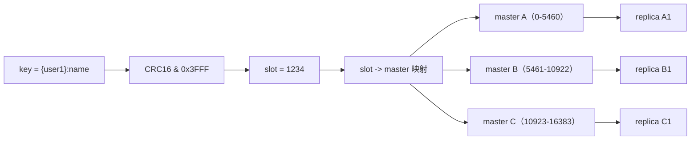
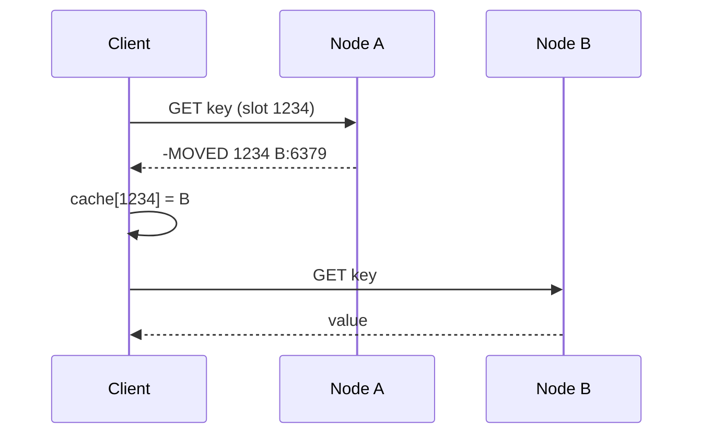
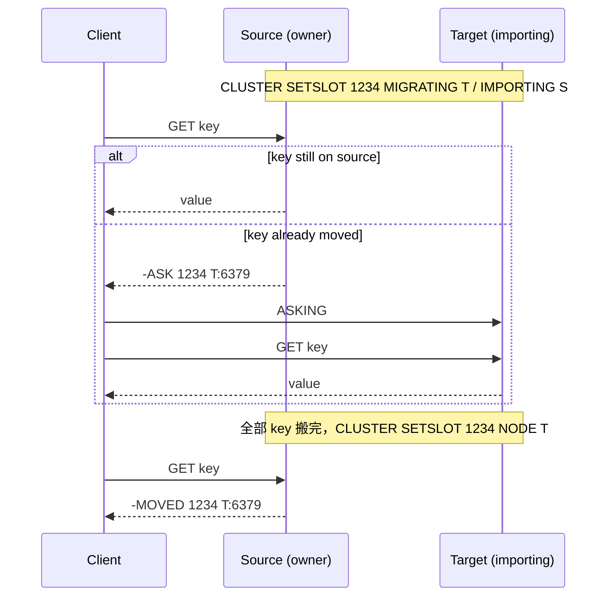
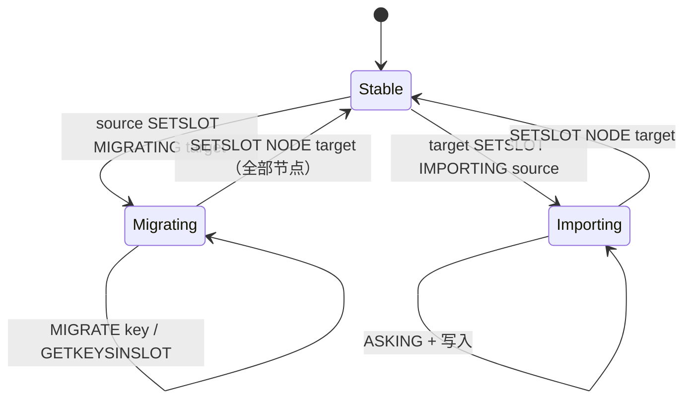
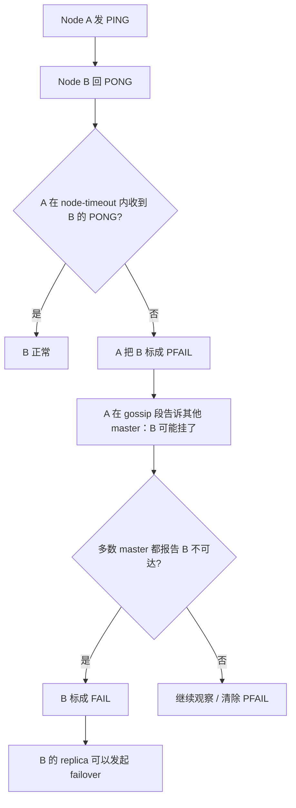
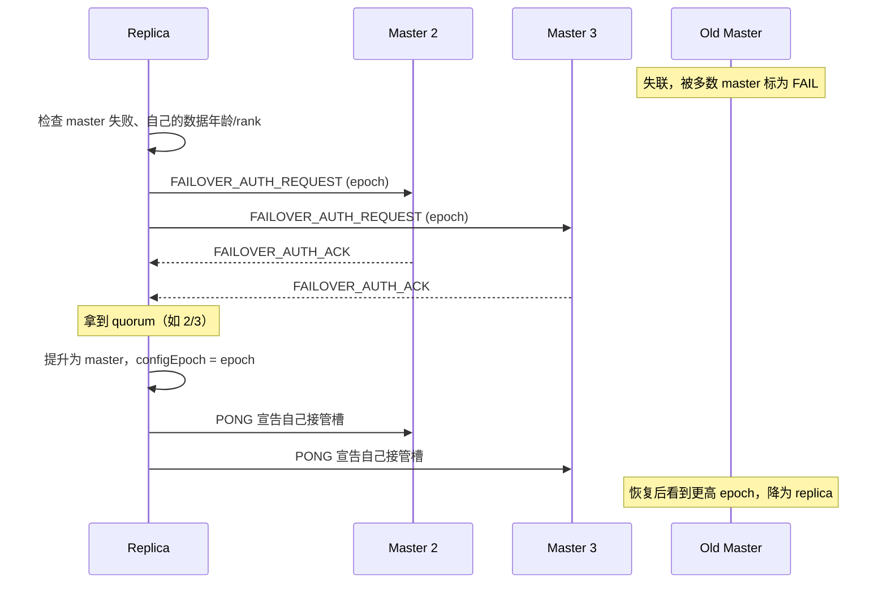

# Day 19 · Redis Cluster：槽、重定向与去中心化故障转移

> **一句话结论**：Redis Cluster 不是「把 key 均匀撒到节点上」这么简单，而是把 16384 个槽的所有权做成一份**可版本化的分布式映射**；客户端通过 MOVED/ASK 修正路由，节点通过 gossip 发现故障、用 epoch + quorum 选出新 owner。真正难的不是分片，而是**迁移中的槽**和**分区时的脑裂边界**。

---

## 0. 本次问题

你有 6 个 Redis 节点，3 主 3 从，跑了 500GB 数据。某天扩容加机器：

- 迁移某个槽到一半，客户端读一个已经被搬走的 key，收到 `ASK`，但它把 `ASK` 当成 `MOVED` 缓存了，接下来 10 分钟一直打错节点；
- 一个大 key 所在槽迁移很慢，期间对这个槽的 `MGET` 时而成功、时而 `TRYAGAIN`；
- 机房网络分区，少数派的主库还在接受写入，恢复后这些写入被新主覆盖，业务方问「Redis Cluster 不是高可用吗？」

三个现象对应三组机制：

1. **槽和 key 怎么对应？** 为什么是 16384 个槽？`{hash tag}` 解决什么问题？
2. **MOVED 和 ASK 有什么区别？** 迁移中的槽，客户端应该怎么重试、什么时候更新缓存？
3. **故障转移怎么投票？** 为什么少数派不能选主？旧主恢复后会发生什么？

本次要能画出三张图：**槽路由图**、**迁移状态图**、**gossip + 选举时序图**。

---

## 0.5 先建立直觉

### 一句话直觉

> **Redis Cluster 像一栋有 16384 个信箱的公寓。**
>
> 每个信箱（slot）归某个管理员（master）管；住户（key）通过 CRC16 决定自己用哪个信箱。你走错楼，管理员不会帮你转交，只会说「这个信箱归 3 号楼，去那里」（MOVED）。
>
> 如果某个信箱正在从 1 号楼搬到 3 号楼，1 号楼会说「这个信箱我已经搬空了一部分；你找的那个格子如果不在我这，去 3 号楼问一下，记得说‘我是来取迁移中的信件’（ASKING）」。ASK 是临时的，搬完后才变成永久的 MOVED。
>
> 如果 1 号楼的管理员联系不上了，其他管理员会互相打听（gossip），够多数人说「他失联了」，就把他负责的信箱交给他的副手（replica）；副手要拿到多数管理员的投票（quorum）才能上任。

### 生活类比

| Redis Cluster 里的东西 | 生活里的东西 | 为什么像 |
|---|---|---|
| slot | 信箱编号 | 16384 个固定格子，key 按哈希入住 |
| master | 楼管 | 每个槽只有一个 owner |
| replica | 副楼管 | 不接普通住户，但可以接班 |
| CRC16 + `% 16384` | 按身份证号分楼 | 同一个 key 永远去同一栋楼 |
| `{hash tag}` | 一家人用同一个户口本 | 多 key 操作要求同槽 |
| MOVED | 「这栋楼不归我，去 3 号楼」 | 永久重定向，客户端更新地图 |
| ASK | 「这格正在搬，去 3 号楼问，但别改地图」 | 临时重定向，下一次仍从旧地图开始 |
| ASKING | 「我是按 ASK 来的」 | 目标节点只对这一次请求放行 |
| CROSSSLOT | 「这些信不在同一个信箱」 | 多 key 命令不能跨槽 |
| CLUSTERDOWN | 「小区还没配齐楼管」 | 槽覆盖不全，拒绝服务 |
| gossip | 楼管之间互相打听 | PING/PONG 携带节点状态 |
| PFAIL / FAIL | 「我联系不上他」/「大家投票确认他失联」 | 主观怀疑 vs 多数确认 |
| epoch | 小区公告的届数 | 新公告覆盖旧公告 |
| quorum | 过半数楼管同意 | 防止少数派私自换人 |
| `configEpoch` | 每个楼管的任期 | 接管槽时用来判断新旧 |

### 只需要记住三个词

1. **槽**：`slot = CRC16(key) & 16383`；槽是路由的最小单位，不是 key。
2. **重定向**：MOVED 是永久的（更新缓存），ASK 是临时的（只对下一次请求生效，不更新缓存）。
3. **epoch + quorum**：故障转移要多数 master 投票；epoch 给拓扑变更排序；少数派不能选主。

### 第一遍可以先跳过

- `clusterMsg` 的二进制布局、cluster bus 的握手和 gossip 段格式；
- `clusterHandleSlaveFailover` 的 rank 延迟、data age、manual failover 细节；
- `CLUSTER SETSLOT` 的所有边界校验；
- 本文第 6 节的 C++ 实现和基准代码。

第一遍只读：**0.5、1、2、4、5**，能画出「客户端 → 槽 → owner」和「迁移中 ASK」两张图，并能解释「为什么少数派不能选主」，就够了。

### 三种分片方案，先摆在一起看

```text
方案 A：客户端分片（如早期 Codis/Twemproxy）
  客户端/代理维护 key -> 节点映射
  优点：实现简单，服务端无状态
  缺点：扩缩容要改映射；代理成为瓶颈/单点

方案 B：一致性哈希环
  key 和节点都哈希到环上，顺时针找第一个节点
  优点：增删节点只影响相邻区间
  缺点：需要虚拟节点解决倾斜；迁移粒度是区间，不是固定槽

方案 C：Redis Cluster 的固定槽
  16384 个槽，槽 -> master；key -> 槽
  优点：映射固定、迁移粒度细、客户端/节点都能算
  缺点：多 key 必须同槽；拓扑变更要传播；故障转移要 quorum
```

Redis 选固定槽，是因为它需要**客户端和服务端都能独立计算路由**，而且迁移可以按槽做，不需要移动整个哈希环。

---

## 1. 设计背景：约束从哪里来

### 1.1 为什么是 16384 个槽

槽数是一个工程折中：

- **太少**：每个槽太大，迁移/故障转移的粒度粗，负载不容易均衡；
- **太多**：节点间交换槽位图（bitmap）和 gossip 消息变大，客户端缓存也变大。

16384 = 2^14，正好能用 14 位表示；CRC16 取低 14 位即可。Redis 作者的解释大致是：在 1000 个 master 的规模下，16384 个槽已经足够均匀；再大只会让心跳包里的 bitmap 更占空间。

关键不是「16384 这个数字有魔法」，而是：**槽是路由和迁移的原子单位**。

### 1.2 key 怎么落到槽

```text
slot = crc16(key) & 0x3FFF
```

如果 key 包含 `{...}`，只哈希 `{}` 之间的内容：

```text
{user1000}.profile  -> crc16("user1000") & 0x3FFF
{user1000}.orders   -> crc16("user1000") & 0x3FFF   // 同槽
user1000            -> crc16("user1000") & 0x3FFF
```

规则：

- 没有 `{`：哈希整个 key；
- 有 `{` 但没有 `}`：哈希整个 key；
- `{}` 为空：哈希整个 key；
- 有 `{...}` 且内容非空：只哈希中间部分。

`{hash tag}` 是 Redis Cluster 给多 key 操作留的「同槽后门」：`MGET {user1}:name {user1}:age` 可以工作，因为两个 key 都落到 `crc16("user1")` 对应的槽。

### 1.3 为什么需要 MOVED

客户端一开始只有一份「槽 -> 节点」的缓存。拓扑变了（扩容、迁移、故障转移），缓存就会过期。Redis 不在服务端做代理转发，而是让客户端自己修正：

```text
client -> node A: GET user:1
node A: 这个槽归 node B
node A -> client: -MOVED 1234 10.0.0.2:6379
client: 更新 cache[1234] = B，重试
```

MOVED 是**永久重定向**：客户端应该更新缓存。它的语义是「这个槽现在归别人了」。

### 1.4 为什么还需要 ASK

迁移一个槽不是瞬间完成的。源节点可能已经搬走一部分 key，但 slot 的 owner 仍然是源节点，直到最后 `CLUSTER SETSLOT <slot> NODE <target>` 才切换。

在这段时间里：

- 如果 key 还在源节点：源节点直接服务；
- 如果 key 已经搬到目标节点：源节点返回 `ASK`，让客户端去目标节点；
- 目标节点只在客户端发了 `ASKING` 后才服务这个请求；
- 客户端**不能**因为 ASK 就更新槽缓存，因为迁移还没完成，下一次请求仍应先问源节点。

ASK 是**临时重定向**：只对这一次请求有效，目标是「迁移中的单个 key」，不是「槽的新 owner」。

### 1.5 为什么多 key 必须同槽

Cluster 的每个节点只负责一部分槽。`MGET k1 k2` 如果 k1、k2 在不同槽，可能需要跨节点读、跨节点事务，甚至跨节点锁。Redis 选择不做分布式事务，直接返回：

```text
-CROSSSLOT Keys in request don't hash to the same slot
```

所以：

- `MGET`、`MSET`、`SUNIONSTORE`、`EVAL`、`MULTI/EXEC` 里的 key 必须同槽；
- 用 `{hash tag}` 把相关 key 绑在一起；
- 不要用「用户 ID + 随机后缀」做 hash tag，否则同一用户的数据会散到不同槽。

### 1.6 关键约束

| 约束 | 具体表现 | 对设计的影响 |
|---|---|---|
| 路由 | 客户端要能独立算槽，服务端要能校验 | 固定 16384 槽 + CRC16 |
| 迁移 | 不能停整个集群，只能按槽搬 | MOVED/ASK 两阶段；ASKING |
| 一致性 | 多 key 跨槽没有分布式事务 | CROSSSLOT；hash tag |
| 故障检测 | 不能靠单点判断 | gossip + PFAIL/FAIL + quorum |
| 选主 | 少数派不能选主 | epoch + 多数 master 投票 |
| 可用性 | 任一槽缺失是否拒绝全部请求 | `cluster-require-full-coverage` |
| 运维 | 扩缩容、迁移、故障演练 | 槽平衡、迁移限速、监控 |

### 1.7 三个真实失败模式

**失败模式 1：把 ASK 当 MOVED 缓存。**

迁移期间，客户端收到 ASK 后把 `cache[slot]` 改成目标节点。迁移还没完成，源节点仍然是 owner；下一次请求直接打目标节点，目标节点没有 `ASKING`，返回 MOVED 回源节点，形成「来回踢皮球」。正确做法：ASK 只用于当前请求，缓存不动。

**失败模式 2：少数派继续写入。**

网络分区后，少数派的主库还活着，客户端也还能连上它。如果它不认为自己失联，可能继续接受写入。多数派已经选出新主，等分区恢复，旧主的写入会被新主的 `configEpoch` 覆盖——这些写入丢了。Redis Cluster 用「多数派才能选主」来限制，但不能阻止少数派在检测到故障前短暂写入；需要客户端/运维理解这个窗口。

**失败模式 3：迁移大 key 阻塞。**

`MIGRATE` 一个大 key（几 GB 的 hash）会阻塞源节点和目标节点；迁移期间这个槽的请求可能超时。生产上要拆分大 key、限制迁移速度、在低峰期做，并监控 `migrate` 相关指标。

---

## 2. 架构与数据流

### 2.1 槽路由图



### 2.2 MOVED 时序



### 2.3 ASK 迁移时序



### 2.4 槽迁移状态图



关键点：**迁移状态是每个节点本地的**。源节点知道「我在迁出」，目标节点知道「我在迁入」；其他节点只需要在最后收到 `SETSLOT NODE` 后更新槽表。

### 2.5 gossip 与故障检测



Redis Cluster 的 cluster bus 使用 `port + 10000`，节点之间用二进制 `clusterMsg` 交换：

- `PING` / `PONG` / `MEET`：心跳和拓扑；
- gossip 段：每个节点随机带几个其他节点的状态；
- `FAIL`：广播某个节点已确认失败；
- `FAILOVER_AUTH_REQUEST` / `FAILOVER_AUTH_ACK`：选主投票；
- `UPDATE`：传播槽位/配置变更。

### 2.6 故障转移时序



### 2.7 关键对象

| 对象 | 职责 | 生命周期 |
|---|---|---|
| `clusterState.slots[16384]` | 槽 -> master | 集群级 |
| `clusterState.slots_to_keys` | 槽 -> key 的辅助索引 | 迁移/统计 |
| `clusterNode.slots[2048]` | 节点拥有的槽 bitmap | 节点级 |
| `clusterState.currentEpoch` | 当前拓扑届数 | 单调递增 |
| `clusterNode.configEpoch` | 节点配置任期 | 每次接管槽更新 |
| `clusterState.migrating_slots_to[]` | 本节点正在迁出的槽 | 迁移期间 |
| `clusterState.importing_slots_from[]` | 本节点正在迁入的槽 | 迁移期间 |
| `clusterState.failover_auth_count` | 当前选举拿到的票数 | 一次选举 |
| `clusterState.size` | 服务至少一个槽的 master 数 | 拓扑变化时更新 |

### 2.8 六条不变量

1. **每个槽最多一个 owner。** 同一时刻不能有两个 master 都声称拥有同一个槽。
2. **同一 key 永远映射到同一槽。** CRC16 + hash tag 是确定性的。
3. **MOVED 是永久的，ASK 是临时的。** 客户端缓存更新规则不同。
4. **多 key 必须同槽。** 否则 CROSSSLOT，不能偷偷跨节点。
5. **故障转移需要多数 master 投票。** 少数派不能单方面换主。
6. **槽覆盖不全时，默认整个集群拒绝服务。** `cluster-require-full-coverage yes`。

---

## 3. 源码关键路径（Redis 7.2）

> 只追一条线：**key 怎么算槽 → 请求怎么被重定向 → 槽怎么迁移 → 节点怎么被判死 → 怎么选主**。不逐行抄整个 `cluster.c`。

### 3.1 `keyHashSlot`：14 位 CRC16

`cluster.h` 里的 `keyHashSlot` 很短：

```c
static inline unsigned int keyHashSlot(const char *key, int keylen) {
    int s, e;

    for (s = 0; s < keylen; s++)
        if (key[s] == '{') break;

    if (s == keylen) return crc16(key, keylen) & 0x3FFF;

    for (e = s + 1; e < keylen; e++)
        if (key[e] == '}') break;

    if (e == keylen || e == s + 1) return crc16(key, keylen) & 0x3FFF;

    return crc16(key + s + 1, e - s - 1) & 0x3FFF;
}
```

`crc16.c` 使用 XMODEM 多项式 `0x1021`、初值 0，已知向量：

```text
crc16("123456789") == 0x31C3
```

注意：`& 0x3FFF` 是取低 14 位，不是取模 16384 的另一种写法——两者等价，但位运算更直观地说明「16384 = 2^14」。

### 3.2 `getNodeByQuery`：路由和重定向的总入口

Redis 在执行命令前会调用 `getNodeByQuery`，它要做：

1. 从命令参数中提取所有 key；
2. 计算每个 key 的槽；
3. 检查是否跨槽（`CROSSSLOT`）；
4. 检查槽是否已分配（`CLUSTERDOWN`）；
5. 检查本节点是否 owner；
6. 检查迁移/导入状态，决定 `MOVED` / `ASK` / `TRYAGAIN`。

简化后的决策树：

```text
if 没有 key: 本地执行
if 槽未分配: CLUSTERDOWN
if 多个 key 不同槽: CROSSSLOT
if 集群不健康且不允许降级读: CLUSTERDOWN

owner = slots[slot]
if 本节点正在迁出该槽:
    if 请求的所有 key 都在本地: 本地执行
    if 部分在本地: TRYAGAIN
    else: ASK target

if 本节点正在导入该槽:
    if 客户端带 ASKING: 本地执行
    else: MOVED source

if owner != 本节点: MOVED owner
else: 本地执行
```

注意 `TRYAGAIN`：多 key 请求在迁移中如果「一部分在源、一部分在目标」，不能拆开执行，也不能返回一半数据；只能让客户端稍后重试。

### 3.3 `clusterRedirectClient`：错误格式

重定向错误不是随便的字符串：

```c
if (error_code == CLUSTER_REDIR_MOVED || error_code == CLUSTER_REDIR_ASK) {
    addReplyErrorSds(c, sdscatprintf(sdsempty(),
        "-%s %d %s:%d",
        (error_code == CLUSTER_REDIR_ASK) ? "ASK" : "MOVED",
        hashslot,
        clusterNodePreferredEndpoint(n),
        port));
}
```

客户端必须解析：

```text
-MOVED <slot> <host>:<port>
-ASK <slot> <host>:<port>
```

`MOVED` 后更新槽缓存；`ASK` 后先发 `ASKING`，再发原命令，且不更新缓存。

### 3.4 `CLUSTER SETSLOT`：迁移的两端

迁移一个槽，需要在源和目标分别设置状态：

```text
# 目标节点
CLUSTER SETSLOT 1234 IMPORTING <source-id>

# 源节点
CLUSTER SETSLOT 1234 MIGRATING <target-id>

# 源节点：拿到这个槽的 key
CLUSTER GETKEYSINSLOT 1234 100

# 源节点：把 key 搬过去
MIGRATE <target-host> <target-port> "" 0 5000 KEYS key1 key2 ...

# 所有节点：正式切换 owner
CLUSTER SETSLOT 1234 NODE <target-id>
```

`MIGRATE` 在目标节点执行的是 `RESTORE-ASKING`：它允许目标在 `importing` 状态下接收 key，而不需要普通的 `ASKING` 客户端标志。

迁移过程中：

- 源节点仍拥有槽，但部分 key 已不在；
- 目标节点已经拥有部分 key，但不是 owner；
- 客户端读已迁走的 key：源返回 ASK，目标凭 ASKING 服务；
- 客户端写已迁走的 key：同理，源返回 ASK；
- 全部 key 搬完，`SETSLOT NODE` 把 owner 切到目标，ASK 变成 MOVED。

### 3.5 gossip：PFAIL 与 FAIL

`cluster_legacy.c` 里（Redis 7.2 在 `cluster.c`）关键函数：

- `clusterCron`：周期性发 PING、检查超时；
- `markNodeAsFailingIfNeeded`：收集 failure reports，达到 quorum 就标 FAIL；
- `clusterSendFail`：广播 FAIL；
- `clusterProcessGossipSection`：处理 gossip 段。

简化：

```c
void markNodeAsFailingIfNeeded(clusterNode *node) {
    int needed_quorum = (server.cluster->size / 2) + 1;

    if (!nodeTimedOut(node)) return;
    if (nodeFailed(node)) return;

    int failures = clusterNodeFailureReportsCount(node);
    if (clusterNodeIsMaster(myself)) failures++;  // 自己也算一票
    if (failures < needed_quorum) return;

    node->flags |= CLUSTER_NODE_FAIL;
    clusterSendFail(node->name);
}
```

两个状态要分清：

- **PFAIL**（possibly fail）：单个节点超时后的主观判断；
- **FAIL**：多数 master 通过 gossip 报告后形成的弱共识。

为什么是「弱共识」？因为分区时 FAIL 消息可能传不到所有节点；Redis 的目标是「多数派能推进故障转移」，不是强一致的成员变更。

### 3.6 选举：`clusterHandleSlaveFailover`

副本发现自己的 master 被标 FAIL 后，会：

1. 检查自己的数据年龄（不能落后太多）；
2. 计算 rank（复制 offset 越新，rank 越小，越早发起选举）；
3. 等待一个随机延迟 + rank 延迟，避免多个副本同时抢；
4. `currentEpoch++`，广播 `FAILOVER_AUTH_REQUEST`；
5. 收集 `FAILOVER_AUTH_ACK`；
6. 票数达到 `cluster->size / 2 + 1` 后，提升自己，接管 master 的槽。

简化：

```c
void clusterHandleSlaveFailover(void) {
    int needed_quorum = (server.cluster->size / 2) + 1;

    if (myself->slaveof == NULL || !nodeFailed(myself->slaveof)) return;
    if (data_age 太大) return;

    if (auth_age > auth_retry_time) {
        failover_auth_time = now + 500 + random() % 500;
        failover_auth_time += clusterGetSlaveRank() * 1000;
        return;
    }

    if (failover_auth_sent == 0) {
        currentEpoch++;
        failover_auth_epoch = currentEpoch;
        clusterRequestFailoverAuth();
        failover_auth_sent = 1;
        return;
    }

    if (failover_auth_count >= needed_quorum) {
        myself->configEpoch = failover_auth_epoch;
        clusterFailoverReplaceYourMaster();
    }
}
```

投票端 `clusterSendFailoverAuthIfNeeded` 会检查：

- 自己是不是「服务至少一个槽的 master」；
- 请求 epoch 是否足够新；
- 这个 epoch 是否已经投过票；
- 请求者是不是 replica，它的 master 是否 FAIL；
- 请求者声称的槽 `configEpoch` 是否不低于当前 owner。

这些检查保证：**每个 master 在一个 epoch 只投一票，且不会把票投给一个数据明显过旧的副本**。

### 3.7 `configEpoch` 与槽接管

`configEpoch` 是节点的配置任期。接管槽时，新主把自己的 `configEpoch` 设为选举 epoch；其他节点收到更高的 `configEpoch` 后，会更新槽的 owner。

这解决了两个问题：

- **旧主恢复**：旧主的 `configEpoch` 较低，看到新主的更高 epoch 后，会降级为 replica；
- **分区脑裂**：少数派无法拿到 quorum，不能产生更高的 epoch；多数派的新主成为唯一合法 owner。

### 3.8 `cluster-require-full-coverage`

默认 `yes`：只要有一个槽没有 owner，整个集群返回 `CLUSTERDOWN`。这很保守，但能避免「部分 key 静默不可用」。

如果设为 `no`，未覆盖槽的请求会 `CLUSTERDOWN`，但其他槽仍可服务；需要业务能接受「部分 key 不可用」。

### 3.9 客户端视角

一个健康的 Cluster 客户端需要：

1. 启动时拉取 `CLUSTER SLOTS`（7.0+ 也可用 `CLUSTER SHARDS`）；
2. 缓存 `slot -> node`；
3. 计算 key 的槽，直接发请求；
4. 收到 MOVED：更新缓存，重试（有上限）；
5. 收到 ASK：先发 `ASKING`，再发原命令到目标，不更新缓存；
6. 收到 TRYAGAIN：退避后重试；
7. 处理 CROSSSLOT：不要跨槽拆命令；
8. 处理拓扑变化：定期刷新/在 MOVED 时刷新。

### 3.10 语言对照

- **C++ / Redisson?** Redisson 是 Java；C++ 客户端如 `redis-plus-plus` 支持 Cluster，内部就是 slot 缓存 + MOVED/ASK。
- **Rust / redis-rs**：`cluster` 模块维护 slot map，处理 MOVED/ASK。
- **Twemproxy / Codis**：代理分片，客户端不需要知道槽；代价是代理层复杂度和额外跳数。
- **Kafka**：分区 leader + ISR；客户端通过 metadata 发现 leader，和 Cluster 的槽表类似，但 Kafka 的分区是连续的日志，Redis 的槽是哈希区间。
- **etcd**：没有分片，靠 Raft 复制全量数据；扩展性和 Redis Cluster 是不同路线。

Redis Cluster 的教学价值：它把「分片 + 重定向 + 迁移 + 故障检测 + 选主」放在一个协议里，而且没有强一致事务。理解了它，再看 Codis、Twemproxy、Kafka metadata、Raft 成员变更，会更容易区分「分片」和「共识」。

---

## 4. 关键设计技巧

### 技巧 1：固定槽，而不是一致性哈希环

- **做法**：预分配 16384 个槽，槽 -> master；key 通过 CRC16 落到槽。
- **为什么有效**：客户端和服务端都能独立算；迁移粒度是槽，不是整个环；槽表可以压缩成 bitmap。
- **代价**：槽数固定，扩缩容要搬槽；多 key 必须同槽；槽分布可能不均。
- **适用边界**：需要客户端直连、服务端无代理的分片系统。如果代理层可以承担路由，一致性哈希环也很常见。

### 技巧 2：MOVED 永久、ASK 临时

- **做法**：MOVED 表示槽 owner 已变；ASK 表示迁移中单个 key 临时在目标。
- **为什么有效**：客户端只在拓扑真正变化时更新缓存；迁移中的请求不会把缓存提前改错。
- **代价**：客户端必须理解两种语义；ASK 需要额外 `ASKING` 往返。
- **适用边界**：所有「在线迁移」的分片系统。迁移期间不更新缓存，是正确性的关键。

### 技巧 3：迁移按槽、按 key 两阶段切换

- **做法**：目标 IMPORTING、源 MIGRATING；逐 key MIGRATE；最后 SETSLOT NODE 全局切换。
- **为什么有效**：迁移期间源仍是 owner，读已迁走的 key 用 ASK，未迁走的本地服务；切换后统一 MOVED。
- **代价**：迁移期间多 key 请求可能 TRYAGAIN；大 key 会阻塞；需要迁移限速。
- **适用边界**：在线扩缩容、重平衡。不能接受迁移抖动的场景要低峰期做。

### 技巧 4：gossip + PFAIL/FAIL，而不是中心化健康检查

- **做法**：节点互相 PING/PONG，gossip 传播状态；单节点超时标 PFAIL，多数 master 报告后标 FAIL。
- **为什么有效**：没有中心单点；分区时多数派仍能推进故障转移。
- **代价**：故障检测有延迟；FAIL 是弱共识，可能误判/漏判；gossip 流量随节点数增长。
- **适用边界**：去中心化集群。对强一致成员变更要求高的系统（Raft）会用日志复制和 quorum 提交，而不是 gossip。

### 技巧 5：epoch + quorum 选主

- **做法**：副本发起选举，epoch 递增；每个 master 每个 epoch 只投一票；票数过半才接管槽。
- **为什么有效**：少数派拿不到 quorum，不能产生合法新主；epoch 让旧主恢复后自动降级。
- **代价**：选举有延迟；分区期间少数派可能短暂接受写入；需要正确的时钟/超时配置。
- **适用边界**：主从式分片系统。真正的强一致需要 Raft/Paxos 的日志提交，而不是仅靠选主。

### 技巧 6：hash tag 把多 key 绑到同槽

- **做法**：`{user1}:name` 和 `{user1}:age` 只哈希 `user1`。
- **为什么有效**：多 key 操作、事务、Lua 可以在同一个节点完成；不需要分布式事务。
- **代价**：hash tag 设计不好会造成热点；同一个 tag 的 key 永远在同一槽，容量/负载可能倾斜。
- **适用边界**：需要多 key 原子性的业务。不要用随机后缀做 tag，也不要把所有 key 都塞进一个 tag。

---

## 5. 反例与边界

| 看起来对的用法 | 实际问题 | 正确做法 |
|---|---|---|
| 把 ASK 当 MOVED 缓存 | 迁移未完成就改缓存，请求来回踢 | ASK 只对当前请求生效，不更新缓存 |
| 用 `{user}:random` 做 hash tag | 同一用户数据散到不同槽，多 key 失败 | tag 只放稳定、共享的业务 ID |
| 所有 key 用同一个 `{all}` | 全部落一个槽，扩容无效、热点严重 | 按业务实体分 tag，监控槽倾斜 |
| 在 Cluster 上跑跨槽 `MGET`/事务 | CROSSSLOT | 用 hash tag 绑定，或客户端拆分/聚合 |
| 认为 Cluster 是强一致 | 默认异步复制，故障转移可能丢写 | 接受最终一致；强一致用 Raft/同步复制 |
| 少数派继续写入 | 分区恢复后写入被新主覆盖 | 依赖 quorum + 客户端重定向；监控分区 |
| `cluster-require-full-coverage no` 就高可用 | 部分槽不可用时业务可能读到错数据 | 明确降级策略；监控槽覆盖 |
| 迁移大 key 不限速 | 源/目标阻塞，p99 飙升 | 拆分大 key；低峰迁移；限速/分批 |
| 只靠 `CLUSTER NODES` 做客户端路由 | 输出格式/拓扑可能变化；解析复杂 | 用 `CLUSTER SLOTS`/`CLUSTER SHARDS`，处理 MOVED |
| 故障转移后立刻认为旧主数据可读 | 旧主可能还没降级/数据落后 | 等新主拓扑稳定；读走新主 |

### 压力下会发生什么

- **扩容迁移**：槽迁移占用源/目标 CPU 和网络；大 key 会拉长迁移时间；多 key 请求在迁移中可能 TRYAGAIN。
- **热点槽**：某个 hash tag 的所有 key 落一个槽；单 master 打满，扩容无法拆分这个 tag。需要重新设计 key 或做二级分片。
- **节点失联**：PFAIL -> FAIL 需要 `cluster-node-timeout` 级别的延迟；期间该槽的请求可能超时/CLUSTERDOWN。
- **分区**：多数派选主，少数派不能选主；少数派可能短暂接受写入，恢复后丢失。需要业务理解 RPO。
- **同时多个副本竞选**：rank 延迟让数据最新的副本先发起；仍可能分裂投票，靠随机延迟和重试收敛。
- **集群规模**：gossip 流量和失败检测时间随节点数增长；官方建议 master 数量不要太大（通常几十到几百，不是几千）。
- **客户端缓存过期**：MOVED 会修正，但大量客户端同时收到 MOVED 会产生重试风暴；需要退避/刷新限速。

---

## 6. 最小实现（C++20）

> 目标：把「CRC16 + 槽映射 + MOVED/ASK + 迁移 + gossip 故障举报 + epoch/quorum 选主」做成一个能跑、能测、能破坏的小系统。不是完整的 cluster bus，但每条路由/选主不变量都有测试。

### 6.1 文件与结构

```text
day-019-cluster/
├── README.md
└── code/
    ├── CMakeLists.txt
    ├── main.cpp                  # 命令行入口
    ├── demo.cpp                  # 槽/MOVED/ASK/故障转移演示
    ├── bench.cpp                 # 槽计算、分布、客户端路由
    ├── src/
    │   ├── common.hpp            # Slot / NodeId / Epoch / Reply
    │   ├── crc16.hpp/.cpp        # CRC16 + hash tag
    │   ├── slot_map.hpp/.cpp     # 16384 槽 -> owner
    │   ├── node.hpp              # 节点角色/数据/故障举报
    │   ├── cluster.hpp           # Cluster 接口与状态
    │   ├── cluster_core.cpp      # 拓扑、健康、命令执行
    │   ├── cluster_routing.cpp   # 槽迁移 + MOVED/ASK/TRYAGAIN
    │   ├── cluster_failover.cpp  # PFAIL/FAIL、投票、提升
    │   └── client.hpp/.cpp       # 客户端缓存与重定向
    └── tests/
        ├── test_support.hpp/.cpp # 三主拓扑、按槽找 key
        ├── test_registry.cpp     # 14 个用例
        ├── tests_slots.cpp       # 槽/哈希/CROSSSLOT/CLUSTERDOWN
        ├── tests_redirect.cpp    # MOVED/ASK/缓存/TRYAGAIN
        └── tests_failover.cpp    # gossip/quorum/epoch/副本数据
```

职责边界：

- `crc16` 只做哈希，不知道集群；
- `slot_map` 只维护 16384 个 owner，不知道迁移；
- `cluster_routing` 只做“收到请求后怎么回”，不知道选主；
- `cluster_failover` 只做故障举报和投票，不知道命令语义；
- `client` 只做缓存和重试，不直接改集群状态。

所有文件低于 600 行（最大 `cluster_core.cpp` 约 145 行）。

### 6.2 槽计算

```cpp
Slot key_hash_slot(std::string_view key) {
    const std::size_t open = key.find('{');
    if (open == std::string_view::npos) return crc16(key) & 0x3FFF;

    const std::size_t close = key.find('}', open + 1);
    if (close == std::string_view::npos || close == open + 1) {
        return crc16(key) & 0x3FFF;
    }
    return crc16(key.substr(open + 1, close - open - 1)) & 0x3FFF;
}
```

### 6.3 路由决策

```cpp
auto migrating = migrating_.find(slot);
auto importing = importing_.find(slot);
if (migrating != migrating_.end() && importing != importing_.end()) {
    if (receiving_node == importing->second) {       // source
        std::size_t present = count keys on local;
        if (present == keys.size()) return serve(local, command);
        if (present > 0) return TryAgain;
        return Ask(migrating->second);               // 已搬走
    }
    if (receiving_node == migrating->second) {       // target
        if (asking) return serve(local, command);    // 必须带 ASKING
        return Moved(importing->second);             // 否则回源
    }
}

const NodeId& owner = slots_.owner(slot);
if (owner == receiving_node) return serve(local, command);
return Moved(owner);
```

### 6.4 迁移

```cpp
void Cluster::begin_migration(Slot slot, NodeId from, NodeId to) {
    migrating_[slot] = to;    // 源：我在迁出
    importing_[slot] = from;  // 目标：我在迁入
}

std::size_t Cluster::migrate_keys(Slot slot, NodeId from, NodeId to, std::size_t max) {
    // 从 source->data 中挑出属于该槽的 key，搬到 target->data
}

void Cluster::finish_migration(Slot slot, NodeId to) {
    // 确认 source 没有该槽的 key
    slots_.assign(slot, to);
    migrating_.erase(slot);
    importing_.erase(slot);
}
```

### 6.5 客户端重定向

```cpp
Reply ClusterClient::execute(const Command& command) {
    const Slot slot = key_hash_slot(command.args[1]);
    for (int attempt = 0; attempt < 8; ++attempt) {
        NodeId target = route_slot(slot);
        Reply reply = cluster_.execute(target, command, false);

        if (reply.type == ReplyType::Moved) {
            cache_[slot] = reply.target;   // 永久：更新缓存
            ++moved_;
            continue;
        }
        if (reply.type == ReplyType::Ask) {
            ++ask_;
            // 临时：只对下一次请求发 ASKING，不更新 cache
            return cluster_.execute(reply.target, command, true);
        }
        return reply;
    }
    return Reply{ReplyType::Error, "too many redirects", {}, slot};
}
```

### 6.6 投票与提升

```cpp
bool Cluster::grant_vote(NodeId voter, NodeId replica) {
    if (!voter.master || voter.failed) return false;
    if (last_vote_epoch_[voter] >= current_epoch_) return false;
    last_vote_epoch_[voter] = current_epoch_;
    votes_[replica].insert(voter);
    return true;
}

bool Cluster::promote(NodeId replica) {
    const std::size_t quorum = master_count() / 2 + 1;
    if (votes_[replica].size() < quorum) return false;
    // replica.master = true; old_master.master = false;
    // 把 old_master 的槽全部 assign 给 replica
}
```

### 6.7 运行

```bash
cd step1/week-03-redis/day-019-cluster/code
cmake -S . -B build -G Ninja
cmake --build build
ctest --test-dir build --output-on-failure
```

其他入口：

```bash
./build/cluster_demo --demo     # 槽/MOVED/ASK/故障转移
./build/cluster_demo --bench    # 槽计算/分布/路由
./build/cluster_demo --list
./build/cluster_demo --case ask_migration
```

### 6.8 预期输出（节选）

```text
== 1. 槽与 hash tag ==
  {user1000}.profile -> slot 3443
  {user1000}.orders -> slot 3443（同一 tag，同槽）

== 2. MOVED ==
  GET key-3 发到 M1 -> MOVED 8359 -> M2

== 3. 迁移中的 ASK ==
  迁移中 GET 发到 M1 -> ASK；客户端带 ASKING 去 M2 -> Bob
  迁移完成后再 GET -> MOVED 学习到新 owner，值=Bob

== 4. gossip + quorum 故障转移 ==
  1 个 master 举报 M3：还不到 quorum
  2 个 master 举报 M3：FAIL
  R3 拿到 2 票，promote=yes，slot(12422) -> R3
  promoted 后 healthy=yes
```

### 6.9 14 个用例

| 组 | 用例 | 验证的不变量 |
|---|---|---|
| 槽 | `slot_hash` | CRC16 向量、hash tag 规则 |
| 槽 | `slot_map` | 16384 槽全覆盖；范围映射 |
| 路由 | `moved` | 错节点 -> MOVED，带 slot/target |
| 路由 | `client_cache` | MOVED 更新缓存，第二次不再重定向 |
| 路由 | `crossslot` | 多 key 不同槽 -> CROSSSLOT |
| 路由 | `clusterdown` | 槽覆盖不全 -> CLUSTERDOWN |
| 迁移 | `ask_migration` | 源缺 key -> ASK；ASK 不更新缓存；完成后 MOVED |
| 迁移 | `tryagain` | 源部分 key -> TRYAGAIN |
| 迁移 | `ask_target_requires_asking` | 目标不带 ASKING -> MOVED 源 |
| 故障 | `gossip_quorum` | 1 票不够，2/3 才 FAIL |
| 故障 | `failover` | quorum 后提升、接管槽、恢复 healthy |
| 故障 | `failover_no_quorum` | 少数票不能提升 |
| 故障 | `epoch_vote_once` | 同一 epoch 每个 master 只投一票 |
| 故障 | `replica_data` | 副本同步后才有数据可接管 |

### 6.10 基准（本机实测）

环境：Windows 11 + MinGW-w64 g++ 15.2，Release（`-O2`），单线程。

| 实验 | 结果 |
|---|---|
| 100 万 key 算槽 | 53.0ms |
| 100 万 key 三主分布 | M1=333350，M2=333290，M3=333360 |
| 10 万次客户端 GET | 19.7ms；MOVED=0，ASK=0 |

数字只说明量级；真实客户端还要加上网络、连接池、重定向和命令执行。

### 6.11 三个实现坑

1. **ASK 和 MOVED 的缓存语义搞反。** 第一版客户端收到 ASK 也更新 cache，结果迁移没完成就去目标节点，目标返回 MOVED 回源，形成循环；测试 `ask_migration` 的 `moved_count == 0` 就是用来钉住这一点。
2. **迁移中源/目标的状态判断搞反。** 一开始把 `migrating_[slot] == receiving_node` 当成「源」，实际上 `migrating_` 的目标是 destination；结果目标节点不带 ASKING 也能服务。测试 `ask_target_requires_asking` 暴露了这个问题。
3. **健康检查每请求 O(16384)。** 第一版 `healthy()` 每次都扫全部槽，10 万次 GET 要 15 秒。把健康状态缓存到拓扑变更时刷新，降到 16ms；代价是任何直接改节点状态的代码都必须调用刷新（本实现只允许通过 `report_failure/promote/assign_range` 改）。

### 6.12 生产化缺口

这个实现刻意省略了：

1. **真实 cluster bus**：没有二进制 `clusterMsg`、TLS、握手、gossip 段；
2. **完整命令集**：只支持 SET/GET/DEL/MGET；
3. **真实迁移协议**：没有 `MIGRATE`/`RESTORE-ASKING` 的网络传输、超时、重试；
4. **副本选举细节**：没有 rank 延迟、data age、manual failover、replica migration；
5. **槽位图合并**：没有 `configEpoch` 冲突解决和 UPDATE 消息；
6. **持久化**：没有 `nodes.conf` 的保存/恢复；
7. **客户端发现**：没有 `CLUSTER SLOTS`/`CLUSTER SHARDS` 的响应解析；
8. **安全**：没有 ACL、TLS、cluster bus 认证；
9. **限流/大 key**：没有迁移限速、大 key 拆分；
10. **监控**：没有 `cluster_state`、`cluster_slots_assigned`、`cluster_known_nodes` 等指标。

这些缺口不影响本课的核心不变量，但在生产环境里，每一个都可能变成事故。

---

## 7. 如何借鉴到自己的项目

### 7.1 可以复用的模式

- **固定分片表**：用一张可版本化的映射表做路由，客户端和服务端都能算。
- **永久/临时重定向分离**：拓扑变更用 MOVED，在线迁移用 ASK；不要让临时状态污染长期缓存。
- **两阶段迁移**：先标记 importing/migrating，再逐 key 搬，最后原子切换 owner。
- **gossip + quorum**：去中心化故障检测，避免中心单点；用 epoch 给拓扑变更排序。
- **hash tag**：用业务实体把多 key 绑在同一分片，避免分布式事务。
- **全量覆盖检查**：槽/分片缺失时，明确失败而不是静默返回错数据。

### 7.2 接口清单

```text
[ ] key -> 分片的函数是否确定、可跨语言实现？
[ ] 分片表是否有版本号/epoch？拓扑变更如何传播？
[ ] 客户端缓存过期时，服务端返回什么重定向？
[ ] 永久重定向和临时重定向是否区分？临时重定向是否污染缓存？
[ ] 多 key 操作是否限制同分片？错误是否明确？
[ ] 分片迁移是否两阶段？迁移中的读写如何处理？
[ ] 故障检测是中心化还是 gossip？PFAIL/FAIL 阈值是多少？
[ ] 选主是否需要 quorum？少数派能否写入？
[ ] 旧主恢复后如何降级？epoch 是否足够？
[ ] 分片覆盖不全时，是整体拒绝还是部分服务？
[ ] 是否有分片倾斜、迁移延迟、重定向次数、FAIL 数指标？
```

### 7.3 迁移步骤

1. **先定义分片函数**：固定槽/哈希环/一致性哈希；写跨语言测试向量。
2. **实现路由缓存**：客户端缓存 + 服务端权威表；处理缓存过期。
3. **实现重定向**：MOVED/ASK 分离；客户端有重试上限和退避。
4. **实现两阶段迁移**：importing/migrating；逐 key 搬；最后切换 owner。
5. **实现故障检测**：心跳、PFAIL、gossip、FAIL quorum。
6. **实现选主**：epoch、投票、quorum、旧主降级。
7. **做故障注入**：迁移中读写、分区、少数派写入、旧主恢复。

### 7.4 决策表

| 场景 | 建议 | 理由 |
|---|---|---|
| 客户端能改、需要直连 | Redis Cluster / 固定槽 | 无代理、客户端可算路由 |
| 不想改客户端 | Twemproxy/Codis/Proxy | 代理承担路由，代价是额外跳数 |
| 多 key 事务多 | 设计 hash tag，或换单分片/分布式事务 | Cluster 不支持跨槽事务 |
| 强一致 | Raft/Paxos 系统（etcd） | Cluster 是异步复制 + 选主，不是强一致 |
| 分片倾斜严重 | 重新设计 key/tag；二级分片 | 固定槽无法拆一个热点 tag |
| 分区容忍优先 | quorum + 明确降级；监控少数派 | 少数派必须停止写入或接受丢失 |

---

## 8. 练习

**基础**

1. 把 `kClusterSlots` 改成 1024，跑 `slot_map` 和 `bench`，观察分布和冲突。
2. 给 `ClusterClient` 加 `TRYAGAIN` 的指数退避重试，统计重试次数。
3. 给 `Cluster` 加 `CLUSTER KEYSLOT` 风格的查询接口，输出 key 的槽和 owner。

**进阶**

1. 实现 `CLUSTER SLOTS` 的返回格式（slot 范围 + master/replica 地址），让客户端从它初始化缓存。
2. 实现迁移限速：每次 `migrate_keys` 最多 N 个 key 或 M 字节，剩余 key 让客户端 `TRYAGAIN`。
3. 实现 `configEpoch` 冲突解决：两个 master 声称同一槽时，按 epoch 大者胜。
4. 实现 `CLUSTER FAILOVER` 的手动切换：不依赖 master FAIL，直接让 replica 接管。

**挑战**

1. 设计一个 1000  master、16384 槽的扩容方案：每次迁移多少槽、如何限速、如何验证不丢 key、如何回滚。
2. 比较 Redis Cluster、Kafka ISR、Raft 的故障转移：三者的「提交点」和「少数派写入」分别怎样处理？
3. 写一页设计说明：如果你的业务有多 key 事务、强一致、跨机房容灾需求，Redis Cluster 哪些能做、哪些不能做？替代方案是什么？

---

## 9. 自测题

<details>
<summary>点击展开答案</summary>

1. **问题**：为什么 Redis Cluster 用 16384 个槽，而不是一致性哈希环？
   **答案**：固定槽让客户端和服务端都能独立计算路由，迁移粒度是槽而不是整个环；16384 = 2^14，位图/心跳大小和分布粒度折中。一致性哈希环增删节点影响小，但路由和迁移模型不同。

2. **问题**：`MOVED` 和 `ASK` 的区别是什么？客户端收到后分别该做什么？
   **答案**：MOVED 表示槽的 owner 已经永久改变，客户端应更新槽缓存并重试；ASK 表示迁移中这个 key 临时在目标节点，客户端应先发 `ASKING`，再发原命令到目标，不更新缓存。把 ASK 当 MOVED 会导致迁移期间路由错误。

3. **问题**：为什么多 key 操作要求同槽？`{hash tag}` 如何帮助？
   **答案**：Cluster 不做跨节点事务/聚合；不同槽的 key 可能在不同 master，无法原子执行。`{tag}` 让多个 key 只哈希 tag 部分，从而落到同一槽；但 tag 设计不好会导致热点。

4. **问题**：迁移一个槽的完整步骤是什么？
   **答案**：目标 `CLUSTER SETSLOT <slot> IMPORTING <source>`；源 `CLUSTER SETSLOT <slot> MIGRATING <target>`；源用 `CLUSTER GETKEYSINSLOT` + `MIGRATE` 逐 key 搬；全部搬完后在所有节点执行 `CLUSTER SETSLOT <slot> NODE <target>`。迁移中源缺 key 返回 ASK，目标需要 ASKING。

5. **问题**：PFAIL 和 FAIL 有什么区别？为什么要多数 master 报告？
   **答案**：PFAIL 是单个节点超时后的主观怀疑；FAIL 是多数 master 通过 gossip 报告后形成的弱共识。多数确认可以避免单个节点网络抖动就触发故障转移；但它是弱共识，分区时可能不完整。

6. **问题**：故障转移为什么需要 quorum？少数派为什么不能选主？
   **答案**：quorum（多数 master）保证同一时间只有一个分区能产生合法新主；少数派拿不到多数票，不能提升 replica，否则会出现两个 master 同时服务同一槽（脑裂）。旧主恢复后通过更高的 `configEpoch` 降级。

7. **问题**：`cluster-require-full-coverage yes` 的代价是什么？
   **答案**：只要有一个槽没有 owner，整个集群返回 CLUSTERDOWN，哪怕其他槽正常。这避免部分 key 静默不可用，但降低了可用性；可以设为 no，让未覆盖槽单独报错，但业务要能处理部分不可用。

8. **问题**：为什么大 key 迁移会阻塞？怎么缓解？
   **答案**：`MIGRATE` 在大 key 上要序列化/传输/重建，源和目标都可能长时间占用主线程；期间该槽请求延迟升高甚至超时。缓解：拆分大 key、低峰迁移、限速/分批、监控迁移延迟。

</details>

---

## 10. 模式卡片

```text
模式名称：固定槽 + 永久/临时重定向
解决什么问题：客户端直连的分片系统，拓扑会变，迁移又不能停服。
核心机制：16384 个槽 -> owner；key 通过 CRC16 落槽；
          MOVED 永久改缓存；ASK 临时去目标并带 ASKING；迁移按槽两阶段切换。
代价/限制：多 key 必须同槽；迁移中可能 TRYAGAIN；客户端要实现重定向/缓存；
          大 key 迁移会阻塞。
不适用场景：需要跨槽事务/强一致；不能改客户端且没有代理；
          热点 tag 无法拆分。
一个最小例子：GET key 发到错误节点 -> MOVED 1234 B；
          迁移中源缺 key -> ASK 1234 B；客户端 ASKING 后取到值。
```

```text
模式名称：gossip + epoch/quorum 故障转移
解决什么问题：去中心化集群里，节点失联后由谁接班，如何避免脑裂。
核心机制：PING/PONG + gossip 传播状态；单节点超时 PFAIL，多数 master 报告 FAIL；
          replica 用递增 epoch 请求投票；拿到多数票后接管槽，configEpoch 胜出。
代价/限制：故障检测有延迟；FAIL 是弱共识；分区期间少数派可能短暂写入；
          选举有随机延迟和 rank 竞争。
不适用场景：需要强一致成员变更/线性一致读；节点数极大导致 gossip 成本过高。
一个最小例子：3 master，M3 失联；M1/M2 报告 FAIL；R3 拿 2 票，
          configEpoch=1，接管 M3 的槽；旧 M3 恢复后降为 replica。
```

---

## 11. 下次预习

- **Day 20 · Streams：消费者组与 PEL**。
- 带着三个问题读：
  1. Streams 的 consumer group 和 Kafka 的 consumer group 有什么相同/不同？
  2. PEL（Pending Entries List）解决什么问题？`XACK` 之后消息去哪了？
  3. `XAUTOCLAIM` 如何避免「消费者崩溃后消息永远卡在 PEL」？
- 回看本文的 2.4 和 2.6：迁移的「两阶段切换」和故障转移的「epoch + quorum」都是分布式状态机；Streams 的 PEL 也是一个需要「认领/超时/幂等」的状态机。

---

## 参考资料

- Redis 官方文档：[Redis Cluster specification](https://redis.io/docs/latest/operate/oss_and_stack/reference/cluster-spec/)、[Scaling with Redis Cluster](https://redis.io/docs/latest/operate/oss_and_stack/management/scaling/)（访问日期 2026-11-26）。
- Redis 源码 7.2：`src/cluster.c`、`src/cluster.h`、`src/crc16.c`、`src/cluster_legacy.c`（访问日期 2026-11-26）。
- Redis 命令文档：[CLUSTER SETSLOT](https://redis.io/commands/cluster-setslot/)、[CLUSTER SLOTS](https://redis.io/commands/cluster-slots/)、[CLUSTER SHARDS](https://redis.io/commands/cluster-shards/)、[MIGRATE](https://redis.io/commands/migrate/)、[ASKING](https://redis.io/commands/asking/)。
- `redis.conf` 注释：`cluster-enabled`、`cluster-node-timeout`、`cluster-require-full-coverage`、`cluster-migration-barrier`、`cluster-allow-reads-when-down`、`cluster-announce-*`。
- 本仓库：[Day 18 主从复制](../day-018-replication/README.md)、[Day 15 渐进式 rehash](../day-015-incremental-rehash/README.md)、[Day 17 RDB 与 AOF](../day-017-rdb-aof/README.md)。
- 本课代码：[src/](code/src/)、[tests/](code/tests/)、[main.cpp](code/main.cpp)、[CMakeLists.txt](code/CMakeLists.txt)。
