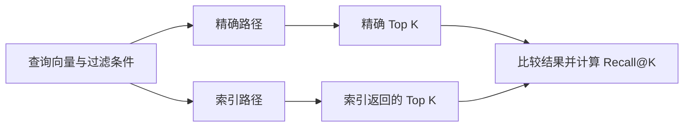

# Week 01 入门 · Qdrant 向量检索

假设客服系统要找十条与你的新问题相似的历史工单。工单已被表示成向量。查询时还要限定租户和时间范围，再按相似程度取前十条。

## 0. 先画出一次查询

简单做法是逐条计算距离并挑出最近的十条。数据多时，这条路径的成本会随着参与比较的向量增加。图索引让查询只访问部分候选，代价是可能错过某些真正的近邻。要衡量这个代价，先用精确路径算出同一查询的参考答案。

同一次查询的两条路径要共用数据快照、距离度量、过滤条件和 K。改变图搜索预算时，只改这一项。否则无法解释召回率或距离计算次数为什么变化。

## 1. 先掌握的术语

| 术语 | 在例子里的含义 | 哪天读 |
|---|---|---|
| 精确 Top-K | 在所有满足条件的工单中逐条比较，拿到最近的 K 条 | Day 01 |
| HNSW | 一个把向量连成多层近邻图的索引，搜索可以逐层缩小范围 | Day 02 |
| `hnsw_ef` | 查询时允许跟踪的候选规模，会影响遍历成本和召回率 | Day 03 |
| Payload | 工单所属租户、时间或标签等可供过滤的元数据 | Day 04 |
| 量化与重排 | 先用较紧凑的表示筛选候选，再用更高精度重新排序 | Day 05 |
| Segment | 承载部分向量、索引和元数据的存储单位 | Day 06 |

## 2. 本周要验证什么

- 给定相同查询，限制候选预算会漏掉哪些 ID？用精确 Top-K 算出 Recall@K，并记录搜索做了多少次距离计算。
- 加入租户过滤后，查询仍须只返回允许的工单。实验要同时报告合规结果的召回率和候选范围。
- 并排比较预算不足与过滤过窄。前者可通过探索更多候选缓解，后者需要理解过滤后实际剩下的数据量和图的可达性。

第一遍先看图、术语和实验输出。第二遍拿着一次具体查询追到源码中的分支。开始读 [Day 01 · 精确 Top-K 与 Recall@K](day-001-exact-top-k/README.md)。

[Qdrant 索引文档](https://qdrant.tech/documentation/manage-data/indexing/) · [Qdrant 召回率指南](https://qdrant.tech/documentation/tutorials-search-engineering/ann-recall/)
