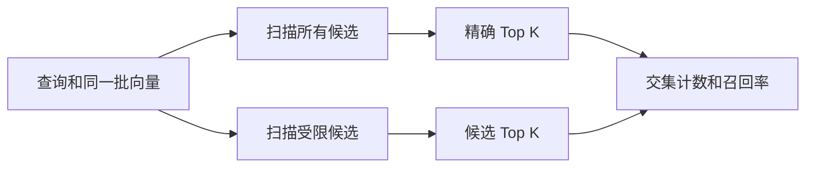

# Day 01 · 精确 Top-K 与 Recall@K

> 给图索引提速之前，先保留一条能逐个核对近邻的精确搜索路径。

## 0. 本次问题

相似工单查询变快了，前十条的分数看起来也都很高。要判断结果有没有退化，需要知道三件事。

1. 对同一个查询，怎样算出真正的前 K 名？
2. 漏掉一个近邻时，怎样把这个变化变成可比较的指标？
3. 如何同时衡量漏掉的结果和节省的距离计算？

## 0.5 先建立直觉

把工单想成地图上的站点。精确搜索量出当前位置到每个站点的距离，按距离排序。如果只量其中几个站点，依然能找出这几个里面最近的一个，但它在全地图上的排名要用完整结果核对。

## 1. 设计背景与约束

精确路径读取并打分所有符合条件的候选。在向量维度固定时，距离计算次数随候选数线性增长。在线请求可能无法承担这个成本，测试却可以取一批代表性查询离线计算精确结果。随后测试图索引、量化或过滤策略时，都有同一份参考答案。

数学上，Recall@K 等于返回结果与参考 Top-K 的公共 ID 数除以参考集合的实际大小。候选本来就不足 K 时，参考集合也会变小。没有参考结果的查询在本实验里记为 `n/a`。

## 2. 数据流



| 对象 | 职责 |
|---|---|
| `Point` | 唯一 ID 和二维坐标 |
| `Hit` | 输出 ID 和对应的距离平方 |
| `SearchResult` | 记录 Top-K 和距离计算次数 |

## 3. 源码关键路径

1. 从 Qdrant v1.15.0 的 `HNSWIndex::search` 找到 `params.exact`。先看无过滤分支切到 `search_plain_unfiltered` 的条件。[HNSW 索引](https://github.com/qdrant/qdrant/blob/v1.15.0/lib/segment/src/index/hnsw_index/hnsw.rs)
2. 对照 `PlainVectorIndex::search`。无过滤路径调用 scorer 的 `peek_top_all`，有过滤时可用候选迭代器与 `peek_top_iter`。[PlainVectorIndex](https://github.com/qdrant/qdrant/blob/v1.15.0/lib/segment/src/index/plain_vector_index.rs)
3. 回到接口层，`exact: true` 可以生成同一查询的参考结果。只对照 ID 与同一条件下的数据，分数用于理解排序。[Qdrant 召回率指南](https://qdrant.tech/documentation/tutorials-search-engineering/ann-recall/)

## 4. 可迁移的设计技巧

| 做法 | 收益 | 代价或边界 |
|---|---|---|
| 把全量扫描保留为参照 | 后续更换索引、搜索预算和量化策略时沿用同一把尺 | 消耗随候选数增长，适合小数据集和离线验证 |
| 固定数据、查询、过滤和 K | 实验只反映被调整的参数 | 代表性依赖查询和数据的采样质量 |
| 约定等距离时以 ID 排序 | 小实验能稳定复现并手工核对 | 生产评估可另外统计等分候选，避免把等价结果当成退化 |
| 同时记录召回率和距离计算次数 | 能解释快了多少以及少找回多少 | 距离次数只能解释部分成本，端到端延迟还受缓存、I/O 等影响 |

## 5. 反例与边界

线上查询只允许当前租户的工单，参考结果却来自全库。生产搜索即使返回该租户内最近的十条，看起来也可能是 `Recall@10 = 0`。评估前要核对两条路径的数据快照与过滤条件。若把所有被过滤的结果也当成漏召回，就会误解线上搜索质量。

## 6. C++20 最小实现

`code/top_k.cpp` 逐条计算平方欧氏距离并排序。有限数值的距离上，省去开平方仍可获得相同排序。演示用全量排序方便对照，排序时间为 O(n log n)，额外存储为 O(n)。数据固定为二维，点 ID 唯一。`main.cpp` 负责演示和检查 K 边界。

在仓库根目录用 PowerShell 构建并测试。测试结束后会清理新建的临时目录。

```powershell
$sourceDir = 'step2/week-01-qdrant/day-001-exact-top-k/code'
$tempRoot = (Resolve-Path -LiteralPath ([IO.Path]::GetTempPath())).Path.TrimEnd('\')
$buildDir = (New-Item -ItemType Directory -Path (Join-Path $tempRoot "archdesign-day001-$([guid]::NewGuid())")).FullName
$buildDir = (Resolve-Path -LiteralPath $buildDir).Path
if ([IO.Path]::GetDirectoryName($buildDir) -ne $tempRoot) { throw 'Unexpected build path' }
try {
    cmake -S $sourceDir -B $buildDir -G Ninja
    if ($LASTEXITCODE -ne 0) { throw 'CMake configuration failed' }
    cmake --build $buildDir
    if ($LASTEXITCODE -ne 0) { throw 'Build failed' }
    ctest --test-dir $buildDir --output-on-failure -V
    if ($LASTEXITCODE -ne 0) { throw 'Tests failed' }
} finally {
    Remove-Item -LiteralPath $buildDir -Recurse -Force
}
```

预期演示先对五个点全量评分，然后从候选中去掉最近点 `11`，重新评分。

```text
exact top 3: 11 22 33 (distance evaluations: 5)
limited top 3: 22 33 44 (distance evaluations: 4)
Recall@3: 0.6667
```

受限候选用于制造可控的漏召回。Day 02 会再引入真实的图搜索过程。

2026-11-28 在 Windows、GCC 15.2 和 Ninja 下构建通过。CTest 的召回率演示与边界检查均通过，实测输出与上方一致。

## 7. 复用清单

- 接口返回稳定的点 ID，允许在精确和近似策略间切换。
- 测试覆盖候选少于 K、等分和候选为空，提前约定零结果如何统计。
- 观测同时记录候选数、距离计算次数、召回率和延迟。

## 8. 练习与自测

把受限候选改成保留最近点 `11`、去掉最远点 `55`。先预测计算次数和召回率，再运行并解释为什么更少的计算也可能保住全部 Top-K。

<details>
<summary>查看答案</summary>

两轮的精确参考均有三个 ID。受限路径做四次距离计算，Top-K 仍为 `11 22 33`，所以 Recall@3 为 1。省掉哪些候选决定了质量是否下降。

</details>

## 9. 模式卡片

用一条可核对的参考路径衡量近似算法。固定输入与输出规则，分别记录质量和成本。为降低测量开销，可以离线预计算精确结果，但数据、查询条件和参考结果要来自同一快照。

## 10. 下次预习

从同一个入口开始，如果每次只向当前最近的邻居移动，能否保证找到全图的最近点？画四个点和它们的邻接关系，再去读 [Qdrant HNSW 导读](https://qdrant.tech/course/beginners/module-2/hnsw/)。
