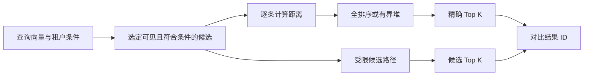

# Day 01 · 精确 Top-K 与 Recall@K

> 给图索引提速之前，先保留一条能逐个核对近邻的精确搜索路径。

## 0. 本次问题

客服系统把相似工单检索加速后，前十条的分数依然很高，但客服找不到以前总能搜到的一条工单。调试发现可能有三种原因。一是索引漏掉了近邻，二是基准用了另一种距离，三是服务先对全库截取 Top-K，最后才过滤租户。三个原因都可能表现为“少了一条”，验证方法各不相同。

1. 给定向量、度量和准入条件，怎样算出真正的前 K 名？
2. 逐条计算距离以后，是否必须保存全部分数并排序？
3. 上游收到 `exact: true` 之后，候选从哪里来，谁打分，谁维护 Top-K？
4. 候选数不足 K、同分或空集合时，怎样解释 Recall@K？

## 0.5 先建立直觉

把工单想成地图上的站点。精确搜索量出当前位置到每个站点的距离，按距离排序。如果只量其中几个站点，依然能找出这几个里面最近的一个，但它在全地图上的排名要用完整结果核对。

## 1. 设计背景与约束

### 1.1 精确搜索的两部分成本

精确路径给每个符合条件的向量打分，再从这些分数中挑前 K 个。前一步最少要看多少数据，取决于合格候选数 `N` 和向量维度 `D`。后一步要保留多少中间结果，取决于选优算法。

假设租户过滤后还有 10 万个 384 维 `float32` 向量。一次扫描涉及约 146.5 MiB 的逻辑向量数据，实际磁盘读取量取决于驻留内存和缓存。同样是精确扫描，把全量排序换成有界堆能减少候选存储和排序工作，仍然要给这 10 万个向量打分。两部分成本需要分开看。

### 1.2 排名先由度量定义

| 度量 | 越相似时的变化 | 用之前要确认什么 |
|---|---|---|
| 欧氏距离 L2 | 距离越小 | 数值尺度是否符合模型设定。只需要排序时可以用距离平方 |
| 点积 | 分数越大 | 向量模长会影响分数，先确认模型是否希望保留这个信息 |
| 余弦相似度 | 分数越大 | 比较方向，需要非零模长。归一化后等于对应单位向量的点积 |

手算一组查询 `q=(1,0)`。候选 `A=(10,0)` 与 `B=(1,1)`，A 的方向和 q 完全相同，余弦排序会把 A 放前面。B 的 L2 距离是 1，A 的距离是 9，L2 排名正好相反。两种路径选了不同度量时，计算出的低召回可能只是基准定义的差异。

本课使用二维有限数值和 L2。设 `d²=(x₁−q₁)²+(x₂−q₂)²`。平方根在非负数上保持大小关系，因此可先按 `d²` 选优，确实需要返回几何距离时再开平方。[Qdrant 度量实现](https://github.com/qdrant/qdrant/blob/v1.15.0/lib/segment/src/spaces/simple.rs) · [Collection 与度量](https://qdrant.tech/documentation/manage-data/collections/)

### 1.3 为什么保留一条精确路径

在线流量可能无法为每个请求支付全量打分的成本。离线评估可选一组代表性查询，用精确路径计算参考答案，再对同一数据快照、查询向量、度量、过滤和 K 比较图索引结果。记录这些条件，才能在后续更换索引或搜索预算时复现质量变化。[Qdrant 召回率指南](https://qdrant.tech/documentation/tutorials-search-engineering/ann-recall/)

## 2. 数据流



| 对象 | 职责 |
|---|---|
| `Point` | 唯一 ID 和二维坐标 |
| `Hit` | 输出 ID 和对应的距离平方 |
| `SearchResult` | 记录 Top-K、距离计算次数和峰值候选条数 |

### 2.1 有界堆里放谁

对 L2 使用“越小越好”的排序。有界堆的堆顶保留**当前最差的入围者**，方便用一次比较决定是否替换。以 `K=2`、按顺序见到距离平方 `9, 4, 16, 1` 为例。

| 本次分数 | 入围集合 | 下一次替换门槛 |
|---|---|---|
| 9 | `9` | 堆未满，接受新候选 |
| 4 | `4, 9` | 9 |
| 16 | `4, 9` | 9，16 被丢弃 |
| 1 | `1, 4` | 4，1 替换了 9 |

不变量是**处理任意前缀后，堆里保留该前缀最好的最多 K 个候选**。堆满后，若新候选排不进当前前 K，后面再读更多候选也不会提升它的排名。扫描结束，把堆里的 K 个结果排成输出顺序即可。

| 实现 | 距离计算 | 选优的最坏时间 | 额外候选空间 |
|---|---|---|---|
| 存分数后全排序 | `N` 次 | `O(N log N)` | `O(N)` |
| 固定容量堆 | `N` 次 | `O(N log(K+1))`，含最终排序 | `O(min(K, N))` |

两者的打分成本都约为 `O(ND)`。当 `K` 接近 `N`，堆的空间优势随之缩小。用它做参考基线时，先保障相同排序规则下的可核对性，再决定要不要优化常数。

## 3. 源码关键路径

以 Qdrant **v1.15.0** 为准，从一个带租户条件、`exact: true` 的近邻查询开始。读到带分数的候选进入固定容量队列为止。

1. **决定走哪条路。** `HNSWIndex::search` 读 `params.exact`。要求精确搜索时，它禁用本次查询的量化打分并走遍历分支。无过滤时通过 `search_plain_unfiltered` 遍历内部 ID；有过滤时通过 `search_vectors_plain` 调用 payload 索引取得候选 ID。同一批查询向量可复用这批过滤结果。[HNSW 索引](https://github.com/qdrant/qdrant/blob/v1.15.0/lib/segment/src/index/hnsw_index/hnsw.rs)
2. **检查候选再打分。** `FilteredScorer::peek_top_iter` 在 `top == 0` 时直接返回。正常扫描中，它通过 `check_vector` 跳过无效向量，检查停止信号，把一批有效 ID 写入复用的缓冲区，再进行批量打分。可在 `PlainVectorIndex::search` 对照同一套 scorer 的两个入口 `peek_top_all` 和 `peek_top_iter`。[候选打分](https://github.com/qdrant/qdrant/blob/v1.15.0/lib/segment/src/index/hnsw_index/point_scorer.rs) · [PlainVectorIndex](https://github.com/qdrant/qdrant/blob/v1.15.0/lib/segment/src/index/plain_vector_index.rs)
3. **只保留当前前 K 名。** scorer 把带分数的候选交给 `FixedLengthPriorityQueue::push`。它使用 `BinaryHeap<Reverse<T>>`，让最小的入围分数在堆顶，满时比较新分数再决定是否替换。Qdrant 的欧氏打分使用负的距离平方，所以它保留最大分数。本课的 C++ 用正的距离平方，保留最小距离，两者的选优方向一致。[固定容量队列](https://github.com/qdrant/qdrant/blob/v1.15.0/lib/common/common/src/fixed_length_priority_queue.rs) · [欧氏打分](https://github.com/qdrant/qdrant/blob/v1.15.0/lib/segment/src/spaces/simple.rs)

读完后可以把路径压缩为 `请求约束 → 候选 ID → 检查和打分 → 前 K 个分数`。调试时在每个边界记录数量。例如在打分入口只有 2 个租户内候选，返回 2 条很正常；打分前有 400 个候选而结果少于 K，才需要继续查可见性、取消或下游截断。

**跨分段延伸。** 如果各段候选互斥，使用相同的总排序，分别取本段 K 个再合并即可得到全局 Top-K。在本段排第 K+1 的点，至少输给同段 K 个点，所以无法进入全局前 K。实际 Qdrant 合并还会处理同一个点的版本，这会影响去重和取候选的边界。源码入口是 `BatchResultAggregator`，到 Day 06 再细读。[分段结果合并](https://github.com/qdrant/qdrant/blob/v1.15.0/lib/collection/src/collection_manager/segments_searcher.rs)

## 4. 可迁移的设计技巧

| 做法 | 收益 | 代价或边界 |
|---|---|---|
| 把全量扫描保留为参照 | 后续更换索引、搜索预算和量化策略时沿用同一把尺 | 消耗随候选数增长，适合小数据集和离线验证 |
| 先限定候选，再做 Top-K | K 个名额用于符合条件的点 | 过滤策略的代价取决于索引和过滤选择性 |
| 用堆顶维护最差的入围者 | 每个新分数只需先过一次门槛 | 堆减少选优开销，距离计算仍有哪些点就算哪些点 |
| 约定等距离时以 ID 排序 | 小实验能稳定复现并手工核对 | 生产评估可另外统计等分候选，避免把等价结果当成退化 |
| 同时记录结果质量和工作量 | 能区分少打了分、少存了候选、少找回了结果 | 端到端延迟还受并发、缓存和 I/O 影响 |

## 5. 反例与边界

### 5.1 全局先截断，再过滤租户

用 `[11, 22, 33, 44, 55]` 表示全库按距离排好的结果。当前租户只允许看到 `22` 和 `55`，查询要求 `K=3`。在合格候选里做精确选择会返回 `[22, 55]`，先取全库前三再过滤只剩 `[22]`。列表中仍有合格数据，却在更早的一次全局截断时被丢掉了。把全局预算扩大到 4，在本例仍然漏掉第 5 名 `55`。

### 5.2 用错了参考集合或分母

本课取 `Recall@K = |参考 ID ∩ 返回 ID| / |参考 ID|`，两个列表都以同一查询的 Top-K 为准。候选不足 K 时用实际参考条数，因此上例为 `1/2`。基准取全库的 Top-K、使用另一种度量或换了数据快照，都可能把正确结果误判为漏召回。分母采用实际参考条数，可以把“未找回应有结果”和“原本没有足够候选”分开观测。[Qdrant 召回率计算](https://qdrant.tech/documentation/tutorials-search-engineering/ann-recall/)

| 情况 | 本实验的处理 |
|---|---|
| 没有符合条件的参考结果 | `n/a`，另计空查询数，避免平均值受空查询占比影响 |
| 返回结果里重复了一个 ID | 对同一参考 ID 只计一次 |
| 结果相同但排名颠倒 | Recall 保持不变，若第一名的位置也重要，需要另测排名指标 |
| 第 K 名附近有大量同分 | 本课按 ID 稳定排序，生产评估可单独标记这类查询 |

### 5.3 给图索引测出了完美召回

很小的数据集可能还没有建立 HNSW，或者被选择为全量扫描。此时召回率为 1，说明回来的列表和参考结果一样。要据此评估图索引，先确认索引建成、查询实际走了图路径，再读召回率、延迟和访问量。[Qdrant ANN 召回率排查](https://qdrant.tech/documentation/tutorials-search-engineering/ann-recall/)

## 6. C++20 最小实现

| 文件 | 职责 |
|---|---|
| `code/top_k.hpp` | 输入点、结果和计数的接口 |
| `code/top_k.cpp` | 共享一套打分和同分规则，实现全排序、有界堆和召回率 |
| `code/main.cpp` | 编排候选缺失、算法对照、过滤顺序和边界测试 |

实验点的 ID 唯一，坐标是有限的二维数值，过滤案例用显式候选集合表示租户条件。峰值候选数只统计选优结构保存的 `Hit`。这样可以独立观察 `K` 限制的是哪块存储。

先写下三项预测再运行。漏掉最近点后，还能命中几个参考 ID？10 万个点只取前 10 时，两种算法各打分多少次、最多存几个结果？全局先截取 `K=3` 时，目标租户的两个点还有几个能留下？

在仓库根目录用 PowerShell 构建并测试。测试结束后会清理新建的临时目录。

```powershell
$sourceDir = 'step2/week-01-qdrant/day-001-exact-top-k/code'
$tempRoot = (Resolve-Path -LiteralPath ([IO.Path]::GetTempPath())).Path.TrimEnd('\')
$buildDir = (New-Item -ItemType Directory -Path (Join-Path $tempRoot "archdesign-day001-$([guid]::NewGuid())")).FullName
$buildDir = (Resolve-Path -LiteralPath $buildDir).Path
if ([IO.Path]::GetDirectoryName($buildDir) -ne $tempRoot) { throw 'Unexpected build path' }
try {
    cmake -S $sourceDir -B $buildDir -G Ninja
    if ($LASTEXITCODE -ne 0) { throw 'CMake configuration failed' }
    cmake --build $buildDir
    if ($LASTEXITCODE -ne 0) { throw 'Build failed' }
    ctest --test-dir $buildDir --output-on-failure -V
    if ($LASTEXITCODE -ne 0) { throw 'Tests failed' }
} finally {
    Remove-Item -LiteralPath $buildDir -Recurse -Force
}
```

### 6.1 实测 A · 漏掉最近点后，召回下降多少

参考路径扫描五个点，受限路径漏掉最近点 `11`，只做四次评分。如果漏掉的是 `55`，同样只做四次评分，前 3 名却仍能保住。查询质量取决于漏掉了谁。

```text
exact top 3: 11 22 33 (distance evaluations: 5, peak candidates: 5)
limited top 3: 22 33 44 (distance evaluations: 4, peak candidates: 3)
Recall@3: 0.6667
```

### 6.2 实测 B · 全排序和有界堆，分别做了多少工作

输入 10 万个点，按从远到近的顺序送入，`K=10`。堆填满之后，剩下的每个点都会触发替换；这种顺序还能覆盖堆的替换路径。

| 实现 | 返回 ID | 距离计算次数 | 峰值候选条数 |
|---|---|---:|---:|
| 全排序 | `1 … 10` | 100,000 | 100,000 |
| 有界堆 | `1 … 10` | 100,000 | 10 |

两个实现的结果和打分次数一致，差异在于选优期间保存的候选数。若下一个瓶颈是高维打分，即使把堆再优化一遍，也无法减少这 10 万次打分。

### 6.3 实测 C · 把过滤放到 Top-K 之后

租户内只有 `22` 和 `55`，两种流程执行 `K=3`。

| 顺序 | 返回 ID | 距离计算次数 | 过滤后的 Recall@3 |
|---|---|---:|---:|
| 先过滤，后取 Top-K | `22 55` | 2 | 1.0000 |
| 先取全局 Top-K，再过滤 | `22` | 5 | 0.5000 |

2026-11-28 在 Windows、GCC 15.2 和 Ninja 下构建通过。CTest **4/4**，包括候选漏失、两种精确算法的结果和工作量对比、过滤顺序、以及 K 为 0 或大于候选数、同分和重复结果的边界检查。构建在系统临时目录完成并已清理。

## 7. 如何迁移到自己的检索链路

- **接口**：用同一个查询对象携带向量、度量、过滤、K 和可选的精确模式。结果返回稳定 ID，并固定同分时的规则。
- **测试**：用包含 K 为 0、合格点不足 K、同分、租户混排的固定数据校验参考实现。对两个精确实现使用同一套断言。
- **观测**：按过滤后候选数分桶，在每桶上同时看 Recall@K、实际返回条数、空结果比例、距离次数和 p95。整体平均可能掩盖狭窄过滤条件下的退化。
- **迭代**：先上线观测，再单独改一个索引参数。保留精确查询作为诊断方式，能在发现异常时对同一请求重跑参考结果。

## 8. 练习

1. **基础**：把受限候选改成保留 `11`、去掉 `55`。写出两轮的距离计算次数和 Recall@3，再跑测试验证自己的预测。
2. **进阶**：把算法对照里的 `K` 改成 1、100 和 100,000。分别推导输出条数、距离计算次数和堆保留的候选峰值，调整对应的验收断言。
3. **挑战**：手工把五个点切成两段，每段先取局部 Top-2 再合并。随后把一个点用同 ID 的不同版本放到两段里，推演什么时候需要去重或扩大取数范围。

## 9. 自测

<details>
<summary>查看答案</summary>

1. **有界堆为什么要把当前最差的入围者放在堆顶？** 新候选只需和入围门槛比较。更好的候选替换堆顶，其他候选直接丢弃。
2. **有界堆和全排序的输出相同，哪里节省了资源？** 两条路径打分次数相同。有界堆只保留最多 K 个候选，成本变化发生在选优阶段。
3. **租户过滤后没有任何参考结果，Recall@K 算多少？** 本课记 `n/a` 并单独计数。没有参考对象，交集比例没有可用分母。
4. **Recall@10 为 1，是否说明第一名一样？** 只知道两个 Top-10 的 ID 集合相同，仍要核对名次或使用排名指标。

</details>

## 10. 模式卡片

| 模式 | 解决的问题 | 代价与边界 |
|---|---|---|
| 精确路径作参考 | 能定位近似过程丢失了哪些结果 | 批量扫描有成本，固定快照和查询条件再比较 |
| 最差入围者作门槛 | 在扫描中用 O(K) 空间维护前 K 名 | 适合 K 远小于 N 的场景，仍需扫描所有候选 |
| 在合格候选内选优 | 让过滤和数量上限同时符合语义 | 需要单独估计过滤选择性和筛选代价 |

## 11. 下次预习

从同一个入口开始，如果每次只向当前最近的邻居移动，能否保证找到全图的最近点？画四个点和它们的邻接关系，再去读 [Qdrant HNSW 导读](https://qdrant.tech/course/beginners/module-2/hnsw/)。
