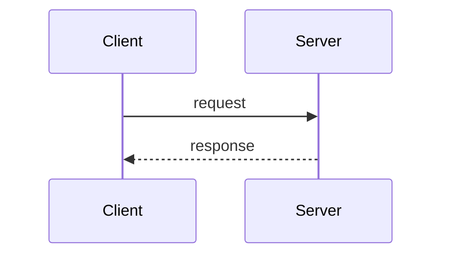

# Day {N} · {标题}

> 一句话结论：{如果只记住一件事，是什么？}

## 0. 本次问题

- 这个模块解决什么问题？
- 如果不这样设计，最坏会发生什么？
- 本次要能回答的三个具体问题：
  1. {问题一}
  2. {问题二}
  3. {问题三}

## 1. 设计背景：约束从哪里来

{业务规模、硬件条件、历史包袱、失败案例。不要从“它很流行”开始。}

**关键约束**

| 约束 | 具体表现 | 对设计的影响 |
|---|---|---|
| 延迟 | | |
| 吞吐 | | |
| 内存 | | |
| 一致性/持久性 | | |
| 运维复杂度 | | |

## 2. 架构与数据流

{一张 Mermaid 图：组件、队列、状态、关键路径。}


**关键对象**

| 对象 | 职责 | 生命周期 |
|---|---|---|
| | | |

## 3. 源码关键路径

> 只追一条路径。记录方法名/状态机/协议字段，不抄大段源码。

1. 入口：`{file}:{Class.method}`
2. 状态变化：`{...}`
3. 关键分支：`{...}`
4. 退出/清理：`{...}`

**时序图**



## 4. 关键设计技巧

### 技巧 1：{名称}

- **做法**：
- **为什么有效**：
- **代价**：
- **适用边界**：

### 技巧 2：{名称}

{同上}

### 技巧 3：{名称}

{同上}

## 5. 反例与边界

| 看起来对的用法 | 实际问题 | 正确做法 |
|---|---|---|
| | | |
| | | |

**压力下会发生什么**

- 队列打满：
- 下游超时：
- 进程崩溃：
- 时钟跳跃/重启：
- 扩缩容：

## 6. 最小实现（C++20 / Rust）

{说明为什么这样拆接口，以及示例省略了哪些生产特性。}

```cpp
// 关键代码 1：接口/状态机
```

```cpp
// 关键代码 2：关键路径
```

**运行**

```bash
cmake -S . -B build
cmake --build build
./build/demo
```

**预期输出**

```text
...
```

## 7. 如何借鉴到自己的项目

### 7.1 可以复用的模式

- {模式 A}
- {模式 B}

### 7.2 接口清单

```text
[ ] 资源上限是否显式？
[ ] 拒绝/失败策略是否可配置？
[ ] 关闭是否幂等、是否有截止时间？
[ ] 是否有队列深度、延迟、拒绝数指标？
[ ] 是否能在测试中注入饱和/异常？
```

### 7.3 迁移步骤

1. 先加观测，不改行为。
2. 用小流量/单实例验证边界。
3. 加保护（上限、超时、拒绝）。
4. 做故障注入。
5. 再推广。

## 8. 练习

**基础**

1. {改一个参数/加一个指标}

**进阶**

1. {实现一个缺失策略/替换数据结构}

**挑战**

1. {在约束下做取舍，写一页设计说明}

## 9. 自测题

<details>
<summary>点击展开答案</summary>

1. **问题**：{...}
   **答案**：{...}

2. **问题**：{...}
   **答案**：{...}

3. **问题**：{...}
   **答案**：{...}

</details>

## 10. 模式卡片

```text
模式名称：
解决什么问题：
核心机制：
代价/限制：
不适用场景：
一个最小例子：
```

## 11. 下次预习

- 阅读：{下一篇的入口}
- 带着问题：{一个问题}

## 参考资料

- {官方文档/源码/论文，注明访问日期}
