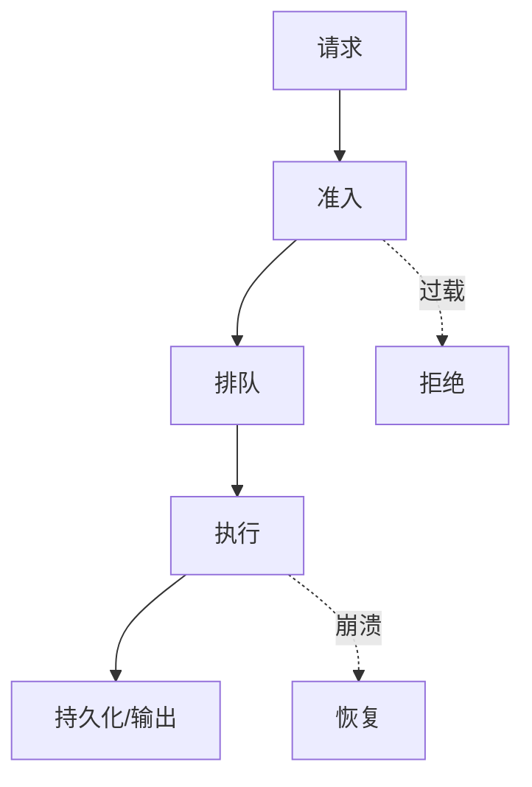

# Week {N} 复盘 · {主题}

> 本周不是“再学一个工具”，而是把 6 个机制组合起来，验证它们能否共同工作。

## 1. 一张图：本周知识结构

{不要复述目录。画“输入 → 资源边界 → 状态 → 失败模式”的关系图。}



## 2. 六个机制如何互相影响

| 机制 | 单独看时的假设 | 组合后暴露的问题 | 本周结论 |
|---|---|---|---|
| | | | |
| | | | |
| | | | |

## 3. 组合实现

**目标**：{一句话描述最小系统}

**组件**

- {组件 1}
- {组件 2}
- {组件 3}

**数据流**

```text
...
```

**代码位置**：`code/`

**运行方式**

```bash
...
```

## 4. 破坏性实验

### 实验 1：{饱和/队列打满}

- 注入方式：
- 观察指标：
- 实际结果：
- 是否符合预期：
- 修正：

### 实验 2：{崩溃/重启/分区}

- 注入方式：
- 观察指标：
- 实际结果：
- 是否符合预期：
- 修正：

## 5. 本周模式卡片

| 模式 | 解决什么问题 | 代价/限制 | 不适用场景 |
|---|---|---|---|
| | | | |
| | | | |

## 6. 我仍然不确定的地方

1. {问题}
2. {问题}

> 把这些问题带入下一周，不要急着找“标准答案”。

## 7. 下周预习

- 主题：
- 先读：
- 带着问题：

## 8. 迁移到自己的项目

**最小可行动作（本周内可完成）**

- [ ] {加一个指标/上限/超时}
- [ ] {写一个故障注入测试}
- [ ] {更新一页设计文档}

**验证方式**

- {如何知道改动有效}
- {如何回滚}
