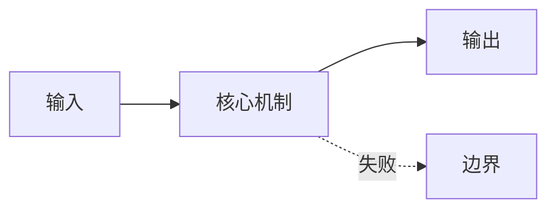

# Week {N} 入门：{主题}

> 一句话：{这个星期到底在解决什么问题？不要用术语开头。}

## 0. 为什么先读这篇

- 这个星期的内容解决什么真实问题？
- 如果不先建立直觉，最容易卡在哪个词上？
- 读完这篇，你应该能用自己的话解释哪 3 件事？

## 1. 一句话直觉

{用一个生活场景说明，不要超过三句话。}

## 2. 一个贯穿本周的小例子

```text
{一个具体、很小的例子，后面每篇课文都尽量回到它}
```

## 3. 生活类比

| 系统里的东西 | 生活里的东西 | 为什么像 |
|---|---|---|
| | | |
| | | |

## 4. 概念地图



## 5. 术语翻译表

| 术语 | 先用一句人话解释 | 本周会在哪里出现 |
|---|---|---|
| | | |
| | | |
| | | |

## 6. 本周要回答的问题

1. {问题一}
2. {问题二}
3. {问题三}

## 7. 两条阅读路线

**直觉轨道（基础不牢先走这条）**

- 只读：一句话直觉、类比、概念图、术语表、模式卡片。
- 跳过：源码路径、复杂公式、完整代码。
- 目标：能画出数据流，能用自己的话解释。

**源码轨道（第二遍）**

- 追一条关键路径；
- 对照代码/实验；
- 记录边界条件和失败模式。

## 8. 先记住这几句话

1. {句子一}
2. {句子二}
3. {句子三}
4. {句子四}

## 9. 常见误解

| 容易误解 | 更准确的理解 |
|---|---|
| | |
| | |

## 10. 本周实验与不变量

- 实验：
- 必须始终成立的不变量：
- 失败注入：

## 11. 下一步

- 本周第一篇：`day-XXX-...`
- 建议先读哪一节、先跑哪个代码。
